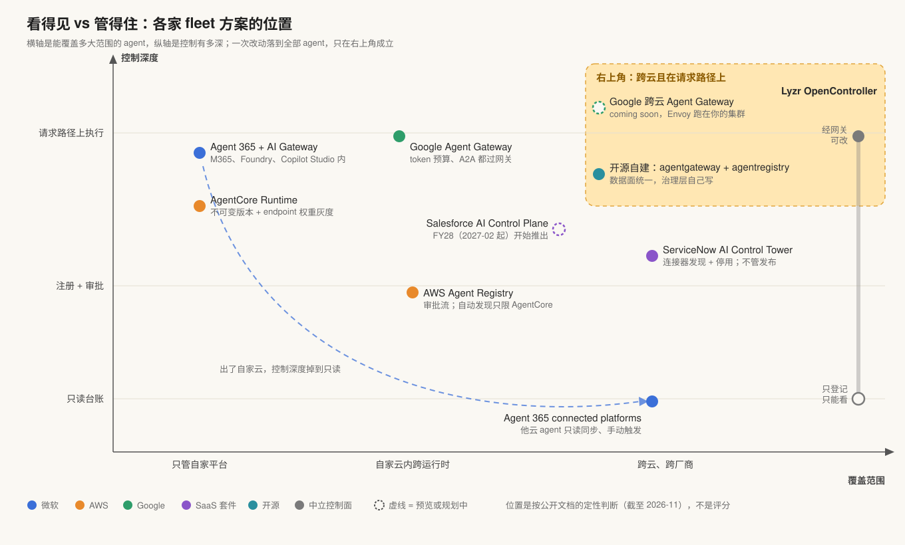

# Agent 基础设施系列 06：Fleet Management 与 Agent Platform 的区别

最近读到 Lyzr 的一篇 [7 Best Platforms for AI Agent Fleet Management](https://www.lyzr.ai/blog/best-platforms-for-ai-agent-fleet-management/)，里面引了 Gartner 2026 年 4 月的一组数字：到 2028 年，一家全球 Fortune 500 企业平均会有超过 15 万个 agent 在用，2025 年还不到 15 个；而认为自己的 agent 治理到位的组织只有 13%（[Gartner Identifies Six Steps to Manage AI Agent Sprawl](https://www.gartner.com/en/newsroom/press-releases/2026-04-28-gartner-identifies-six-steps-to-manage-artificial-intelligence-agent-sprawl)）。这篇文章是 Lyzr 推自家产品的，评分表把自己排在第一，但它提出的问题是对的：造一个 agent 现在只要两天，可某个模型要退役、某条数据规则收紧时，三百个 agent 还是一个一个改。

我和客户聊 agent 平台时，常把 fleet management 和 agent platform 混成一件事。这篇把两者分开，再看三朵云各自给了什么解法，以及跨云的方案能做到哪一步。

## 一、Platform 管造和跑，fleet 管跨平台的运营

先对齐一下用词。[系列 01](../agent-platform/Agent基础设施系列01：三层划分与自建路线.md) 把 agent 基础设施分成 Framework、Runtime、Platform 三层，那里的 Platform 指**治理层**：企业怎么发现、授权、治理、运营这些 agent。市场上叫"agent platform"的产品，比如 Foundry、AgentCore、Gemini Enterprise Agent Platform，是另一回事：它们把建 agent 的工具（Framework）、跑 agent 的托管环境（Runtime）和管自家 agent 的那部分治理层打包在一起，给每个 agent 配上身份、观测和评估。这篇标题里的 Agent Platform 指的是这种产品。一个平台托管几百个 agent 很正常，Foundry 有 Control Plane 的 fleet 监控，AgentCore 有组织级的 Registry，所以两者的区别**不在数量**。平台的治理范围止于它自己托管的 agent。

Fleet management 是一种能力，在两个范围上都存在：

- **平台内**：平台管自己托管的那一群 agent，比如 Foundry Control Plane 管订阅里的 Foundry agent，LangSmith Fleet 管在它里面建出来的 agent。这一层是平台的本职，各家都在做。
- **跨平台**：不管 agent 是哪个平台建的、跑在哪朵云上，把企业里所有 agent 当成一笔资产来运营，Agent 365、Lyzr、ServiceNow 做的是这一层。

把 fleet management 说成"agent platform 的责任"，对平台内这一层是对的；企业真正缺的是跨平台那一层，这篇主要讲它。换成系列 01 的说法，跨平台的 fleet management 就是治理层脱离任何一个产品、覆盖全部 agent 时的样子。Lyzr 那篇文章用五个指标来衡量，我觉得概括得不错：

1. **清点**：一共有多少 agent，包括不是这个平台建的；
2. **健康**：每个 agent 的错误、延迟、升级人工、质量漂移，能逐个看也能汇总看；
3. **版本**：哪个版本跑在哪里，能不能灰度、能不能一步回滚；
4. **花费**：按 agent、按团队算钱，预算到了能真的拦住；
5. **触达**：一条策略或一次换模型，同时落到所有 agent 上。

前四个大多数平台都在补，第五个才是 fleet 和 platform 真正拉开差距的地方。

健康这一项我会再加一层业务结果。错误率和漂移只能说明 agent 有没有出问题，回答不了"这几百个 agent 值不值"。ServiceNow AI Control Tower 的 Measure、Agent 365 的 Business Analytics 都在往这个方向补；垂直行业的厂商做得更直接，比如做金融研究外包的 Acuity Analytics，按工作流统计周转时间和准确率。

按这五个指标去看具体产品，会发现分界其实是两条：

- **能不能看到别家建的 agent**。平台天然只认识自己托管的 agent；fleet 要求的是全量清点，包括别的云、别的 SaaS、开发者笔记本上的 coding agent。
- **在不在请求路径上**。注册表能告诉你有哪些 agent，却改不了任何一个 agent 的行为。要让"一次改全部"成立，控制点必须站在 agent 调模型、调工具的路上，也就是网关。

下面这张定位图把这两条分界画成两个轴，后面讲到的产品都在上面：

越往右，能看到的 agent 越多；越往上，控制越深。几乎每家都是在自己的地盘里能做到很上面，一出自家云就掉到只读。

### fleet 控制台长什么样

Lyzr 的 OpenController 是一个比较典型的 fleet 控制台，三个界面正好对应"看得见"和"管得住"两件事（以下截图来自厂商产品页，数据为演示数据）。

**第一层是清点。** AI Inventory 按"云 → 平台 → agent → 用到的资源"把整个资产串起来：Microsoft 的 3 个租户、AWS 的 6 个账号、Google 的 2 个项目，下面挂着 Foundry、Copilot Studio、AgentCore、Vertex、Databricks、Agentforce，还有开发者本机上的 Claude Code。右上角 312 个 agent 里有 86 个是影子 agent，也就是没人登记过的。

**第二层是风险和花费的汇总。** Overview 把问题按平台和类别做成热力图（暴露面、身份、数据、自主度、供应链、运行时、治理），右边对照 OWASP、MITRE ATLAS、NIST AI RMF、ISO/IEC 42001、EU AI Act 这些框架的覆盖情况，下面是按平台的 agent 数量和当月花费。

这两层都还是"看得见"。真正能改变 agent 行为的是第三层。

**第三层是网关。** LLM Gateway 站在 agent 和模型提供方中间：左边是各个 agent 的流量占比，右边是 OpenAI、Anthropic、Gemini、Azure OpenAI 和本地 Llama 的延迟。下面的实时调用里能看到 403（策略拒绝）和 429（预算或限流），右下角是各团队离预算还有多远。换模型、切流量、封工具、卡预算，都发生在这一层。

Lyzr 自己也承认这个边界：一次改全部只对流量经过它网关的 agent 成立，只登记了的 agent 是"看得见、改不了"。这句话对后面所有产品都适用。

### 先分清"fleet"这个词

"fleet"这个词在市场上有三种用法，要先分清：

- **管好企业已有的一群业务 agent**：这篇主要讲的就是这一种，Lyzr OpenController、Agent 365 都在这一格。
- **卖给你一群现成的 agent**：Acuity Analytics 的 [Agent Fleet](https://www.acuityanalytics.com/agent-fleet/) 是面向资管、私募、投行、信贷的一套 agent 工作流，每份输出由它的分析师复核，治理指的是单个工作流内的审计记录和人工复核，没有对其他平台 agent 的清点，也没有网关。
- **运营一群 coding agent 会话**：开源项目 [Agent Fleet](https://agent-fleet.org/) 把团队在用的 Claude Code、Codex CLI、GitHub Copilot CLI、OpenCode、Cursor CLI、Kiro 等原样跑在自己的服务器上，统一管会话、worktree、调度和用量，管的是开发者手边的工具层。第三节会单独讲它和业务 agent 的 fleet 有什么不同。

客户说"agent fleet"时，先问清楚是哪一种。

这个词本身也能说明问题。fleet 读 /fliːt/，来自古英语的 flēot（船），和 flēotan（漂浮）同源（[Wiktionary: fleet](https://en.wiktionary.org/wiki/fleet)），本义是一支舰队，后来扩展到车队、机队，再到 IT 里的服务器群、Intune 管的终端设备群。这些用法的共同点**不是数量多，而是被统一管理**：一百台各管各的服务器不叫 fleet，一百台由同一个平台统一开通、配置、打补丁、扩缩、退役的服务器才叫。agent fleet 沿用的是同一层意思。

在 Kubernetes 里，fleet 也不是"一组 Pod"。Kubernetes 没有 `PodFleet` 这种资源，一组 Pod 由 Deployment、ReplicaSet、StatefulSet 这些控制器管；一组节点对应的是 AKS 的 node pool。Kubernetes 语境里说 fleet，通常指比单个集群更高一层的多集群管理，比如 [Azure Kubernetes Fleet Manager](https://learn.microsoft.com/en-us/azure/kubernetes-fleet/) 把多个 AKS 和 Arc 集群当成一个整体，统一编排升级、把资源下发到各成员集群。所以"agent runtime"和"agent fleet runtime"也不是一个东西换了新名字：前者管一个 agent 怎么跑，后者管一群 agent 怎么被开通、运营和退役；"agent fleet runtime"目前也不是一个有统一定义的标准术语，不同厂商会叫它 agent platform、fleet manager 或 control plane。

另一个常被拿来对比的词是 swarm。OpenAI 早期的 Swarm 和 LangGraph 的 swarm 库讲的是多个 agent 怎么分工、委派、handoff，描述的是**协作拓扑**，属于 framework 层；fleet 描述的是一群 agent 怎么被创建、共享、授权和审计，是**运营模型**，属于平台层。两者不互相替代：一个 fleet 里可以有几个 agent 以 swarm 的方式协作，也可以有完全独立运行、从不参与协作的 agent。

微软的文档里还有一个更窄的说法。Entra Agent ID 把 [agent fleet](https://learn.microsoft.com/en-us/entra/agent-id/plan-agent-fleet) 定义为"跑在同一个云运行时上的一组 agent"，每个 agent 有自己的 agent identity。这是**身份层的专门含义**：Entra 的职责是身份，所以它只从身份的角度看 fleet，讨论的是一份凭据怎么派生一组互不越权的身份，跨平台清点、花费、一次改全部都不在它的范围里。

这不等于微软把 fleet 的概念收窄了，微软自己就在用两种意思：Entra 文档用窄义；Foundry 的 [fleet 监控](https://learn.microsoft.com/en-us/azure/foundry/control-plane/monitoring-across-fleet) 开头讲的是"从孤立的 copilot 走向自主的多 agent fleet"，要跨企业监控所有 agent、模型和工具，用的是宽义，和本文说的是同一件事；Agent 365 不用这个词，自称 AI agent 的控制面，做的也是宽义 fleet management 的事。所以宽义是主流，Entra 的定义是这个词在身份层的一个专门用法，读微软文档时看到 fleet，要先看是哪个产品的文档。

#### Entra 的窄义 fleet

Entra 的 fleet 对应的是一个 **multi-instance 的 agent identity blueprint**：运行时只持有一份 blueprint 凭据，用它给这个 blueprint 派生的任何 agent identity 拿 token，每次请求由运行时决定用哪个身份。和它相对的是 single-instance，一个 tenant 里只有一个 Agent ID。这里的 instance 指身份实例，不是运行副本：一个本地 assistant 装在 100 台电脑上，仍然只有 1 个 Agent ID。blueprint、实例模式、tenant 之间的关系，以及 Copilot Studio、Foundry 各自怎么用，我单独写在了 [系列 07](../agent-identity/Agent基础设施系列07：Blueprint与Agent-Identity的实例模式.md)。

把这个窄义和另外两种说法放在一起，差别在三件事上：

| | Entra 的 fleet | coding agent 的 fleet（agent-fleet.org） | 宽义的 fleet management |
|---|---|---|---|
| 共享什么 | 同一个运行时、同一套代码、同一份 blueprint 凭据 | 同一台服务器和控制台，agent 种类各不相同 | 什么都不共享，分散在各朵云、各个平台 |
| 一个成员是什么 | 长期存在的 agent，有开通和退役 | 一次会话，一个任务加一个 worktree | 已经存在的 agent，不管是谁建的 |
| 身份 | 每个 agent 一个 Agent ID，运行时逐请求选用 | 没有 agent 身份，成员用自己的账号登录各家 CLI | 各平台自己的身份，靠同步或映射对齐 |

Entra 的定义在形状上最接近 coding agent 的 fleet，都是很多东西跑在一个共享宿主上，但身份模型正好相反。按 Entra 自己的分类，Claude Code、Copilot CLI 这类 coding agent 其实**不算 fleet**：跑在终端设备上的 public client 必须用 single-instance，装在 100 台电脑上也只有 1 个 Agent ID。开源社区说的"一群 coding agent"，在 Entra 看来是少数几个 single-instance agent 开出来的很多次会话，每次都代表某个用户在做事。只有平台托管各团队、各客户各自的 agent，每个都要独立的权限和生命周期时，才是 Entra 意义上的 fleet。

[系列 05](../agent-platform/Agent基础设施系列05：完整Agent方案的三条路线.md) 混合方案里，EKS 上的 kagent 用 blueprint 的联合凭据换 Entra token，就是一个 Entra 意义上的 fleet；fleet management 管的则是这些 fleet 之上的全部 agent。

## 二、三朵云的出发点不同

三家都在往 fleet 方向补，但起点不一样，补出来的形状也不一样。

### 微软：从身份和台账出发

微软的 fleet 核心是 Agent 365 加 Entra Agent ID。Agent 365 的注册表是 Microsoft 365 管理中心里的 agent 台账，Foundry、Copilot Studio、Agent Builder 建出来的 agent 自动进来；Entra 给每个 agent 一个目录里的身份，带 owner、sponsor 和 Conditional Access。逐请求的执行在 AI Gateway 上：Agent 365 能把工具策略写进网关，由网关在每次 MCP 调用时拦截。这条链路的细节我在 [系列 05](../agent-platform/Agent基础设施系列05：完整Agent方案的三条路线.md) 里写过，这里不重复。

对 fleet 来说，关键是 Azure 之外的部分。Agent 365 通过 connected platforms 把 Bedrock、AgentCore、Vertex AI、Agentforce、Databricks、Snowflake 等平台的 agent 同步进注册表，按 [Connected platforms in Microsoft Agent 365](https://learn.microsoft.com/en-us/microsoft-agent-365/admin/connected-platforms) 的说法，这条连接**设计上就是只读的**：Agent 365 不调用、不执行源平台上的 agent，也不改源平台的资源；同步要手动触发，没有定时任务。Ignite 2026 上宣布同步进来的 agent 会自动拿到 Entra Agent ID、连接改成免密钥，目前还是预览。

所以微软的形状是：**清点最全，身份最强，但出了 Azure 就只剩看得见**。花费这一项，Agent 365 Business Analytics 刚进 Frontier 预览，能看用量和花费预测；真正能拦住花费的，是 AI Gateway 上的成本上限，它只管经过网关的流量。

#### Azure 侧的 fleet 运营台：Foundry Control Plane

Agent 365 之外，Azure 上还有一层容易和注册表混淆的东西：Foundry Control Plane。它的 [fleet 监控](https://learn.microsoft.com/en-us/azure/foundry/control-plane/monitoring-across-fleet) 在 Operate 下面，自动发现当前订阅里的 Foundry agent（prompt agent、workflow、hosted agent）、Azure SRE Agent 和 Logic Apps 的 agent loop，给出活跃 agent 数、运行完成率、错误趋势、token 用量和估算花费，能从 fleet 级指标一路钻到单个 agent 的 trace，对 Foundry agent 还能启停。前提是 agent 按 OpenTelemetry 的 GenAI 语义约定把遥测送进 Application Insights，没接的 agent 既没有健康指标也没有花费数据。

它和 Agent 365 的分工是：

- **范围不同**：Control Plane 按订阅、按 RBAC 汇总，不同的人看到的 agent 不一样，Reader 只能看，Contributor 才能启停；Agent 365 和 Entra 的 agent 清单是整个 tenant 的。
- **职责不同**：Control Plane 管 Azure 上 agent 的健康、花费和排障，相当于 AWS 的 AgentCore 控制台加 CloudWatch；没有审批流，也不是给 agent 互相查找用的目录。企业的台账还是 Agent 365。

Control Plane 最近有一个变化，正好落在"看得见"和"管得住"的分界上。原来的 custom agent 是让客户端改调 AI Gateway 的地址，由网关代理流量，所以 Foundry 能拦截请求、封禁 agent；这个机制已经不能新建，2027-05-07 弃用。替代它的 [external agent](https://learn.microsoft.com/en-us/azure/foundry/agents/how-to/register-external-agent)（预览）让 agent 保留自己的端点，只把带 `gen_ai.agent.id` 的 OpenTelemetry span 发给 Foundry，Foundry 只存注册元数据，不托管、不代理、不调用，**也就没有基于网关的封禁**。对外部 agent，Foundry 从"能拦住"退回到"看得见、能评估"，AI Gateway 回到只管模型和 MCP 工具。

external agent 可以跑在任何云和本地，所以一个可行的做法是**建一个 hub 订阅，当观测和评估的中心**：在 hub 里建一个 Foundry project 并连上 Application Insights，各处自建的 agent 把 span 发过来，再逐个注册成 external agent。这样能在一处看到清单、trace，并直接在 trace 上跑评估。但它的边界要说清楚：

- **管不住**：没有封禁和启停，删除注册也不影响 agent 运行。
- **原生 Foundry agent 搬不过来**：别的订阅里的 Foundry agent 在各自订阅里被发现，Control Plane 一次只看选中的订阅；能集中的只是遥测，多个 project 可以把 trace 送到同一个 Application Insights。
- **别人托管的 agent 进不来**：要在 agent 代码里接 OTel，Agentforce、Copilot Studio、Bedrock 托管的 agent 改不了代码，还得走 Agent 365 的 connected platforms。
- **花费看不全**：Control Plane 的花费来自所在订阅的 Cost Management，external agent 调的是别处的模型，钱不会出现在 hub 订阅里。这一点是我按文档推断的，没有实测。
- **敏感内容会集中**：打开消息内容采集后，各团队 agent 的提示词和回复都进了 hub 的 Application Insights，数据驻留、Reader 权限、要不要关掉内容采集，都要先定。
- **还是预览**：人工评估、把 trace 转成评估数据集、AI 红队测试，目前都不支持 external agent。

所以在 Azure 上，我会把三件事分开放：**台账在 Agent 365，观测和评估在 hub project，管控在 hub 上的 AI Gateway**。每一层只做自己那件事。

### AWS：从版本和灰度出发

AWS 在"版本"这一项上做得最扎实。AgentCore Runtime 每次更新都会生成一个完整、自包含的新版本，`DEFAULT` endpoint 自动指向最新版本，你自己建的 `PROD` 之类的 endpoint 则停在你指定的版本上，不会被更新带走（[AgentCore Runtime versioning and endpoints](https://docs.aws.amazon.com/bedrock-agentcore/latest/devguide/agent-runtime-versioning.html)）。Well-Architected 的 Agentic AI Lens 建议用 endpoint 的权重路由做灰度：新版本先放 5%~10% 的流量，看质量指标，干净了再放量，并配自动的放行门槛（[AGENTOPS02-BP03](https://docs.aws.amazon.com/wellarchitected/latest/agentic-ai-lens/agentops02-bp03.html)）。

清点交给 AWS Agent Registry，2026-08-31 GA。它是一个带审批流的目录：记录从 `DRAFT` 到 `PENDING_APPROVAL` 再到 `APPROVED` 或 `REJECTED`，状态变化发 EventBridge 事件，安全扫描、查重、人工审批都能挂上去；全程有 CloudTrail 审计，支持 CloudFormation、Terraform、CDK 管理，能用 RAM 跨账号共享成组织级注册表，记录可以打标签做成本分摊（[AWS Agent Registry is now generally available](https://aws.amazon.com/about-aws/whats-new/2026/08/aws-agent-registry-generally-available)）。

边界有两处：

- **自动发现只覆盖 AgentCore Runtime 和 AgentCore Gateway**，其他 agent 要手工建记录或填 URL 同步；AWS 的博客说跨云和本地的联邦发现还在规划。
- **灰度是按一个 runtime 做的**。整个 fleet 换模型，等于对几百个 runtime 逐个发版本、调权重，这件事要自己写脚本编排。

所以 AWS 的形状是：**工程师友好、一切皆代码，单个 agent 的发布最稳，fleet 级的动作要自己拼**。

### Google：从网络数据面出发

Google 在 Next '26 把 Vertex AI 改成了 Gemini Enterprise Agent Platform，治理侧是 Agent Identity、Agent Registry、Agent Gateway 三件套。和另外两家最大的不同是 Agent Gateway **从一开始就站在请求路径上**，而且管两个方向：客户端到 agent 的入站，和 agent 到任何地方的出站（[Agent Gateway overview](https://docs.cloud.google.com/gemini-enterprise-agent-platform/govern/gateways/agent-gateway-overview)）：

- 每个 agent 有一个 SPIFFE ID，默认用 mTLS 和 DPoP 做端到端的密码学认证；
- 默认拒绝所有连接，只有 IAM 策略显式授权了，agent 才能访问注册表里的工具和端点；
- Model Armor 扫提示词和工具返回，自然语言写的 semantic governance 策略在运行时约束 agent 怎么用工具；
- token management policies 能把 token 用量和估算花费归到每个 agent identity 上，共享预算用完了直接返回 HTTP 429（[Token management policies overview](https://docs.cloud.google.com/gemini-enterprise-agent-platform/govern/policies/token-management-overview)）。

顺带一提，Lyzr 的评分表说 Google "没有按 agent 的预算"，和 Google 的文档对不上。

健康这一项，Agent Evaluation 的 online monitor 按过滤条件从 Cloud Trace 抽样生产流量，持续打分，用来发现质量下降和行为漂移，这是三家里最完整的漂移方案。

边界在跨云。Agent Gateway 目前只有 Agent Runtime 和 Gemini Enterprise 上的托管形态可用，GKE、Cloud Run 和跨云形态都还写着 coming soon。跨云形态的设计是：管理面在 Google Cloud，你在 EKS、AKS、OpenShift 或自己机房的集群里装一个基于 Envoy 的轻量网关，agent 流量留在你的环境里，只有 Model Armor 这类策略检查回调 Google。Agent Registry 对外部 agent 目前要手工登记，跨云自动注册是 Limited Preview。

所以 Google 的形状是：**控制最深，设计上最接近 fleet，但跨云那一半还没交付**。

### 三家放在一起

| 指标 | 微软 | AWS | Google |
|---|---|---|---|
| 清点 | 注册表 GA；他云 agent 只读、手动同步 | Registry GA；自动发现只限 AgentCore | Registry GA；外部 agent 手工登记，跨云自动注册 Limited Preview |
| 健康 | Foundry Control Plane 按订阅做 fleet 监控；外部 agent 要接 OTel 或 SDK | CloudWatch 按版本出指标（Lens 推荐做法） | online monitor 持续评估漂移 |
| 版本 | 没有 fleet 级灰度 | 不可变版本 + endpoint 权重灰度，最完整 | 没查到与 AgentCore endpoint 权重灰度对应的机制 |
| 花费 | AI Gateway 成本上限（软上限）；Business Analytics 预览 | 标签做成本分摊，没有按 agent 拦截 | token 预算按 agent 归属，用完返回 429 |
| 触达 | 工具策略经网关下发；只管经过 AI Gateway 的流量 | 要自己写脚本逐个 runtime 推 | 网关上的策略对所有经过它的 agent 生效 |

三家在自己的云里都能管得很深，差别在于先补哪一项。真正的分水岭还是那句话：**agent 的流量不经过你的网关，你就只能看，不能改**。

## 三、跨云方案的四类做法

客户的 agent 不会只在一朵云上。Lyzr 那篇文章里的产品，加上前面几篇写过的开源组件，可以分成四类。

**第一类：SaaS 套件往外扩。** 这一类的厂商本来就是企业的系统台账，现在把 agent 也当成一种资产来管。

- **ServiceNow AI Control Tower** 按发现、观测、治理、安全、衡量五个维度组织，把 agent 当成和服务器、应用一样的 IT 资产，挂在 CMDB 上。Knowledge 2026 的官方新闻稿说它加深了和 AWS、Microsoft、NVIDIA 的集成，增强功能 2026-08 GA；媒体报道里提到它新增了约 30 个连接器（AWS、Azure、Google Cloud、SAP、Oracle、Workday 等），并能停用其他平台上的 agent，这两点我在官方新闻稿正文里没找到原文。它管的是"agent 是什么、能做什么"，不管发布，版本和灰度还在各自的构建流水线里。
- **Salesforce AI Control Plane** 是 2026-09-10 随 Trusted Enterprise AI Harness 一起宣布的，承诺发现、注册、身份、策略、生命周期、评估、观测和成本控制，覆盖 Salesforce 和第三方 AI（[Salesforce Introduces the Trusted Enterprise AI Harness](https://www.salesforce.com/news/stories/enterprise-ai-harness)）。新能力计划从 FY28 初（2027 年 2 月起）开始推出，在那之前，MuleSoft 的 Agent Scanners 能发现 Bedrock、Vertex AI、Copilot Studio 上的 agent，但只是发现。

这一类适合流程、审批、风险本来就跑在 ServiceNow 或 Salesforce 上的企业：agent 的台账跟着已有的系统台账走，最省组织成本。

**第二类：中立的控制面。** Lyzr OpenController 是代表，Kosmoy 这类产品也在这一格。它们的卖点是不属于任何一朵云，能部署在你自己的 VPC、机房甚至离线环境里，用 adapter 对接 AgentCore、Gemini Enterprise Agent Platform 和 Foundry。前面的截图说明了它的完整形态：清点和风险是一层，网关是另一层。

**第三类：云厂商往外延伸。** Agent 365 的 connected platforms、Google 的跨云 Agent Gateway、AWS 规划中的联邦发现，都是云厂商把自己的控制面伸到别的云上。这条路的好处是身份和策略只有一个源；问题是延伸出去的部分要么只读（微软），要么还没交付（Google、AWS）。

**第四类：开源自建。** 数据面用 [agentgateway](../agent-gateway/agentgateway的定位与扩展机制.md)，一个代理同时管 LLM、MCP、A2A；目录和审批用 [agentregistry](../agent-registry/agentregistry的定位与部署实践.md)；身份用 SPIFFE/SPIRE 加 Keycloak。数据面天然跨云，缺的是 owner、到期回收、风险分级这层治理，要自己写。[系列 05](../agent-platform/Agent基础设施系列05：完整Agent方案的三条路线.md) 的混合方案就是这一类和微软控制面的组合。

对业务 agent 来说，四类放在一起，共同的边界不变：**清点可以靠同步、扫描、连接器做到全量，触达只能靠流量经过网关**。所以选跨云方案，本质上是在选"把哪一个网关放到所有 agent 的路上"，以及"台账以谁为准"。

### coding agent 的 fleet：不经过网关的触达

上面的结论有一个例外，就是 coding agent。前面提到的开源 [Agent Fleet](https://github.com/k-k1/agent-fleet)（Apache-2.0，个人项目，2026 年 6 月建仓库）是个很好的参照。它的部署**不经手 AI 提供方的凭据**：每个成员在控制台里用自己的账号登录各家 CLI，模型调用直接从 CLI 发到提供方，不经过它，也就没有 LLM 网关可言。但它照样做到了几件 fleet 的事。

**触达靠统一启动入口。** 全局策略和每个成员的指令，在会话启动时按每种 CLI 自己的习惯写进去（Cursor 是唯一不接收的）；管理员还能定好成员启动会话时默认的模型和执行方式。这是配置面的触达：所有会话都从它这里启动，改一处就落到每一种 agent 上。代价是只管它启动的会话，也管不到单次请求，开发者在自己笔记本上直接跑的 Claude Code 不在范围内。

**版本管的是上游 CLI。** 每个 CLI 都钉在验证过的版本上，自动升级要主动打开；每天有个监视任务发现新版本，就拿真实的 CLI（包括交互式 TUI）跑契约测试，"看到新版本"和"测过了"分开记录。这和 AgentCore 的版本管理正好相反：AgentCore 管的是你自己发布的 agent，这里管的是别人发布、你在用的 harness。Copilot、Claude Code 这类 CLI 几天一更，企业要统一管开发者工具时，这个做法很实用。

**花费不把"没上报"当成免费。** token 按功能、agent、模型拆分统计，没有上报 token 的调用单独记为"未计量"，不算成 0。这条原则对所有 fleet 的花费统计都适用。

另外几个设计也是 coding agent 场景特有的：额度用完时，被截断的一轮在额度恢复后自动续上，或者把整个任务移交给还有额度的另一种 agent；跨 agent 的共享记忆记录每条改动是哪个会话写的，可以回滚；网络这一层，AWS 部署可以选一个出站网关，记录每条连接属于哪个 workspace，并强制白名单。

所以 coding agent 的 fleet 和业务 agent 的 fleet 抓手不同：业务 agent 的流量能收口到网关上，coding agent 自带登录，抓手在启动入口和运行环境。这和我在 [AKS Agent Runtime 系列 03](../../../../Azure/Azure-Kubernetes-Service/AKS-Agent-Runtime系列03：控制面怎么驱动编码Harness.md) 里写的控制面驱动编码 harness、[Orca 使用笔记](../../../tool/Orca/Orca使用笔记：多Agent编排与远程互动.md)里的多 agent 编排是同一个方向。企业那一侧，按 Lyzr 那篇文章的说法，Agent 365 借 Defender 和 Intune 发现本地 agent，OpenClaw 先支持、coding agent 排在后面；即便做到了，也只是发现。

### 网关管到哪一层：LLM、AI 还是 Agent

说到网关，各家的名字很乱，管的范围也不一样。我按管到哪一层分成三档：

- **LLM Gateway**：只管 agent 调模型。统一别名、路由与失败切换、按 token 算钱、预算拦截。LiteLLM 起家时就是这一档。
- **AI Gateway**：在模型之外再管 MCP 工具，能封某个 server 或某个工具。
- **Agent Gateway**：再往前一步，管 agent 之间的 A2A 调用，以及 agent 的全部出入站连接。

有意思的是名字和实际范围对不上。Lyzr 的网关叫 LLM Gateway，菜单里却已经有 MCP servers 和 Tool policies，实际是 AI Gateway 这一档；微软叫 AI Gateway，范围也是模型加 MCP，A2A 留在 APIM。两家都没有把 A2A 和 Agent Card 列表放进网关：OpenController 的 Inventory 里，agent "用到的资源"只列了模型、MCP server、工具、API key、身份和知识库，没有"调用了哪个 agent"这条边。另一边，Google Agent Gateway、agentgateway、Kong、LiteLLM 都把 A2A 放进了网关。

两家都没有官方解释过为什么不放，我的理解是两派对网关的定义不同。

**把网关当成消费入口。** 这一派的网关只管 agent 要消费的资源：模型和工具能计价、能替换，路由、降级、预算这些网关能力都用得上。A2A 不一样：

- **它本身不花 token**。钱花在被调用的 agent 内部的模型调用上，如果那个 agent 也走网关，这笔账已经记过一次；
- **agent 不能像模型那样按成本或延迟互相替换**，路由和降级用不上；
- **"有哪些 agent"本来就是注册表的事**。网关再维护一份 Agent Card 目录，就和 Agent 365、OpenController 的 Registry 成了两个台账。

换句话说，A2A 调用本身就是一次 HTTP/JSON-RPC 请求，里面没有模型调用，要管的是谁能调、调多少次、怎么限流和审计，按请求次数计量，和业务 API 是一类流量。微软把它放在 APIM 而不是 AI Gateway，按这个角度就讲得通：APIM 按请求管 API，AI Gateway 按 token 管模型和工具。不过 A2A 也不完全等同于普通 API：一个 task 可以跑很久，中间有状态变化、流式返回和推送通知；agent 之间传的是自然语言写的任务和结果，可能带敏感数据，需要 DLP、内容安全这类检查。按 API 的方式管 A2A，身份和调用量能管住，内容这一层要另外补。

**把网关当成 agent 的网络边界。** 这一派不区分流量是去模型、去工具还是去另一个 agent，凡是出入 agent 的连接都要认证身份、检查策略、留下审计。Google 的 Agent Gateway 底下是 Secure Web Proxy 和负载均衡器，本质是零信任的网络边界，A2A 自然在里面。微软在 Ignite 2026 也补上了这一派：Agent Grid 在 ACI 沙箱和 AKS 的工作负载外截获流量、按 SPIFFE 身份执行策略，agent 调 agent 也在它的管辖里，所以现在微软内部两种定义并存，见 [系列 08](../agent-grid%28network-security%29/Agent基础设施系列08：Agent-Grid的网络层管控.md)。

对 fleet 来说，眼下第一种已经够用。最痛的"一次改全部"是换模型和改策略，落在模型和工具这一层；企业里多数多 agent 协作还发生在同一个框架、同一个进程里（一个 CrewAI crew、一张 LangGraph 图），根本不经过网络。等跨团队、跨平台的 A2A 调用多起来，第二种定义会变得必要，到时候 agent 调 agent 的权限和审计，也需要一个站在路径上的控制点。

## 四、选型时做一次换模型演练

Lyzr 那篇文章最后提了一个验收办法，我觉得比看功能表有用：假设某个 agent 依赖的模型要退役了，在候选平台上走一遍下面几步。

1. **清点**：问平台有多少 agent 在调这个模型，看多久能给出答案。
2. **灰度**：把其中 10% 切到替代模型。
3. **对比**：看新旧模型的错误率、升级人工次数和单次运行成本。
4. **回滚**：把其中一个 agent 一步切回去。
5. **收尾**：把剩下的全部切完，数一下有几个 agent 需要改代码。

第一步就要导表格的，答案已经有了。

按这个演练对照前面三家：AWS 在第 2 步和第 4 步最顺手，但第 1 步只能回答 AgentCore 上的 agent，第 5 步要自己写脚本；Google 在第 1 步到第 3 步都有现成的东西，只限 Google Cloud 里经过 Agent Gateway 的 agent；微软在第 1 步覆盖最广，但对他云的 agent 只能回答"有哪些"，回答不了"在调哪个模型"，除非那些 agent 改走 AI Gateway。

我的判断：

- **agent 只在一朵云上、规模在几十个，先用原生能力**，不必为 fleet 单独买产品。
- **跨云时先定台账和网关**。台账只能有一个源，这件事和[系列 05](../agent-platform/Agent基础设施系列05：完整Agent方案的三条路线.md) 的结论一样；网关可以每朵云一个，但策略要能从同一处下发。
- **"看得见"和"管得住"要分开验收**。演示里的发现和清点都很漂亮，要追问的是：这个 agent 的下一次模型调用，会不会经过你能改的那个点。

## 相关阅读

- [Agent 基础设施系列 01：三层划分与自建路线](../agent-platform/Agent基础设施系列01：三层划分与自建路线.md)——Framework、Runtime、Platform 的划分
- [Agent 基础设施系列 05：完整 Agent 方案的三条路线](../agent-platform/Agent基础设施系列05：完整Agent方案的三条路线.md)——Agent 365、AI Gateway 的细节与混合方案
- [agentgateway 的定位与扩展机制](../agent-gateway/agentgateway的定位与扩展机制.md)——开源网关这一层
- [agentregistry 的定位与部署实践](../agent-registry/agentregistry的定位与部署实践.md)——开源注册表这一层
- [Entra Agent ID 的双层身份模型](../../../../Azure/Foundary-Agent/Entra-Agent-ID的双层身份模型.md)——blueprint 与 agent identity

## 参考资料

- [7 Best Platforms for AI Agent Fleet Management](https://www.lyzr.ai/blog/best-platforms-for-ai-agent-fleet-management/)（厂商文章）
- [OpenController: Unified AI Agent Control Plane](https://www.lyzr.ai/opencontroller/)
- [Gartner Identifies Six Steps to Manage AI Agent Sprawl](https://www.gartner.com/en/newsroom/press-releases/2026-04-28-gartner-identifies-six-steps-to-manage-artificial-intelligence-agent-sprawl)
- [Connected platforms in Microsoft Agent 365](https://learn.microsoft.com/en-us/microsoft-agent-365/admin/connected-platforms)
- [What's new in Microsoft Agent 365: Ignite 2026](https://techcommunity.microsoft.com/blog/agent-365-blog/whats-new-in-microsoft-agent-365-ignite-2026/4571753)
- [AgentCore Runtime versioning and endpoints](https://docs.aws.amazon.com/bedrock-agentcore/latest/devguide/agent-runtime-versioning.html)
- [AGENTOPS02-BP03 Implement agent behavior versioning and rollback capabilities](https://docs.aws.amazon.com/wellarchitected/latest/agentic-ai-lens/agentops02-bp03.html)
- [AWS Agent Registry is now generally available](https://aws.amazon.com/about-aws/whats-new/2026/08/aws-agent-registry-generally-available)
- [Manage agents, tools and skills at scale with AWS Agent Registry](https://aws.amazon.com/blogs/machine-learning/manage-agents-tools-and-skills-at-scale-with-aws-agent-registry)
- [What's new in Gemini Enterprise Agent Platform](https://cloud.google.com/blog/products/ai-machine-learning/whats-new-in-gemini-enterprise-agent-platform)
- [Agent Gateway overview](https://docs.cloud.google.com/gemini-enterprise-agent-platform/govern/gateways/agent-gateway-overview)
- [Token management policies overview](https://docs.cloud.google.com/gemini-enterprise-agent-platform/govern/policies/token-management-overview)
- [Continuous evaluation with online monitors](https://docs.cloud.google.com/gemini-enterprise-agent-platform/optimize/evaluation/evaluate-online)
- [Agent Registry key concepts](https://docs.cloud.google.com/agent-registry/concepts)
- [ServiceNow expands AI Control Tower](https://newsroom.servicenow.com/press-releases/details/2026/ServiceNow-expands-AI-Control-Tower-to-discover-observe-govern-secure-and-measure-AI-deployed-across-any-system-in-the-enterprise/default.aspx)
- [ServiceNow's AI Control Tower Gets Enforcement Muscle](https://theaieconomy.substack.com/p/servicenow-ai-control-tower-knowledge-2026-enforcement)
- [Salesforce Introduces the Trusted Enterprise AI Harness](https://www.salesforce.com/news/stories/enterprise-ai-harness)
- [Agent Fleet: Agentic AI Platform for Financial Services](https://www.acuityanalytics.com/agent-fleet/)
- [Agent Fleet: Self-Hosted Operations for AI Coding Agents](https://agent-fleet.org/)
- [Monitor AI agent fleet health and performance](https://learn.microsoft.com/en-us/azure/foundry/control-plane/monitoring-across-fleet)
- [Manage agents at scale in Microsoft Foundry Control Plane](https://learn.microsoft.com/en-us/azure/foundry/control-plane/how-to-manage-agents)
- [Register external agents for observability and evaluation](https://learn.microsoft.com/en-us/azure/foundry/agents/how-to/register-external-agent)
- [Plan an agent fleet on a shared runtime](https://learn.microsoft.com/en-us/entra/agent-id/plan-agent-fleet)
- [Agent identity blueprints in Microsoft Entra Agent ID](https://learn.microsoft.com/en-us/entra/agent-id/identity-platform/agent-blueprint)
