# Agent 基础设施系列 04：Framework 层与三层串联

前三篇讲的是 Runtime 和 Platform。这一篇回到最上面写代码的那一层，把我之前在 Foundry、Copilot Studio、各家 coding agent 上积累的判断归拢一下，再把三层串起来，最后定下一步做哪些 PoC。

## 一、Framework 层：区别在于 harness 归谁

`Agent = Model + Harness`。Framework 是搭 harness 的材料，harness 是搭出来的成品（见 [系列 01](../agent-platform/Agent基础设施系列01：三层划分与自建路线.md)）。我之前在 [Foundry Toolbox 与 Skills 解析](../../../../Azure/Foundary-Agent/Foundry-Toolbox与Skills解析.md) 里得出过一个结论：每个 agent 都有 harness，区别从来不是"有没有"，而是 **harness 归谁、能不能改**。按这个标准，我接触过的东西可以分成三类：

- **代码框架，自己搭 harness**：Microsoft Agent Framework、LangGraph、Google ADK、OpenAI Agents SDK、Dapr Agents。loop、状态、编排、审批都由你决定，产物是一个容器镜像。harness 的质量也归你。
- **现成 harness，拿来即用**：Claude Code、Codex、GitHub Copilot、OpenClaw、Hermes、OpenHands、Goose。行为别人已经调好，靠 skill、MCP、hook 扩展（几家的路线差异见 [Agent Harness 五平台对比](../Agent-Harness五平台对比.md)）。它们本身会执行 shell 和代码，是不可信执行环境，适合整个放进沙箱。
- **平台托管 harness，不能改**：Foundry Prompt Agent 的运行时、Copilot Studio 的 Standard 和 Copilot Chat harness（见 [Copilot Studio 系列 03](../../../../Azure/Copilot-Studio/Copilot-Studio系列03：四种Harness对比与选型.md)）。配置即 agent，上手最快；新能力要等平台排期，也只能跑在自家运行时上。

**Foundry Hosted Agent 在这里的位置**很清楚：它是"framework 自选、runtime 托管"。你用 Microsoft Agent Framework、LangGraph、OpenAI Agents SDK 等任意框架写 agent，打成镜像，Foundry 负责每个会话一个 VM 级沙箱、闲置回收与带状态恢复、Entra agent identity 和 Responses / Invocations 端点（细节见 [Foundry Agent 三种形态对比与选型](../../../../Azure/Foundary-Agent/Foundry-Agent三种形态对比与选型.md)）。客户说"不想只有 Hosted Agent"，本质是想把 runtime 这一半也换成自己的——framework 那一半其实已经是自选的了。

> [!NOTE]
> Foundry 的 Workflows 将于 2026-12-01 退役，官方指引是把多 agent 编排移回 Microsoft Agent Framework 的代码级 workflow。这也说明编排正在从"平台上的可视化产品"回到 framework 层。

## 二、五个代码框架怎么选

| 框架 | 编排方式 | 状态与恢复 | 在这套栈里的位置 |
|---|---|---|---|
| Microsoft Agent Framework | agent + 代码级 workflow | AgentSession、workflow checkpoint | 微软栈首选，Hosted Agent 一等支持，承接 Foundry Workflows |
| LangGraph | 图：节点 + 条件边 | Checkpointer + Store，可落 PostgreSQL | 编排最灵活，Hosted Agent 与 kagent BYO 都能跑 |
| Google ADK | 多 agent + workflow agent | SessionService、MemoryService | kagent 声明式 agent 内部用的就是它的 Go / Python 实现 |
| OpenAI Agents SDK | handoff + guardrail | session、内置 tracing | 轻量，Hosted Agent 支持 |
| Dapr Agents | DurableAgent 跑在 Dapr Workflow 上 | 每步落 state store，断点重放 | 自带持久执行，长任务首选（仅 Python） |

我的选择逻辑很简单：客户以微软栈为主、要上 Hosted Agent，先用 **Microsoft Agent Framework**；编排逻辑复杂、要精细控制状态图，用 **LangGraph**；长任务、要跨审批续跑，看 **Dapr Agents**，或者用 Diagrid 给已有框架加的持久执行集成。前提都一样：**状态存储外置**，不要把会话和 checkpoint 留在进程内存里，否则 runtime 一换就断。

## 三、三层串起来

三层可以分别选，但能不能换取决于层与层之间的接口：

- **Framework ↔ Runtime**：容器镜像、调用协议（Responses、Invocations、A2A、ACP）、外置的状态存储。守住这三样，同一份 agent 代码可以在 Hosted Agent 和 AKS 上的 kagent 之间切换。
- **Runtime ↔ Platform**：agent 身份（Entra Agent ID，见 [Entra Agent ID 的双层身份模型](../../../../Azure/Foundary-Agent/Entra-Agent-ID的双层身份模型.md)）、网关路由、OTel trace。不管 agent 跑在托管还是自建 runtime 上，都按这三样接入，最后在 Agent 365 里汇成同一张台账。

反过来看，最容易被锁住的是平台托管 harness：它的 harness 和 runtime 是绑在一起的，换 runtime 就意味着重写 agent。这是给客户做选型时最值得提前讲清楚的一点。

## 四、下一步：四个 PoC

到这里，概念和选型已经梳理完了，但还有两件事没验证：AKS 上的实际数字，以及同一份代码是不是真能不改就换 runtime。接下来按这个顺序做：

1. **PoC 1 · 执行面**（马上开始）：AKS 开 Kata 节点池，装 agent-sandbox，配预热池和 router 鉴权。量 limits 与每节点沙箱数、预热领取和冷启动的耗时、出站按域名拦截是否生效。它不依赖任何 pre-1.0 项目，一两天能出结果，后面三个都要用到这套沙箱。
2. **PoC 2 · 同一 agent 两种 runtime**：用 Microsoft Agent Framework 写一个会跑 Python 的数据分析 agent，同一个镜像分别上 Hosted Agent 和 kagent BYO Agent，执行代码交给 PoC 1 的沙箱。量改动量、每会话冷启动与成本、Agent ID 和 trace 是否一致。
3. **PoC 3 · Substrate 超售**：AKS 上装 Substrate 和 kagent SandboxAgent，快照用 S3 兼容存储。量恢复延迟的分位数、worker 数与会话数之比、身份与凭据注入是否正确，判断它在 Azure 上离生产还差什么。
4. **PoC 4 · 长任务续跑**：用 Dapr Workflow 包一个要等人审批的多步任务，中途杀掉 pod，看能不能从断点续上、已完成的步骤会不会重复调用模型。

每个 PoC 做完单独成文，记实际数字和踩到的坑。

## 相关阅读

- [Agent 基础设施系列 01：三层划分与自建路线](../agent-platform/Agent基础设施系列01：三层划分与自建路线.md)
- [Agent 基础设施系列 02：Kubernetes 上的 Agent 沙箱](../agent-runtime/Agent基础设施系列02：Kubernetes上的Agent沙箱.md)
- [Agent 基础设施系列 03：kagent 与 Agent Substrate](../agent-runtime/Agent基础设施系列03：kagent与Agent-Substrate.md)
- [Agent = Model + Harness](../../../tool/Agent=Model+Harness.md)
