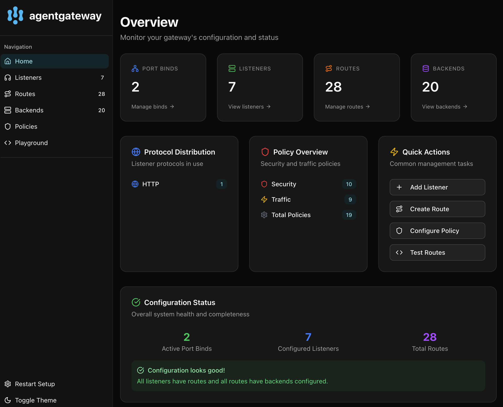
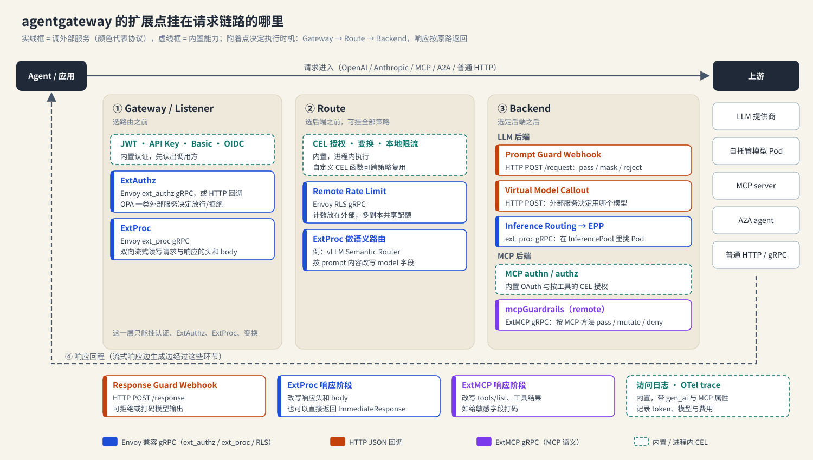

# agentgateway 的定位与扩展机制

我第一次看 [agentgateway](https://github.com/agentgateway/agentgateway) 的 README，卡在 Key Features 里的 Inference Routing 这一条：一个给 agent 用的网关，为什么要按 GPU 利用率、KV cache、LoRA 和队列深度来选路？弄明白之后发现，这一条恰好最能说明它是什么、能怎么扩展。这篇按这个顺序来写：先说定位，再列内置功能，然后讲扩展机制，最后用 Inference Routing 把扩展机制完整走一遍。

## 一、定位：一个数据面，三类 AI 流量

agentgateway 用 Rust 写，Apache-2.0 许可，最早由 Solo.io 开发，2025 年捐给 Linux Foundation，2026 年成为 Agentic AI Foundation（AAIF）的项目。它的底子是一个**通用的 HTTP 和 gRPC 数据面**：负载均衡、超时、重试、TLS、限流、授权都有，普通的 REST API 和微服务也可以挂在它后面。在这个底子上，它原生认识三类 AI 流量：

- **Agent → LLM**：统一的 OpenAI 兼容入口，后面接各家模型或自建模型；
- **Agent → Tool**：MCP，把多个 MCP server 聚合成一个入口，按工具授权；
- **Agent → Agent**：A2A，代理 agent 之间的调用，改写 Agent Card 里的入口地址。

官方给出的理由是：MCP 是有状态的 JSON-RPC 协议，客户端和服务端要维持长会话，服务端还会主动往回推消息；一次 `tools/list` 可能要扇出到好几个后端再合并结果，而且每个会话能看到的工具还不一样。为短连接 REST 设计的传统网关不认识这些语义。

### 它不属于 agent runtime

按我在 [Agent 基础设施系列 01](../agent-platform/Agent基础设施系列01：三层划分与自建路线.md) 里的分法，runtime 回答的是"agent 在哪跑、怎么隔离、怎么扩缩、崩了怎么续"，管的是进程和执行环境；网关回答的是"agent 和模型、工具、其他 agent 之间怎么连、连接怎么治理"，管的是双方之间的流量。所以 agentgateway 在那张分层图里放在 Platform 层的"网关与策略"，而不在 Runtime 的四个子层里。

runtime 会依赖它：沙箱的出站必须经过网关，模型请求要在网关上和会话绑定，所以[在 AKS 上自建 runtime 时](../../../../Azure/Azure-Kubernetes-Service/AKS-Agent-Runtime系列08补充：agentgateway的定位与三种角色.md)它看起来像 runtime 的一部分。但它服务的范围比 runtime 大：不需要沙箱、按普通服务部署的 agent 一样要经过它访问模型和 MCP；不涉及 agent 的应用可以只拿它当 LLM 网关；Inference Routing 面向的是自托管模型集群，跟 agent runtime 没有关系。我更愿意把它看成一个**跨层的连接与治理层**：策略由平台层定，运行时层强制流量经过它，层外的工作负载也能用。

### 和 LiteLLM 的分工

LiteLLM 是 LLM proxy，强项在模型这一侧：上百家提供方、虚拟 key、预算、按团队出账。它也支持接入 MCP 和 A2A，但核心还是模型流量。agentgateway 自己也有完整的 LLM 网关，两者有重叠；区别在于 LiteLLM 管"怎么调模型"，agentgateway 管"谁能调什么"，而且三类流量在同一处管。已经有 LiteLLM 的团队，常见做法是把它放在 agentgateway 后面一跳，详细的组合方式和与 Kong、APIM、Higress 的对照在 [AKS Agent Runtime 系列 08 补充](../../../../Azure/Azure-Kubernetes-Service/AKS-Agent-Runtime系列08补充：agentgateway的定位与三种角色.md)里写过。

### 注册发现、创建托管、身份不归它管

讲 agent 平台和治理时绕不开注册与发现，Nacos 这类注册中心已经能托管 AgentCard 和 MCP server 的元数据。agentgateway 在这件事上的态度很明确：有人在仓库里提议加 [Agent Registry and Discovery](https://github.com/agentgateway/agentgateway/issues/2254) 和 [Skill 注册表](https://github.com/agentgateway/agentgateway/issues/3094)，都被维护者以"不在计划内"关闭，理由是网关不把自己定位成注册表，注册发现应该交给架在它上面的项目，推荐的是 [agentregistry](https://aregistry.ai/)。仓库里的 `catalog` 目录和 `agctl catalog` 命令容易让人误会，其实那是**模型价格表**，用来给 LLM 请求算成本。

几件常被归到"平台"的事，它各做到哪一步：

- **注册与发现：不做**。它和发现有关的能力只服务于路由——Kubernetes 模式下 MCP 后端可以按标签选中一批 Service 作为目标，A2A 代理会改写 Agent Card 里的入口地址。A2A 后端按标签自动发现、由平台统一下发治理过的 Agent Card，目前都还是社区里的开放提议。
- **创建与托管：不做**。官方 FAQ 写得很清楚：agentgateway 假设 MCP server、工具和 agent 已经在环境里跑着；创建和运行它们是 [kagent](https://kagent.dev) 的事。
- **身份：只做流量这一侧**。它能认出调用方（JWT、OIDC、API key），能把调用方的凭据换成访问后端用的令牌（RFC 8693、RFC 7523），能用工作负载身份去访问云上的模型。但它不签发、不管理 agent 身份，没有"一个 agent 是谁、归谁负责"这层模型；[把 agent 身份做成一等概念](https://github.com/agentgateway/agentgateway/issues/2871)也只是一个开放的提议。

公开的路线图只有 GitHub 上的 milestone 和项目看板，里面没有往注册、托管、身份方向扩展的计划。所以在 Solo 这套开源组合里，三件事是分开的：**agentregistry 负责注册与发现**（MCP server、agent、skill、prompt 的目录与审批，agent 的 blueprint 里记录身份、模型、工具），**kagent 负责创建与托管**，**agentgateway 负责连接与治理**。换到阿里的生态里，对应的是 Nacos 加 Higress；换到微软这边，是 Agent 365 的注册表加 Entra Agent ID，网关由 APIM 或 Foundry 的接入层承担。

> [!NOTE]
> agentgateway 本身也没有 skill 这个功能。A2A 的 Agent Card 里有 `skills` 字段，那是 agent 自己声明的能力，网关只是代理和改写入口地址；文档站提供的 "agentgateway skills" 是教 Claude Code、Codex 这类编码助手如何配置 agentgateway 的说明文件，属于文档工具。和 skill 真正相关的一项进展是 MCP 的 Skills 扩展：维护者同意先做单个 server 的只读透传，让客户端能经网关浏览和拉取 MCP server 上的 skill，目前还在开发中。

### 两种部署方式

| | 独立模式（standalone） | Kubernetes 模式 |
|---|---|---|
| 运行形态 | 单个二进制，也可以用 Docker 或单 Deployment 的 Helm chart | CRD 加控制面，控制器把资源翻译给数据面 |
| 配置 | 一份 YAML，有 JSON schema 可先校验 | Gateway API（Gateway、HTTPRoute）加 agentgateway 自己的 CR，经 xDS 动态下发 |
| UI | 可以直接编辑配置 | 只读 |
| 适合 | 个人、小团队、边车、非 Kubernetes 环境 | 已经走 GitOps 的共享 Kubernetes 平台 |

独立模式自带的 UI 可以看到端口、监听器、路由、后端和策略的整体情况，也能在 Playground 里直接测路由：



## 二、内置功能

按层归一下，下面这些不需要写任何外部服务就能用：

| 层 | 内置能力 |
|---|---|
| 通用流量 | 按路径、头、方法、查询参数匹配；改写头、路径、host，重定向，直接返回；路由委托给不同团队维护；镜像流量、重试、超时、故障注入；CORS、CSRF；CONNECT 出站代理 |
| 认证授权 | JWT、API key、Basic、浏览器 OIDC 登录；用 CEL 写的 HTTP 授权和 L4 网络授权；后端凭据可以是静态 key、透传、自签 JWT、AWS SigV4、GCP、Entra ID，或者按 RFC 8693、RFC 7523 做令牌交换 |
| LLM | OpenAI 兼容入口，同时接受 Anthropic Messages、Responses、Gemini 原生格式；Embeddings、音频、Realtime、Rerank；虚拟模型（按权重、失败切换、按条件选目标）；虚拟 key、按 key 的美元或 token 预算、模型价格表与成本看板；能把 LiteLLM 的配置转换过来 |
| 内容防护 | 正则与内置 PII 检测，OpenAI Moderation、AWS Bedrock Guardrails、Azure AI Content Safety、Google Model Armor；多个防护按顺序串联；可以只记录不拦截（audit） |
| MCP | stdio、SSE、Streamable HTTP 后端；多个 server 聚合成一个入口，工具名加目标前缀；把 OpenAPI 转成 MCP 工具；OAuth 认证、按工具的 CEL 授权；MCP Apps；在新旧两代 MCP 规范之间自动协商 |
| A2A | 代理 Agent Card 并改写入口地址；访问日志里带 A2A 方法名和任务状态；也能接 AWS Bedrock AgentCore |
| 观测 | OpenTelemetry trace（带 `gen_ai` 和 MCP 属性）、Prometheus 指标与 Grafana 看板、可用 CEL 过滤的访问日志，日志也能落 SQLite 或 PostgreSQL 供 UI 做分析 |

翻文档时有几处容易想当然的地方：

- **内容防护只作用于对话类请求**。Chat Completions、Messages、Responses、Gemini 这几类会过防护；Embeddings、Rerank、模型列表、token 计数和 passthrough 一律不过。流式响应要单独打开流式防护才会检查，而且流式响应上只能拦截，不能打码。
- **MCP 聚合时，协议版本取所有目标的交集**。新一代 MCP 规范改成了无状态、无会话（用 `server/discover` 代替 `initialize` 握手），agentgateway 默认两代都支持，新客户端连旧服务端时自动回退；但只要聚合里有一个旧 server，整个入口就只能协商到旧版本。
- **虚拟模型可以把真实模型藏起来**。`visibility: internal` 的模型只能作为虚拟模型的目标，客户端不能直接点名调用；trace 里 `agw.ai.original_model` 记客户端请求的名字，`gen_ai.request.model` 记实际发给提供方的模型。

## 三、扩展机制

内置功能不够的时候，agentgateway 提供的扩展手段分两种：一种是**进程内的 CEL**，授权、变换、日志过滤、条件策略都能写表达式，还能用 `config.customFunctions` 定义可复用的函数；另一种是**调外部服务**，在请求链路的固定位置把决定权交出去。下图是这些扩展点挂在链路上的位置：



执行时机由附着点决定：Gateway 或 Listener 上的策略在选路由之前执行，只能挂认证、ExtAuthz、ExtProc 和变换；Route 上的在选后端之前执行，什么策略都能挂；Backend 上的在选定后端之后执行，LLM 和 MCP 相关的策略都在这一层。

| 扩展点 | 协议 | 外部服务拿到什么 | 能做什么 | 外部服务出错时（默认） |
|---|---|---|---|---|
| ExtAuthz | Envoy ext_authz gRPC，或 HTTP | 请求头，可选带上 body | 放行或拒绝，附带改头 | 拒绝；gRPC 默认 2 秒超时 |
| ExtProc | Envoy ext_proc gRPC | 双向的头、body、trailer，默认全双工流式 | 任意改写，或直接返回响应截断请求 | 拒绝；body 开始流向外部服务后，即使设了放行也会报错 |
| Remote Rate Limit | Envoy Rate Limit gRPC | 配置好的 descriptor | 在外部存计数，多副本共享配额 | 由限流服务决定 |
| Prompt Guard Webhook | HTTP JSON（`POST /request`、`/response`） | 请求的 messages 或响应的 choices | pass、mask、reject | 拒绝并返回 503；可改为 audit 只记录 |
| Virtual Model Callout | HTTP JSON | 原请求 body，或用 CEL 拼出来的 body；只带显式配置的头 | 选目标模型，顺带改写 body 字段；结果可以按会话缓存 | 返回 503，或回退到指定模型 |
| mcpGuardrails（remote） | ExtMCP gRPC | MCP 方法名、目标、`params` 或 `result` | pass、mutate、deny | 拒绝 |
| Inference Routing（EPP） | ext_proc gRPC，Inference Extension 协议 | 推理请求 | 返回目标 Pod 地址 | EPP 找不到可用端点时返回 503 |

几点我觉得值得单独说：

**协议大多沿用 Envoy 的**。ExtAuthz、ExtProc、远程限流都和 Envoy 的 gRPC 接口兼容，已经在用 OPA 做授权、用 envoyproxy/ratelimit 加 Redis 做限流的团队可以直接复用。不过 ext_proc 里有一些 Envoy 专属字段被忽略或受限，比如 `clear_route_cache`（agentgateway 没有路由缓存）和 `CONTINUE_AND_REPLACE`，迁移现成的处理服务前要对一遍兼容清单。

**MCP 有自己的扩展接口 ExtMCP**。用 ExtAuthz 或 ExtProc 管 MCP 也可以，但外部服务得自己拼 body、解析 JSON-RPC、处理 MCP 的分帧；ExtMCP 直接把方法名、目标和参数给过去，按工具名、参数、调用方身份拒绝调用，或者给工具参数和结果里的敏感字段打码，都简单得多。CEL 处理器和远程处理器可以串在一起，先用 CEL 挡掉明显不允许的调用，再把剩下的交给远程服务做开销大的检查。要注意的是**改写参数不会触发重新选后端**：`tools/call` 的后端和工具名在处理器运行之前就解析好了，MCP 授权检查的是原始的工具名。处理器把参数改了，要在最后一个改写之后再加一道检查。

**失败时一律默认拒绝**。ExtAuthz、ExtProc、内容防护、callout、ExtMCP 都是 fail closed。ExtProc 的放行选项有个细节：默认的全双工流式模式下，处理流一建立 body 就开始往外送，所以"外部服务挂了就放行"实际上只在流建立失败时才生效。

**同样是选模型，有四个层次**。虚拟模型的权重、失败切换和条件路由是内置的；规则写不下时用 callout，交给外部服务按提示词复杂度或会话状态来决定；按提示词语义选模型可以接 vLLM Semantic Router，它通过 ExtProc 改写请求里的 `model` 字段，还能直接从缓存返回结果；Inference Routing 解决的是另一层问题——模型已经定了，发给这个模型的哪个副本。前三种选的是"哪个模型"，最后一种选的是"哪个 Pod"。

## 四、Inference Routing：一个完整的扩展例子

### 两层路由

企业只用云端模型时，AI 网关要解决的是统一 API、选提供方、限流、认证、成本、失败切换，路由的单位是"提供方、模型、endpoint"。开始在自己的 GPU 集群上部署模型之后，又多出一层：同一个模型跑了好几个副本，这个请求发给哪个副本。前一层是 provider-level routing，后一层是 inference-level routing。agentgateway 把两层放进了同一个代理里。

### 普通负载均衡为什么不够

Kubernetes Service 的负载均衡只看连接，而 LLM 副本的"忙不忙"、"合不合适"由推理层面的状态决定：

- **GPU 利用率**：能说明一部分负载，但利用率高不等于接不了新请求，不能单独作为依据。
- **KV cache 与前缀**：多轮对话里，每一轮都带着前面的全部内容。第 1 轮在 Pod 1 上算过，System Prompt、上下文和前面的问答就留在 Pod 1 的 KV cache 里；第 2 轮如果被随机分到 Pod 3，这段前缀要全部重新 prefill，首 token 时间（TTFT）变长，GPU 算力花在重复劳动上。
- **LoRA adapter**：一个基础模型可以在同一组 GPU 上动态加载医疗、金融、法律等不同的 LoRA。请求要医疗 adapter，发到已经加载了它的 Pod 最合适，发到没加载的 Pod 就要额外加载。
- **队列深度**：LLM 请求的处理时长差别极大，生成 50 个 token 和输入 5 万 token 的长上下文完全不是一个量级。两个 Pod 的 GPU 利用率看着差不多，排队的工作量可能差很多。

KV cache 这一条最能说明问题：



### 谁负责什么

关键在于 agentgateway **自己不实现调度算法**。Kubernetes 社区的 [Gateway API Inference Extension](https://gateway-api-inference-extension.sigs.k8s.io/) 定义了两样东西：`InferencePool` 这个资源，用来把一组模型服务 Pod 变成可路由的后端；以及网关和 Endpoint Picker（EPP）之间的协议。生产级的 EPP 实现是 [llm-d Router](https://github.com/llm-d/llm-d-router)。一次请求是这样走的：

1. agentgateway 按 HTTPRoute 匹配到后端是一个 InferencePool；
2. agentgateway 通过 ext_proc 把请求交给这个 pool 的 EPP；
3. EPP 根据各个模型服务的指标（前缀缓存、KV cache 占用、LoRA 加载情况、队列深度）选出一个 Pod；
4. EPP 在 `x-gateway-destination-endpoint` 头和 ext_proc 的 dynamic metadata 里返回选中的地址，还可以带一个备用地址供重试；
5. agentgateway 把请求转发到这个 Pod，vLLM 或 SGLang 执行推理后返回结果。

也就是说，Inference Routing 就是第三节里的 ExtProc 扩展点，只不过协议和资源模型由 Kubernetes 社区统一定义了，所以同一个 EPP 也能配 Istio、NGINX Gateway Fabric 等其他网关。agentgateway 不负责创建 GPU Pod，也不负责加载模型，它只负责推理请求的入口和端点选择。

还有一处容易混：**vLLM 自己的调度器和 llm-d Router 不是一回事**。vLLM 的调度器决定一个实例内部哪些请求进入批次、什么时候执行；llm-d Router 决定一个新请求发给哪个实例。一个是实例内调度，一个是跨实例路由，两者是配合关系。

### 两种部署方式

- **Kubernetes Gateway API 模式**：agentgateway 作为 Gateway 的数据面，安装时打开 `inferenceExtension.enabled`，装上 Inference Extension 的 CRD，创建 InferencePool，从 HTTPRoute 路由过去。能用上流量切分、路由匹配这些 Gateway API 的能力，还能按请求里的模型名分发到多个 InferencePool。
- **独立的请求调度模式**：agentgateway 和 EPP 作为边车跑在一起，经 localhost 通信。不支持 InferencePool，要在配置里定义一个不含地址的占位 service，由 EPP 决定真实的目标。适合单租户或单个任务的工作负载，不值得为它搭一整套 Gateway API。

独立模式的配置大致是这样：

```yaml
services:
- name: my-model
  namespace: default
  hostname: my-model
  vips: []
  ports:
    "8000": 8000
binds:
- port: 8081
  listeners:
  - routes:
    - matches:
      - path:
          pathPrefix: /v1/chat/completions
      backends:
      - service:
          name: default/my-model
          port: 8000
        policies:
          inferenceRouting:
            endpointPicker:
              host: 127.0.0.1:9002
            destinationMode: passthrough
```

`destinationMode` 默认是 `validated`，只接受属于本地 service 的 IP；EPP 自己负责发现端点，或者要返回域名（比如让一个全局 EPP 把请求导到另一个集群的负载均衡）时，要改成 `passthrough`。

### 什么时候值得上

多个模型、多个 LoRA、多类 agent 工作负载共享同一个 GPU 集群时，才需要一个懂推理状态的调度层；只有一两个副本，或者模型全在云上，普通负载均衡就够了。它也不替代 vLLM、SGLang、Kubernetes 调度器或 GPU Operator，它管的只是请求入口和端点选择，不是 GPU 资源编排。真要深入，值得研究的是 **agentgateway + Gateway API Inference Extension + llm-d** 这一组合，而不是单看 agentgateway：负载均衡开始需要理解前缀、KV cache 命中率、请求长度和显存压力，这一层由社区标准接起来，网关和调度器才能各自替换。

## 相关阅读

- [Agent 基础设施系列 01：三层划分与自建路线](../agent-platform/Agent基础设施系列01：三层划分与自建路线.md)——Platform、Runtime、Framework 三层的划分，网关在 Platform 层
- [agentregistry 的定位与部署实践](../agent-registry/agentregistry的定位与部署实践.md)——注册发现交给的那个项目，以及它和 agentgateway、kagent 在 AKS 上怎么接
- [Agent 基础设施系列 05：完整 Agent 方案的三条路线](../agent-platform/Agent基础设施系列05：完整Agent方案的三条路线.md)——微软这一侧的网关（AI Gateway、APIM、AGC）与混合方案里 agentgateway 的位置
- [AKS Agent Runtime 系列 08 补充：agentgateway 的定位与三种角色](../../../../Azure/Azure-Kubernetes-Service/AKS-Agent-Runtime系列08补充：agentgateway的定位与三种角色.md)——本机实测三类流量，与 Kong、APIM、Higress、LiteLLM 的对照
- [Agent 基础设施系列 03：kagent 与 Agent Substrate](../agent-runtime/Agent基础设施系列03：kagent与Agent-Substrate.md)——和 agentgateway 同出一源的 agent 运行与编排
- [企业级 A2A 方案：从微服务治理到 Agent 互操作层](../protocol/企业级A2A方案：从微服务治理到Agent互操作层.md)——A2A 流量治理的整体方案

## 参考资料

- [agentgateway/agentgateway](https://github.com/agentgateway/agentgateway)
- [agentgateway Introduction](https://agentgateway.dev/docs/standalone/latest/documentation/about/introduction/)
- [Policy attachment points](https://agentgateway.dev/docs/standalone/latest/documentation/configuration/policies/attachment/)
- [External processing (ExtProc)](https://agentgateway.dev/docs/standalone/latest/documentation/configuration/traffic-management/extproc/)
- [External authorization](https://agentgateway.dev/docs/standalone/latest/documentation/configuration/security/external-authz/)
- [Guardrail processors](https://agentgateway.dev/docs/standalone/latest/documentation/mcp/guardrails/processors/)
- [Custom webhooks](https://agentgateway.dev/docs/standalone/latest/documentation/llm/prompt-guards/webhooks/)
- [Virtual models](https://agentgateway.dev/docs/standalone/latest/documentation/llm/virtual-models/)
- [vLLM Semantic Router](https://agentgateway.dev/docs/standalone/latest/integrations/llm/routing/vllm-semantic-router/)
- [Inference routing（standalone）](https://agentgateway.dev/docs/standalone/latest/documentation/llm/inference/)
- [Inference routing（Kubernetes）](https://agentgateway.dev/docs/kubernetes/latest/documentation/llm/inference/inference-routing/)
- [agentgateway FAQs](https://agentgateway.dev/docs/standalone/latest/documentation/faqs/)
- [agentregistry](https://aregistry.ai/)
- [Gateway API Inference Extension: Implementer's Guide](https://gateway-api-inference-extension.sigs.k8s.io/guides/implementers/)
- [llm-d Router](https://github.com/llm-d/llm-d-router)
