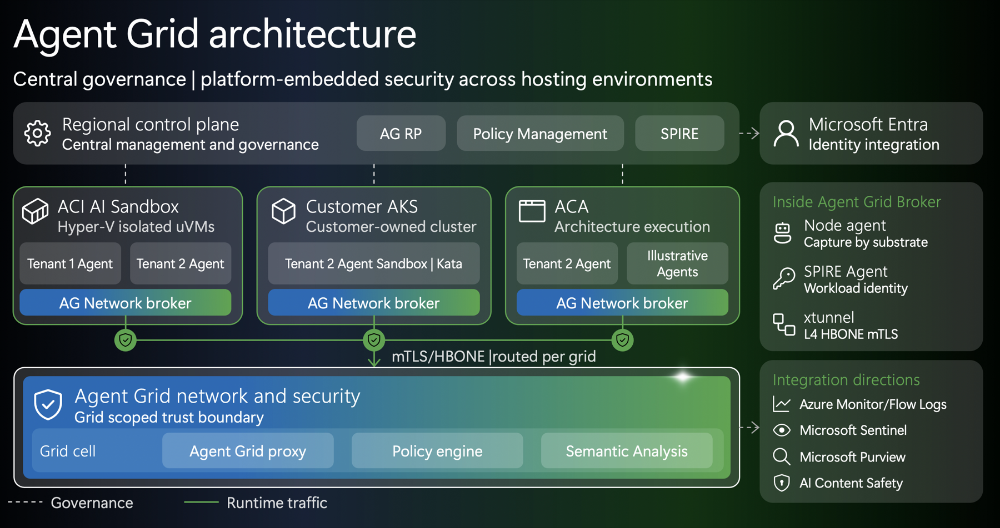
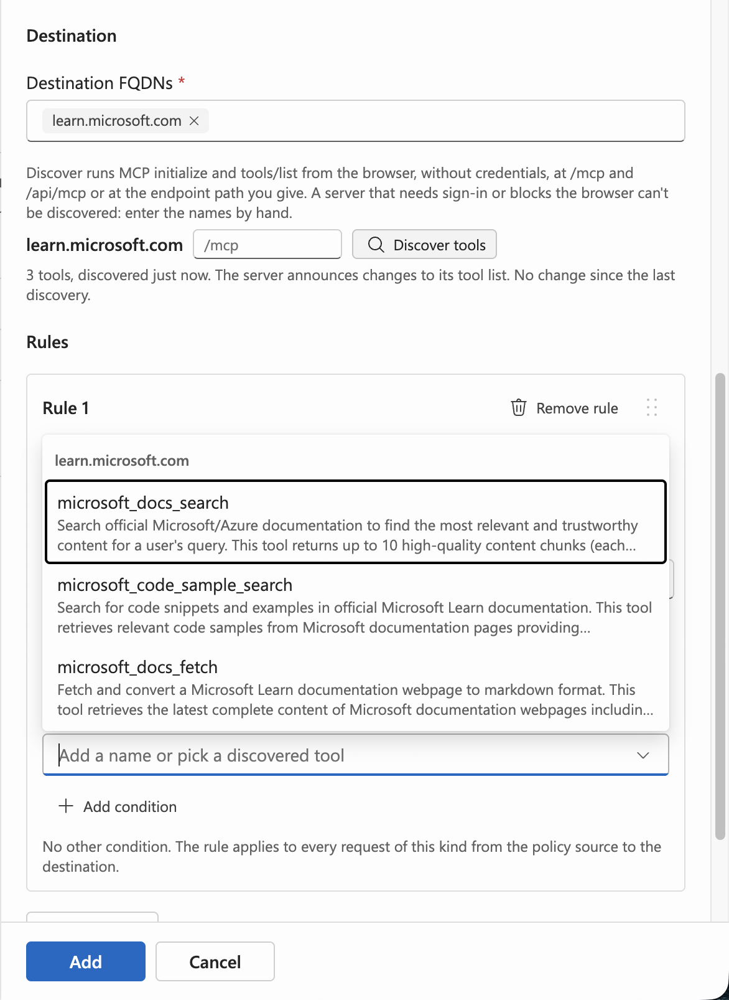
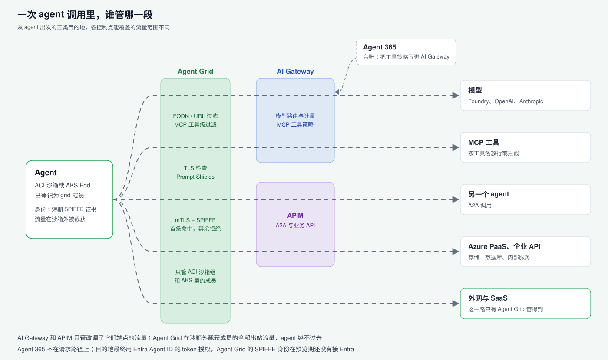

# Agent 基础设施系列 08：Agent Grid 的网络层管控

写 [系列 06](../agent-fleet-management/Agent基础设施系列06：Fleet-Management与Agent-Platform的区别.md) 时我把网关分成了两派：一派把网关当成**消费入口**，只管 agent 要消费的模型和工具，Azure AI Gateway、Lyzr 的 LLM Gateway 属于这一派；另一派把网关当成 **agent 的网络边界**，凡是出入 agent 的连接都要认证、检查、留审计，Google 的 Agent Gateway 属于这一派。当时微软只有前一种。Ignite 2026 上微软发布了 [Agent Grid](https://techcommunity.microsoft.com/blog/azurenetworkingblog/introducing-agent-grid/4573407)，补上了后一种。这篇按 [Learn 上的预览文档](https://learn.microsoft.com/en-us/azure/agent-grid/overview) 把它的机制、策略和边界理一遍，再看它和 AI Gateway、Agent 365、Entra Agent ID 怎么分工。

## 一、为什么要在网络层管

微软给的前提是一句话：**agent 是不可信的内部人**。它有合法的凭据和权限，又可能被藏在工单、网页、文档里的提示词注入带偏，所以"它是认证过的合法工作负载"不足以说明它这一次的调用是对的。

由此推出的设计原则是：**管控点必须放在 agent 自己的信任边界之外**，一个被攻破的 agent 不能改写约束它通信的规则。所以 Agent Grid 在沙箱外截获流量，agent 关不掉也绕不过去；而且不需要改 agent 代码、不加 SDK、不部署 sidecar，安全团队可以独立于 agent 开发团队来管策略。

微软还给了一个不在每个 agent 前面放网关的理由：一次请求会在 agent、模型、MCP server、其他 agent 和 Azure 服务之间多轮、多跳地调用，流量是一张网而不是几条固定的线。给每一种交互单独放一个网关，基础设施和策略会成倍增长；全塞到一个网关后面，又成了瓶颈和单点。短命的 pod 和沙箱共用基础设施，按 IP 写策略也维护不下去，所以策略要写在工作负载身份上。

## 二、对象模型和工作方式

Agent Grid 有几个对象（[What is Azure Agent Grid?](https://learn.microsoft.com/en-us/azure/agent-grid/overview)）：

- **Agent Grid**：顶层资源，一个隔离的安全边界，有自己的信任域和默认策略组。不同 grid 互相隔离，一个 grid 配错或出事不会波及别的 grid。
- **Attached resource**：挂到 grid 上的计算资源，比如一个 ACI 沙箱组或一个 AKS 集群。挂上去只是让它的工作负载可以登记，不会改变任何流量。
- **Member**：登记进 grid 的工作负载。member 由计算服务那一侧创建和删除（比如登记一个沙箱时），不能在 Agent Grid 里直接建。**Agent Grid 只截获和管理 member 的流量**，挂上去但没登记的工作负载不受影响。
- **Policy group 和 policy**：策略组有优先级，按资源组管理，应用到 grid 后对所有 member 生效；每条策略按工作负载 ID 的模式选中要管的对象，规定放行、拦截还是检查。
- **Workload identity**：一张短期的 X.509 证书，也就是 SVID，里面带着工作负载的 SPIFFE ID。

工作流程是五步：建 grid、挂计算资源、把工作负载登记成 member、应用策略；Agent Grid 证明每个 member 的身份并签发短期证书；在沙箱外截获它的流量，走一条用它的身份认证的 mTLS 隧道；按身份匹配 grid 的策略；放行的转发到目的地，拦截的丢弃，并记下请求、命中的策略和原因。

架构上分三层，博客里的这张图画得很清楚：

- **区域控制面**：管理 grid 资源、策略和 SPIRE，身份方面对接 Entra。
- **各计算环境里的网络 broker**：ACI 的 Hyper-V 隔离微 VM、客户自己的 AKS（含 Kata 的 agent 沙箱）里各有一个由 Azure 托管的 broker，里面是按计算环境截获流量的 node agent、签发工作负载身份的 SPIRE agent，以及做 L4 HBONE mTLS 的 ztunnel。ztunnel 和 HBONE 是 Istio ambient 模式里的组件和隧道协议，文档要求自带虚拟网络时在 NSG 里放行网关负载均衡器的 TCP 15008 和 15009 端口，15008 正是 HBONE 的标准端口，看得出 Agent Grid 借用了这套数据面。
- **grid 范围的安全边界**：grid cell 里有代理、策略引擎和语义分析，需要深度检查的流量经认证加密的连接送到这里。这些保护服务和 agent 的算力分开扩缩。

还有一个小细节：Agent Grid 内部原来叫 **Agent Fabric**，资源类型、CLI、API 属性里还会看到这个名字，比如 AKS 的预览开关叫 `EnableAgentFabricPreview`，流日志的类别叫 `AgentFabricFlowLogs`。

## 三、五类策略

预览期支持五类策略（[Configure Azure Agent Grid](https://learn.microsoft.com/en-us/azure/agent-grid/configure-agent-grid)）：

1. **FQDN 过滤**：只允许访问列出的域名，默认端口 443。
2. **URL 过滤**：按主机名、HTTP 方法和路径过滤，主机名里的 `*` 可以跨点匹配，路径按行写，比如 `/v1/*`。
3. **MCP 策略**：按工具名放行或拦截对 MCP server 的工具调用，并设一个默认动作，策略页上会显示成"Allow 1 rule · default Deny"这样。
4. **TLS 检查**：解密 HTTPS 做检查再重新加密，证书由 Azure 管理的 CA 签发。每条 TLS 检查策略最多一条规则，默认动作是检查（Inspect）或直通（Bypass）。
5. **内容检查**：用你自己的 Azure AI Content Safety 资源里的 Prompt Shields，检查 POST、PUT、PATCH 请求的 JSON body 里有没有提示词注入，发现就返回 403。

MCP 策略最能体现它和普通防火墙的区别：**信任一个 MCP server，不等于授权它暴露的每一个工具**。同一个 server 上，可以只放行检索工单的工具，拦掉删除记录、改配置的工具。配置时界面会用 MCP 的 `initialize` 和 `tools/list` 去发现这个 server 的工具清单，不带凭据；需要登录或拦浏览器请求的 server 发现不了，要手工填工具名。

### 几处容易踩的规则

这几条文档里都写了，但不仔细看很容易配错：

- **首条命中**。策略组按优先级数字从小到大检查，组内的策略从上到下，第一条适用于这次请求的策略说了算。
- **配了过滤就默认拒绝其余流量**。只要对某个 member 应用了 FQDN、URL 或 MCP 策略，这个 member 的其他流量就会被拒绝，除非另有策略放行。给 agent 加一条"只许访问某个 MCP server"的策略，它访问模型端点的流量也会一起断掉，要记得同时放行。
- **TLS 检查影响别的策略**。grid 只对 TLS 检查策略的来源解密 HTTPS，而 URL 过滤、MCP 策略和内容检查都要看到明文才能工作，所以没开 TLS 检查的 member，这几类策略对 HTTPS 流量能做的有限。TLS 检查和内容检查的来源也只能是 member 的身份。
- **被拦截的 HTTP 请求返回 403**。验证时从 member 里分别访问一个允许和一个拒绝的目的地，再到 Live inspect 里看每个请求的来源、目的地、判定结果、原因和命中的规则，MCP 流量还会显示调用的方法或工具，比如 `tools/list`。Flow map 把来源和目的地之间的流量画成图，有被拒请求的线标红；Member connectivity 用矩阵显示每个 member 到其他 member 和外部的判定，是允许、拒绝还是"取决于请求"。

## 四、预览期的边界

Agent Grid 现在是 limited preview，要填申请表获批才能用。上线评估前要知道这些限制（[What is Azure Agent Grid?](https://learn.microsoft.com/en-us/azure/agent-grid/overview)）：

- **支持的计算环境只有两种**：ACI 的 AI 沙箱组，以及 AKS（Agent Sandbox 工作负载和普通 Kubernetes 部署都可以）。**Foundry hosted agent、Azure Container Apps、Copilot Studio 都不支持**。博客里的示意图把 Foundry 和 ACA 也画了进去，那是方向，不是现在能用的。
- **网络形态有要求**：ACI 沙箱组只支持公网 IP，用虚拟网络集成的不支持；不支持私有 AKS 集群；AKS 集群要启用 Entra 集成；删除 AKS 集群前要先从 grid 退出。只支持 TCP 和 IPv4。
- **范围和规模**：计算资源必须和 grid 在同一个订阅、同一个区域，一个计算资源只能挂一个 grid；grid 的信任域建好后不能改；每个区域最多 500 个 grid，**每个 grid 最多 100 个 member**。
- **区域**：Central US、West US 2、Sweden Central、Australia East、Indonesia Central。
- **工作负载身份还没有接 Entra Agent ID**。Agent Grid 签发的是它自己信任域下的 SPIFFE 身份，和 Entra 里的 agent identity 是两套，下一节会说这意味着什么。

还有一点：博客的第二个场景是一键"隔离所有 agent"的紧急刹车，覆盖现有放行规则、切断活动连接、拦掉所有新的出入站通信。这个能力我在预览文档里没有找到对应的配置，现在只能算宣布过的方向。

## 五、和其他组件怎么分工

把一次 agent 调用拆开看，会经过模型、MCP 工具、其他 agent、Azure PaaS 和企业 API、外网与 SaaS 五类目的地，每个控制点能管到的范围不一样：

**和 AI Gateway：两种网关定义在微软内部并存了。** AI Gateway 是消费入口，管模型别名、路由与失败切换、按 token 计量和成本上限，也管 MCP 工具，Agent 365 的工具策略就是写进它里面执行的（见 [系列 05](../agent-platform/Agent基础设施系列05：完整Agent方案的三条路线.md)）；但它只能管**改调了它端点**的流量，agent 直连模型或外网，它看不到。Agent Grid 是网络边界，截获 member 的全部出站，agent 绕不过去，但它不做模型路由、不按 token 计量。两者在 MCP 工具上有重叠：同一个"禁止调用删除工具"的意图，可以写在 Agent 365 下发到 AI Gateway 的工具策略里，也可以写在 Agent Grid 的 MCP 策略里。两边都配时，要指定一处为准，否则很容易出现一边放行、一边拦截，排查起来很痛苦。

**A2A 第一次被网络层管到。** 系列 06 里提到微软把 A2A 放在 APIM 而不是 AI Gateway，按 API 的方式管身份和调用量。Agent Grid 用身份隔离和微分段，直接限制哪个 agent 能连哪个 agent，这是网络边界那一派本来就会覆盖的流量。

**和 Entra Agent ID：一个 agent 有两套身份。** 目的地最终授权用的是 Entra Agent ID 签的 token，看的是 agent identity 上的角色和权限（见 [系列 07](../agent-identity/Agent基础设施系列07：Blueprint与Agent-Identity的实例模式.md)）；Agent Grid 的策略写在 SPIFFE 工作负载身份上。预览期两者没有关联，所以同一个 agent 在网络层和资源层是用两个名字被识别的，策略和审计要靠命名约定手工对上。博客的产品示意图里把 Entra Agent ID 列为集成方向，这个缺口大概率会补，但现在要按两套来设计。

**和 Agent 365：一个管台账，一个在路上。** Agent 365 不在请求路径上，它管有哪些 agent、归谁、给 AI Gateway 下发工具策略。Agent Grid 管的是这些 agent 的连接能不能建立。它管的是一个 grid 里的成员，不是全企业的 agent 台账。

**和 Global Secure Access：一个管人，一个管工作负载。** GSA 管的是用户设备的访问路径，Agent Grid 管的是跑在 Azure 计算环境里的 agent 工作负载，两者覆盖的流量不重叠。

**和自建的出站治理：多了一个托管选项。** [AKS Agent Runtime 系列 04](../../../../Azure/Azure-Kubernetes-Service/AKS-Agent-Runtime系列04：出站治理与逐请求授权.md) 里我在 AKS 上用 egress 网关和策略引擎自己搭出站管控，[系列 02](../agent-runtime/Agent基础设施系列02：Kubernetes上的Agent沙箱.md) 里也提到 NetworkPolicy 只认 IP 和端口、按域名放行要靠 Cilium 的 FQDN 策略或 egress 代理。Agent Grid 把按身份的微分段、FQDN 和 URL 过滤、MCP 工具级过滤做成了托管能力，代价是每个 grid 100 个 member、只支持这两种计算环境，以及还在预览。

**和 Google Agent Gateway 对比：思路几乎一样。** 两者都用 SPIFFE 标识工作负载、mTLS 加密，在 agent 的沙箱外管出站，都内置提示词注入检查（Google 用 Model Armor，微软用 Prompt Shields），都按 MCP 工具名做细粒度控制。差别在覆盖面：Google 的 Agent Gateway 规划了用 Envoy 部署到 EKS、AKS 等外部集群的跨云形态，目前还是 coming soon；Agent Grid 目前只管 Azure 上的两种计算环境，文档里没有提到跨云。

## 六、我的判断

- **它补的是一个真实的缺口**。AI Gateway 管不到绕开它的流量，而提示词注入最危险的后果恰恰是让 agent 去连它不该连的地方、调它不该调的工具。在沙箱外、按身份、默认拒绝，这是目前对"agent 被带偏"最可靠的兜底。
- **现阶段适合跑代码的 agent**。支持的正好是 ACI 沙箱组和 AKS 的 Agent Sandbox，也就是执行模型生成代码的那类工作负载，这类场景最需要网络兜底。跑在 Foundry hosted agent 或 Copilot Studio 上的 agent，现在还用不上它。
- **先把两件事想清楚再上**：一是 MCP 工具策略在 AI Gateway 和 Agent Grid 之间以谁为准；二是 SPIFFE 身份和 Entra agent identity 怎么对应、审计怎么对齐。这两件不定，后面策略越多越难管。
- **评估时重点验证"默认拒绝"的影响面**。配一条 FQDN 或 MCP 策略就会断掉 member 的其他流量，第一次配很容易把模型调用一起断掉。先在一个测试 grid 里用 Member connectivity 和 Live inspect 把每个 member 的放行面看清楚，再挪到正式环境。

## 相关阅读

- [Agent 基础设施系列 06：Fleet Management 与 Agent Platform 的区别](../agent-fleet-management/Agent基础设施系列06：Fleet-Management与Agent-Platform的区别.md)——网关的两种定义
- [Agent 基础设施系列 05：完整 Agent 方案的三条路线](../agent-platform/Agent基础设施系列05：完整Agent方案的三条路线.md)——AI Gateway 与 Agent 365 的工具治理链路
- [Agent 基础设施系列 07：Blueprint 与 Agent Identity 的实例模式](../agent-identity/Agent基础设施系列07：Blueprint与Agent-Identity的实例模式.md)——Entra 这一侧的 agent 身份
- [Agent 基础设施系列 02：Kubernetes 上的 Agent 沙箱](../agent-runtime/Agent基础设施系列02：Kubernetes上的Agent沙箱.md)——沙箱与出站
- [AKS Agent Runtime 系列 04：出站治理与逐请求授权](../../../../Azure/Azure-Kubernetes-Service/AKS-Agent-Runtime系列04：出站治理与逐请求授权.md)——在 AKS 上自建出站管控

## 参考资料

- [Introducing Agent Grid](https://techcommunity.microsoft.com/blog/azurenetworkingblog/introducing-agent-grid/4573407)
- [What is Azure Agent Grid? (limited preview)](https://learn.microsoft.com/en-us/azure/agent-grid/overview)
- [Configure Azure Agent Grid (limited preview)](https://learn.microsoft.com/en-us/azure/agent-grid/configure-agent-grid)
- [Agent Sandbox cluster extension (preview)](https://learn.microsoft.com/en-us/azure/aks/agent-sandbox-cluster-extension)
- [Agent Gateway overview（Google Cloud）](https://docs.cloud.google.com/gemini-enterprise-agent-platform/govern/gateways/agent-gateway-overview)
