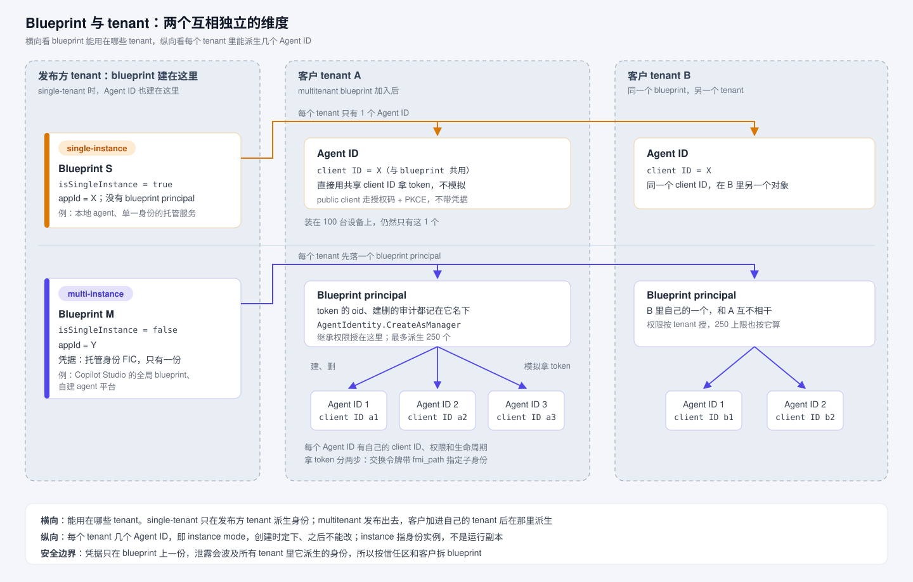

# Agent 基础设施系列 07：Blueprint 与 Agent Identity 的实例模式

写 [系列 06](../agent-fleet-management/Agent基础设施系列06：Fleet-Management与Agent-Platform的区别.md) 时碰到 Entra Agent ID 文档里的一句话："An agent identity blueprint has an instance mode that determines how many Agent IDs it can create in each tenant." 我以前在 [Entra Agent ID 的双层身份模型](../../../../Azure/Foundary-Agent/Entra-Agent-ID的双层身份模型.md) 里写过 blueprint 持凭据、agent identity 持权限这层分工，那时还没有实例模式这个概念。这篇把 blueprint 和 tenant 的关系、single-instance 与 multi-instance 的区别理清楚，再看 Copilot Studio、Foundry 的 prompt agent 和 hosted agent 实际是怎么用的。

## 一、四种对象

先把 Entra 里和 agent 相关的对象摆出来（[Agent identities, service principals, and applications](https://learn.microsoft.com/en-us/entra/agent-id/agent-service-principals)）：

- **Agent identity blueprint**：建在某一个 tenant 里的模板对象，定义描述、app role、verified publisher、token 里带哪些声明，凭据也配在它上面。它的位置相当于普通应用的 app registration。blueprint 本身**不能被授予 Azure RBAC 角色**。
- **Agent identity blueprint principal**：blueprint 在某个 tenant 里的落地对象，相当于 service principal。只有 multi-instance 的 blueprint 才有，每个工作的 tenant 一个。它负责在这个 tenant 里建、删 Agent ID，用 blueprint 拿的 token 里 `oid` 指向它，建删操作的审计日志也记在它名下。它自动带有 `AgentIdentity.CreateAsManager` 权限，这个权限撤不掉，要阻止它建身份只能禁用或删除这个 principal。
- **Agent identity（Agent ID）**：一种带 agent 子类型的单租户 service principal，代表一个 agent 去访问下游资源。权限直接授给它，Azure RBAC 和 Entra 角色都能给；登录日志里它是实际做事的那个身份；必须指定 sponsor。
- **Agent 的用户账号**：可选。agent 要用邮箱、加入 Teams 这类 Microsoft 365 能力时，给它配一个用户对象，每个 agent identity 最多一个。

还有一类容易混进来的：Copilot Studio 和 Foundry 的早期版本用普通的应用 service principal 来保护 agent，它们也出现在 Entra 管理中心的 agent 清单里，但没有 agent 特有的行为，可以按类型筛掉。

登录日志会区分 blueprint、agent identity 和 agent 的用户账号三种类型，所以一条日志能同时看出凭据从哪来、谁在做事、替谁做事。

## 二、blueprint 和 tenant 的两个维度

blueprint 和 tenant 之间有两个互相独立的维度，文档特别提醒它们不是一回事（[Agent identity blueprints](https://learn.microsoft.com/en-us/entra/agent-id/identity-platform/agent-blueprint)）。

**第一个维度：能用在哪些 tenant。** blueprint 总是建在某一个 tenant 里。single-tenant 的只在自己所在的 tenant 里派生身份；multitenant 的通过微软的目录发布，客户加进自己的 tenant 后，就能在客户 tenant 里派生身份。这和普通应用的单租户、多租户是同一个模型。

**第二个维度：每个 tenant 里能派生几个 Agent ID**，也就是实例模式（预览）。

| | single-instance | multi-instance |
|---|---|---|
| 每个 tenant 里的 Agent ID | 1 个 | 1 个或多个，各自独立 |
| OAuth client ID | 和 blueprint 共用 `appId` | 每个 Agent ID 有自己的 client ID |
| blueprint principal | 没有 | 每个 tenant 一个 |
| 拿 token | Agent ID 直接用共享 client ID 请求 | blueprint 先拿交换令牌，再模拟子 Agent ID |
| 继承权限 | 不支持 | 支持，授在 blueprint principal 上 |

两种模式下 blueprint 和 Agent ID 都是两个独立的目录对象；single-instance 共用的是 OAuth client ID，不是 object ID。模式在创建时用 Graph beta API 的 `isSingleInstance` 定下，**之后不能改**；不设或设为 `false` 就是 multi-instance。

两个维度可以任意组合：

| | single-instance | multi-instance |
|---|---|---|
| **single-tenant** | 企业自己开发的本地 assistant，或者一个用单一身份做后台任务、替登录用户办事的托管服务 | 企业自建的 agent 平台，托管各团队各自的 agent（Entra 文档里的 agent fleet） |
| **multitenant** | ISV 发布一个本地 agent，每个客户 tenant 里各有 1 个 Agent ID | ISV 或微软自己的 SaaS，在每个客户 tenant 里给每个 agent 派生身份，Copilot Studio 就是这一格 |

下面这张图把两个维度和三种对象画在一起：横向是 blueprint 从发布方 tenant 加入客户 tenant，纵向是两种实例模式在每个 tenant 里落下的对象。



### instance 不是运行副本

这一点最容易误解。文档原话是：实例模式不计算运行的进程、副本或用户会话。

- 一个本地 assistant 装在 100 台电脑上，仍然只有 1 个 Agent ID。跑在终端设备上的 public client **必须**用 single-instance，每次安装用同一个 client ID，不要给每台设备建一个 Agent ID；本地 agent 也可以改用 Client ID Metadata Document 的 URL 作为 client ID（[Choose an authentication protocol for an agent](https://learn.microsoft.com/en-us/entra/agent-id/identity-platform/agent-oauth-protocols)）。
- 一个托管服务开 20 个副本，也可以只用 1 个 Agent ID。
- 需要给每个 agent **独立的权限或生命周期**时，才用 multi-instance。一个 multi-instance 的 blueprint 现在只派生了 1 个身份，它也仍然是 multi-instance。

single-instance 也不只是给 public client 用的。它同样支持 confidential client，凭据配在 blueprint 上直接用；模式描述的是身份关系，不是 agent 能不能保管凭据。

## 三、两种模式怎么拿 token

**multi-instance 走两步。** blueprint 先用自己的凭据（托管身份的 FIC、证书或 secret）换一个交换令牌，请求里用 `fmi_path` 指明要模拟哪个子身份；再用这个交换令牌，以 Agent ID 的身份去换访问下游资源的 token（[Agent autonomous app OAuth flow](https://learn.microsoft.com/en-us/entra/agent-id/identity-platform/agent-autonomous-app-oauth-flow)）。第一步的请求长这样：

```http
POST /oauth2/v2.0/token
Content-Type: application/x-www-form-urlencoded

client_id=<blueprint-app-id>
&scope=api://AzureADTokenExchange/.default
&fmi_path=<agent-identity-client-id>
&client_assertion_type=urn:ietf:params:oauth:client-assertion-type:jwt-bearer
&client_assertion=<managed-identity-token>
&grant_type=client_credentials
```

最终 token 里的客户端是 Agent ID，审计日志里也是它，尽管第一步的凭据交换是 blueprint 做的。

**single-instance 一步到位。** Agent ID 直接用共享的 client ID 发授权码、刷新、client credentials 或 OBO 请求，不拿中间的交换令牌，也不用 `fmi_path`。confidential client 带 blueprint 上的凭据，public client 走授权码加 PKCE、不带凭据。要用 single-instance，tenant 里的 single-instance 开通和 single-instance 认证都要启用，这是两个独立的开关。

我那篇双层身份模型里写过"Agent Identity 没有自己的凭据，只能通过 Blueprint 签发的 FIC 认证"，这句话现在要补一个限定：它描述的是 multi-instance。single-instance 的 Agent ID 照样没有自己的凭据，但它直接用 blueprint 上的凭据和共享的 client ID 拿 token，中间没有模拟这一步。

### 模拟带来的安全边界

multi-instance 的模拟模型把凭据和权限分开了：凭据在 blueprint 上，权限和审计身份在每个 Agent ID 上。文档也直说了代价：**blueprint 的凭据一旦泄露，它下面所有 agent identity 都受影响，所以 blueprint 的数量本身就是一个安全边界决策**。

对 multitenant 的 blueprint，这一点更要紧：凭据只有一份，它能进所有加了这个 blueprint 的客户 tenant。这就是 fleet 文档建议"不同信任区、不同客户用不同 blueprint"的原因。

## 四、blueprint 管什么、怎么拆

### 数量按信任边界定

Entra 的 [架构规划文档](https://learn.microsoft.com/en-us/entra/agent-id/how-to-plan-agent-identity-architecture) 把默认做法写得很明确：**每个信任边界一个 blueprint，每个逻辑 agent 一个 agent identity**。前者是因为 blueprint 泄露会波及它下面所有身份，后者是为了审计、追踪和访问控制能精确到具体某个 agent。[设计模式文档](https://learn.microsoft.com/en-us/entra/agent-id/concept-agent-id-design-patterns) 给了几种典型结构：

- **同一信任边界里的多个角色**：一个 blueprint 派生多个 agent identity，每个角色一个，日志能区分是谁做的，下游权限也各不相同；
- **编排者加跨信任边界的工人**：编排者一个 blueprint，各组工人分属不同的运行时、密钥或团队时，各用各的 blueprint，一个域出事不波及其他域；
- **按用户、部门或环境建实例**：比如每个云环境一个 SOC 分析 agent、每个部门一个审计 agent，一个 blueprint 派生几十到一两百个身份，而不是给目录里每个用户都建一个。

所以 blueprint 本来就不是为了"让身份少一点"而存在的。减少凭据数量是它的效果之一，真正决定它怎么拆的是信任边界。

### 换版本、加工具都不换 blueprint

blueprint 管的是身份和凭据边界，不管 agent 的代码、Prompt、模型、框架和版本。所以：

- **agent 发新版本**，换模型、改 Prompt、加 MCP 工具、从 LangGraph 换到 Agent Framework，通常既不需要新 blueprint，也不需要新 agent identity；
- **给 Foundry prompt agent 加一个 SharePoint、Web Search 或 Foundry IQ 工具**，改的是 agent 定义和工具连接，blueprint 和身份都不会自动换掉；
- **加工具也不等于授权**。工具加进去了，这个身份能不能访问对应资源，还是要看你有没有给它授权，或者这个工具是不是走用户委托，第六节会说。

什么时候该考虑换 blueprint？看信任边界有没有变。一个 agent 从只读 SharePoint 变成能写、再变成能碰 HR 敏感数据、能代表用户做高权限操作时，它其实已经换了信任区，这时应该重新评估它是否还和原来那组 agent 共用一个 blueprint，至少要重新设计它的权限边界。

## 五、微软自己的产品怎么用

### Copilot Studio：一个全局 blueprint 派生所有 agent

Copilot Studio 是 multitenant 加 multi-instance 的典型（[Manage Entra Agent IDs](https://learn.microsoft.com/en-us/microsoft-copilot-studio/admin-use-entra-agent-identities)）：

- 一个 environment 里第一次创建 agent 身份时，Copilot Studio 在 tenant 里加上 **Microsoft Copilot Studio agent identity blueprint**（应用 ID `25664c89-cea5-4ab6-b924-a54fd8a19ae0`）和对应的 blueprint principal。这个 blueprint 是微软发布的，所有 Copilot Studio agent 的身份都是这个全局 blueprint 的子身份。文档没有写它的 `isSingleInstance`，但每个 agent 的身份都是作为这个 **blueprint principal** 的子身份建出来的，而只有 multi-instance 才有 blueprint principal，所以可以判断它是 multi-instance。
- **身份什么时候建，看 harness**：standard harness 在创建 agent 时就建；Microsoft Copilot harness 存草稿时不建，第一次发布时才建，哪怕没配任何渠道（[App registration, agent identities, and authentication](https://learn.microsoft.com/en-us/microsoft-copilot-studio/govern-agents-identities-overview)）。
- **发布时把 connector 权限挂到身份上**：agent 用到的每个 Power Platform connector 都会作为 API 权限挂在它的 Agent ID 上，Entra 和 Microsoft 365 管理员不用进 Power Platform 管理中心就能看到这个 agent 能调哪些 connector，还能用 Conditional Access 针对这些 connector 加网络位置、设备合规、风险条件。真正执行这些 scope 的只有 Power Platform 的 connector 运行时，运行时还会按 connector 策略和数据策略再校验一次。
- **删除 agent 时，身份一起删**。2026 年 5 月起不能再按 environment 关掉自动建身份。
- **老 agent 还是 app registration**。在此之前建的 agent 用的是普通的应用注册，微软说之后会迁移，也可以在 Power Platform 管理中心、PowerShell 或 API 手动迁。Entra 的迁移文档则写的是：没有原地转换，重新发布也不会生成 agent identity，要新建一个开了 Agent ID 集成的 agent，重新配渠道和连接，再下线旧的。两份文档对"手动迁移"的说法不一样，动手前要以实际体验为准。

要特别注意的一点：**这个全局 blueprint 的企业应用必须保持启用**。关掉它，environment 的复制、还原和新 agent 的身份开通都会失败，报 `AADSTS7000112: Application is disabled`。另外，blueprint 被禁用时它下面所有 agent identity 都无法认证，所以按 Entra 的机制推断，禁用这个全局 blueprint 等于一次停掉 tenant 里所有 Copilot Studio agent 的认证。它既是一个总开关，也是一个容易误操作的地方。

### Foundry prompt agent：每个 agent 一个 blueprint

Foundry 走的是另一条路（[Agent identity concepts in Microsoft Foundry](https://learn.microsoft.com/en-us/azure/foundry/agents/concepts/agent-identity)）：

- **当前的对象模型里，创建一个 agent 就开通一个独立的 blueprint，加上它"默认实例"的身份**。新建的身份没有任何资源权限，Foundry 也不会自动分配 RBAC 角色，要自己按下游服务的授权方式去授。
- **凭据不在你手里**。Foundry 在 blueprint 上配了一个联合凭据，信任的是微软的第一方应用"Azure Machine Learning"（应用 ID `0736f41a-0425-4b46-bdb5-1563eff02385`），而且只在你的 tenant 里生效。Agent Service 用它建身份、在运行时拿 token；Foundry 项目、agent 代码、项目的托管身份都不持有这份凭据。
- **调工具时走四步交换**：Agent Service 用 blueprint 的凭据认证，Entra 给这个 agent identity 发 token，Agent Service 再拿它换目标服务 audience 的 token，最后带着这个 token 调 MCP server 或 A2A 端点。这就是 multi-instance 的模拟路径，只是这个 blueprint 下面只有一个默认实例。
- **旧的共享身份还在**。项目级的共享 blueprint 和身份仍然会开通，给没有独立身份的旧 agent 用；从共享身份或旧的 Agent Application 迁到新模型，身份会变，原来的角色分配不会带过去。

Foundry 的 [Autopilot 概念文档](https://learn.microsoft.com/en-us/azure/foundry/agents/concepts/autopilot-overview) 把普通 agent 的形状说得更直接：**一个 agent、一个 blueprint、一个 agent identity，没有 agent 用户账号**；这个 blueprint 由 blueprint 应用和 blueprint service principal 两部分组成。Foundry 的文档同样没有写 `isSingleInstance` 的值，我按两点判断它是 multi-instance：它有 blueprint principal，只有 multi-instance 才有；同一个 blueprint 在 Autopilot 场景下能派生出多个实例身份，下面会讲。

所以 Foundry 是"multi-instance 的 blueprint，平时只用一个默认实例"。好处是每个 agent 一个独立的凭据边界，一个 blueprint 出事只影响一个 agent。我在双层身份模型那篇实测到的"每个 agent 成对出现一个 blueprint 和一个身份"，和这个模型是一致的。

### Foundry hosted agent：Autopilot 才用到多个实例

hosted agent 在身份模型上和 prompt agent 一样，区别在运行时怎么拿 token（[Hosted agent token service reference](https://learn.microsoft.com/en-us/azure/foundry/agents/concepts/hosted-agent-token-service)）：

- **沙箱里没有凭据**。每个会话跑在独立的 VM 级沙箱里，里面没有 blueprint 凭据。代码只能通过沙箱外的 token service 或工具服务器拿 token，这两个服务会识别是哪个会话在调用，只给对应的 agent 发 token。项目的托管身份对 hosted agent 代码不可用。
- **Azure Identity 的 `ManagedIdentityCredential` 访问的其实是这个 token service**，名字容易误导：它拿到的是 agent identity 的 token，不是项目托管身份的。`WorkloadIdentityCredential` 访问不到这个服务。
- **身份选择有硬规则**：不指定 client ID 时用当前实例的身份；只能选当前实例或默认实例的 client ID，指定其他任何 client ID 都会被拒绝。

这里第一次出现了"当前实例"和"默认实例"的区别。普通的 hosted agent 只有默认实例，两者是同一个身份。**Autopilot 不一样**，它是我在 Azure 上看到的、真正"一个 blueprint 派生多个身份实例"的用法（[What is an autopilot in Microsoft Foundry?](https://learn.microsoft.com/en-us/azure/foundry/agents/concepts/autopilot-overview)、[Quickstart: Build your first autopilot](https://learn.microsoft.com/en-us/azure/foundry/agents/how-to/agent-365)）：

- **不是直接做一个 Autopilot，而是做一个 blueprint**。从 hosted agent 发布时设 `publishAsAutopilot`，发布范围只能是整个 tenant；Microsoft 365 管理员在管理中心审批，并定下"雇用范围"，也就是谁可以从这个 blueprint 创建实例。
- **每"雇用"一个实例，就建一个新的 agent identity 和一个新的 agent 用户账号**，消耗一个许可，雇用的人成为它的经理，它会出现在组织架构里，在 Teams 里主动和你聊天。形状是一个 blueprint 对多个实例。
- **两个身份对象各管各的，不能互换**：agent identity 是它的基础设施身份；agent 用户账号代表它在 Microsoft 365 里以自己的名义做事，而不是代表某个用户。
- **运行时**，当前实例的身份由 Microsoft 365 提供，和默认实例不是同一个，hosted runtime 用会话把每个实例的身份上下文隔开。Autopilot 还会用一个 blueprint 交换令牌去模拟实例的 agent 用户账号，这个令牌绑定在当前实例的身份上，只能用于这一个身份。
- **只有 hosted agent 能发布成 Autopilot**。按 [Agent 365 集成文档](https://learn.microsoft.com/en-us/azure/foundry/agents/concepts/agent-365-integration)，prompt agent 和 hosted agent 都会同步进 Agent 365 的注册表，但 prompt agent 不支持 Autopilot 发布。

这和 Entra fleet 文档描述的模型对得上：一个 blueprint，按需开通、各自独立权限和生命周期的一组身份。

### 放在一起看

| 产品 | blueprint 怎么分 | 每个 blueprint 下的身份 | 身份何时建 | 凭据在哪 |
|---|---|---|---|---|
| Copilot Studio | tenant 里一个微软发布的全局 blueprint | 每个 agent 一个，全挂在同一个 blueprint 下 | standard harness 创建时；Microsoft Copilot harness 首次发布时 | 微软管理 |
| Foundry prompt agent | 每个 agent 一个 | 一个默认实例 | 创建 agent 时 | blueprint 上的联合凭据，信任微软第一方应用 |
| Foundry hosted agent（普通） | 每个 agent 一个 | 一个默认实例 | 创建 agent 时 | 同上，沙箱内无凭据，经 token service 取 |
| Foundry hosted agent（Autopilot） | 每个 Autopilot 一个 | 每雇用一个实例，新增一个 agent identity 和一个 agent 用户账号 | 默认身份在创建时建；实例身份在被雇用时建 | 同上 |
| 自己写的 agent（Agent 365 SDK 或自建平台） | 自己决定 | 自己决定 | 自己的开通服务或 Agent 365 | 自己配，推荐托管身份的 FIC |

两种分法的取舍很清楚：Copilot Studio 一个 blueprint 管全部，治理集中，一个开关就能停掉所有 agent，但凭据边界也只有一个；Foundry 每个 agent 一个 blueprint，凭据边界最细，代价是 tenant 里 blueprint 对象很多。

在我查到的微软产品里，没有看到明确使用 single-instance 的；按文档的描述，它目前主要留给自己开发的本地 agent，以及只需要一个身份的托管服务。

## 六、身份、委托、审批：三层别混

讨论 blueprint 时，很容易把三件不同的事搅在一起：agent 是谁、它借谁的权限做事、这一次具体操作谁批准。它们是三层：

1. **agent 身份：agent 是谁。** 由 Entra Agent ID 管：blueprint、agent identity、agent 用户账号。
2. **用户委托：agent 在谁的授权下做事。** 由 OBO、委托权限和 consent 管。
3. **业务审批：这一次操作批不批。** 由工作流、人工介入和业务规则管。

一个 agent 可以同时有自己的身份、在这次请求里代表 Alice、并在删除文件前等 Alice 点批准，三者并不矛盾。

### 前两层：application-only 和委托

Foundry 把工具调用分成两种访问模式（[User delegation for tools](https://learn.microsoft.com/en-us/azure/foundry/agents/concepts/user-delegation)）：

- **application-only**：agent 以自己的身份做事，没有登录用户参与，能访问什么取决于授给 agent identity 的角色和权限。适合后台自动化，比如读一个专用的存储账户。
- **委托**：agent 代表登录用户做事，agent identity 是这次调用的执行者，但用户本人也必须有权访问资源。适合个人数据和企业用户数据。

不同工具支持的模式不一样。**SharePoint 工具只支持委托**，文档写明 app-only 和 service principal 认证都不支持，用应用身份去调会报 `AppOnly OBO tokens not supported by target service`（[Use SharePoint with the Foundry Agent Service API](https://learn.microsoft.com/en-us/azure/foundry/agents/how-to/tools/sharepoint)）。所以同一个 agent 被 Alice 和 Bob 用时，Alice 能读到她有权限的 Finance 文档，Bob 读不到：agent 没有把 Alice 的权限存进自己的身份里，而是每次请求时代表当前用户去拿下游 token。

委托缺授权时怎么办，是协议层面的流程，不是写进 Prompt 里（[Configure user delegation for tools](https://learn.microsoft.com/en-us/azure/foundry/agents/how-to/configure-user-delegation)）：

1. 调用 agent 后，检查返回里有没有 `oauth_consent_request`；
2. 有的话，把其中的 `consent_link` 作为链接或按钮展示给用户，在浏览器里打开；
3. 用户登录并确认所需权限，然后客户端继续这次对话。

也可以请 tenant 管理员把这些委托权限**直接授给 agent 的 blueprint**，之后工具调用就不会再弹出 consent。这里又一次看到 blueprint 在运行时的作用：委托权限的同意是记在 blueprint 上的。

LangChain 的 LangSmith Fleet 把同样的区分做成了两种 agent（[Two different types of agent authorization](https://www.langchain.com/blog/two-different-types-of-agent-authorization)）：**Claws** 有一套固定的凭据，谁来用都一样，比如团队共用的 Linear Slack bot；**Assistants** 代表调用它的用户，每个人用自己的 OAuth 账号登录工具，比如个人邮件助手。前者对应 application-only，后者对应委托。

### 第三层：业务审批要自己做

OAuth consent 授的是"这个 agent 可以请求这类权限"，业务审批决定的是"这一次删除、付款、改生产配置能不能执行"，两者不是一回事。Entra Agent ID 不会为每次工具调用生成一个审批界面，业务审批要在应用或编排层实现：Logic Apps 或 Power Automate 的审批、Agent Framework 工作流里的人工介入、在 MCP 工具外面包一层审批，或者自建运行时的暂停、等待、恢复。Entra 能提供的是身份、审计、权限和 Conditional Access，审批流程本身不在它的职责里。

## 七、自建平台时：multi-instance 落地成 fleet

自己做一个托管多个 agent 的平台，比如 [系列 05](../agent-platform/Agent基础设施系列05：完整Agent方案的三条路线.md) 混合方案里 EKS 上的 kagent，就是在实现 Entra 意义上的 agent fleet（[Plan an agent fleet on a shared runtime](https://learn.microsoft.com/en-us/entra/agent-id/plan-agent-fleet)）。除了 blueprint，运行时这边要自己做三个组件：

- **agent 目录**：记录每个 agent 对应的 agent identity，以及 agent 的用户账号（如果有）；
- **开通服务**：agent 部署时建身份、退役时删身份；
- **token broker**：在运行时进程里用 Microsoft.Identity.Web，或者用 Auth SDK 的 sidecar。

生命周期是四步：部署、开通、运行、退役。开通有两种方式：运行时自己以 blueprint 身份调 Graph 建身份，适合部署由运行时控制的场景；或者交给 Agent 365，agent 从 Microsoft 365 的入口创建时由 Agent 365 建身份，运行时监听开通事件，把身份 ID 记进目录。两种方式产生的目录记录是一样的。

文档里的安全要求，我觉得是这部分最值得记住的：

- **选身份的代码就是安全边界**。blueprint 凭据能给 fleet 里任何一个 agent 拿 token，身份必须由运行时用自己控制的键去目录里查，不能接受请求、提示词或工具输出里传来的 agent ID；拿 token 之前还要确认调用方有权用这个 agent。
- **凭据远离 agent 代码，token broker 要隔离**。agent 跑的是不可信代码或客户代码时，不能让它直接调 broker，能调到 broker 的进程就能给 fleet 里任何一个 agent 拿 token。Foundry hosted agent 把 token service 放在沙箱外、按会话识别调用方，就是这条要求的实现。
- **开通和取 token 分开**。开通服务用的 blueprint token 能建、删身份，要走单独的访问路径，agent 代码拿不到。
- **按 agent 的授权要在运行时里做**。用户调 fleet 里的 agent，用的是 blueprint 的 `access_agent` scope，所有 agent 共用一个 audience，token 只证明用户是谁；blueprint 上的 app role 对整个 fleet 生效，"这个用户能不能用这个 agent"要运行时自己判断，做 OBO 时也要用目标 agent 的身份。
- **权限尽量按 agent 单独授**。继承权限在 blueprint principal 上授一次，所有子身份都带上，适合做公共基线；但继承来的权限不显示在 agent identity 上，审计更难。文档的建议是继承权限放共同基线，具体角色直接授给各自的 agent。

还有一个数量上限：**一个 blueprint principal 最多派生 250 个 agent identity**。fleet 更大时要建多个 blueprint，开通时给每个 agent 分配一个 blueprint 并记进目录；运行时也要按 agent 找到对应的 blueprint 配置和凭据，只换 agent ID 不会自动换 blueprint。

## 八、怎么选实例模式

我的判断规则很简单：

- **一个 tenant 里，这个 agent 只需要一个身份**（本地工具、只有一个角色的托管服务），用 single-instance。跑在用户设备上的 public client 没得选，只能用 single-instance。
- **每个 agent 要有独立的权限、owner、生命周期**（平台托管多个 agent、按客户隔离），用 multi-instance。
- **blueprint 怎么拆，按信任区决定**，不按 agent 数量决定。同一个信任区的 agent 可以共用一个 blueprint，到 250 个再拆；不同客户、不同安全等级的 agent，哪怕只有几个，也要分开。
- **模式定了就改不了**，而且实例模式还在预览。上线前把这一项想清楚，比之后重建身份、重新授权便宜得多。

## 相关阅读

- [Entra Agent ID 的双层身份模型](../../../../Azure/Foundary-Agent/Entra-Agent-ID的双层身份模型.md)——blueprint 持凭据、agent identity 持权限，以及 Foundry 的实测
- [Agent 基础设施系列 06：Fleet Management 与 Agent Platform 的区别](../agent-fleet-management/Agent基础设施系列06：Fleet-Management与Agent-Platform的区别.md)——fleet 这个词的几种用法
- [Agent 基础设施系列 05：完整 Agent 方案的三条路线](../agent-platform/Agent基础设施系列05：完整Agent方案的三条路线.md)——跨云时用联合凭据接回 Entra
- [AKS Agent Runtime 系列 09：Agent 以谁的身份行事](../../../../Azure/Azure-Kubernetes-Service/AKS-Agent-Runtime系列09：Agent以谁的身份行事.md)——自建运行时里的身份传递

## 参考资料

- [Agent identities, service principals, and applications](https://learn.microsoft.com/en-us/entra/agent-id/agent-service-principals)
- [Agent identity blueprints in Microsoft Entra Agent ID](https://learn.microsoft.com/en-us/entra/agent-id/identity-platform/agent-blueprint)
- [Choose an authentication protocol for an agent](https://learn.microsoft.com/en-us/entra/agent-id/identity-platform/agent-oauth-protocols)
- [Agent autonomous app OAuth flow](https://learn.microsoft.com/en-us/entra/agent-id/identity-platform/agent-autonomous-app-oauth-flow)
- [How are agent identities created?](https://learn.microsoft.com/en-us/entra/agent-id/agent-id-creation-channels)
- [Plan an agent fleet on a shared runtime](https://learn.microsoft.com/en-us/entra/agent-id/plan-agent-fleet)
- [Plan your agent identity architecture](https://learn.microsoft.com/en-us/entra/agent-id/how-to-plan-agent-identity-architecture)
- [Microsoft Entra Agent ID design patterns](https://learn.microsoft.com/en-us/entra/agent-id/concept-agent-id-design-patterns)
- [What's new in Microsoft Entra Agent ID](https://learn.microsoft.com/en-us/entra/agent-id/whats-new-agent-id)
- [Manage Entra Agent IDs in Copilot Studio](https://learn.microsoft.com/en-us/microsoft-copilot-studio/admin-use-entra-agent-identities)
- [App registration, agent identities, and authentication in Copilot Studio](https://learn.microsoft.com/en-us/microsoft-copilot-studio/govern-agents-identities-overview)
- [Recreate Copilot Studio agents with Microsoft Entra Agent ID](https://learn.microsoft.com/en-us/entra/agent-id/migrate-copilot-studio-agents-to-agent-id)
- [Agent identity concepts in Microsoft Foundry](https://learn.microsoft.com/en-us/azure/foundry/agents/concepts/agent-identity)
- [Hosted agent token service reference](https://learn.microsoft.com/en-us/azure/foundry/agents/concepts/hosted-agent-token-service)
- [What is an autopilot in Microsoft Foundry?](https://learn.microsoft.com/en-us/azure/foundry/agents/concepts/autopilot-overview)
- [Microsoft Agent 365 integration with Foundry](https://learn.microsoft.com/en-us/azure/foundry/agents/concepts/agent-365-integration)
- [User delegation for tools in Microsoft Foundry](https://learn.microsoft.com/en-us/azure/foundry/agents/concepts/user-delegation)
- [Configure user delegation for tools in Microsoft Foundry](https://learn.microsoft.com/en-us/azure/foundry/agents/how-to/configure-user-delegation)
- [Use SharePoint with the Foundry Agent Service API](https://learn.microsoft.com/en-us/azure/foundry/agents/how-to/tools/sharepoint)
- [Two different types of agent authorization](https://www.langchain.com/blog/two-different-types-of-agent-authorization)
