# Agent 基础设施系列 01：三层划分与自建路线

最近和客户聊 agent 落地，越来越多的问题不再是"用哪个模型"，而是"除了 Agent 365 和 Foundry 的 Hosted Agent，能不能自己掌控 agent 跑在哪里"。要回答这个问题，得先把 Agent Framework、Agent Runtime、Agent Platform 这三个词分清楚——它们经常被混着用，一个开源项目往往同时声称自己是其中两个甚至三个，客户听完反而更糊涂。

我自己的分法是三个问题：

1. **agent 怎么思考、调工具、管状态？** —— Framework
2. **agent 在哪跑、怎么隔离、怎么扩缩、崩了怎么续？** —— Runtime
3. **企业怎么发现、授权、治理、运营这些 agent？** —— Platform

下面这张图是按这三个问题画出的全景，Runtime 层又拆成了四个子层，后面会逐层讲。



## 一、Framework 和 Runtime 的边界不在"有没有 Session"

最容易划错的地方是 Session、Memory、State。直觉上这些听起来像"运行时的事"，但 LangGraph、Google ADK、Microsoft Agent Framework 都原生提供了它们：LangGraph 有 Thread、Graph State、Checkpointer 和 Store，ADK 有 SessionService 和 MemoryService，Microsoft Agent Framework 有 AgentSession 和 Context Provider。所以不能看到"Session 管理"就把一个组件归到 Runtime。

真正的分界是**逻辑和设施**：Framework 定义状态长什么样、什么时候存、怎么恢复；Runtime 提供让这些逻辑真正可靠的环境——存储在哪、进程被杀了谁来拉起、两个用户的会话怎么隔离。LangGraph 的 checkpoint 是个很直观的例子：

```python
from langgraph.checkpoint.postgres import PostgresSaver

# LangGraph 决定 checkpoint 的时机与格式，PostgreSQL 负责把它存住
with PostgresSaver.from_conn_string(DB_URI) as checkpointer:
    graph = builder.compile(checkpointer=checkpointer)
```

Framework 写好了"存"的逻辑，但"数据库高可用吗、进程挂了谁从这个 checkpoint 接着跑"，它并不负责。沙箱也一样：Framework 可以定义"执行一段代码"的工具接口，真正的隔离环境只能由 Runtime 提供。

| 能力 | Framework 负责 | Runtime 负责 |
|---|---|---|
| Session / State | 状态模型、读写时机 | 持久化存储、多副本下的会话路由 |
| Checkpoint | 存什么、从哪恢复 | 故障检测、自动重放、重试策略 |
| 工具调用 | 工具注册、调用与结果回填 | 工具进程跑在哪、能访问什么网络 |
| 代码执行 | 定义执行接口 | 提供沙箱、隔离内核、回收环境 |
| 多 Agent | 委派、handoff、编排语义 | 各 agent 的实例调度与资源配额 |
| 扩缩容与部署 | 一般不管 | 实例数、冷启动、挂起与恢复 |

> [!TIP]
> 判断一个能力归哪层，问它"换一个 Runtime 还在不在"。换到别的集群仍然成立的（状态结构、编排逻辑），属于 Framework；换了环境就要重新配置的（存储、隔离、网络），属于 Runtime。

### Harness 不用单列一层

`Agent = Model + Harness` 是我很认同的抽象（展开见 [Agent = Model + Harness](../../../tool/Agent=Model+Harness.md)）。Harness 是把模型变成能干活的 agent 的那套东西：agent loop、工具路由、上下文管理、权限、重试、验证。它和 Framework 的关系是**Framework 是材料，Harness 是用材料搭出来的成品**——用 LangGraph 写完 loop、规划、工具调用、审批，你就得到了一个 harness；Claude Code、Codex 则是别人已经搭好的 harness。

所以架构上不需要在 Framework 和 Runtime 之间再加一层"Harness 层"。最好的佐证来自 Runtime 一侧：kagent 的 Agent 资源里有一个 Harness 字段，可以选它自带的 Go / Python ADK，也可以选 Claude Code、Codex 或自定义镜像；Agent Substrate 也明说自己"适配任何 framework 或 harness"。在 Runtime 眼里，harness 就是一个**被托管、可替换的进程**。Harness Engineering 作为一门工程实践当然重要，但它是贯穿 Framework 和 Runtime 的方法，不是一个部署层次。

## 二、Runtime 内部其实有四个子层

客户说"我想自建 agent runtime"时，背后往往是四件不同的事。拆开看，才知道 Kata、agent-sandbox、OpenSandbox、kagent、Dapr 各自落在哪，以及它们为什么不互相替代。

### 隔离原语：墙有多厚

最底层是"模型生成的代码碰不碰得到节点内核"。普通容器共享宿主内核，对执行不可信代码来说太薄。可选的有三类：

- **Kata Containers**：每个 pod 跑在一个轻量 VM 里，有自己的 guest kernel。AKS 把它做成了内置的 **Pod Sandboxing**：建节点池时指定 `--workload-runtime KataVmIsolation`（较早的集群上叫 `KataMshvVmIsolation`），系统会自动装好 Kata、注册 `kata-vm-isolation` 这个 RuntimeClass，不需要自己装 DaemonSet。要求是 Azure Linux 节点、支持嵌套虚拟化的 Gen2 规格（如 Dsv5）。
- **gVisor**：用户态内核拦截系统调用，开销小、密度高，kagent 默认的 WorkerPool 用的就是它。
- **microVM**：Firecracker 或 Cloud Hypervisor，OpenSandbox 和 Agent Substrate 都支持。

这一层只决定"墙有多厚"，不管"房间怎么分配"。

```yaml
spec:
  runtimeClassName: kata-vm-isolation
  nodeSelector:
    kubernetes.azure.com/kata-vm-isolation: "true"
  tolerations:
    - key: kata
      operator: Equal
      value: enabled
      effect: NoSchedule
```

> [!WARNING]
> Kata 的隔离单位是 **pod**，不是容器：同一个 pod 里的多个容器共享一个 VM。它也不替代应用层的鉴权、出站限制和业务审批——VM 挡住的是内核逃逸，挡不住 agent 拿着合法 token 做不该做的操作。

### 沙箱编排：怎么分配和回收工作环境

有了隔离原语，还需要有人负责"按模板快速领一个环境、空闲时休眠、用完回收"。这正是 Deployment 和 StatefulSet 不擅长的：agent 的工作区是单例、有状态、大部分时间空闲。

- **agent-sandbox**（Kubernetes SIG Apps 的项目）：核心 CRD 是 `Sandbox`（单个有稳定身份和持久存储的 pod），扩展 CRD 有 `SandboxTemplate`、`SandboxClaim`、`SandboxWarmPool`。平台团队维护模板和预热池，使用方提一个 Claim 就能在毫秒级拿到环境。它本身不做隔离，把隔离交给 RuntimeClass——和 AKS 的 Kata 节点池正好拼在一起，社区已经有在 AKS 上做"每个用户一个 Kata VM、共享预热池"的完整示例。
- **OpenSandbox**：更像一个"工作区管理系统"，在 Kubernetes 上用 `BatchSandbox` 和资源池管理沙箱，同时提供命令执行、文件操作的 API（execd）、Python / Java / TypeScript / C# / Go 多语言 SDK、per-sandbox 的 egress 策略，以及 **Credential Vault**——沙箱里的进程只拿到占位符，真实凭据由 egress 代理在出站请求上注入。微软技术社区今年 10 月有一篇在 AKS 上用 OpenSandbox + Kata 跑点餐助手的实践（[When AI Starts Taking Action: Building Execution Boundaries with OpenSandbox and AKS](https://techcommunity.microsoft.com/blog/azuredevcommunityblog/when-ai-starts-taking-action-building-execution-boundaries-with-opensandbox-and-/4561601)），把"每个会话一个 Kata 沙箱"的边界讲得很清楚。

两者的选择很实际：只需要"一个隔离的 pod"并且想贴近 Kubernetes 原生 API，用 agent-sandbox；需要现成的命令 / 文件接口和凭据代理，用 OpenSandbox。

### 持久执行：长任务崩了能不能续上

这一维和隔离无关。一个跑 30 分钟、中间要等人审批的任务，pod 被驱逐时要能从断点继续，而不是从头再烧一遍 token。前面说过，framework 自带的 checkpoint 只解决了"能存能读"，故障检测、自动重放、多副本调度还得自己写。

**Dapr** 是这一层的典型。Dapr Workflow 建在 virtual actor 之上，每完成一步就把状态写进 state store（支持 30 多种存储后端），进程挂了从断点重放；sidecar 还顺带给了 pub/sub、重试熔断和基于 SPIFFE 的服务身份。**Dapr Agents** 今年 3 月发布 1.0 GA，是基于这套能力的 Python framework，主推 `DurableAgent`。Dapr 有意思的地方在于它**横跨两层**：Dapr Agents 是 Framework，sidecar 和 workflow 引擎是 Runtime。如果客户已经用 LangGraph 或 Microsoft Agent Framework 写好了 agent，不想换框架，Diagrid 也提供了给这些框架加 Dapr 持久执行的集成。

### 调度与生命周期：把 agent 当成什么来管

最上面一个子层回答"一个 agent 在集群里是什么对象"。

**kagent**（CNCF Sandbox 项目）的回答是 CRD：Agent、ModelConfig、MCP Server 都是 Kubernetes 资源，能进 Git、走 PR、用 GitOps 发布。Controller 监听这些资源、准备 agent 运行、管理会话，对外暴露 A2A、MCP 和 gRPC 接口；会话、任务、对话历史存在 PostgreSQL 里，和运行中的 agent 进程解耦。配套的 kmcp 负责把 MCP Server 部署到集群。

kagent 团队自己也在反思"一个 agent 一个 Pod"是不是对的。Pod 解决了隔离、身份、网络策略和观测归属，但 agent 和微服务不一样：它可能只在接到任务时醒来跑几十秒，然后长时间空闲；可能临时派生几个 sub-agent；可能停下来等人审批。为每个潜在的 agent 常驻一个 Pod 很浪费。这就是 **Agent Substrate** 要解决的问题：它在 Kubernetes 之上加了一层控制面，把大量 actor（逻辑上的 agent）映射到少量常驻的 worker pod 上，actor 空闲时把内存和文件系统快照到对象存储、释放 worker，来请求时再恢复到任意空闲 worker。Kubernetes 只看到 WorkerPool 和 ActorTemplate，看不到 actor 本身。项目由 Google 发起，宣称 10~30 倍超售，演示用 8 个 pod 承载约 250 个有状态 actor，10 月刚通过 CNCF Sandbox 投票。

> [!CAUTION]
> Agent Substrate 仍是 pre-1.0，仓库自己写着 API 几乎肯定会变。它代表的方向（Pod 是执行单元，但不再是 agent 的部署、身份和生命周期单元）很值得跟，但现阶段只适合 PoC，不建议直接放进客户的生产方案。

## 三、Hosted Agent 和 Agent 365 分别替你做了哪一层

客户问"为什么不直接用 Agent 365 和 Hosted Agent"，先要说清楚：**这两个东西不在同一层**。

**Foundry Hosted Agent** 是托管的 Runtime。你把用任意 framework 写的 agent 打成容器，平台负责镜像与版本、agent 身份、会话存储，并为每个会话启动一个 VM 级隔离的沙箱，沙箱在活跃、空闲、恢复之间切换；对外用 Responses、Invocations 或 Activity 协议提供端点。它的细节在 [Foundry Agent 三种形态对比与选型](../../../../Azure/Foundary-Agent/Foundry-Agent三种形态对比与选型.md) 里写过。

**Agent 365** 是 Platform 层的控制面，今年 5 月 GA：统一的 agent 注册表，可以纳管微软自家、第三方和自建平台上的 agent；身份由 Entra Agent ID 提供（owner、sponsor、条件访问都能套上去），安全和合规接 Defender 与 Purview。它不运行 agent。

这意味着**自建 runtime 和用 Agent 365 并不冲突**——跑在自己 AKS 上的 agent 照样可以申请 Entra Agent ID、登记进 Agent 365，让安全团队在同一张台账里看到它。客户真正要权衡的，是"Runtime 这一层要不要自己掌控"。下面是 Hosted Agent 提供的能力和开源自建的对应关系：

| Hosted Agent 替你做的 | 自建时用什么补 | 自建要多承担的 |
|---|---|---|
| 容器托管、版本、回滚 | kagent 的 Agent CRD + GitOps | 控制面升级、CRD 版本兼容 |
| per-session VM 隔离沙箱 | AKS Kata 节点池 + agent-sandbox / OpenSandbox | 节点容量、预热池大小、镜像来源审查 |
| 会话与对话历史存储 | kagent 的 PostgreSQL、Dapr state store | 数据库运维、备份与保留策略 |
| 空闲挂起、按需恢复 | SandboxWarmPool 休眠恢复，或 Agent Substrate | 冷启动调优（镜像拉取常常是大头） |
| agent 身份 | Workload Identity → Entra Agent ID | 身份映射、权限最小化 |
| Toolbox / MCP 接入 | kmcp 部署 MCP Server，agentgateway 统一代理 | 网关策略、MCP 鉴权 |
| 平台内置观测 | OpenTelemetry → App Insights | 按 agent 而不是按 pod 归集 trace |

换来的东西也很明确：数据和执行环境都在客户自己的集群和网络里；模型、framework、harness 都能自由选；隔离强度、出站策略、凭据注入方式可以按客户的安全要求定制；同一套集群还能和推理、RL 训练等工作负载共享。

## 四、在 AKS 上自建的参考组合

把上面四个子层落到 AKS 上，我给客户的参考组合是这样的：



几个设计上的要点：

1. **按信任程度分节点池。** 受信的 harness 进程（自己写的 ADK / MAF / LangGraph agent）放普通 agent 池；模型生成的代码只在 Kata 池里跑。Kata 池默认带 `kata=enabled:NoSchedule` 污点，普通工作负载不会误落进去。
2. **沙箱的出站只走代理。** 不在白名单的域名直接拒绝；需要调外部服务时，由 egress 代理从 Key Vault 取凭据注入，沙箱里只有占位符。这里要说准确：凭据并没有从系统里消失，代理和后端仍在可信边界内，而且"拿不到 token"不等于"不能滥用 token 授权的操作"，工具权限仍要收窄。
3. **模型流量和工具流量都经过网关。** agentgateway 同时代理 LLM、MCP 和 A2A，配额、token 计量、内容过滤和审计集中在一处；自托管模型时还能接 Gateway API Inference Extension 按 KV cache 占用选副本。
4. **持久执行按需上。** 只有长任务、跨审批的流程才需要 Dapr Workflow；几秒钟就结束的问答型 agent，framework 自带的 checkpoint 足够。
5. **观测跟着逻辑 agent 走。** 一个 agent 一生可能跑在多个 pod 甚至多个 worker 上，trace 和审计记录要以 agent 身份而不是 pod 名来归集。

> [!IMPORTANT]
> 冷启动要拆开量。社区那篇 OpenSandbox 实践里，一个约 2.8 GB 的沙箱镜像首次拉取花了将近 6 分钟——这和模型推理快慢毫无关系。端到端延迟 = 调度 + 镜像拉取 + guest 启动 + 代理与证书初始化 + harness 启动 + 模型与工具执行。"亚秒级分配"说的是从预热池里领一个现成的沙箱，不能拿来和一次冷拉镜像直接比较。

## 五、怎么帮客户选

不是每个 agent 都需要这一整套。我和客户过方案时，先问两个问题：



**第一个问题：会不会执行模型生成的代码，或者需要跨轮次保留文件和进程的工作区？** 如果 agent 只是调用受治理的业务 API，那它就是一个普通服务：部署到 ACA 或 AKS，鉴权、权限、审批都放在服务端，工具走网关，根本不需要沙箱平台。很多"agent 平台"需求其实落在这里。

**第二个问题：是否要求 Runtime 自主可控，并且团队能运维 AKS？** 答案是否，就走托管路线：Hosted Agent 承载 agent 本身，只需要跑一段代码用 ACA Dynamic Sessions，需要长期工作区用 ACA Sandboxes。答案是是，再按实际需求逐项叠加——执行不可信代码上 Kata + 沙箱编排，想用 CRD 管 agent 上 kagent，长任务上 Dapr，agent 数量大且大多空闲再评估 Substrate。用不到的不装，每多一个组件就多一份升级和排障的负担。

这几个项目的成熟度差别很大，写进方案前要说清楚：

| 项目 | 所在子层 | 当前状态 | 方案中的定位 |
|---|---|---|---|
| AKS Pod Sandboxing（Kata） | 隔离原语 | AKS 内置能力，按节点池开启 | 执行面的基础 |
| agent-sandbox | 沙箱编排 | K8s SIG 项目，API 为 v1beta1 | 贴近原生 K8s 的首选 |
| OpenSandbox | 沙箱编排 | 开源，带多语言 SDK 与 Credential Vault | 需要现成执行 API 时选 |
| Dapr Workflow / Dapr Agents | 持久执行 | Dapr 是 CNCF 毕业项目，Dapr Agents 1.0 GA | 长任务按需引入 |
| kagent | 调度与生命周期 | CNCF Sandbox | 用 CRD 和 GitOps 管 agent |
| Agent Substrate | 调度与生命周期 | pre-1.0，CNCF Sandbox | 跟进方向，只做 PoC |

最后一点：三条路可以在同一个企业里并存。轻量的 agent 放 Hosted Agent，需要执行面控制的放自建 runtime，API 型 agent 就是普通服务；身份和台账统一收在 Entra 与 Agent 365。客户要的"自主可控"，多数时候指的是 Runtime 这一层，而不是要自己从头再造一个 Platform。

## 后续篇目

这个系列接下来按层展开：

- Runtime：Kubernetes 上的 agent 沙箱——agent-sandbox、AKS Kata 与 OpenSandbox 实测
- Runtime：kagent 与 Agent Substrate——把 agent 当作 CRD 和 actor 来管
- Runtime：Dapr Agents——把持久执行做进运行时
- Framework：LangGraph、Microsoft Agent Framework、Google ADK 对比

相关阅读：[Agent Harness 五平台对比](../Agent-Harness五平台对比.md)、[Copilot Managed Runtime 系列 03：宿主沙箱与安全边界](../../../../Azure/Copilot-Managed-Runtime/Copilot-Managed-Runtime系列03：宿主沙箱与安全边界.md)。

## 参考资料

- [kagent](https://github.com/kagent-dev/kagent)、[Is a Pod the right deployment unit for an AI agent?](https://www.cncf.io/blog/2026/07/14/is-a-pod-the-right-deployment-unit-for-an-ai-agent)
- [Agent Substrate](https://github.com/agent-substrate/substrate)、[Agent Substrate brings high-density, scalable, trusted infrastructure to GKE](https://cloud.google.com/blog/products/containers-kubernetes/agent-substrate-available-on-gke)
- [Agent Sandbox](https://github.com/kubernetes-sigs/agent-sandbox)、[Kata-Isolated Per-Owner Agent Warm Pool on AKS](https://agent-sandbox.sigs.k8s.io/docs/use-cases/examples/kata-aks)
- [OpenSandbox](https://github.com/opensandbox-group/OpenSandbox)
- [Pod sandboxing with Azure Kubernetes Service (AKS)](https://learn.microsoft.com/en-us/azure/aks/use-pod-sandboxing)
- [Dapr Agents Core Concepts](https://docs.dapr.io/developing-ai/dapr-agents/dapr-agents-core-concepts)、[General Availability of Dapr Agents Delivers Production Reliability for Enterprise AI](https://www.prnewswire.com/news-releases/general-availability-of-dapr-agents-delivers-production-reliability-for-enterprise-ai-302719481.html)
- [Hosted agents in Foundry Agent Service](https://learn.microsoft.com/en-us/azure/foundry/agents/concepts/hosted-agents)
- [Agent Registry convergence with Microsoft Agent 365](https://learn.microsoft.com/en-us/entra/agent-id/agent-registry-convergence)
