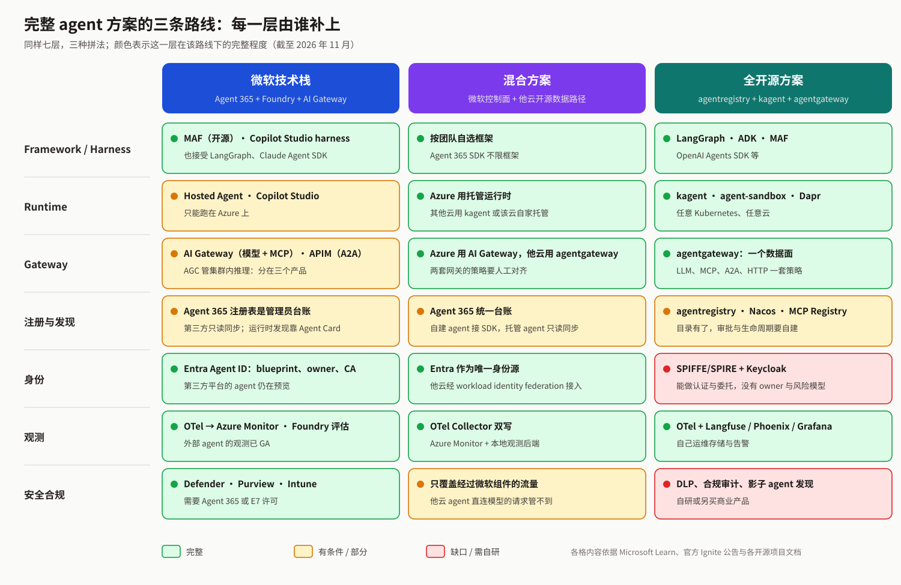

# Agent 基础设施系列 05：完整 Agent 方案的三条路线

[系列 01](Agent基础设施系列01：三层划分与自建路线.md) 把 Framework、Runtime、Platform 分开，[系列 04](../agent-framework/Agent基础设施系列04：Framework层与三层串联.md) 把三层串了起来。和客户聊到最后，问题总会落到三个具体选择上：只用微软的技术栈，能不能把注册发现、网关、运行时、框架、监控一起做全？客户的 agent 不全在 Azure 上，AWS、GCP 上的怎么办？要是完全不用微软，开源能不能凑出一整套？

这篇按七层把三条路线摊开对照。七层是：

1. **Framework / Harness**：agent 怎么思考、调工具；
2. **Runtime**：agent 在哪跑、怎么隔离和扩缩；
3. **Gateway**：agent 到模型、工具、其他 agent 的流量怎么管；
4. **注册与发现**：企业有哪些 agent，agent 之间怎么找到对方；
5. **身份**：agent 是谁、替谁做事、谁对它负责；
6. **观测**：trace、日志、评估、成本；
7. **安全合规**：DLP、审计、威胁防护。



## 一、微软技术栈：七层都有对应产品

| 层 | 微软的产品 | 现状（截至 2026-11 Ignite） |
|---|---|---|
| Framework / Harness | Microsoft Agent Framework（MAF，开源，.NET 与 Python）；Copilot Studio 自带的几种 harness；Foundry 也接受 LangGraph、Claude Agent SDK 等 | MAF 1.0 于 2026-04-02 GA |
| Runtime | Foundry Hosted Agent（每会话沙箱、缩到零）、Prompt Agent、Copilot Studio；也可以自己跑在 AKS 或 ACA 上 | Hosted Agent 已 GA |
| Gateway | Azure AI Gateway（模型与 MCP 工具）、APIM（A2A 与业务 API）、Application Gateway for Containers（AKS 内的推理路由）、Entra Global Secure Access（网络层） | AI Gateway 于 11-17 GA |
| 注册与发现 | Agent 365 注册表做企业台账；agent 之间的运行时发现靠 A2A Agent Card | 注册表已 GA |
| 身份 | Entra Agent ID：blueprint、agent identity、owner 与 sponsor、Conditional Access、OBO | 已 GA |
| 观测 | Microsoft OpenTelemetry Distro → Azure Monitor / Application Insights，Foundry 的 tracing 与评估，Agent 365 的活动视图 | 外部 agent 的观测与评估已 GA |
| 安全合规 | Defender（姿态、运行时防护）、Purview（DLP、审计、eDiscovery）、Intune（本地 agent） | GA 与预览并存 |

几处容易混的地方单独说。

### Agent 365 是控制面，不跑 agent

Agent 365 的注册表是 Microsoft 365 管理中心里的 agent 台账。Microsoft Learn 的说法是：Agent 365 负责发现和管理组织里所有的 agent，Entra 负责 agent 身份、身份治理和 Conditional Access，两边的注册表体验已经收敛到 Agent 365。Foundry、Copilot Studio 和 Copilot 里的 Agent Builder 建出来的 agent 会自动接入。

它不运行 agent，也不在请求的路径上。真正逐请求执行策略的是网关：Agent 365 能发现 Azure AI Gateway 上注册的 MCP server 并下发工具策略，执行由网关在每次工具调用时完成。

注册表管的是"企业有哪些 agent"。agent 运行时互相发现，靠的是 A2A 的 Agent Card：Hosted Agent 可以发布 Agent Card，APIM 可以把它导入成 A2A agent API。Agent 365 的注册表能不能作为 agent 运行时查询的发现服务，我没有查到官方说法；它的 Graph API 能读注册表和执行治理动作，但需要 E7 或 Agent 365 许可。

### 网关拆在三个产品里

- **Azure AI Gateway**：预览阶段是 APIM 的一个 SKU（`Microsoft.ApiManagement/service`，SKU 为 `AIGateway`）。2026-10-14 起换成独立的资源类型 `Microsoft.ApiManagement/aigateways`，两者只共用资源提供程序；旧 SKU 的资源 2027-01-15 之后会被删除，资源类型是资源 ID 的一部分，不能原地转换，只能新建再迁移。它管模型（统一别名、路由与失败切换、成本上限）和 MCP 工具（联合、把 OpenAPI 和 connector 转成 MCP），按请求数计费。
- **APIM**：继续负责完整的 API 生命周期，经典与 v2 tier 保留原有的 AI 网关能力。A2A agent API 在 APIM 里于 2026-06 GA，AI Gateway 的 GA 公告里没有提到 A2A。
- **Application Gateway for Containers（AGC）**：Application Gateway 家族的一员，是 Azure 上独立的资源，L7 数据面由 Azure 托管、跑在集群外；集群里跑 ALB Controller，把 Gateway、HTTPRoute、InferencePool 翻译成 AGC 的配置，AKS 提供托管的 add-on 来装它。它实现了 Gateway API Inference Extension，自带按请求体取模型名的 body-based router，InferencePool 和 EPP 由你自己部署在集群里。它只服务 AKS。

A2A 放在 APIM 而不是 AI Gateway，从职责上不好跟客户讲。我用的一个解释框架是**按方向分**：APIM 在发布侧，把自己的能力当成产品发布出去——业务 API、REST 转成的 MCP、通过 Agent Card 暴露的 agent 都算；AI Gateway 在消费侧，管应用和 agent 去调用哪些模型、哪些工具。这个框架只能降低解释成本，并不严密：agent A 调 agent B，对 A 来说是消费，却要走 APIM；MCP 两边都有。Microsoft 自己的说法只是"业务 API 留在 APIM，模型与工具流量用 AI Gateway，两者可以并存"，没有解释 A2A 为什么留在 APIM。

### Agent 365 SDK 不绑定 Copilot Studio

Agent 365 SDK 和 Microsoft 365 Agents SDK 是两个产品。后者是构建对话式 agent 的框架，负责把消息送到 Teams、Copilot 这些渠道；前者不构建 agent，只给已经存在的 agent 加上身份、受治理的 Work IQ 工具和通知。官方文档写得很明确：模型、框架或运行时、宿主三层都由你自己掌握，宿主可以是 "Azure, AWS, Google Cloud, or on-premises"。

所以跑在 AWS 上、用 LangGraph 写的 agent 也能接 Agent 365，前提条件要提前讲清楚：

- **身份**：租户要启用 Agent 365，在 Entra 里建 blueprint 和由它派生的 agent identity，不需要额外许可。凭据放在 blueprint 上，agent identity 通过 blueprint 的模拟令牌拿 token。
- **观测**：现在用 Microsoft OpenTelemetry Distro，旧的 Agent 365 Observability SDK 已经弃用。**租户里至少要有一个用户分配了 E7 或 Agent 365 许可，否则遥测会被静默丢弃，请求照样返回 200**；trace 的根上还必须有合法的 `invoke_agent` span，否则只能在 Defender 的高级搜索里查到，三个管理界面都看不到。
- **Work IQ 工具**：要 M365 Copilot 许可，而且只支持 OBO 委托模式，以自身身份运行的 S2S agent 用不了。
- **通知**（像同事一样在 Teams、邮件里收发消息）：要给 agent 分配用户账号，目前只在 Frontier 预览里。
- **语言**：Python、Node.js、.NET。

## 二、微软技术栈的边界

### 第三方平台的 agent：看得见，管不深

Agent 365 通过 connected platforms 把其他平台的 agent 同步进注册表。目前支持 7 个：Amazon Bedrock（Agents Classic 与 AgentCore）、Google Vertex AI、Salesforce Agentforce、Databricks Genie、Anthropic Claude Managed Agents、Oracle Generative AI Agents、Snowflake Cortex；后两个的观测还标着"Coming soon"。

按 Microsoft Learn 当前的说明，这条路有几处硬限制：

- **只读**：Agent 365 从不调用、执行或与源平台上的 agent 交互，也不修改源平台的资源；唯一的例外是管理员主动删除一个已同步的 agent，而且这个删除权限可以不授予。
- **只能手动同步**：没有定时同步，源平台上 agent 增删改之后要人工点"Sync agents"；源平台删掉的 agent 不保证会从注册表里消失。
- **凭据要存密钥**：目前每个平台都需要存 API key、secret 或私钥。Ignite 上宣布的基于 workload identity federation 的免密钥连接还在预览。
- **不加代码级能力**：同步只提供可见性和一部分治理动作。身份、DLP、完整的遥测，要在 agent 代码里接 Agent 365 SDK——也就是说，别人托管的 agent 你多半改不了代码，就只能停在"看得见"。

Ignite 上还宣布同步进来的 agent 会自动获得 Entra Agent ID，覆盖 Agentforce、AgentCore、Vertex AI、Databricks、Snowflake、Claude Managed Agents、OpenAI、Oracle、SAP、ServiceNow、UiPath，目前是预览，12 月完成推送。

### 策略只在流量经过微软组件时才生效

Agent 365 能管的，是经过 AI Gateway、APIM、Global Secure Access 或接了 SDK 的那部分。AWS 上的 agent 直接调 Bedrock 上的模型，这条流量不经过任何微软组件，Agent 365 只能从同步过来的元数据和活动数据里看到它，管不到具体的请求。

### 其他几处

- **托管运行时只在 Azure 上**：Hosted Agent 和 Copilot Studio 都没有 AWS、GCP 上的部署形态。
- **有条件的能力**：工具调用的威胁防护只对注册在 AI Gateway 上的 MCP server 生效，而且需要委托的用户 token，不支持 app-only 的 S2S 调用；在 APIM v2 上，Agent 365 只能列出 MCP server、整台封禁或解封，不能精确到单个工具。
- **许可按人算**：注册表和基础的治理动作随 Microsoft 365 附带；观测、租户级的工具策略、Purview 和 Defender 的 agent 能力、Graph API 都要 Agent 365 或 E7，许可按用户分配。
- **预览项多**：动态 agent 风险、本地 agent 的 Entra Agent ID、影子 agent 发现、多租户管理在 Ignite 时都是预览。

## 三、混合方案：微软做控制面，他云用开源数据路径

客户的 agent 分散在几朵云上、又已经用了 Microsoft 365 和 Entra 时，我建议的拆法是：**台账、身份、观测只留一个源，就是 Entra 加 Agent 365；Azure 之外的数据路径和运行时用开源组件补。**


各层怎么补：

- **他云的网关**：在 AWS、GCP 或任意 Kubernetes 上跑 [agentgateway](../agent-gateway/agentgateway的定位与扩展机制.md)，一个数据面同时管 LLM、MCP、A2A。它能校验 Entra 签发的 JWT，也能做 RFC 8693 令牌交换，策略照样在请求上执行。
- **他云的运行时**：自建的 agent 跑在 EKS、GKE 上的 kagent 里；已经用了 AgentCore、Vertex 托管 agent 的，保留它们，走 connected platforms 只读同步。
- **身份**：自建 agent 在 Entra 里建 blueprint，凭据用联合凭据而不是密钥——EKS、GKE 的 OIDC 签发方，或者 SPIFFE 签发的 JWT-SVID，作为 blueprint 上的 federated identity credential，agent 拿自己的 service account token 换 Entra token。Entra Agent ID 的文档推荐的是托管身份作为联合凭据，外部 OIDC 签发方按联合凭据的通用规则配置，上线前要实测。
- **观测**：OTel Collector 双写，一份送 Azure Monitor 进统一视图，一份留在本地的 Langfuse、Phoenix 或 Grafana。
- **回到台账**：自建 agent 接 Agent 365 SDK 的身份与观测部分；托管在别家平台的 agent 走 connected platforms。

blueprint 上的联合凭据大致长这样（字段含义与普通应用注册的联合凭据相同）：

```json
{
  "name": "eks-planner",
  "issuer": "https://oidc.eks.<region>.amazonaws.com/id/<cluster-id>",
  "subject": "system:serviceaccount:agents:planner",
  "audiences": ["api://AzureADTokenExchange"]
}
```

通过 Graph 的 `POST /applications/{blueprint-id}/microsoft.graph.agentIdentityBlueprint/federatedIdentityCredentials` 添加。文档特别提醒，走普通的 `/applications/{id}/federatedIdentityCredentials` 路径对 blueprint 也许能用，但不受支持。

混合方案的代价有两处：两套网关（Azure 上的 AI Gateway 和他云的 agentgateway）的策略要人工对齐；他云 agent 只要绕开网关直连模型，就又回到"只能看"的状态，所以出站网络要配合收口。

## 四、全开源方案：能搭起来，缺治理这一层

| 层 | 开源组件 |
|---|---|
| Framework / Harness | LangGraph、Google ADK、MAF（也是开源的）、OpenAI Agents SDK |
| Runtime | kagent、agent-sandbox 或 OpenSandbox、Dapr Workflow |
| Gateway | agentgateway，或 Envoy AI Gateway、Higress |
| 注册与发现 | agentregistry（MCP server、agent、skill、prompt 的目录与审批，agent 的 blueprint）、Nacos、MCP Registry |
| 身份 | SPIFFE/SPIRE（工作负载身份）+ Keycloak（每个 agent 一个 OAuth client、令牌交换） |
| 授权 | OpenFGA、OPA |
| 观测 | OpenTelemetry + Langfuse、Phoenix 或 Grafana 一套 |

这几层都能找到成熟或在快速成熟的项目，一套全开源的方案是搭得起来的，而且天然跨云。缺的是把这些串起来的治理层：

- **agent 的生命周期**：owner、sponsor、到期回收、清理没人管的 agent；
- **按风险调整的访问控制**：类似 Conditional Access 那样随 agent 的风险变化收紧权限；
- **DLP、内部风险、eDiscovery 这类合规能力**；
- **终端上影子 agent 的发现与封禁**；
- **统一的管理界面**。

这些要么自己写，要么另买商业产品。组件之间的胶水代码——注册表里的审批结果怎么变成网关上的策略、agent 下线时身份怎么吊销——也都要自己维护。

### 开源不是没有 agent 身份

"开源没有 agent identity"只说对了一半。开源有的是身份的积木：

- **SPIFFE/SPIRE**（CNCF 毕业项目）给工作负载签发短期、可证明的身份，已经是 agent 身份的共识底座；
- **Keycloak** 把 agent 当成 OAuth client，支持标准的令牌交换；26.6.0 起，用外部 OIDC 签发方和 Kubernetes service account 做免密钥的客户端认证（federated client authentication）转为正式支持，SPIFFE 方式因为对应的 OAuth 规范还是草案，仍是预览；
- **agentgateway** 自身支持 RFC 8693、RFC 7523 和 Cross App Access（ID-JAG），能在网关上把调用方的凭据换成访问后端用的令牌。

开源缺的是 Entra Agent ID 那样把 **agent 当成目录里的一等对象**：blueprint 派生出多个 agent identity 的父子关系，owner 与 sponsor 的问责链，按风险触发的 Conditional Access。标准层面也还没定型：agent 身份的工作主要在 IETF 的 WIMSE 工作组附近，相关草案据公开报道到 2026 年 9 月前后才开始被工作组采纳；[draft-klrc-aiagent-auth](https://datatracker.ietf.org/doc/html/draft-klrc-aiagent-auth-03) 这类把 SPIFFE、WIMSE、OAuth 组合成完整认证授权框架的文档，还是个人提交的草案。

一句话：开源能解决"这个 agent 是谁、替谁做事"，解决不了"谁对这个 agent 负责、它什么时候该退役、它现在风险多高"。这正是 Entra Agent ID 真正不同的地方。

## 五、三条路线怎么选

| 维度 | 微软技术栈 | 混合方案 | 全开源 |
|---|---|---|---|
| Azure 与 M365 里的 agent | 最强，开箱即用 | 同微软技术栈 | 要自己接 |
| AWS / GCP 上的 agent | 看得见，只读，管不深 | 网关和运行时用开源，台账和身份回到 Entra | 统一，但全部自建 |
| agent 身份治理 | Entra Agent ID，最完整 | Entra 加联合凭据 | 只有积木，没有生命周期治理 |
| DLP 与合规审计 | Purview、Defender | 只覆盖经过微软组件的流量 | 缺口 |
| 网关 | 三个产品、两套策略 | Azure 一套，他云一套 | 一个数据面 |
| 成本结构 | 按人许可加用量 | 中等 | 没有许可费，工程和运维成本最高 |
| 适合 | 以微软为标准的企业 | 微软为主、多云并存 | 有主权要求，或者不用微软 |

我的判断：

- **大多数企业客户应该走混合方案**。决定性的不是哪条路线功能更全，而是**身份和台账以谁为准**。这件事只能有一个答案；运行时和网关可以每朵云各不相同。
- **全开源方案的门槛不在技术组件，在治理层**。组件都找得到，生命周期、合规、风险这一层要有团队长期维护。没有这个团队，开源方案搭得起来，管不住。
- **跟客户讲微软栈时，边界要提前说**：connected platforms 是只读的；Agent 365 SDK 要改代码，观测还依赖许可；A2A 不在 AI Gateway 里。这几处不讲，客户上线以后才会发现。

## 相关阅读

- [Agent 基础设施系列 01：三层划分与自建路线](Agent基础设施系列01：三层划分与自建路线.md)——Framework、Runtime、Platform 的划分
- [Agent 基础设施系列 03：kagent 与 Agent Substrate](../agent-runtime/Agent基础设施系列03：kagent与Agent-Substrate.md)——开源运行时
- [Agent 基础设施系列 04：Framework 层与三层串联](../agent-framework/Agent基础设施系列04：Framework层与三层串联.md)——三层之间的接口
- [agentgateway 的定位与扩展机制](../agent-gateway/agentgateway的定位与扩展机制.md)——开源网关这一层
- [Entra Agent ID 的双层身份模型](../../../../Azure/Foundary-Agent/Entra-Agent-ID的双层身份模型.md)——blueprint 与 agent identity

## 参考资料

- [Agent Registry convergence with Microsoft Agent 365](https://learn.microsoft.com/en-us/entra/agent-id/agent-registry-convergence)
- [Connected platforms in Microsoft Agent 365](https://learn.microsoft.com/en-us/microsoft-agent-365/admin/connected-platforms)
- [Microsoft Agent 365 SDK overview](https://learn.microsoft.com/en-us/microsoft-agent-365/developer/agent-365-sdk)
- [Quickstart: Connect an Existing Agent to Agent 365](https://learn.microsoft.com/en-us/microsoft-agent-365/developer/get-started)
- [Microsoft Agent 365 Service Description](https://learn.microsoft.com/en-us/office365/servicedescriptions/microsoft-agent-365/microsoft-agent-365)
- [What's new in Microsoft Agent 365: Ignite 2026](https://techcommunity.microsoft.com/blog/agent-365-blog/whats-new-in-microsoft-agent-365-ignite-2026/4571753)
- [Azure AI Gateway is now generally available](https://techcommunity.microsoft.com/blog/integrationsonazureblog/azure-ai-gateway-is-now-generally-available-ship-faster-stay-in-control/4572644)
- [What is AI Gateway?](https://learn.microsoft.com/en-us/azure/ai-gateway/overview)
- [Migrate from the AI Gateway tier to AI Gateway resource type](https://learn.microsoft.com/en-us/azure/ai-gateway/ai-gateway-resource)
- [Govern tools with Microsoft Agent 365 and Azure API Management](https://learn.microsoft.com/en-us/azure/api-management/agent-365)
- [New AI gateway capabilities in Azure API Management](https://techcommunity.microsoft.com/blog/integrationsonazureblog/new-ai-gateway-capabilities-in-azure-api-management/4524604)
- [What is Application Gateway for Containers?](https://learn.microsoft.com/en-us/azure/application-gateway/for-containers/overview)
- [Application Gateway for Containers: Inference gateway](https://learn.microsoft.com/en-us/azure/application-gateway/for-containers/inference-gateway)
- [Overview of agent identities in Microsoft Entra](https://learn.microsoft.com/en-us/entra/agent-id/agent-identities)
- [Create an agent identity blueprint](https://learn.microsoft.com/en-us/entra/agent-id/create-blueprint)
- [Agent observability in Azure Monitor at Ignite 2026](https://techcommunity.microsoft.com/blog/azureobservabilityblog/agent-observability-in-azure-monitor-at-ignite-2026/4573966)
- [Microsoft Agent Framework at BUILD 2026](https://devblogs.microsoft.com/agent-framework/microsoft-agent-framework-at-build-2026-announce)
- [Keycloak 26.6.0 released](https://www.keycloak.org/2026/04/keycloak-2660-released)
- [draft-klrc-aiagent-auth](https://datatracker.ietf.org/doc/html/draft-klrc-aiagent-auth-03)
- [agentregistry](https://aregistry.ai/)
