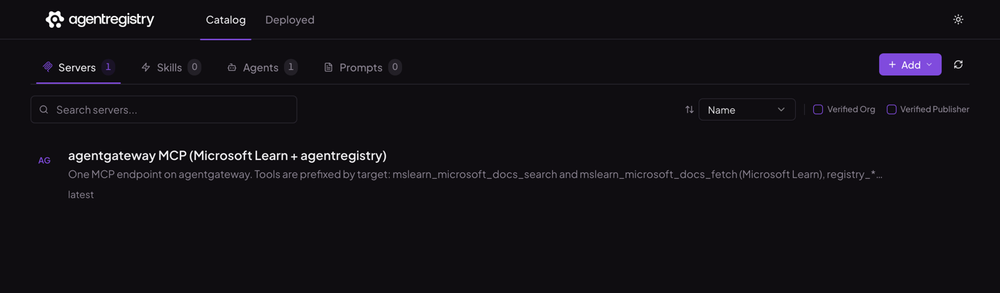
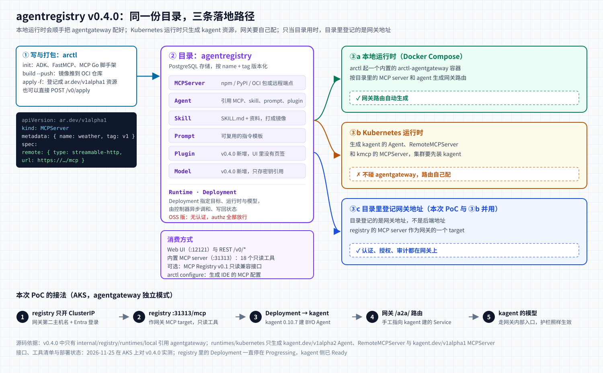

# agentregistry 的定位与部署实践

[agentgateway](../agent-gateway/agentgateway的定位与扩展机制.md) 解决"调得通、管得住"，但它明确不做注册与发现，维护者把这件事交给了 [agentregistry](https://github.com/agentregistry-dev/agentregistry)。我在一套已经跑着 agentgateway 的 AKS 集群上把 agentregistry 和 kagent 也装了进去，让三者接在一起，这篇记录它是什么、v0.4.0 实际能做到哪一步，以及接的过程中踩到的版本和配置问题。

## 一、它是什么

agentregistry 由 Solo.io 开发，Go 写的，Apache-2.0 许可。官方的一句话定位是 "One registry for MCP servers, agents, skills and prompts"。它要解决的问题很具体：团队要用的 MCP server 和 AI 工具散落在 npm、PyPI、Docker Hub、GitHub 和各种 URL 上，谁也说不清哪些可信、哪个版本能用、怎么跑起来。

它做三件事：

- **目录**：把 agent 用到的构件登记成带版本的资源，按 name 加 tag 管理，存在 PostgreSQL 里。
- **打包与发布**：`arctl` 命令行负责脚手架（ADK Python、FastMCP Python、MCP Go）、构建镜像、登记资源。
- **部署**：把目录里的 MCP server 和 agent 部署到本地 Docker 或 Kubernetes。

它不存制品本身：镜像还在 OCI 仓库，包还在 npm 和 PyPI，目录里存的是元数据和引用。项目最早从[官方 MCP Registry](https://github.com/modelcontextprotocol/registry) fork 出来，后来改成了 Kubernetes 风格的资源模型，因此不再直接兼容官方的 `server.json` 接口，另外提供了一个可选的兼容层（见第五节）。

治理上，agentregistry 2026 年 3 月申请进入 CNCF Sandbox，TOC 投票 2026-09-29 通过，但贡献协议还没签，正式入驻还没完成。它和 kagent（CNCF Sandbox）、agentgateway（Linux Foundation）同出 Solo.io，三者在设计上就是一套：registry 管"有什么"，kagent 管"跑起来"，agentgateway 管"怎么调"。

## 二、资源模型

v0.4.0 是一次不兼容的重写：v0.3.x 不能原地升级，要新装、新库、新的 manifest。所有东西都变成了 `ar.dev/v1alpha1` 资源：

| 类别 | 资源 | 说明 |
|---|---|---|
| 目录里的制品（带 tag） | MCPServer | 远程端点，或 npm、PyPI、OCI 包（`origin`、`launch`、`transport` 三段描述） |
| | Agent | 引用它需要的 MCP server、skill、prompt、plugin |
| | Skill | `SKILL.md` 加代码示例、文档等资料，打成镜像 |
| | Prompt | 可复用的指令模板 |
| | Plugin、Model | v0.4.0 新增；Model 只存密钥引用，不存密钥 |
| 运行 | Runtime | 部署目标，Local 或 Kubernetes |
| | Deployment | 选定目标制品、运行时和模型，由控制器异步调和 |

一个远程 MCP server 的登记长这样：

```yaml
apiVersion: ar.dev/v1alpha1
kind: MCPServer
metadata:
  name: weather
  tag: v1
spec:
  title: Weather tools
  remote:
    type: streamable-http
    url: https://gateway.example.com/mcp
```

`arctl apply -f` 和 `POST /v0/apply` 是同一件事，后者直接接受 YAML。



Web UI 在 12121 端口，v0.4.0 只有 Servers、Skills、Agents、Prompts 四个页签，Plugin 和 Model 只能走 API 和 CLI。另一个容易忽略的入口是内置的 MCP server（31313 端口）：我实测 `tools/list` 返回 18 个工具，全是 `list_*`、`get_*`、健康检查和版本信息这类只读操作，agent 可以拿它查目录，但改不了目录。

## 三、部署到哪里：三条路径不对称



README 里写着"运行 `arctl apply -f deployment.yaml` 时，agentregistry 会自动配置网关路由"。翻 v0.4.0 的源码，这句话只对本地运行时成立：

- **本地运行时**：`arctl` 用 Docker Compose 起一个内置的 `arctl-agentgateway` 容器，按目录里的 MCP server 和 agent 生成它的路由配置，客户端连这一个入口就行。
- **Kubernetes 运行时**：只生成 kagent 的资源——agent 是 `kagent.dev/v1alpha2` 的 `Agent`，远程 MCP 是 `RemoteMCPServer`，要部署的 MCP 包是 kmcp 的 `MCPServer`。代码里没有任何 agentgateway 相关的部分，集群里的网关路由要自己写。

所以在 Kubernetes 上，registry 和 agentgateway 的配合不是自动的。我最后用的是第三种接法：**目录里登记的都是网关地址，不是后端地址**。客户端从目录里查到的是网关的 `/mcp`、`/a2a/`，拿 Entra token 才能调用，认证、授权、审计都落在网关上。

## 四、在 AKS 上把三者接起来

起点是一套独立模式的 agentgateway：`/v1` 接 Azure OpenAI 并挂了内容护栏，`/mcp` 接 Microsoft Learn 的 MCP server，`/a2a/` 接一个示例 agent，所有路由要 Entra token。在这上面加 agentregistry 和 kagent，最后的连接关系是五条：

1. **registry 不对外**：Service 只开 ClusterIP。网关用第二个公网 IP 和主机名，按 SNI 选证书，前面挂 oauth2-proxy 做 Entra 登录，浏览器访问 UI 先跳到 Microsoft 登录页。
2. **网关 → 目录**：registry 的 `:31313/mcp` 作为网关 `/mcp` 下的一个 target，和 Microsoft Learn 的 MCP server 复用同一个入口，工具名带 `registry_` 前缀。因为这 18 个工具都只读，授权规则对这个 target 整体放行。
3. **目录 → 集群**：在 registry 里建一个 Kubernetes 类型的 Runtime，限定到 `agents` 命名空间，再建 Deployment。registry 写出一个 kagent 的 BYO `Agent`，kagent 再建出 Deployment 和 Service。
4. **集群 → 网关**：网关的 `/a2a/` 路由手工改成指向 kagent 建出来的 Service。
5. **kagent → 模型**：kagent 默认的 ModelConfig 走 OpenAI 协议，地址是网关的集群内入口，用网关签发的 API key（网关配置里只存它的 sha256）。kagent 里 agent 的模型调用因此和外部调用一样过护栏，网关再用 workload identity 访问 Azure OpenAI。

第 3 步用到的两份资源：

```yaml
apiVersion: ar.dev/v1alpha1
kind: Runtime
metadata:
  name: aks-poc
spec:
  type: Kubernetes
  config:
    namespace: agents        # registry 的 RBAC 只允许写这个命名空间
---
apiVersion: ar.dev/v1alpha1
kind: Deployment
metadata:
  name: a2a-helloworld
spec:
  targetRef:
    kind: Agent
    name: a2a-helloworld
  runtimeRef:
    kind: Runtime
    name: aks-poc
  desiredState: deployed
  env:
    PORT: "8080"             # kagent 的 BYO agent 监听 8080
```

### 版本和配置上的坑

- **kagent 只能用 0.10.7，不能用 1.x**：kagent 1.x 把 CRD 换到了 `api.kagent.dev/v1alpha3`，agentregistry v0.4.0 写的还是 `kagent.dev/v1alpha2`。
- **kagent controller 的 Service 要开在 80 端口**：agentregistry v0.4.0 注入的 `KAGENT_URL` 是 `http://kagent-controller.kagent.svc.cluster.local`，不带端口号。kagent 默认端口是 8083，要在 Helm values 里把 Service 端口改成 80、targetPort 指向 8083。
- **收窄 registry 的写权限**：chart 默认让 registry 对整个集群的 Secret 有写权限，用 `rbac.watchedNamespaces` 限定到 `agents` 一个命名空间。
- **BYO agent 的镜像要读 `PORT`**：kagent 的 BYO agent 约定监听 8080，Deployment 里用 `env` 传 `PORT=8080`，镜像要按这个变量起服务。
- **kagent controller 首次启动会失败几次**：它启动时先跑数据库迁移，PostgreSQL 还没就绪就报连接失败、被重启，等数据库起来之后自己恢复，不用处理。

### v0.4.0 的已知限制

- **Deployment 的状态一直停在 Progressing**：registry 里显示 `Progressing=True`、"waiting for rollout"，kagent 那边的 Agent 早已 Ready、Deployment 1/1。按代码里的设计，Kubernetes 适配器提交 kagent 资源后返回 `Progressing`，再由控制器的 watch 循环在 rollout 完成后改成 Ready；但 v0.4.0 的 Kubernetes 运行时没有回读 kagent 的状态，实测一直没有变，main 分支新加的 kagent 部署与发现适配器补的就是这一块。看真实状态要直接 `kubectl get agents.kagent.dev`。
- **Model 只接受 `bedrock`**：v0.4.0 的 Model 资源里 provider 是一个只有 `bedrock` 的枚举，Azure OpenAI 的模型登记不进来。
- **网络隔离要靠集群**：这套 AKS 用的是 Azure CNI overlay，建集群时没开网络策略引擎，NetworkPolicy 不生效，集群里的 pod 可以直接访问 registry 的 API——而这个 API 本身不做认证。要么开网络策略，要么接受"集群内即可信"。

## 五、安全边界：开源版什么都放行

这是部署 agentregistry 之前必须知道的一点。文档的授权矩阵写得很明确："The OSS public provider allows everything"。我在集群里不带任何凭据请求 `/v0/mcpservers`、`/v0/agents`、`/v0/deployments`，全部原样返回；写接口 `POST /v0/apply` 在开源版同样没有认证。

授权的钩子是留好的：每类资源有 `Read`、`Publish`、`Edit`、`Delete`、`Deploy` 几种权限，部署时还会以调用者身份检查它对 agent 引用的每个 plugin、skill、prompt 有没有 `Read`。但这些要接入一个非公开的 authz provider 才生效，开源版没有带。Solo 的企业版把审批流、RBAC、多云可见性放在了这一层。

两个兼容接口都默认关闭，原因也在这里：

- **MCP Registry v0.1 兼容接口**：按官方 `server.json` 的格式只读暴露 MCPServer，VS Code 的企业策略 `McpGalleryServiceUrl` 可以指向它。开源版里它跨所有命名空间、不鉴权，所以默认关，只在可以接受公开目录的地方打开。
- **Claude Code 插件市场接口**：把 Plugin 暴露成 `marketplace.json`，这个只在 main 分支上，v0.4.0 没有。

开源版的正确姿势就是第四节那样：registry 不直接暴露，所有访问都经过网关和登录；能写目录的人，要通过 port-forward 这类集群权限来控制。

## 六、和其他 agent 注册中心的区别

| | 登记的内容 | 运行时发现 | 管部署 | 审批与治理 | 形态 | 配套网关 |
|---|---|---|---|---|---|---|
| agentregistry v0.4.0 | agent、MCP、skill、prompt、plugin、model | REST、内置 MCP server、可选 MCP Registry 兼容接口 | 是，本地 Docker 或经 kagent 上 Kubernetes | 开源版全部放行，要自接授权实现 | 开源 | agentgateway |
| Nacos 3.3 | agent（A2A AgentCard 与通用 agent 模型）、MCP、skill、prompt、AgentSpec | 最强：运行时端点、SDK Watch/Push、RAD | 否 | 命名空间隔离、版本、草稿 → 审核 → 发布 | 开源 | Higress |
| Kong Konnect Catalog | API、AI Model、MCP server、agent（beta） | MCP Registry（tech preview）供 agent 发现工具 | 否 | 归属、审批过的工具、Konnect 鉴权 | 商业 SaaS | Kong AI Gateway |
| AWS Agent Registry | MCP server、A2A agent、skill、自定义资源 | 混合检索 + 原生 MCP 端点 | 否 | draft → approval，publisher 与 curator 分工 | 托管，属于 AgentCore | AgentCore Gateway |
| Agent 365 注册表 | 微软与接入平台的 agent，另有工具注册表 | 管理员台账，运行时发现没有查到官方说法 | 否 | 生命周期、Conditional Access、Defender 与 Purview | 托管 | Azure AI Gateway |

几点区别：

- **Nacos 的强项是运行时发现**。它本来就是服务注册中心，3.3 把 agent 做成了和服务一样的资源：登记运行时端点，客户端通过 SDK 订阅变化。agentregistry 更像一个"制品目录"，记的是 agent 由什么组成、版本是多少，而不是此刻在哪几个地址上提供服务。
- **Kong 的强项是和 API 目录合在一起**。MCP server 在 Konnect Catalog 里和它背后的 API、归属、策略挂在一起，agent 也在同一个 Catalog 里登记（目前是 beta）。适合已经用 Kong 管 API 的团队。
- **AWS 的审批流最完整**：发布者提交、策展人审核、草稿到批准的状态流转，都是现成的托管能力。
- **agentregistry 独有的是"目录加部署"**：同一份目录既能被查，也能 `arctl build`、`apply` 之后直接部署到运行时，开发和平台团队走同一条路。代价是开源版的治理层要自己补。
- **Agent 365 是另一个层面的东西**：它管的是企业 agent 的台账和合规，目录里的条目对应 Entra Agent ID。agentregistry 的 main 分支（未发布）已经加了对 Microsoft Foundry 和 Copilot Studio agent 的发现，以后两者也许能对接，目前还看不出来。

## 七、我的判断

- **v0.4.0 适合当"团队内部的 agent 构件目录"**：MCP server、skill、prompt 的版本化登记，加上 IDE 配置的生成，已经够用。拿它当企业级的注册中心，还缺认证、授权、审批这一整层。
- **在 Kubernetes 上，它和 agentgateway 的配合要自己设计**。我推荐的做法是目录里只登记网关地址：网关是唯一的调用入口，目录只负责"让人和 agent 找得到"。
- **用 registry 驱动部署，要能接受版本绑定**：registry、kagent、kagent 的 CRD 版本必须对得上，部署状态也要回到 kagent 那边去看。main 分支已经在补 kagent 的部署与发现适配器，下一个版本值得再试一次。

## 相关阅读

- [agentgateway 的定位与扩展机制](../agent-gateway/agentgateway的定位与扩展机制.md)——网关这一层，以及它为什么不做注册发现
- [Agent 基础设施系列 05：完整 Agent 方案的三条路线](../agent-platform/Agent基础设施系列05：完整Agent方案的三条路线.md)——注册与发现在完整方案里的位置
- [Agent 基础设施系列 03：kagent 与 Agent Substrate](../agent-runtime/Agent基础设施系列03：kagent与Agent-Substrate.md)——kagent 的资源模型
- [企业级 A2A 方案：从微服务治理到 Agent 互操作层](../protocol/企业级A2A方案：从微服务治理到Agent互操作层.md)——A2A 的发现与治理

## 参考资料

- [agentregistry-dev/agentregistry](https://github.com/agentregistry-dev/agentregistry)
- [AgentRegistry v0.4.0: Declarative Control Plane](https://github.com/agentregistry-dev/agentregistry/releases/tag/v0.4.0)
- [agentregistry 文档](https://aregistry.ai/docs/)
- [AuthZ Matrix](https://github.com/agentregistry-dev/agentregistry/blob/main/docs/auth/authz-matrix.md)
- [MCP Registry v0.1 Compatibility](https://github.com/agentregistry-dev/agentregistry/blob/main/docs/mcp-registry-compatibility.md)
- [Understanding the agentregistry Project and the Problems It Solves](https://www.solo.io/blog/understanding-the-agentregistry-project-and-the-problems-it-solves)
- [CNCF Sandbox application: agentregistry](https://github.com/cncf/sandbox/issues/477)
- [Nacos 3.3.0 release](https://github.com/alibaba/nacos/releases/tag/3.3.0)
- [Nacos: Agent Management](https://nacos.io/en/docs/next/manual/user/ai/agent-registry)
- [Kong Konnect Catalog](https://developer.konghq.com/catalog)
- [Agents in Catalog](https://developer.konghq.com/catalog/agents)
- [MCP registries in Catalog](https://developer.konghq.com/catalog/mcp-registry)
- [AWS Agent Registry](https://docs.aws.amazon.com/bedrock-agentcore/latest/devguide/registry.html)
- [Agent Registry convergence with Microsoft Agent 365](https://learn.microsoft.com/en-us/entra/agent-id/agent-registry-convergence)
- [kagent](https://kagent.dev)
