# Agent 基础设施系列 02：Kubernetes 上的 Agent 沙箱

客户的 agent 一旦要执行模型生成的代码——数据分析 agent 跑 pandas、coding agent 跑测试和 shell、浏览器 agent 开 Chromium——问题就从"模型答得好不好"变成"这段代码能碰到什么"。在 [系列 01](../agent-platform/Agent基础设施系列01：三层划分与自建路线.md) 里，我把 Runtime 拆成了四个子层，这一篇讲最下面两层：隔离原语和沙箱编排，外加一个总被低估的问题——沙箱往外走的流量和凭据。

我和客户讨论沙箱时，会把它拆成三件事来问：

1. **墙有多厚**：模型生成的代码能不能碰到节点内核？—— Kata、gVisor、microVM
2. **房间怎么分**：谁来按模板快速领一个环境、空闲时休眠、用完回收？—— agent-sandbox、OpenSandbox
3. **门怎么管**：沙箱能连哪些地址、用什么凭据？—— NetworkPolicy、egress 代理、Credential Vault

## 一、三者是什么关系

Kata 和 agent-sandbox、OpenSandbox 不在同一层，也不是三选一。

- **Kata 管"pod 里的容器怎么跑"。** 它是挂在 containerd 下面的容器运行时，凡是 pod spec 里写了 `runtimeClassName: kata-vm-isolation` 的 pod，都会被它放进一个轻量 VM 里运行。它不认识 agent，也不知道什么是会话、预热池、用户。
- **agent-sandbox 和 OpenSandbox 管"pod 什么时候建、给谁用、什么时候回收"。** 它们是 Kubernetes 控制器：维护模板和预热池、处理认领、转发流量、到期回收，OpenSandbox 还附带执行 API 和凭据代理。它们自己不做任何隔离，只是在生成的 pod 模板里写上 `runtimeClassName`，把"用哪个运行时"交给下一层。

所以两者是上下两层，中间只靠 `runtimeClassName` 这一个字段衔接：编排层二选一，运行时可以换成 Kata、gVisor 或普通的 runc，上面的流程完全不变。只用 Kata 也能跑——Deployment 里加一行 `runtimeClassName` 就有了 VM 边界——只是预热、认领、回收、路由都得自己写。



### Kata 到底是 VM 还是容器

两者都是，看从哪一侧看。**对 Kubernetes 来说它是容器运行时**：实现的是和 runc 一样的 OCI / CRI 接口，pod、镜像、`kubectl logs`、`kubectl exec` 用法都不变，现有镜像不用改。**从物理上看它是 VM**：每个 pod 由一个 VMM（虚拟机监控器）启动一个精简的虚拟机，带自己的 guest kernel；VM 里跑一个 kata-agent，再由它在 guest 内部按普通容器的方式（namespace、cgroup）把 pod 的各个容器启动起来。

也就是"容器的接口，VM 的边界"。一个 pod 对应一个 VM，pod 里的多个容器在这个 VM 里仍是普通容器，彼此之间只有容器级隔离——这就是后面反复提到"隔离单位是 pod"的原因。

### microVM 是另一个选项吗

不完全是。Kata 本身就是"轻量 VM"路线，它底下可以接不同的 VMM：QEMU、Cloud Hypervisor、Firecracker 都是 Kata 支持的后端，AKS 上的 Pod Sandboxing 跑在微软的 Hyper-V 之上。所以 Kata 和 Firecracker 不是并列的两种技术，前者是"把 VMM 包装成容器运行时"的那一层。

真正的区别在于 **VM 由谁来管**：

- **经 Kata 由 Kubernetes 管**：一个 pod 就是一个 VM，生命周期跟着 pod 走，调度、网络、存储都用 Kubernetes 原生的那一套。
- **沙箱系统直接管 VMM**：OpenSandbox 的 Firecracker 运行时、Agent Substrate 的 microVM worker、E2B 这类托管沙箱，是自己调用 Firecracker 或 Cloud Hypervisor 起 VM。好处是能做 Kubernetes 不擅长的事——毫秒级从预热快照恢复、把整个 VM 的内存连同文件系统一起快照再挪到别的机器上恢复；代价是要多维护一套 VM 管理组件，在 AKS 上还依赖节点规格支持嵌套虚拟化。

gVisor 是另一条路：不起 VM，而是用一个用户态内核拦截并实现系统调用，比 VM 更轻、启动更快，隔离强度介于普通容器和 VM 之间。

### 调度单位一定是 pod 吗

在 Kubernetes 里，pod 是最小的调度单位，所以默认答案是"一个沙箱一个 pod"——agent-sandbox 的一个 `Sandbox` 就是一个 pod，kagent 目前也是一个 agent 对应一个 Pod、Service 和 ServiceAccount。但 agent 的特点是大量、短时、大部分时间空闲，社区已经在往更细的粒度走，思路有几种：

| 粒度 | 怎么做 | 隔离边界 | 代表 |
|---|---|---|---|
| 一个 agent / 沙箱一个 pod | pod 常驻或从预热池领取 | 容器或 Kata VM | agent-sandbox、kagent 默认 |
| 一个 pod 托管很多会话 | 进程内按会话区分状态 | 只有逻辑隔离 | kagent 早期形态、Dapr virtual actor、会话池类服务 |
| actor 与 pod 解耦 | 自己的控制面把 actor 调度到 worker pod，空闲时快照换出 | gVisor 或 microVM | Agent Substrate |
| 进程内的代码沙箱 | 用 WebAssembly 之类的运行时跑代码片段 | 语言运行时级 | 适合短小的计算，系统调用和语言受限 |

Agent Substrate 是最值得关注的一种：Kubernetes 只看到 WorkerPool 和 ActorTemplate，一个个 actor（逻辑上的 agent）不是 Kubernetes 对象，由它自己的控制面在 worker pod 之间调度、快照、恢复，Kubernetes 的 API server 不在这条热路径上。pod 退回成"执行 worker"，不再是 agent 的部署、身份和生命周期单位。这部分在 [系列 03](Agent基础设施系列03：kagent与Agent-Substrate.md) 里和 kagent 一起展开。

## 二、AKS 上的 Kata：开起来容易，规格要想清楚

AKS 把 Kata Containers 做成了内置的 **Pod Sandboxing**，开启方式就是建一个特定的节点池：

```bash
az aks nodepool add \
  --resource-group <rg> \
  --cluster-name <aks-cluster> \
  --name sandboxpool \
  --os-sku AzureLinux \
  --workload-runtime KataVmIsolation \
  --node-vm-size Standard_D4s_v5 \
  --node-count 2

kubectl get runtimeclass kata-vm-isolation
kubectl get nodes -L kubernetes.azure.com/kata-vm-isolation
```

前提是 Azure Linux 节点、支持嵌套虚拟化的 Gen2 规格（Dsv3 / Dsv5 一类），集群 1.27 以上。较早的集群和一些社区示例里用的是 `KataMshvVmIsolation`，是同一个功能的旧名字，以集群里实际存在的 RuntimeClass 为准。和自己装 Kata 不同，AKS 会自动注册 `kata-vm-isolation` 这个 RuntimeClass，并给节点打上 `kubernetes.azure.com/kata-vm-isolation=true` 标签和 `kata=enabled:NoSchedule` 污点——普通工作负载不会误落到这个池子上，沙箱的 pod 则要显式加上对应的 toleration。

验证隔离有没有生效很简单：沙箱里 `uname -r` 和节点上的 kernelVersion 不一样，就说明跑在独立的 guest kernel 里。



开起来不难，真正影响方案的是下面几处和普通 runc 容器不一样的地方：

- **内存按 limit 固定分配。** 每个 Kata pod 是一个 VM，VM 的内存大小取自 pod 的 memory limit；不设 limit 就是默认的 512Mi。跑 Chromium 或 pandas 的沙箱用 512Mi 很容易 OOM，模板里必须显式写 limits。反过来，limit 写大了这块内存就一直被 VM 占着，不像 runc 那样按实际用量挤占。
- **CPU 向上取整。** CPU limit 决定 VM 的 vCPU 数，小数会向上取整到整核，`500m` 实际占 1 个 vCPU。估算每个节点能放多少沙箱，要按 VM 粒度算，不能按 requests 加总。
- **`kubectl port-forward` 不通。** kubelet 实现 port-forward 的方式是进入宿主的网络命名空间去拨 `127.0.0.1:端口`，而服务监听在 guest VM 里，连接会被拒绝。调试改用 `kubectl exec` 进 pod 里 curl，正式访问要走集群内的 router 或 Service。
- **其他限制。** 不支持 host network；Microsoft Defender for Containers 不评估 Kata pod；挂 Azure Files 或本地 SSD 时 IOPS 可能达不到 runc 容器的上限。

> [!WARNING]
> Kata 的隔离单位是 **pod**：同一个 pod 里的 agent 容器、执行器、sidecar 共享一个 VM。如果 agent 进程本身是可信的、只有它生成的代码不可信，要考虑把执行器放进单独的沙箱 pod，而不是和 agent 塞在同一个 pod 里。

## 三、agent-sandbox：平台团队备模板，使用方只提 Claim

有了墙，还得有人负责分配房间。agent 的工作区是单例、有状态、大部分时间空闲的，用 Deployment 和 StatefulSet 硬凑并不顺手。Kubernetes SIG Apps 的 agent-sandbox 专门做这件事，它本身不做隔离，只管理 pod，隔离交给 RuntimeClass。

它的资源分工很清晰：

- **Sandbox**（核心 CRD）：一个有稳定主机名、可选持久存储的单例 pod。
- **SandboxTemplate**：平台团队维护的 pod 蓝图，RuntimeClass、节点选择、资源 limits、网络策略都写在这里。
- **SandboxWarmPool**：引用模板，常备 N 个已经启动好的沙箱。
- **SandboxClaim**：使用方的入口，提一个 Claim 就从池里领走一个，不需要知道 RuntimeClass 和节点池这些细节。



模板里和 Kata、网络相关的关键部分大致是这样：

```yaml
apiVersion: extensions.agents.x-k8s.io/v1beta1
kind: SandboxTemplate
metadata:
  name: kata-agent-template
spec:
  service: true                      # 为每个沙箱建 headless Service，供 router 转发
  networkPolicyManagement: Managed
  networkPolicy:
    ingress:
      - from:
          - podSelector:
              matchLabels:
                app: sandbox-router  # 只有 router 能访问沙箱
        ports:
          - protocol: TCP
            port: 8080
    egress:
      - ports:                       # DNS
          - protocol: UDP
            port: 53
          - protocol: TCP
            port: 53
      - ports:                       # HTTPS
          - protocol: TCP
            port: 443
  podTemplate:
    spec:
      runtimeClassName: kata-vm-isolation
      nodeSelector:
        kubernetes.azure.com/kata-vm-isolation: "true"
      tolerations:
        - key: kata
          operator: Equal
          value: enabled
          effect: NoSchedule
      containers:
        - name: agent
          image: <acr>.azurecr.io/agent:v1
          resources:
            limits:
              cpu: "1"
              memory: 2Gi            # 这就是 Kata VM 的内存大小
```

使用方一侧通常不手写 YAML，而是用 Go 或 Python SDK（`k8s-agent-sandbox`）建 Claim、等沙箱 Ready、拿到沙箱名；要多轮复用同一个环境时，用 `GetSandbox` 绑回原来的 pod。请求通过 **sandbox-router** 进入：它读 `X-Sandbox-ID`、`X-Sandbox-Namespace`、`X-Sandbox-Port` 三个请求头，转发到对应沙箱的 headless Service，其他请求头原样透传。在 Kata 和 gVisor 环境里 port-forward 本来就不可用，router 不是可选项。

社区有一个在 AKS 上做"每个用户一个 Kata VM、共享预热池、单个公网 IP 按请求头路由"的完整示例，照着跑一遍很快能看清全貌。但它是演示配置，放到客户环境前有三处必须改：

1. **router 的鉴权。** 示例设置了 `ALLOW_UNAUTHENTICATED_ROUTER=true`，公网 LoadBalancer 接受所有请求，等于开了一个通往沙箱的开放代理。生产要配 `ROUTER_AUTH_TOKEN`，让调用方带 Bearer token；而 Go SDK 目前还不会自动带 `Authorization` 头，这一层要自己补。
2. **CNI 必须支持 NetworkPolicy。** 集群没有策略引擎时，模板渲染出来的 NetworkPolicy 会被静默忽略，不报错，隔离效果比你以为的弱。建集群时就要选 Azure CNI Powered by Cilium、Calico 或 Azure NPM。
3. **状态和身份不在沙箱里。** 示例 agent 把对话历史放在 pod 内存里，pod 重建就没了；用来区分用户的 `X-Owner` 请求头只是路由信息，谁带上这个头都能打到那个 pod，它不是安全边界。真正的边界是 Kata VM 加 NetworkPolicy，用户身份要在 router 前面的网关上校验。

> [!IMPORTANT]
> NetworkPolicy 只认 IP 和端口。上面模板里的 egress 规则放行的是"任意地址的 443"，模型生成的代码照样能把数据 POST 到任何 HTTPS 站点。要做到"只能访问模型端点和指定 API"，得靠支持 FQDN 策略的 CNI（如 Cilium 的 `toFQDNs`，在 AKS 上属于 Advanced Container Networking Services 的能力），或者像下面 OpenSandbox 那样用 egress 代理按域名放行。

## 四、OpenSandbox：执行 API 和凭据代理都是现成的

agent-sandbox 交给你的是"一个隔离好的 pod"，里面怎么执行命令、怎么读写文件，需要自己的 agent 镜像来提供。OpenSandbox 往上多做了一层，它更像一个工作区管理系统：应用后端通过 SDK（Python、Java/Kotlin、TypeScript、C#、Go）调用 lifecycle server，server 在 Kubernetes 上创建 `BatchSandbox`，controller 把它落成 pod；pod 里有 **execd** 提供命令执行、文件操作、代码运行的 API，SDK 经 ingress 网关访问它。同一套生命周期 API 在本地 Docker 和 Kubernetes 上都能用，开发阶段很方便。



### Pool 的几个设计细节

OpenSandbox 的 `Pool` 是两级容量模型：**buffer** 是已经 Running 且 Ready、等着被领取的 pod，数量保持在 `bufferMin` 和 `bufferMax` 之间；**总量** 包括已分配和启动中的 pod，受 `poolMin` 和 `poolMax` 约束。启动中的 pod 不算进可用 buffer，池子不会承诺它给不出的容量。每轮调谐最多创建或删除 `maxUnavailable` 个 pod（默认 25%），一波突发请求会变成一个平缓的扩容坡，而不是一下子起几十个 pod 把节点打满。

有三处值得在方案里写明：

- **归还策略决定会不会串号。** `recycleStrategy` 有三种：`Delete`（默认）把归还的 pod 删掉换新的，每次分配都从干净状态开始；`Restart` 原地重启容器，清掉进程状态但更省；`Noop` 原样放回，最快，但上一个用户的文件和进程会漏给下一个。多租户场景只能用 `Delete`。
- **池化 pod 不能按请求定制。** pod 在请求到来之前就已经建好了，所以 entrypoint 和 env 是分配之后以任务形式下发的，volumes 和 networkPolicy 也不能在请求里临时指定，只能写进 Pool 模板。不同租户要不同的出站策略，就要拆成不同的 Pool。
- **池子耗尽会返回 429。** 没有空位时，`BatchSandbox` 被标上 `PoolAllocationPending`，controller 每 5 秒重查；等待窗口内仍没有空位，服务端返回可重试的 429。调用方要按"可重试"来处理，而不是当成故障。

OpenSandbox 的文档里有一组自测数据：开启池化后交付 100 个沙箱，`BatchSandbox` 用了 0.92 秒，agent-sandbox 在并发 1 / 10 / 50 下分别是 76.4 / 23.2 / 33.9 秒。这是项目方自己的测试，测法和配置未必对等，但能说明一点：批量场景（agent 评估、RL rollout）下，"一次申请 N 个"的 API 设计比逐个 Claim 有优势。

### Credential Vault：沙箱里只有假密钥

这是 OpenSandbox 最实用的部分。沙箱里跑 Claude Code、git、curl 这类工具时，它们都需要凭据；把真密钥放进环境变量，模型生成的代码或者一次 prompt injection 就能把它读出来外传。Credential Vault 的做法是：

1. 创建沙箱时声明出站策略（`defaultAction="deny"`，显式放行需要的域名）并开启 Credential Proxy，lifecycle server 给 pod 挂上 egress sidecar。
2. 后端 SDK 把真实凭据和绑定规则写进 sidecar 的 vault；沙箱进程拿到的是假值或空值。
3. 沙箱发 HTTPS 请求时，sidecar 透明拦截，按 scheme、host、method、path 匹配绑定规则；**恰好命中一条**时注入真实的认证头再转发，命中多条视为歧义直接拒绝。
4. vault 的读接口只返回脱敏后的元数据，明文凭据是只写的。

下面是让沙箱里的 Claude Code 调 Anthropic API 的写法，沙箱只看到一个假的 `ANTHROPIC_API_KEY`：

```python
sandbox = SandboxSync.create(
    image=SandboxImageSpec("opensandbox/code-interpreter:latest"),
    env={"ANTHROPIC_API_KEY": "fake-key-inside-sandbox"},
    network_policy=NetworkPolicy(
        defaultAction="deny",
        egress=[
            NetworkRule(action="allow", target="api.anthropic.com"),
            NetworkRule(action="allow", target="registry.npmjs.org"),
        ],
    ),
    credential_proxy=CredentialProxyConfig(enabled=True),
)

sandbox.credential_vault.create(
    credentials=[Credential(name="anthropic-api-key", source={"value": REAL_API_KEY})],
    bindings=[
        CredentialBinding(
            name="anthropic-api",
            match={
                "schemes": ["https"],
                "hosts": ["api.anthropic.com"],
                "methods": ["GET", "POST"],
                "paths": ["/v1/*"],
            },
            auth={"type": "apiKey", "name": "x-api-key", "credential": "anthropic-api-key"},
        )
    ],
)
```

除了请求头注入，它还支持把凭据替换进 URL 路径、查询串或请求体里的占位符，应付那些要求把密钥放在 body 里的老接口。

用之前要清楚它的边界：

- **egress 必须是 `dns+nft` 模式。** 只靠 DNS 的模式下，直接用 IP 连接可以绕过域名策略，Credential Vault 会拒绝启用。
- **不能和同 pod 的透明代理共存。** 如果沙箱 pod 被注入了 Istio / Envoy sidecar，两层都会去拦截出站流量，目前不支持这种组合。客户集群开了 mesh 自动注入的，要给沙箱命名空间关掉注入。
- **vault 只在 sidecar 内存里。** 暂停时 pod 会被删掉，恢复时 sidecar 是新进程，vault 是空的，凭据注入会停止，直到可信的一方重新写入。所以凭据的来源（Key Vault 引用）要留在沙箱之外的控制面，恢复流程里要显式包含"重新注入凭据"这一步。
- **读不到 vault 就失败关闭。** sidecar 访问内部 vault 接口超时、出错时，被拦截的请求一律不放行：小请求返回本地 503，流式请求直接断开。这对安全是对的，但意味着 sidecar 成了出站数据面的可用性依赖，要纳入监控。

> [!CAUTION]
> 凭据并没有从系统里消失：后端和 egress sidecar 仍在可信计算基里。而且"读不到 token"不等于"不能滥用 token 授权的操作"——沙箱仍然能用注入的凭据调用它被允许的接口。绑定规则要按路径和方法收窄（比如只放行 `/v1/*` 的 GET），工具本身的权限也要按最小化来授。

### 暂停与恢复

单副本的 `BatchSandbox` 可以设 `pause: true` 暂停：controller 创建 `SandboxSnapshot`，在源节点上跑一个 Job 把 rootfs 提交成镜像推到仓库（默认格式 `rootfs-v1`，也有带 VM 内存状态的 `qemu-v1`），然后删除 pod、释放池位；设回 `false` 就以同一个沙箱 ID 从快照镜像重建。要注意删除快照记录并不会删掉推上去的镜像，仓库的保留和清理策略要自己定，否则快照镜像会一直累积。

## 五、两者怎么选

| 维度 | agent-sandbox | OpenSandbox |
|---|---|---|
| 定位 | Kubernetes 原生的沙箱编排，只管 pod 生命周期 | 带执行 API 的工作区管理系统 |
| 核心资源 | Sandbox、SandboxTemplate、SandboxClaim、SandboxWarmPool | BatchSandbox、Pool、SandboxSnapshot |
| 沙箱里的执行能力 | 自己的镜像提供 | execd 提供命令、文件、代码执行 API |
| 访问方式 | sandbox-router 按请求头转发 | SDK 经 ingress 网关访问 execd |
| 出站控制 | 模板渲染 NetworkPolicy，只到 IP 和端口 | per-sandbox egress 策略，可按域名放行 |
| 凭据 | 自己解决 | Credential Vault 在出站时注入 |
| 批量申请 | 逐个 Claim | 一个 BatchSandbox 申请 N 个，适合评估与 RL |
| 暂停恢复 | 休眠后按网络请求自动恢复 | 快照推到镜像仓库，同 ID 重建 |
| 本地开发 | 需要集群 | Docker 与 K8s 同一套 API |

我的建议比较简单：

- **agent 自己就是一个服务，只需要一个隔离好的 pod 来跑它**——比如每个用户一个常驻的 agent 进程——用 agent-sandbox，贴着 Kubernetes 原生 API，和 kagent 这类控制面也更容易组合。
- **agent 是调用方，沙箱是它借来执行代码的工具**——比如后端起一个沙箱，让里面的 Claude Code 跑一个任务，跑完拿结果——用 OpenSandbox，execd 和 Credential Vault 省掉了大量胶水代码。
- 两者都只是"房间管理"，墙都来自同一个 Kata 节点池；门禁则要额外设计，OpenSandbox 自带了一部分，agent-sandbox 要靠 FQDN 策略或独立的 egress 网关补齐。

## 六、冷启动要拆开量

客户最常问的是"沙箱多快能起来"，而这个数字通常被说得很混。一次冷启动包括：调度、拉镜像、启动 Kata VM、初始化代理和证书、启动 harness，然后才轮到模型和工具执行。其中**镜像拉取往往是大头**——带浏览器和语言运行时的沙箱镜像动辄几个 GB，首次拉取几分钟很常见，和模型快慢毫无关系。

几个对应的手段要分清：

- **预热池**（WarmPool / Pool buffer）解决的是"已经有一个起好的沙箱等着"，分配可以到毫秒级；
- **镜像预拉取**只是让节点上有镜像缓存，省掉拉取时间，但 VM 启动和初始化仍然要付；
- **休眠恢复 / 快照恢复**介于两者之间，省掉了从零初始化，但恢复本身也有开销。

所以评估时要固定镜像、缓存状态、并发数和测量起止点，看分位数和失败率，而不是拿一个"亚秒级"的宣传数字去对比一次冷拉镜像。预热池的大小则直接对应常驻成本：Kata 的内存按 limit 固定占用，池子里每多一个空闲沙箱，节点上就多占一份 limit 大小的内存。

## 相关阅读

- [Agent 基础设施系列 01：三层划分与自建路线](../agent-platform/Agent基础设施系列01：三层划分与自建路线.md)
- [Copilot Managed Runtime 系列 03：宿主沙箱与安全边界](../../../../Azure/Copilot-Managed-Runtime/Copilot-Managed-Runtime系列03：宿主沙箱与安全边界.md)

## 参考资料

- [Pod sandboxing with Azure Kubernetes Service (AKS)](https://learn.microsoft.com/en-us/azure/aks/use-pod-sandboxing)
- [Agent Sandbox](https://github.com/kubernetes-sigs/agent-sandbox)、[Agent Sandbox Documentation](https://agent-sandbox.sigs.k8s.io/docs)
- [Kata-Isolated Per-Owner Agent Warm Pool on AKS](https://agent-sandbox.sigs.k8s.io/docs/use-cases/examples/kata-aks)
- [Running Agents on Kubernetes with Agent Sandbox](https://kubernetes.io/blog/2026/03/20/running-agents-on-kubernetes-with-agent-sandbox)
- [OpenSandbox](https://github.com/opensandbox-group/OpenSandbox)、[Kubernetes Controller](https://github.com/opensandbox-group/OpenSandbox/blob/3738975fc7b1da6875694f912b0422fe5d622064/docs/architecture/control-plane/operator.md)、[Credential Vault](https://github.com/opensandbox-group/OpenSandbox/blob/3738975fc7b1da6875694f912b0422fe5d622064/docs/guides/credential-vault.md)
- [When AI Starts Taking Action: Building Execution Boundaries with OpenSandbox and AKS](https://techcommunity.microsoft.com/blog/azuredevcommunityblog/when-ai-starts-taking-action-building-execution-boundaries-with-opensandbox-and-/4561601)
