# Agent 基础设施系列 03：kagent 与 Agent Substrate

一个 agent 大部分时间都在等：等模型返回、等工具执行、等人审批。真正在"想"或"做"的时间，往往只占它生命周期的很小一部分。给每个 agent 常驻一个 pod，绝大部分时间是在为等待付钱；而要省钱就得按需起 pod，又要付出调度、拉镜像、启动的时间——当沙箱用可以接受，作为每条消息都要经过的 agent 本身就太慢了。

kagent 正好把这条路完整走了一遍，而 Agent Substrate 是它现在给出的答案。这一篇把两者放在一起讲，核心问题只有一个：**agent 的运行粒度能不能比 pod 更细。**

## 一、kagent 是怎么走到这一步的

kagent 最早并不给每个 agent 单独起 pod，而是所有 agent 都跑在 kagent 的 runtime 进程里——一个 runtime 托管很多 agent。做演示足够，但 agent 一多，问题就来了：agent 之间怎么隔离、每个 agent 怎么有自己的身份、访问策略和网络策略怎么按 agent 下发、日志和 trace 怎么归到具体的 agent、多租户下谁拥有哪个 agent。

第二步是**一个 agent 一个 Pod + Service + ServiceAccount**。这一下解决了上面所有问题：Pod 给了进程和容器隔离，ServiceAccount 给了每个 agent 一个 Kubernetes 身份，现有的 NetworkPolicy、准入策略、观测体系不用改就能按 agent 生效，还能加上 Kata 或 gVisor 做更强的隔离。

但 agent 和微服务的作息完全不同。微服务要求持续在线，agent 是接到任务才醒、跑几秒到几分钟、然后长时间空闲；它可能临时派生几个 sub-agent 并行干活，可能代表某个用户执行，可能停下来等人批准。kagent 团队的总结是三条：agent 很危险，沙箱是必需的；给 agent 自己的文件系统，它能连续干更长时间的活；agent 通常不需要 7×24 运行，为它们预留恒定算力很低效。

而 Kubernetes 本身也不是为这种负载设计的：

- **空闲的 pod 照样占资源。** CPU、内存、每个节点的 pod 数都是有限的，海量大部分时间空闲的 pod 是最差的利用率。
- **API server 不是为几百万个对象设计的。** 它擅长在多个控制器之间异步调谐，但不擅长存放海量离散对象、承受高频写入。
- **起一个 pod 要好几个异步流程收敛。** 调度、网络、拉镜像加起来，几秒钟对一个要跑几小时的服务很快，对一个只跑几百毫秒的 agent 调用就不可接受。
- **PersistentVolume 不是为高频挂卸设计的。** 几百万个大小不一的卷频繁挂载、卸载，不是它的使用场景。

所以 kagent 的结论是：**pod 仍然是很好的执行单元，但不应该再是 agent 的部署、身份和生命周期单元。** 2026 年 8 月 kagent 宣布主线放弃基于 Deployment 的运行时，全面改用 Agent Substrate；原来的运行时留在 `release/v0.10.x` 分支继续维护，新 API 会有破坏性变更。

## 二、Agent Substrate：actor 不是 pod，worker 才是

Agent Substrate 由 Google 发起，Apache-2.0 开源，2026 年 10 月进入 CNCF Sandbox。它的核心想法是把两样东西拆开：

- **actor**：一个有状态的 agent 实例，数量很多，大部分时间挂起；
- **worker**：一个预先启动好的沙箱 pod，数量少，等着被分配。

actor 空闲时，Substrate 把它的内存和文件系统一起快照进对象存储，释放 worker；请求来了，再把快照恢复到任意一个空闲 worker 上，进程从断点继续跑。官方演示里约 250 个有状态 actor 复用 8 个 worker pod，宣称 10~30 倍的超售。



### Kubernetes 看到什么，Substrate 看到什么

Substrate 有意把资源分成两组：

- **低频的基础设施配置留在 Kubernetes。** `WorkerPool` 是一个 CRD，描述一池预热的 worker（沙箱类别、副本数、节点选择、污点容忍），由 `atecontroller` 落成 worker 的 Deployment。平台团队可以照常用 RBAC、审计和策略来管它。
- **高频的实例状态放在自己的存储里。** `Actor` 和 `Worker` 记录存在 Substrate 控制面背后的 PostgreSQL 里：actor 的唯一标识、当前状态（RUNNING / SUSPENDED）、在哪个 worker 上、快照引用；worker 是 IDLE 还是 BUSY、正承载哪个 actor。`ActorTemplate`（用什么镜像、多少内存、哪些行为参数）在早期版本和 kagent 的文档里是 CRD，最新的架构文档已改为通过 Substrate 自己的 API（`kubectl ate`）管理，不再是 Kubernetes 对象——项目还在快速变化，以所用版本为准。

这样，几百万次挂起与恢复都不经过 Kubernetes 的 API server。Kubernetes 只负责它擅长的事：把 worker pod 起起来、调度到节点、做好资源隔离。

### 一次唤醒经过哪些步骤

actor 的状态机很简单：`SUSPENDED → RESUMING → RUNNING → SUSPENDING → SUSPENDED`。一次唤醒是这样的：

1. 调用方带着 `ate-target-actor: <atespace>/<actor 名>` 请求头，把请求发给 `atenet-router`（Envoy + ext_proc）。
2. router 拦下请求，问控制面 `ate-api-server` 这个 actor 在哪；它是挂起的，就触发 `ResumeActor`。
3. 控制面从 WorkerPool 里原子地认领一个空闲 worker，通知那个节点上的 `atelet`。
4. `atelet` 拿到 actor 最近的快照（刚挂起不久、快照还在本节点的就直接用本地的，否则从对象存储下载），由 worker 里的 `ateworker` 恢复进程。新建的 actor 没有自己的快照，就从 ActorTemplate 的 **golden snapshot** 恢复。
5. router 通过 mTLS 隧道把原请求送进 worker。全程不经过 Kubernetes 调度器，也不拉镜像。

挂起则要显式调用 `SuspendActor`：冻结进程、写快照、清空 worker 放回池子。默认是异步挂起——本地快照写完就返回，后台再上传对象存储。项目宣称恢复在 400ms 以内、每秒上千次激活，架构文档里的目标是 p95 100ms。

### 粒度到底细在哪

这里要说准确：**在执行层面，一个 worker 一次仍然只承载一个 actor**，正在跑的 actor 依然独占一个沙箱 pod。细下来的是生命周期和身份——actor 不再跟着 pod 生灭，空闲时不占任何 worker，只在对象存储里留一份快照。所以要准备的 worker 数取决于**同时在"想"或"做"的 actor 数**，而不是 agent 的总数。对于大部分时间在等待的 agent，这就是 10 倍以上的差别。

### 快照里有什么

快照分几种范围，选哪种决定了恢复后还剩什么：

- **MEMORY**：完整的进程内存加文件系统，恢复后进程从冻结那一刻继续，内存里的会话、打开的连接状态都在。
- **VOLUMES / ROOTFS**：只存文件（`DurableDir` 卷、容器可写层），恢复时进程重新冷启动。

所以要明确哪些状态必须跨挂起保留：用 MEMORY 范围，或者把它们写进 `DurableDir`。快照默认用 zstd 压缩，按 ActorTemplate 版本绑定，保证恢复时代码和状态一致。

### 两种沙箱类别

`WorkerPool` 选择一个沙箱类别，每个类别对应一个 `ateworker` 镜像：

- **gVisor**（默认）：在 worker 里用 `runsc` 运行 actor，挂起和恢复用 gVisor 原生的进程树 checkpoint / restore。
- **microVM**：在 worker 里用 Kata Containers + Cloud Hypervisor 跑 actor，挂起时只拍内存快照，恢复时用 `userfaultfd` 按需把内存页调回来，不必等整份内存加载完。

这正好呼应 [系列 02](Agent基础设施系列02：Kubernetes上的Agent沙箱.md) 里"VM 由谁来管"的问题：同样是 Kata，在 AKS Pod Sandboxing 里是 Kubernetes 经 RuntimeClass 管理"一个 pod 一个 VM"；在 Substrate 里是 worker pod 内部的 `ateworker` 直接管 VM，于是才能做到把整个 VM 的内存拍下来、换一台机器恢复。Substrate 明确不支持普通 Linux 容器，每个 actor 都必须在 gVisor 或 microVM 里。

### 安全模型

Substrate 把每个 actor 都当成不可信、而且彼此敌对：

- **每个 actor 一张短期 SPIFFE 证书**，egress 网关还可以按需签发带 actor 身份的 JWT，`ate-idp-server` 提供验签公钥，便于和外部身份系统联邦。
- **沙箱里没有任何凭据。** actor 进程既不持有自己的身份证书和 JWT，也没有 API key 和云 token；凭据由 `atenet-egress` 在沙箱外注入到被允许的出站请求上。
- **默认拒绝的网络。** actor 只有一个私有网络栈，除了经过 router 没有入站路径，不能横向访问其他 actor 和控制面，出站受 egress 网关约束。egress 网关本身是可替换的策略执行点，可以接自己的授权、DLP、prompt injection 扫描。

但也有明确的缺口：入站目前只校验调用方的 SPIFFE ID 是否在一个静态白名单里，**白名单里的任何调用方都能访问任何 actor**，还不支持按 actor 做入站授权；API 鉴权最细只到 atespace。

### 现阶段要知道的坑

- **Substrate 不会自己判断"空闲多久该挂起"。** 挂起是显式调用的，由上层系统（kagent，或者 Google 的 Agent Executor）决定。自己用 Substrate 就要自己写这个策略。
- **身份不能从环境变量读。** 环境变量在 golden snapshot 里是冻结的，从同一个模板恢复出来的所有 actor 会读到同一个值。actor 的身份要从 Substrate 按 actor 投射进来的元数据文件读。
- **给每个容器配 `wakeupProbe`。** 否则恢复后请求可能在工作负载还没准备好时就打进来。
- **worker 不够时，请求会先排队。** router 可以把请求暂存（request parking），等有 worker 空出来再转发，而不是直接回 503；超过等待预算才失败。池子按实测的峰值并发来定，再按已分配的 worker 数做自动扩缩。
- **对象存储只支持 GCS 和 S3。** 内置的存储插件只有这两种，Azure 上要用 S3 兼容的存储（kagent 的本地安装用的就是集群内的 rustfs），或者自己实现存储插件。
- **文档和工具链以 GKE 为先。** 一键安装脚本、IAM 配置都是围绕 GCP 写的；自带集群还要求 PodCertificateRequest 和 ClusterTrustBundle 这类较新的 Kubernetes API。AKS 上的路径要自己验证，microVM 类别还依赖节点支持嵌套虚拟化。
- **很多设计还在路上。** 项目是 pre-1.0，明说不保证向后兼容；架构文档开头就写着"大部分是目标设计，尚未实现"，自动扩缩、跨节点的状态共享、actor 在多个 worker 之间迁移后的观测串联，都还是待解决的问题。

## 三、kagent：把 agent 写成 Kubernetes 资源

kagent（CNCF Sandbox，由 Solo.io 发起）解决的是另一件事：**让平台团队用管理其他工作负载的方式管理 agent**——写成 YAML、进 Git、走 PR、用 GitOps 发布。

主要的资源有这几类：

| CRD | 作用 |
|---|---|
| `Agent` | 一个 agent：系统提示词、模型配置、工具、sub-agent；可以是声明式的，也可以是自带镜像（BYO） |
| `AgentTemplate` | 把提示词、工具、模型这套"行为"抽出来，多个 agent 共用 |
| `ModelConfig` | 模型提供方、模型名、密钥引用 |
| `RemoteMCPServer` / `MCPServer` | 工具来源；`MCPServer` 由配套的 kmcp 部署到集群里 |
| `SandboxAgent` | 声明式 agent 的沙箱版本，跑在 Substrate 上 |
| `AgentHarness` | 长时运行的 coding agent（OpenClaw、Hermes），只能跑在 Substrate 上 |

kagent controller 监听这些资源，准备 agent 运行、管理会话，对外暴露 A2A、MCP 和 gRPC 接口；agent 之间通过 A2A 互相调用，所以一个"团队"就是一张互相引用的 agent 图。引用 MCP server 时建议用 `toolNames` 显式列出要用的工具，而不是把一个 server 的所有工具都挂给 agent。

### 三种运行方式



**Agent（Deployment 运行时）** 就是前面说的"一个 agent 一组 Pod、Service、ServiceAccount"。它成熟、好理解，今天的生产方案仍以它为主，但已经是维护分支上的东西。

**SandboxAgent** 把同样的声明式 agent 放到 Substrate 上跑，粒度是**一个会话一个 actor**：

```yaml
apiVersion: kagent.dev/v1alpha2
kind: SandboxAgent
metadata:
  name: hello-substrate
  namespace: kagent
spec:
  type: Declarative
  description: Tiny declarative agent running inside a substrate actor
  declarative:
    runtime: go
    modelConfig: default-model-config
    systemMessage: |
      You are a friendly assistant living inside an Agent Substrate sandbox.
  substrate:
    workerPoolRef:
      name: kagent-default
```

第一次创建时要生成 golden snapshot，大约 60~90 秒。之后每来一个会话，就从 golden snapshot 恢复出一个 gVisor actor，跑完 LLM 调用和工具调用，回复发出后再快照回对象存储，请求之间它一直是 `Suspended`。会话历史写在 actor 的 `durableDir` 卷里的 SQLite 中，元数据同步到 PostgreSQL 供列表查询。因为每个会话用完就释放 worker，一个 worker 可以依次服务许多会话，只做声明式 agent 时 WorkerPool 设 1 个副本就能跑起来。

**AgentHarness** 面向 OpenClaw、Hermes 这类长时运行的 coding agent：kagent 为每个 harness 生成一个 ActorTemplate，按需创建 Actor，kagent UI 通过 Agent Client Protocol（ACP）和它对话。它需要的 worker 数至少是 1 加上同时活跃的 harness 数。

装的时候有一个容易踩的点：kagent 的 Helm chart 要 0.9.7 以上，更早的版本不认识 `controller.substrate.*` 和 `substrateWorkerPool.*` 这些参数，会**静默忽略**，controller 照常启动但没有接上 Substrate。

## 四、比 pod 更细的几种粒度，以及怎么拆

把系列 02 和这一篇放在一起，agent 的运行粒度大致是一条光谱：



- **一个 agent 一个 pod**：隔离和身份最直观，空闲也一直花钱，新建要走完整调度。
- **预热池领沙箱**（agent-sandbox、OpenSandbox）：快在"已经起好"，领取是毫秒级；但领走之后到归还之前一直占着一个 pod，它解决的是"派得慢"，不是"空闲贵"。
- **actor 快照 + worker 复用**（Agent Substrate）：空闲时只剩对象存储里的一份快照，唤醒是亚秒级，隔离仍是 gVisor 或 microVM。这是目前唯一同时解决"空闲贵"和"派得慢"、又不放弃强隔离的方案，代价是成熟度。
- **进程内的 actor**（Dapr Actors / Workflow）：一个 pod 里承载成千上万个 virtual actor，状态在 state store 里，Dapr 称激活在 50ms 以内。密度最高，但它们同在一个进程，只有逻辑隔离。
- **进程内的代码沙箱**（WebAssembly 一类）：启动几乎没有开销，但语言、系统调用和依赖都受限，只适合跑小段计算。

我更推荐的做法是**把 agent 本身和它执行的代码分开**，各自选粒度：

1. **agent loop 是受信的**——规划、调模型、调受治理的业务 API，代码是你自己写的或者是成熟的 harness。它可以放在轻粒度上：Dapr actor、进程内的会话，或者 Substrate actor。空闲时不占算力，来消息就唤醒。
2. **模型生成的代码是不可信的**——只有这一步需要 VM 级的墙。agent 在需要时从预热池领一个 Kata 沙箱，把代码和数据送进去，拿到结果就归还。不需要执行代码的轮次根本不碰沙箱。

这样，最贵的 VM 只按"执行次数"付费，而不是按"agent 个数"；agent 层按会话数和活跃度扩缩，沙箱层按代码执行的并发扩缩。Substrate 的特别之处在于它把这两层合到了一起——agent 本身就在沙箱里，又不用为空闲付钱——适合 Claude Code、OpenClaw 这类"整个 agent 就是不可信执行环境"的 coding agent。

## 五、放到客户方案里

- **今天上生产**：kagent 的 Agent（Deployment 运行时）加上 Kata 节点池，或者把 agent 做成普通服务、执行代码时去 agent-sandbox / OpenSandbox 的预热池借沙箱。两条路都是成熟组件。
- **Substrate 先做 PoC**：动手之前，先从 trace 里量一下 agent 实际"忙"的时间占比——整套方案的收益都建立在这个数字上，如果 agent 大部分时间都在忙，超售就没有意义。然后再决定哪些状态必须跨挂起保留、用 MEMORY 还是 VOLUMES 范围、谁来调用挂起。
- **Azure 上要补的**：S3 兼容的快照存储、在 AKS 上的安装路径、microVM 类别需要的嵌套虚拟化节点规格，都要自己验证。
- **跟进 kagent 的新 API**：主线迁移到 Substrate 会带来破坏性变更，API 提案还在讨论中，现在基于 v0.10.x 写的 CRD 将来要迁移。

持久执行这一维——agent 在 Dapr Workflow 上怎么做到崩溃后从断点续跑——留给后续的 PoC；Framework 层的对比和三层怎么串起来，见 [系列 04](../agent-framework/Agent基础设施系列04：Framework层与三层串联.md)。

## 相关阅读

- [Agent 基础设施系列 01：三层划分与自建路线](../agent-platform/Agent基础设施系列01：三层划分与自建路线.md)
- [Agent 基础设施系列 02：Kubernetes 上的 Agent 沙箱](Agent基础设施系列02：Kubernetes上的Agent沙箱.md)

## 参考资料

- [Agent Substrate](https://github.com/agent-substrate/substrate)、[Agent Substrate Architecture](https://github.com/agent-substrate/substrate/blob/main/docs/architecture.md)
- [Agent Substrate brings high-density, scalable, trusted infrastructure to GKE](https://cloud.google.com/blog/products/containers-kubernetes/agent-substrate-available-on-gke)
- [Is a Pod the right deployment unit for an AI agent?](https://www.cncf.io/blog/2026/07/14/is-a-pod-the-right-deployment-unit-for-an-ai-agent)
- [The Future of kagent](https://kagent.dev/blog/the-future-of-kagent)
- [kagent](https://github.com/kagent-dev/kagent)、[Agent Substrate – kagent docs](https://kagent.dev/docs/kagent/examples/agent-substrate)
- [Agent Substrate: How Suspended Agents Share a Warm Pool](https://rohitghumare.com/blog/agent-substrate)
- [Announcing Dapr AI Agents](https://www.cncf.io/blog/2025/03/12/announcing-dapr-ai-agents)
