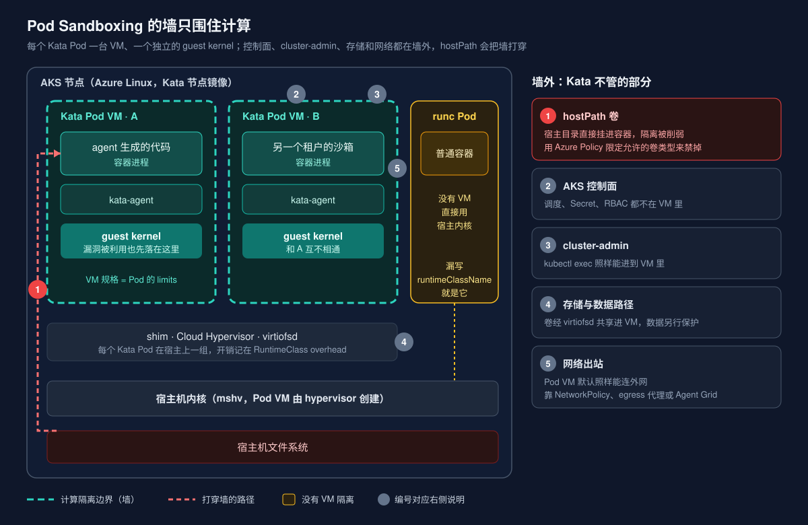
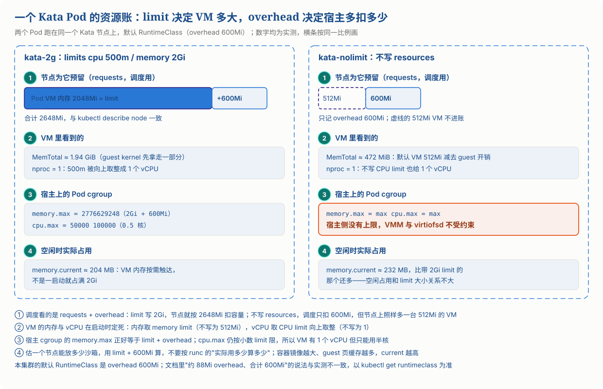

# Agent 基础设施系列 09：AKS Pod Sandboxing

在 Azure 上让 agent 跑模型生成的代码，最基础的一种做法是 AKS 的 Pod Sandboxing：它把开源的 Kata Containers 做成了节点池的一个选项，每个沙箱 Pod 跑在自己的轻量 VM 里，有独立的 guest kernel。它是一个隔离原语，只回答"这段代码在哪种墙后面跑"；托管的另一条路 ACA Sandboxes 放在[系列 10](Agent基础设施系列10：ACA-Sandboxes.md)，两者怎么选放在[系列 11](Agent基础设施系列11：AKS与ACA的沙箱选型.md)。

[系列 02](../agent-runtime/Agent基础设施系列02：Kubernetes上的Agent沙箱.md) 讲过 Kata 和 agent-sandbox、OpenSandbox 的分层关系，[AKS Agent Runtime 系列 01 补充](../../../../Azure/Azure-Kubernetes-Service/AKS-Agent-Runtime系列01补充：Kata运行时与节点池.md) 进节点拆过 containerd、shim 和 cgroup。这里按官方文档把 Pod Sandboxing 本身理一遍。

## 一、两层开关：节点池给能力，Pod 自己选

在 AKS 上开 Pod Sandboxing，表面上只多了一个参数 `--workload-runtime KataVmIsolation`，但它只做了一半的事。

**节点池这一层**，这个参数让节点用上带 Kata 运行时的节点镜像。另外两个条件必须同时满足：`--os-sku AzureLinux`，以及支持嵌套虚拟化的第二代 VM 规格（文档示例是 `Standard_D4ads_v6`）。已有集群不能在普通池上"打开"它，只能新加一个池：

```bash
az aks nodepool add \
  --cluster-name myAKSCluster \
  --resource-group myResourceGroup \
  --name nodepool2 \
  --os-sku AzureLinux \
  --workload-runtime KataVmIsolation \
  --node-vm-size Standard_D4ads_v6 \
  --node-count 1
```

**Pod 这一层**，manifest 里写了 `runtimeClassName` 才会真正进 VM：

```yaml
spec:
  runtimeClassName: kata-vm-isolation
```

没写的 Pod 照样走 `runc`，跟宿主机共用一个内核。所以同一个集群、甚至同一个 Kata 节点上，沙箱 Pod 和普通 Pod 可以混跑，只给需要隔离的工作负载付 VM 的开销。反过来也意味着，**模板里漏写一行 `runtimeClassName`，Pod 照样能跑起来，只是什么隔离都没有**，不会有任何报错。

用节点自动预配（NAP，即 Karpenter）的集群不走 `az aks nodepool add`，而是在 `AKSNodeClass` 里写 `spec.workloadRuntime: KataVmIsolation`，再让一个 Karpenter `NodePool` 引用它。`kata-vm-isolation` 这个 RuntimeClass 自带 `kubernetes.azure.com/kata-vm-isolation: "true"` 的调度选择器，Pod 只要写了 `runtimeClassName`，Karpenter 就能认出来并拉起兼容的节点，也会把 runtime overhead 算进装箱。NAP 这条路要求 Kubernetes 1.32 以上和 Azure Linux 3。

开好之后可以用一个普通 Pod 和一个 Kata Pod 对比 `uname -r`：Kata Pod 里看到的是 guest kernel，和节点的内核版本不一样。

## 二、隔离到哪一层

一个 Kata Pod 的启动链是这样的：containerd 不再调标准的 runc shim，而是调 `containerd-shim-kata-v2`；shim 拉起 Cloud Hypervisor 这个 VMM，创建一台带独立内核和 Kata agent 的 Pod VM；VM 里由 Kata agent 去建容器、起进程。Pod 删除时 shim 关掉 VM，把资源还给节点。

跟默认的 runc 相比，差别集中在内核这一层：

| | runc（默认） | Kata（Pod Sandboxing） |
|---|---|---|
| 内核 | 所有 Pod 共用宿主机内核，靠 namespace 和 cgroup 隔开 | 每个 Pod 一台 VM，有自己的 guest kernel |
| 一个内核漏洞被利用后 | 直接到宿主机，波及节点上所有 Pod | 先落在 guest kernel，外面还隔着一层 hypervisor |
| 特权容器 | 等于拿到宿主机 root | 拿到的是 guest VM 的 root，宿主机设备不挂进来 |
| 资源失控 | 靠 cgroup 限制，共享内核 | 被限制在这台 VM 分到的 CPU 和内存里 |

墙围住的只是计算这一层，墙外还有好几条路能碰到沙箱里的东西：



> [!IMPORTANT]
> 文档明确写了：**Pod VM 只提供计算隔离**。AKS 控制面、存储和数据路径、cluster-admin 权限的操作都不在这道墙里，单靠 Pod Sandboxing 做不到 hard multitenancy。网络要另配 NetworkPolicy，治理要另配 Azure Policy，身份要单独设计。

有几处会把这道墙打穿或者削弱，文档单独列了出来：

- **hostPath 卷**会把宿主机的一部分文件系统直接暴露给容器，Kata 的隔离跟着变弱。`/dev` 是个例外，它挂的是 guest 里的 `/dev`，不是宿主机的。文档建议给集群分配内置策略 *Kubernetes cluster pods should only use allowed volume types*，效果设为 Deny，从允许的卷类型里去掉 hostPath，从准入这一层就把它拦掉。
- **特权 Pod** 可以建，但只是 guest 里的 root。即便如此，文档仍建议只在必要时用、只让受信任的人管理。
- **Microsoft Defender for Containers 不评估 Kata Pod**，这部分安全态势要用别的方式补。
- **不支持 host network**，Pod VM 里访问不到宿主机的网络配置。依赖 `hostNetwork: true` 的组件放不进沙箱。

## 三、v1 和 v2

现在有两个 RuntimeClass：GA 的 `kata-vm-isolation`（v1）和预览中的 `kata-vm-isolation-v2`。两者用的是**同一个节点池参数** `--workload-runtime KataVmIsolation`，v1 还是 v2 在每个工作负载的 `runtimeClassName` 里选。v2 相对 v1 的变化是：

- **宿主侧内存开销**从 600Mi 降到 32Mi，都是固定值，不随 Pod 大小变。
- **Kata 运行时**从 Go 实现换成 Rust 实现。
- **启动方式**：v1 每个沙箱冷启动；v2 可以从一台暂停的、预初始化好的模板 VM 克隆新沙箱，启动更快。
- **快照恢复**：v2 具备快照恢复的运行时前提，可以捕获运行中实例的内存、进程和应用上下文。
- **不写 memory limit 时的 VM 大小**：v1 是 512Mi，v2 是 2GiB。
- **NAP**：v1 支持，v2 不支持。

v2 有几个坑，都写在文档的限制里：

1. **顺序不能反。** feature flag `KataVMIsolationV2Preview` 必须在建集群或建 Kata 节点池之前注册。已经存在的池即使事后跑 `az aks update` 或者升级节点镜像也拿不到 v2，只能新加一个池。节点镜像还要求 `202611.13.0` 或更新，各区域上线时间不一样。
2. **模板模式下 VM 规格是死的。** 用模板克隆时，每个 v2 Pod VM 固定 2GiB 内存、2 vCPU，**不管 Pod 写了多少 limit**。原因是调整 VM 大小需要内存热插拔，和模板用的写时复制快照恢复路径不兼容。需要其他规格的工作负载，所在的池就不要初始化模板。文档也提醒，即使写了更小的 CPU limit 或者没写，模板模式也可能分到 2 vCPU，要在目标区域和节点镜像上实测确认。
3. **模板初始化要节点 root。** 模板 VM 要在每个节点上初始化，文档给的是一个 DaemonSet，它的 init container 以 root 身份在节点上执行 `kata-ctl factory init`。文档特意提醒，上线前要找安全团队评审。
4. **emptyDir 要显式写成内存盘。** v2 下用 emptyDir，要在 Pod spec 里写 `medium: Memory` 和 `sizeLimit`。
5. **迁移就是重建 Pod。** 已有 Pod 的 `runtimeClassName` 改不了。Deployment 这类控制器改 Pod 模板后滚动替换；裸 Pod 只能删掉重建。文档的说法是"不要假定两种运行时在所有存储和挂载模式下行为一致"，要先在预生产环境验证挂载、启动延迟和资源用量。回滚就是改回 `kata-vm-isolation` 再替换一次。

模板克隆和快照恢复这两项，对 agent 沙箱很有用：前者压冷启动，后者让暂停后的会话能带着内存状态恢复。[系列 02](../agent-runtime/Agent基础设施系列02：Kubernetes上的Agent沙箱.md) 里 Kata 的劣势之一就是不像 Firecracker 那样能从快照毫秒级恢复，v2 开始往这个方向补。不过它现在还是预览，模板 VM 的规格又是固定的，离直接拿来做预热池还有距离。

## 四、资源怎么算

Kata 的资源模型和 runc 的根本差别是：**runc 按实际用量挤占节点，Kata 按 VM 规格先占住。** VM 一旦起来，规格就不变了。

一个 Kata Pod 从调度到宿主 cgroup 的整笔资源账，我在系列 01 补充里实测对过一遍：



**内存。** v1 下，Pod 的 `limits.memory` 就是 VM 的内存大小，启动后不能改。guest kernel 和 Kata agent 也要从这块内存里分，应用实际能用的比 limit 少，可以进 Pod 跑 `free` 看 used 列来估算。宿主侧的 shim、Cloud Hypervisor、virtiofsd 由 RuntimeClass 的 overhead 来记账，kubelet 把 cgroup 的 `memory.max` 设成 limit 加 overhead。VM 内存不能小于 128MiB。

> [!WARNING]
> 不写 memory limit 时，v1 的 VM 是默认的 512Mi，**而且 Pod 的 cgroup 没有上限**，宿主侧组件的内存不受约束。跑 Chromium、pandas 这类沙箱，512Mi 也很容易 OOM。沙箱模板里一定要写 limits。

文档在 overhead 上自己有一处没对齐：RuntimeClass 那张表说 v1 是"600Mi 固定、不随 Pod 大小变"，但下面的参考用量表里，overhead 一列从 128Mi VM 对应的 16Mi 一路涨到 128Gi VM 对应的 1Gi。我在 [AKS Agent Runtime 系列 01 补充](../../../../Azure/Azure-Kubernetes-Service/AKS-Agent-Runtime系列01补充：Kata运行时与节点池.md) 里实测的是 600Mi 固定，2Gi 的 Pod 在节点上扣 2648Mi。估容量时以集群里 `kubectl get runtimeclass kata-vm-isolation -o yaml` 实际看到的值为准；参考表更像是在说明自建 RuntimeClass 时 overhead 大致该配多少。

自建 RuntimeClass 时，handler 要写 `kata`（不是 RuntimeClass 的名字），并先用 `kubectl get runtimeclass` 确认集群支持这个 handler：

```yaml
apiVersion: node.k8s.io/v1
kind: RuntimeClass
metadata:
  name: small-kata-pods
handler: kata
overhead:
  podFixed:
    memory: "120Mi"
    cpu: "250m"
```

**CPU。** 有三条规则：

- Pod 的 `limits.cpu` 决定 VM 有几个 vCPU。**小数会向上取整**：写 2.5，VM 分到 3 个 vCPU，但 cgroup 仍按 2.5 限。算成本和密度时要按取整后的数算。
- 不写 CPU limit 时，v1 给 VM 1 个 vCPU，**宿主侧组件的 CPU 用量没有上限**。
- 节点上预留的 CPU 是 RuntimeClass CPU overhead 加 Pod 的 `requests.cpu`。只写了 limit、没写 request 时，limit 会被复制成 request。两个都是 0 就不预留。比如 overhead 1、limit 2.5，节点预留 3.5 核，VM 分到 3 个 vCPU，容器最多用 2.5 个。

归结起来就是三件事：**request 和 limit 写成一样**（shim 只看 limit 来定 VM 规格，request 只影响调度）；节点 CPU 常跑满就给 overhead 配一个非零值，给宿主组件留出余量；按 VM 粒度做容量规划，预热池里每多一个空闲沙箱，就多占一份 limit 加 overhead。

## 五、限制和前提

- **只支持 Azure Linux**。Ubuntu、Windows、Azure Container Linux 都不行。
- **VM 规格**必须是支持嵌套虚拟化的第二代规格；**不支持 Arm64**；Kata 节点池**不能同时开 FIPS 或 Trusted Launch**。
- **版本**：Kubernetes 1.27 以上；NAP 预配的 Kata 节点要求 1.32 以上和 Azure Linux 3；Azure CLI 2.80.0 以上。
- **存储性能**：在 Azure Files 和高性能本地 SSD 上，IOPS 可能达不到普通容器的上限。
- **观测与安全**：Defender for Containers 不评估 Kata Pod；不支持 host network。

## 相关阅读

- [Agent 基础设施系列 10：ACA Sandboxes](Agent基础设施系列10：ACA-Sandboxes.md)——sandbox group、模板、出站代理与可靠性
- [Agent 基础设施系列 11：AKS 与 ACA 的沙箱选型](Agent基础设施系列11：AKS与ACA的沙箱选型.md)——分层对比与决策树
- [Agent 基础设施系列 02：Kubernetes 上的 Agent 沙箱](../agent-runtime/Agent基础设施系列02：Kubernetes上的Agent沙箱.md)——Kata、agent-sandbox、OpenSandbox 的分层与选型
- [AKS Agent Runtime 系列 01 补充：Kata 运行时与节点池](../../../../Azure/Azure-Kubernetes-Service/AKS-Agent-Runtime系列01补充：Kata运行时与节点池.md)——进节点看 shim、节点镜像、混跑规则和 cgroup 实测
- [AKS Agent Runtime 系列 01：Sandbox 之外的三个平面](../../../../Azure/Azure-Kubernetes-Service/AKS-Agent-Runtime系列01：Sandbox之外的三个平面.md)——Kata 池污点与沙箱 Pod 的四条底线

## 参考资料

- [Overview of Pod sandboxing in Azure Kubernetes Service (AKS)](https://learn.microsoft.com/en-us/azure/aks/concepts-pod-sandboxing)
- [Pod sandboxing considerations on Azure Kubernetes Service (AKS)](https://learn.microsoft.com/en-us/azure/aks/considerations-pod-sandboxing)
- [Pod sandboxing with Azure Kubernetes Service (AKS)](https://learn.microsoft.com/en-us/azure/aks/use-pod-sandboxing)
- [Kata Containers](https://katacontainers.io/)
- [Cloud Hypervisor](https://github.com/cloud-hypervisor/cloud-hypervisor)
