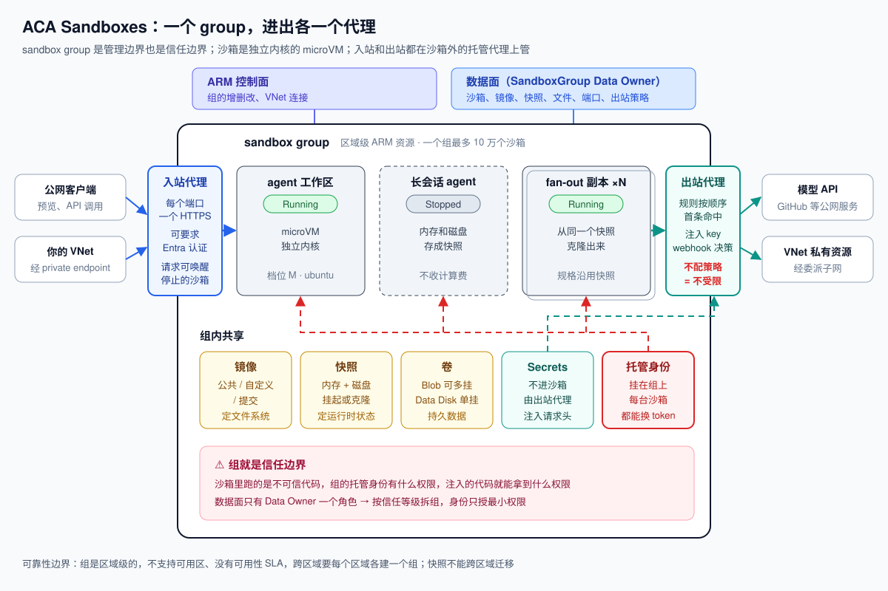

# Agent 基础设施系列 10：ACA Sandboxes

AKS 的 Pod Sandboxing（见[系列 09](Agent基础设施系列09：AKS-Pod-Sandboxing.md)）只给了一道墙，预热、回收、出站、凭据都要自己在上面搭。Azure Container Apps 的 Sandboxes 走的是另一条路：直接调 API 要一台 microVM，墙、房间分配、门禁和钥匙管理都是托管的。两者怎么选放在[系列 11](Agent基础设施系列11：AKS与ACA的沙箱选型.md)。

## 一、它是什么

ACA Sandboxes 是 Container Apps 里的一种一等资源，资源类型是 `Microsoft.App/SandboxGroups`，和 apps、jobs、dynamic sessions 并列，而且**不需要 Container Apps environment**。每个沙箱是一台独立的 microVM，有自己的内核、CPU、内存、本地磁盘和网络边界，从镜像启动不到一秒，从快照恢复更快，停止后不收 CPU 和内存的费用。产品站上标的是 GA。

Container Apps 现在有四种计算形态，sandbox 的位置是"你自己管生命周期、有状态"的那一格：

- **Apps**：长期运行的服务、API，无状态，状态放外部。
- **Jobs**：跑完即止的批处理。
- **Dynamic sessions**：由 session pool 托管分配和生命周期，请求级、用完即弃，适合执行一段 LLM 生成的脚本。
- **Sandboxes**：通过 SDK 和 CLI 直接控制每一台 microVM，创建、挂起、恢复、删除都由你决定，状态靠快照和卷保留。

文档的建议是新项目优先考虑 sandboxes 而不是 dynamic sessions，尤其是需要持久状态和可编程控制的场景。两者的差别主要在控制权：dynamic sessions 是池子替你管，HTTP 请求经池子的管理端点路由进去；sandboxes 是你直接拿到一台机器，文件、端口、出站策略都能逐台配置，还有卷和快照。

## 二、Sandbox group：管理边界，也是信任边界

先看整体：一个组里装着沙箱和它们共享的东西，进出流量各经过一个沙箱外的代理。



Sandbox group 是一个区域级的 ARM 资源，一个组最多装 100,000 个沙箱。组内共享的东西是：镜像、快照、卷、secrets、托管身份、VNet 连接和 connectors。管理上分成两个平面：

- **ARM 控制面**只管组本身：创建、更新、删除、列出组，以及 VNet 连接。
- **数据面**管组里的一切：沙箱、镜像、快照、文件、卷、secrets、端口、出站策略。调数据面需要 **Container Apps SandboxGroup Data Owner** 这个角色，可以分配在组、资源组或订阅范围上。

这里有两点要特别留意：

> [!WARNING]
> **托管身份挂在组上，组内所有沙箱都继承它，都能用它换 Entra token。** 沙箱里跑的是不可信代码，这意味着组的托管身份有什么权限，被注入的代码就能拿到什么权限。所以不同信任等级的工作负载要分到不同的组，组的身份只授最小权限。

另一点是权限粒度：文档里数据面只有 Data Owner 这一个角色，拿到它就能管组内所有沙箱，包括进 shell、读写文件。按租户或团队分权，只能靠拆组来实现。删除组是不可逆的，会连同里面的沙箱、镜像、快照、卷、secrets 一起删掉。

## 三、镜像、规格、快照：把模板固定下来

ACA 把"一个沙箱长什么样"拆成三样东西，各管一层：

**镜像（disk image）定根文件系统。** 来源有三种：

- **公共镜像**，由微软维护，至少每月更新一次，严重安全修复会提前发布。除了 ubuntu、nginx 和 Python、Node.js、.NET、PHP 各版本的运行时，还有几个是专门为 agent 准备的：`claude`（固定版本的 Claude Code CLI）、`copilot`（GitHub Copilot CLI，systemd 作 PID 1，自带 AGENTS.md 和 skills）、`azure-dev`（全套 Azure 开发工具链），以及 `python-3.12-code-interpreter`（暴露 MCP 端点执行不可信 Python）。文档提醒版本可能随时变，生产上要固定版本就用自定义镜像。
- **自定义镜像**，从你自己的 OCI 镜像转换而来，私有仓库可以用用户名加 token 或托管身份认证。
- **提交镜像（commit）**，把一个运行中沙箱的文件系统提交成新镜像，适合在沙箱里交互式装好环境再固化下来。提交时沙箱会短暂暂停。

**规格档位定资源。** 从 XS（0.25 核、0.5GiB 内存、5GiB 磁盘）到 3XL（16 核、32GiB、320GiB）共七档，默认 M（1 核、2GiB、20GiB），每升一档资源翻倍。也可以按 millicore 和 Mi 直接指定 CPU 和内存。

**快照定运行时状态。** 快照捕获一台运行中沙箱的内存和磁盘，独立于源沙箱保存，可以拿来做三件事：挂起后恢复，从一个准备好的状态克隆出很多台（fan-out），以及在危险操作前打检查点。从快照新建的沙箱沿用快照里的 CPU、内存、磁盘，不能改。

这三样加上标签、环境变量、自动挂起策略，可以写成一份 YAML 提交进代码库，评审时和代码放在一起看：

```yaml
disk: ubuntu
resources:
  cpu: 1000m
  memory: 2048Mi
lifecycle:
  autoSuspendPolicy:
    enabled: true
    interval: 300
    mode: Memory
labels:
  workload: code-exec
environment:
  GREETING: hello
```

文档给的分工是：**多台沙箱共用的文件系统基线放进镜像，某个时间点的运行时状态放进快照**。按工作负载的不同，选不同的镜像和档位，再决定挂起时保留多少状态：

- **生命周期策略**：自动挂起（默认空闲 300 秒，没有入站流量、没有 exec、没有交互 shell、没有文件操作才算空闲）和自动删除（停止后多少天删）。
- **挂起模式**：Memory 模式保留内存和磁盘，恢复后进程接着跑；Disk 模式只保留磁盘，恢复时 VM 重新启动。**挂了 data disk 卷的沙箱只能用 Disk 模式。**
- **卷**：Azure Blob（可以同时挂到多台沙箱）、自带的 Blob 容器、Data Disk（高性能，同一时间只能挂一台）。

快照只管沙箱本地的状态，不协调外部系统。从同一个快照 fan-out 出去的多台沙箱，可能把快照之后的非幂等操作重放一遍；恢复后 token、租约、锁也可能已经过期。文档的检查清单里专门要求：初始化和清理步骤要做成幂等，恢复后要重连客户端、重新校验外部依赖。

## 四、网络与凭据：在沙箱外管

ACA 的网络管控都在沙箱外面：入站和出站各有一个托管代理，沙箱里的代码绕不过去。

> [!CAUTION]
> **不配出站策略时，沙箱的出站访问是不受限的。** 出站策略是 opt-in 的。跑不可信代码的沙箱，起步就应该是 `default_action = Deny`、流量检查设为 Full，再按需加最小的放行列表。

出站策略的模型是：

- **规则按顺序匹配，首条命中生效**，可以按 host、path、HTTP method 匹配，动作有 Allow、Deny、Transform（改请求头）、Rewrite（改目标的 scheme、host、path）。没有规则命中就走默认动作。规则要从具体到宽泛排，比如先 Deny `api.example.com/admin`，再 Allow `api.example.com`。
- **凭据在代理上注入**。Transform 可以从组的 secrets 里取值（如 `Bearer {value}`），也可以现场用托管身份换一个 token 塞进请求头。沙箱里的代码只发请求，从头到尾拿不到密钥，这正好解决了 agent 调模型 API 时 key 放哪里的问题。
- **Webhook 动态决策**。规则可以不写静态动作，而是挂一个 `hookRef`，请求命中时由代理调你的 HTTPS 端点，按返回结果放行、拒绝或改写，适合按租户授权、现场签发 token。调用失败时的默认行为（`failBehavior`）是 Deny。
- **流量检查分档**：Full 检查所有流量、非 HTTP 流量一律拦掉；Partial 只检查命中规则的流量，非 HTTP 放行；None 不执行任何出站规则。
- **策略可以在运行中改**，对后续请求生效，已经在途的请求不重新评估。文档建议定期拉取出站决策日志看 Deny 的计数，突然变多通常意味着配置错了，或者有外传数据的企图。

入站这边，每个暴露的端口有一个独立的 HTTPS 地址，可以匿名，也可以要求 Entra ID 认证，请求到达时还能唤醒已停止的沙箱。私有网络两个方向都能做：组可以通过委派子网接入 VNet，访问私有资源；入站可以走 private endpoint，不经公网。VNet 里要避开两段保留地址 `192.168.0.0/24` 和 `100.65.0.0/23`，私有镜像仓库、自定义 DNS、对端网络的地址落在这两段里会访问失败，而 VNet 连接本身照样显示创建成功。

凭据还有一处和"密钥不进沙箱"的原则不完全一致：门户里给 GitHub Copilot 和 Claude 配的 provider credentials，是在**沙箱启动时注入进沙箱**的，供里面的 CLI 直接认证。轮换后正在运行的沙箱不会自动更新，要重启或重建。用 `claude`、`copilot` 预设镜像跑 agent 时，这把 key 是在沙箱里的。

## 五、可靠性和配额

产品站标的是 GA，但看可靠性文档，有几条在定生产方案时绕不过去：

- **没有可用性 SLA。** 只有卷背后的存储服务有自己的 SLA。
- **不支持可用区**，既不能指定 zone，也没有 zone 冗余。
- **单区域服务**，不跨区域复制，也不自动故障转移。要多区域就每个区域各建一个组，镜像、secrets、配置自己同步，流量切换和中断后的恢复也要自己做。快照不能跨区域迁移。
- **区域故障时，只在运行中沙箱内存里的状态可能丢失。** 要持久的数据放卷或外部存储，组的配置用 Bicep、Terraform 管起来。
- **平台维护**会短暂中断几秒，平台会把运行中的沙箱迁到健康节点上自动恢复（Memory 模式连内存一起保留）。客户端要能处理这类瞬时故障。
- **配额**：每个订阅每个区域默认 300 个并发活跃核、每分钟 3,000 次 API 调用，停止的沙箱不占核。到了核数上限就新建不了、也启动不了沙箱，要提前申请提额。
- **工具链还在早期**：Python SDK 是 `0.1.0b4`，文档示例里数据面的 API 版本是 `2026-02-01-preview`；部分功能 CLI 还不支持，只能用门户或 SDK；Azure Government 和 Azure China 还没有上线。
- **计费**：运行时按核秒和 GiB 秒计，停止不收计算费；自定义镜像、快照、卷按存储计费（文档标注为即将开始收费）。

## 相关阅读

- [Agent 基础设施系列 12：本地 coding agent 调用 ACA 沙箱](Agent基础设施系列12：本地coding-agent调用ACA沙箱.md)——Copilot CLI、VS Code Copilot、Claude Code 的实测
- [Agent 基础设施系列 13：把 coding agent 装进 ACA 沙箱](Agent基础设施系列13：把coding-agent装进ACA沙箱.md)——本地只留遥控器、key 不进沙箱
- [Agent 基础设施系列 09：AKS Pod Sandboxing](Agent基础设施系列09：AKS-Pod-Sandboxing.md)——Kata 隔离边界、v1 与 v2、资源规则
- [Agent 基础设施系列 11：AKS 与 ACA 的沙箱选型](Agent基础设施系列11：AKS与ACA的沙箱选型.md)——分层对比与决策树
- [Agent 基础设施系列 02：Kubernetes 上的 Agent 沙箱](../agent-runtime/Agent基础设施系列02：Kubernetes上的Agent沙箱.md)——Kata、agent-sandbox、OpenSandbox 的分层与选型
- [Agent 基础设施系列 08：Agent Grid 的网络层管控](../agent-grid%28network-security%29/Agent基础设施系列08：Agent-Grid的网络层管控.md)——沙箱外按身份管出站

## 参考资料

- [Azure Container Apps Sandboxes overview](https://learn.microsoft.com/en-us/azure/container-apps/sandboxes-overview)
- [Reliability in Azure Container Apps Sandboxes](https://learn.microsoft.com/en-us/azure/reliability/reliability-container-apps-sandboxes)
- [Egress policies and network controls for Azure Container Apps Sandboxes](https://learn.microsoft.com/en-us/azure/container-apps/sandboxes-egress-policies)
- [Sandbox lifecycle in Azure Container Apps Sandboxes](https://learn.microsoft.com/en-us/azure/container-apps/sandboxes-snapshots-state-management)
- [Azure Container Apps Sandboxes 文档站](https://sandboxes.azure.com/docs/sandboxes)
