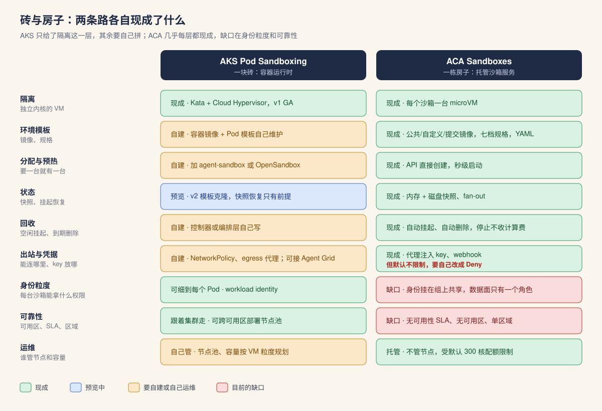
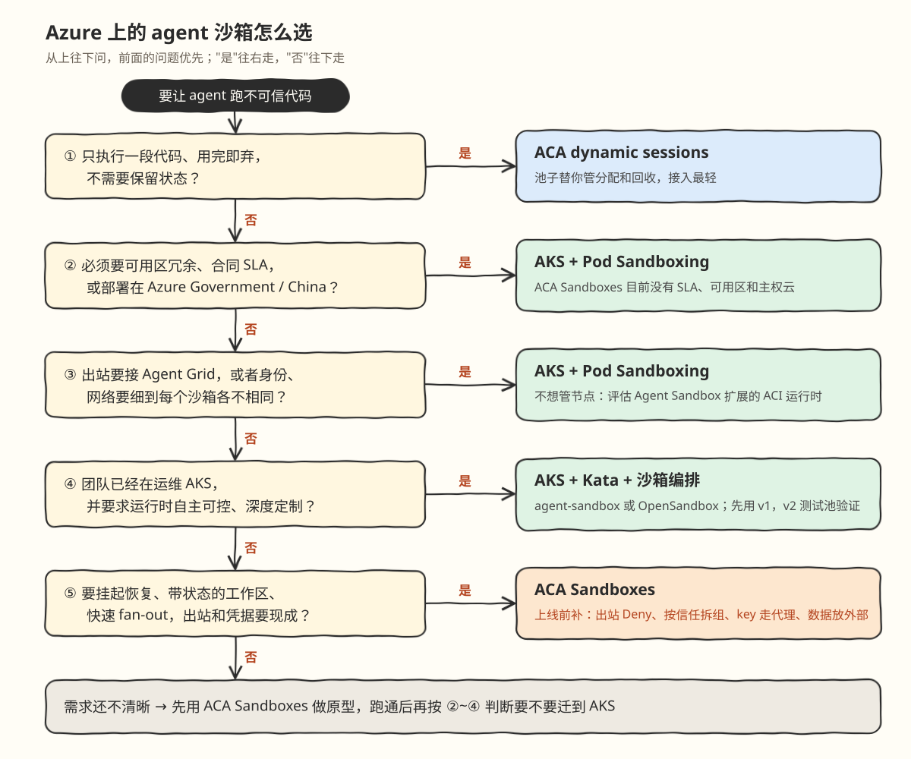

# Agent 基础设施系列 11：AKS 与 ACA 的沙箱选型

[系列 09](Agent基础设施系列09：AKS-Pod-Sandboxing.md) 和 [系列 10](Agent基础设施系列10：ACA-Sandboxes.md) 分别讲了 AKS Pod Sandboxing 和 ACA Sandboxes。这一篇把两者放在一起比，再给一棵选型的决策树。

## 一、Kata 和 microVM：差别在谁管这台 VM

ACA 的文档反复强调 microVM，容易让人以为它和 Kata 是两种隔离技术。其实不是：Kata 本身就是轻量 VM 路线，底下可以接 QEMU、Cloud Hypervisor、Firecracker 这些 VMM，AKS 上用的是 Cloud Hypervisor。两边都是"每个沙箱一台带独立内核的 VM"，墙的厚度是同一个量级。[系列 02](../agent-runtime/Agent基础设施系列02：Kubernetes上的Agent沙箱.md) 里说过，真正的区别在于 **VM 由谁来管**：

- **Kata 把 VM 包成容器运行时，交给 Kubernetes 管。** 一个 Pod 就是一台 VM，生命周期跟着 Pod 走：Pod 删了 VM 就关了，Pod 的模型里没有"暂停一台 VM、把内存存起来、以后再接着跑"这个动作。
- **ACA 的沙箱系统直接管 microVM。** 沙箱不是 Pod，是一台可以单独操作的机器：可以把整台 VM 的内存和磁盘做成快照、停掉、再恢复，或者从一个快照克隆出很多台。这些都是 VMM 层面的能力，Kubernetes 的抽象表达不了。

落到具体产品上，差别是这些：

| | AKS 上的 Kata | ACA 的 microVM |
|---|---|---|
| 交互接口 | CRI / OCI：`kubectl exec`、`logs`，现有容器镜像不用改 | 沙箱 API：exec、文件读写、交互 shell、端口，由 SDK、CLI 调用 |
| 镜像 | 标准容器镜像，按 Pod 拉取 | OCI 镜像先转换成 disk image 再启动，也可以把运行中的沙箱提交成镜像 |
| VM 里面 | kata-agent 再按普通容器起 Pod 里的多个容器，容器之间只有容器级隔离 | 一台沙箱一个根文件系统，直接当一台机器用 |
| 状态 | 跟着 Pod 走，删了就没；v2 的模板克隆和快照恢复前提还在预览 | 内存 + 磁盘快照、挂起恢复、fan-out 克隆是基本操作 |
| 启动 | 镜像已缓存时 Pod 到 Ready 约 2 秒（我在系列 01 补充里实测） | 文档称从缓存镜像启动不到一秒、从快照恢复更快（我没实测） |
| 规格 | 由 Pod 的 limits 决定，VM 起来后不变，小数 CPU 向上取整 | 七档规格或直接指定；从快照新建时沿用快照的规格 |
| VMM 是谁 | Cloud Hypervisor，跑在 Microsoft Hypervisor 的 root partition 上 | 文档没写，但快照的元数据里 `vmmType` 是 `cloudhypervisor`，也是 Cloud Hypervisor |
| 嵌套虚拟化 | 依赖：节点要选支持嵌套虚拟化的 Gen2 规格 | 不用管，平台负责 |

两点结论：

- **隔离强度上不用纠结。** 两边都是 VM 级边界，选型不该在这一层分高下。ACA 的文档没写 VMM，但我实际建快照时，API 返回的元数据里 `vmmType` 是 `cloudhypervisor`，和 AKS 上的 Kata 是同一个 VMM；正式做安全评审时，这类信息仍以微软的书面说明为准。
- **差别在 VM 之上能做什么。** 之所以 agent 工作区需要挂起恢复、快照克隆这类能力，是因为 agent 的会话长、大部分时间在等模型或等人。ACA 天然有这些能力，是因为它直接管 VM；AKS 要做到同样的事，要么等 Kata v2 的快照恢复成熟，要么换成 OpenSandbox 的 Firecracker 运行时这类自己管 VMM 的方案，等于在 Kubernetes 之外再维护一套 VM 管理。

## 二、两者对比

拿 AKS Pod Sandboxing 和 ACA Sandboxes 直接比，其实是拿一块砖和一栋房子比。Kata 只回答"这段代码在哪种墙后面跑"；ACA 把墙、房间分配、门禁、钥匙管理都做好了。公平的比法是 ACA Sandboxes 对比"AKS + Kata + 一层沙箱编排 + 出站管控"这一整套：

图里没放下的还有两点：一是 Agent Grid 目前只支持 ACI 沙箱组和 AKS，不支持 ACA，所以 ACA 的出站只能靠它自带的代理；二是两者的管理单位不同，AKS 按 Pod 用 Kubernetes 那一套管，ACA 按 sandbox group 管，组内共享镜像、快照、身份和网络。

看完文档，ACA 给人的第一印象是比 AKS 这条路更像生产级产品。我的判断是要把两件事分开：

- **产品完整度上，ACA 明显领先。** sandbox group 的统一管理、按工作负载选镜像和档位、可以评审的 YAML 模板、快照和挂起恢复、沙箱外的出站代理和凭据注入，这些在 AKS 上要靠 Kata 加 agent-sandbox 或 OpenSandbox 加 egress 网关自己拼，拼完还得自己运维。对"给 agent 一个可以挂起恢复的独立工作区"这个需求，ACA 几乎是开箱即用。
- **可靠性和治理上，ACA 还没到能直接上生产的程度。** 没有可用性 SLA、不支持可用区、单区域、SDK 还是 beta；安全默认值偏宽松（出站默认放开）；托管身份按组共享、数据面只有一个 Owner 角色，权限粒度粗；也接不进 Agent Grid。AKS 这边隔离原语本身是 GA 的，可用区和 SLA 跟着集群走，粒度可以细到每个 Pod。

所以更准确的说法是：ACA 是 Azure 上**产品化程度最高**的 agent 沙箱，AKS 是**可控程度最高**的。

## 三、怎么选：决策树

每个问题背后的考虑：

1. **只需要执行一段代码、用完即弃，不需要保留状态吗？**
   - 是 → **ACA dynamic sessions**。池子替你管分配和回收，接入最轻。
   - 否 → 进入第 2 题。
2. **有硬性的可用性要求吗？比如要可用区冗余、要合同 SLA，或者要部署在 Azure Government、Azure China？**
   - 是 → **AKS + Pod Sandboxing**。ACA Sandboxes 目前满足不了这些。
   - 否 → 进入第 3 题。
3. **出站要用 Agent Grid 按身份统一管控吗？或者网络和身份必须细到每个沙箱各不相同？**
   - 是 → **AKS + Pod Sandboxing**，自己配 workload identity 和出站；不想管节点的话，可以评估 AKS Agent Sandbox 集群扩展的 ACI serverless 运行时。
   - 否 → 进入第 4 题。
4. **团队已经在运维 AKS，并且要求运行时自主可控、可以深度定制吗？**
   - 是 → **AKS + Pod Sandboxing + agent-sandbox 或 OpenSandbox**。先用 GA 的 v1，v2 的模板克隆在测试池里验证。
   - 否 → 进入第 5 题。
5. **需要挂起恢复、带状态的工作区、快速 fan-out，并且希望出站和凭据有现成方案吗？**
   - 是 → **ACA Sandboxes**。上线前把第四节的四件事补齐。
   - 否 → 需求还不清晰，先用 ACA Sandboxes 做原型，跑通之后再按第 2 到第 4 题判断要不要迁到 AKS。

两者也不是只能选一个。一种常见的组合是：交互式、长会话的 agent 工作区放 ACA Sandboxes，拿它的挂起恢复和快照；需要强治理、高可用的批量执行放 AKS。前提是两边的出站和凭据策略要对齐，不能一边严一边松。

## 四、上线前各自要补的事

沙箱的墙防的是模型生成的代码逃逸到宿主机、波及别人的沙箱。agent 被提示词注入带偏之后，真正的风险往往是它能连到哪里、能拿谁的凭据去调什么接口。不管选哪条路，下面这几件事都要单独想清楚。

**选 ACA Sandboxes 时：**

- **出站默认 Deny**，流量检查设为 Full，放行列表从最小开始。
- **按信任等级拆 sandbox group**，组的托管身份只授最小权限，因为组内每台沙箱都能用它换 token。
- **模型 key 走出站代理的 Transform 注入**，不要用会把 key 放进沙箱的 provider credentials；用 `claude`、`copilot` 预设镜像时要清楚这一点。
- **持久数据放卷或外部存储**，组的配置用 IaC 管起来，多区域自己做。

**选 AKS Pod Sandboxing 时：**

- **沙箱节点池打污点**，沙箱 Pod 带 toleration。
- **Pod 模板里 `runtimeClassName`、`limits` 两样都写死**，request 和 limit 写成一样。
- **用 Azure Policy 禁掉 hostPath。**
- **出站用 NetworkPolicy、egress 代理或 [Agent Grid](../agent-grid%28network-security%29/Agent基础设施系列08：Agent-Grid的网络层管控.md)**，自建做法见 [AKS Agent Runtime 系列 04](../../../../Azure/Azure-Kubernetes-Service/AKS-Agent-Runtime系列04：出站治理与逐请求授权.md)。
- **建沙箱、预热、回收交给 agent-sandbox 或 OpenSandbox**，AKS 也把 agent-sandbox 做成了预览中的 [Agent Sandbox 集群扩展](https://learn.microsoft.com/en-us/azure/aks/agent-sandbox-cluster-extension)。

## 相关阅读

- [Agent 基础设施系列 12：本地 coding agent 调用 ACA 沙箱](Agent基础设施系列12：本地coding-agent调用ACA沙箱.md)——Copilot CLI、VS Code Copilot、Claude Code 的实测
- [Agent 基础设施系列 13：把 coding agent 装进 ACA 沙箱](Agent基础设施系列13：把coding-agent装进ACA沙箱.md)——本地只留遥控器、key 不进沙箱
- [Agent 基础设施系列 09：AKS Pod Sandboxing](Agent基础设施系列09：AKS-Pod-Sandboxing.md)——Kata 隔离边界、v1 与 v2、资源规则
- [Agent 基础设施系列 10：ACA Sandboxes](Agent基础设施系列10：ACA-Sandboxes.md)——sandbox group、模板、出站代理与可靠性
- [Agent 基础设施系列 01：三层划分与自建路线](../agent-platform/Agent基础设施系列01：三层划分与自建路线.md)——托管路线与 AKS 自建路线的分界
- [Agent 基础设施系列 02：Kubernetes 上的 Agent 沙箱](../agent-runtime/Agent基础设施系列02：Kubernetes上的Agent沙箱.md)——Kata、agent-sandbox、OpenSandbox 的分层与选型
- [Agent 基础设施系列 08：Agent Grid 的网络层管控](../agent-grid%28network-security%29/Agent基础设施系列08：Agent-Grid的网络层管控.md)——沙箱外按身份管出站

## 参考资料

- [Overview of Pod sandboxing in Azure Kubernetes Service (AKS)](https://learn.microsoft.com/en-us/azure/aks/concepts-pod-sandboxing)
- [Pod sandboxing considerations on Azure Kubernetes Service (AKS)](https://learn.microsoft.com/en-us/azure/aks/considerations-pod-sandboxing)
- [Pod sandboxing with Azure Kubernetes Service (AKS)](https://learn.microsoft.com/en-us/azure/aks/use-pod-sandboxing)
- [Azure Container Apps Sandboxes overview](https://learn.microsoft.com/en-us/azure/container-apps/sandboxes-overview)
- [Reliability in Azure Container Apps Sandboxes](https://learn.microsoft.com/en-us/azure/reliability/reliability-container-apps-sandboxes)
- [Egress policies and network controls for Azure Container Apps Sandboxes](https://learn.microsoft.com/en-us/azure/container-apps/sandboxes-egress-policies)
