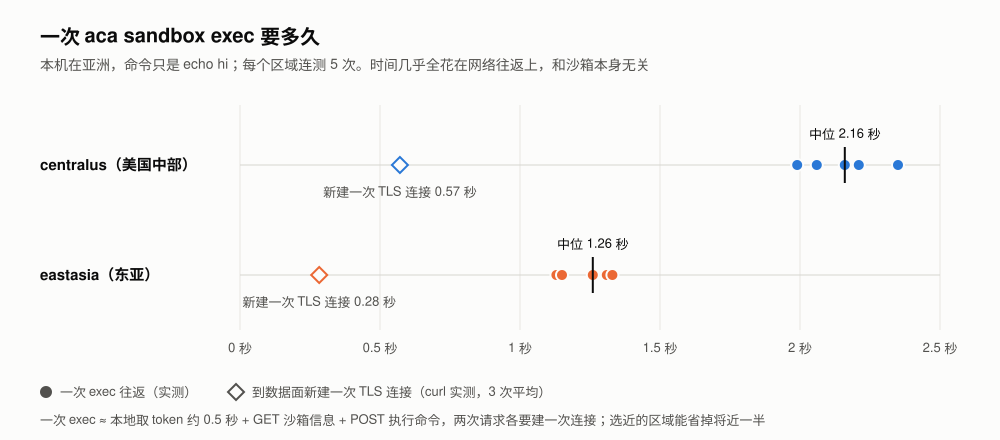
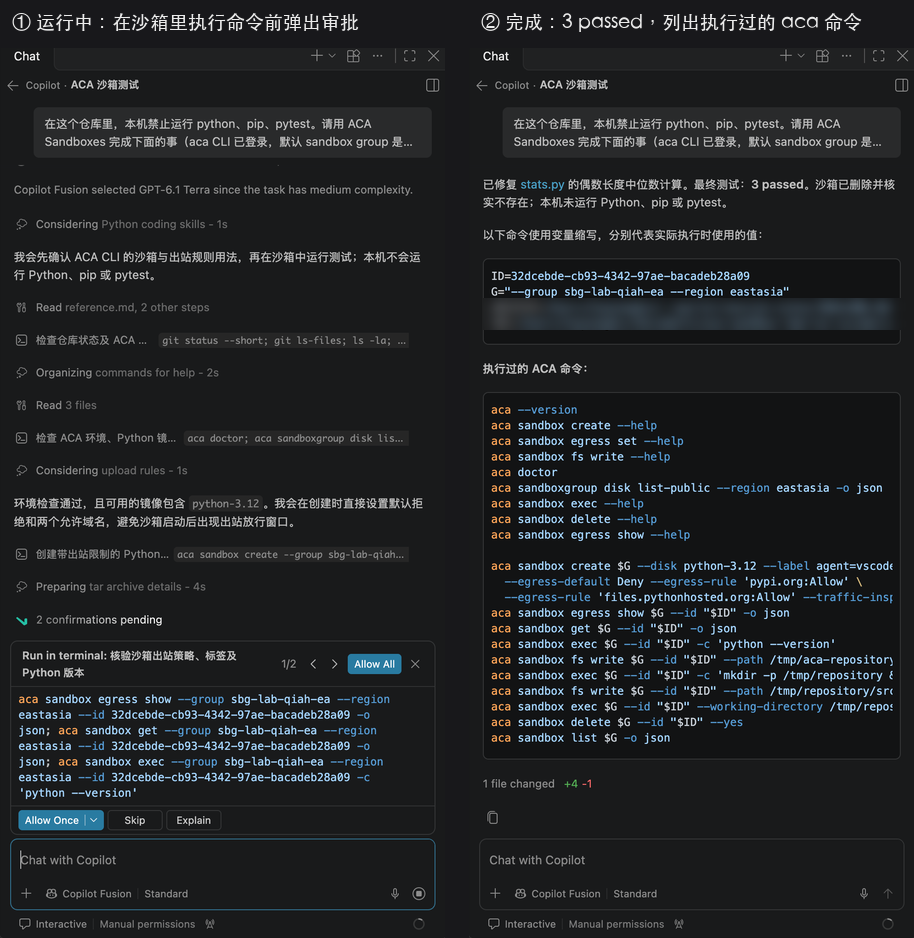

# Agent 基础设施系列 12：本地 coding agent 调用 ACA 沙箱

[系列 10](Agent基础设施系列10：ACA-Sandboxes.md) 看的是 ACA Sandboxes 的文档，这一篇是动手。我想要的是这样一种用法：平时在本机用 VS Code 和 Copilot、Claude Code 写代码，但凡要跑代码，尤其是模型生成的、我没细看的代码，就放到云上的沙箱里跑，本机不碰。

我在一个订阅里建了 sandbox group，准备了一个有 bug 的小 Python 仓库，让三个 agent 各跑一遍同一个任务：Copilot CLI、VS Code 里的 Copilot Chat、Claude Code。把 agent 本身也装进沙箱的做法放在[系列 13](Agent基础设施系列13：把coding-agent装进ACA沙箱.md)。

## 一、准备：CLI、sandbox group 和 skill

**CLI。** 沙箱用的是单独的 `aca` CLI，`az containerapp` 里没有沙箱命令。官方安装脚本按固定版本下载发布包并校验 SHA-256，可以装到用户目录、不用 sudo。`aca` 自己不管登录，借用 `az login` 的身份。

**sandbox group。** 一条命令建组并写进本地配置，之后的命令就不用每次带组名：

```bash
az group create -n rg-aca-sandbox-lab -l eastasia
aca sandboxgroup create -g rg-aca-sandbox-lab --name sbg-lab --location eastasia --set-config
aca doctor
```

建组只要几秒，CLI 会顺手把 Data Owner 角色授给当前用户。`aca doctor` 检查订阅、资源组、组、区域和角色，九项全绿再往下走。

**skill。** ACA 在 GitHub 上提供了官方的 sandboxes skill，Copilot CLI 和 Claude Code 都可以按插件装。我没有装到全局，而是把 skill 目录拷进示例仓库的 `.claude/skills/aca-sandboxes/`。Claude Code 本来就读这个目录；Copilot CLI 查项目级 skill 时，除了 `.github/skills/` 也会读 `.claude/skills/`，用 `copilot skill list` 能看到它。这样三个 agent 读的是同一份说明书，对比才公平，也不会改动全局配置。

这份 skill 不只是命令清单，它对每类意图都列了"回答里必须出现什么"，还专门写了反例：没有 SSH、不要用 scp、出站只有 `--default` 加重复的 `--rule` 一种写法。三个 agent 后来生成的命令几乎没有错的，这份 skill 功劳不小。

## 二、沙箱本身的表现

先不用 agent，手工测一组基线。我的本机在亚洲，同时在 centralus 和 eastasia 各建了一个组。

**创建很快。** 从公共镜像建一台 python 沙箱，连 CLI 往返在内约 3 秒。默认规格 1 核 2GiB，root 用户，Debian 系统。镜像很精简，`free`、`pgrep`、`uptime` 都没有。

**exec 的时间几乎全花在网络上。** 一个 `echo hi`，从本机调 centralus 每次 2.0~2.35 秒，调 eastasia 每次 1.1~1.3 秒：



用 `--verbose` 看，一次 exec 是先 GET 沙箱信息、再 POST 执行命令，两次请求；加上本地取 token 约 0.5 秒。到 centralus 新建一次 TLS 连接就要 0.55 秒左右。所以**选离自己近的区域能省掉将近一半**，但每次 exec 仍有约 1 秒的固定开销。对人来说这不算什么，对 agent 来说就是每调一次工具多等 1 秒。

**出站默认是放开的。** 新建的沙箱访问 github 和 example.com 都返回 200。改成默认拒绝、只放行 pypi 两个域名、流量检查设为 Full 之后：

- pypi 返回 200；
- github 返回 403，说明代理在 Full 模式下解开了 TLS，以 HTTP 的方式拒绝；
- 直连 IP 的请求直接断开；
- `aca sandbox egress decisions` 能查到每次放行和拒绝命中的规则。

**挂起恢复会冻结时钟。** 我在沙箱里起了一个每秒写一次计数的后台进程，然后 `stop`，等 35 秒再 `resume`。`stop` 用了约 4 秒，`resume` 约 2 秒；恢复后进程还在，PID 没变，计数接着往下走。但这 35 秒里 guest 的开机时长只走了 3 秒，**挂起期间 VM 里的时钟是停的**。文档提醒恢复后 token、租约可能过期，原因就在这里：沙箱里的代码感觉不到自己睡过。

**自动挂起是 600 秒。** 默认的自动挂起策略是空闲 600 秒、Memory 模式，文档写的是 300 秒，以 `aca sandbox get` 看到的为准。我最后一次操作之后十多分钟去看，沙箱确实已经自己停了。

## 三、三个 agent 跑同一个任务

**任务是一样的。** 仓库里的 `median` 对偶数长度的列表取错了中位数，测试依赖 numpy。给三个 agent 的 prompt 相同：新建一个 python 沙箱并打标签；出站默认拒绝，只放行 pypi；把仓库传进沙箱，装依赖跑 pytest；失败就在本地改代码，重新上传复测，直到通过；最后删掉沙箱，列出执行过的 aca 命令。

**权限也尽量对齐。** 只放行 `aca`、`tar`、`git` 这类命令和文件编辑，**禁止在本机运行 python、pip、pytest**。这一条很关键：skill 只是教 agent 怎么用沙箱，并不会阻止它在本机跑代码，不禁掉的话，它完全可以图省事直接在本地 `pytest`。

| | Copilot CLI | VS Code 里的 Copilot | Claude Code |
|---|---|---|---|
| 运行方式 | `copilot -p` 无人值守 | Chat 面板，手动审批模式 | `claude -p` 无人值守 |
| 模型 | 管理员指定的 GPT 模型 | Copilot 自动选模型 | Claude Opus |
| 第一轮 | 被本地路径校验拦下，没完成 | 一次完成 | 一次完成 |
| 耗时 | 第二轮 131 秒 | 4 分 35 秒，含 15 次审批 | 229 秒，模型调用占 51 秒 |
| 上传方式 | 本地打 tar 包，一次 `fs write` | 同左 | 逐个文件 `fs write`，跳过 `.claude/` |
| 结果 | 修好 `median`，3 个测试通过，删除沙箱并确认 | 同左 | 同左 |

**Copilot CLI 卡在自己的路径校验上。** 它把仓库打包到自己的会话目录 `~/.copilot/session-state/...`，这个目录在项目之外。接着 `aca sandbox fs write --file` 要读这个文件，触发了 Copilot 的本地路径校验；非交互模式下没人点批准，直接被拒。它没有卡死，判断上传不了之后主动删掉了已经建好的沙箱，再报告失败。第二轮加上 `--allow-all-paths`（只放开本地路径校验，禁止本机跑 python 的限制不变）就顺利完成了。这个失败跟 ACA 无关，但说明**无人值守跑之前，要先想清楚 agent 自己的权限模型会放行哪些路径**。

**VS Code 里跑的是同一套 Copilot 引擎。** VS Code Insiders 里新的 Copilot 体验，会话记录也写在 `~/.copilot/session-state/` 下，格式和 Copilot CLI 一样，记录里的 producer 字段就是 `copilot-agent`。它同样自动读到了项目里的 skill，同样把 tar 包放进会话目录，只是在 VS Code 里没有被路径校验拦住。手动审批模式下一共有 15 次审批请求，界面上会把要在沙箱里执行的命令完整列出来：



15 次里只有一次停了 22 秒，就是我手动点 Allow Once 那次，其余在几毫秒到几秒内就通过了。界面上出现过"Evaluating"，看起来是 VS Code 先评估命令风险、再自动放行，具体机制我没有核实。

**Claude Code 一次完成，但最慢。** 229 秒里模型调用只占 51 秒，其余主要是十几次 aca 往返和沙箱里装依赖。它没有打包，而是逐个文件上传，主动跳过了 `.claude/` 目录。`fs mkdir` 返回 404，因为它不会自动建父目录；好在后面的 `fs write` 会自己建。

三个 agent 修出来的代码几乎一样，生成的 aca 命令也基本一致，**ACA 这一层的体验没有差别，差别全在 agent 自己的权限和审批模型**。

## 四、几个坑

都是这次实测碰到的，文档里没写或者写得不一样：

- **`create` 的输出不是 JSON。** 加了 `-o json` 也只打印一行 `Created sandbox: <id>`，脚本里要用 grep 取 ID。从快照创建时，输出里还会先出现快照 ID，取第一个 UUID 会取错。
- **全局参数要放在子命令前面。** `--sandbox-group`、`--region` 写在 `sandbox create` 后面会报错，要写成 `aca --sandbox-group X sandbox create`，或者用环境变量 `ACA_SANDBOX_GROUP`、`ACA_REGION`。
- **`fs mkdir` 不建父目录**，`fs write` 会。
- **默认自动挂起是 600 秒**，文档写 300 秒。
- **出站默认不限制**，跑不可信代码一定要显式改成 Deny。
- **macOS 的 tar 会带扩展属性**，在 Linux 沙箱里解包会刷一屏警告，还会多出一堆 `._*` 文件。打包时加 `COPYFILE_DISABLE=1` 和 `--no-xattrs`。

## 五、这条路的边界

本地 agent 加 ACA 沙箱，解决的是"代码不在本机跑"，但只解决了这一件事：

- **agent 还在本机。** 它读写本地文件、执行本地命令，ACA 管不着。所以必须用 agent 自己的权限机制禁止它在本机跑代码，否则沙箱形同虚设。
- **key 也在本机。** 模型的 key 和 agent 的凭据都在本地进程里。
- **每一步都要往返一次。** agent 每跑一条命令都是一次 1~2 秒的 exec，十几步下来，几十秒就花在网络上了。

如果想让本地只剩几条简单命令，把 agent 本身、它的 key 和它的所有动作都放到云上，就要换一种接法：把 coding agent 装进沙箱里跑。这是[系列 13](Agent基础设施系列13：把coding-agent装进ACA沙箱.md) 的内容。

## 相关阅读

- [Agent 基础设施系列 10：ACA Sandboxes](Agent基础设施系列10：ACA-Sandboxes.md)——sandbox group、模板、出站代理与可靠性
- [Agent 基础设施系列 11：AKS 与 ACA 的沙箱选型](Agent基础设施系列11：AKS与ACA的沙箱选型.md)——Kata 与 microVM、分层对比与决策树
- [Agent 基础设施系列 13：把 coding agent 装进 ACA 沙箱](Agent基础设施系列13：把coding-agent装进ACA沙箱.md)——本地只留遥控器、key 不进沙箱
- [Agent Harness 五平台对比](../Agent-Harness五平台对比.md)——各家 harness 的权限与执行模型

## 参考资料

- [Azure Container Apps Sandboxes 文档站](https://sandboxes.azure.com/docs/sandboxes)
- [ACA Sandboxes Agent Skills 快速入门](https://sandboxes.azure.com/docs/sandboxes/quickstart/agent-skills)
- [Control egress（ACA Sandboxes）](https://sandboxes.azure.com/docs/sandboxes/sandbox/egress)
- [Sandbox lifecycle in Azure Container Apps Sandboxes](https://learn.microsoft.com/en-us/azure/container-apps/sandboxes-snapshots-state-management)
- [microsoft/azure-container-apps（plugin 与 aca CLI 发布）](https://github.com/microsoft/azure-container-apps)
