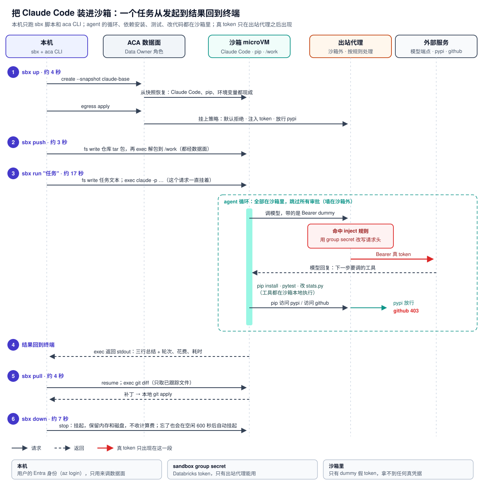
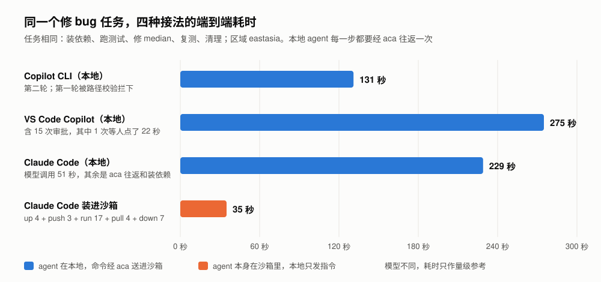

# Agent 基础设施系列 13：把 coding agent 装进 ACA 沙箱

[系列 12](Agent基础设施系列12：本地coding-agent调用ACA沙箱.md) 里，agent 在本机，只把命令送进沙箱执行。这样做有三个问题：要额外禁止 agent 在本机跑代码，模型的 key 留在本机，每调一次工具都要多一次 1~2 秒的网络往返。

反过来做更彻底：**把 coding agent 本身装进沙箱**。代码、依赖、agent 的整个循环都在云上，本机只发一句任务、收一个结果。ACA 的公共镜像里已经有装好 Claude Code 的 `claude` 镜像和装好 Copilot CLI 的 `copilot` 镜像，这次我实测的是 Claude Code。

## 一、一个任务的完整流程

本机只有两样东西：`aca` CLI，和我写的一个约 50 行的 bash 脚本 `sbx`（名字取自 sandbox，不是官方工具）。一个任务从发起到结果回到终端，经过下面六步：



1. **`sbx up` 起沙箱，约 4 秒。** 从快照 `claude-base` 恢复一台 microVM，内存和磁盘都是打快照时的状态，Claude Code、pip、环境变量都现成。再给它挂上出站策略。
2. **`sbx push` 送代码，约 3 秒。** 本机把仓库打成 tar 包，经数据面的文件接口传进沙箱，再在沙箱里解包到 `/work`。
3. **`sbx run "任务"` 执行，约 17 秒。** 本机把任务文本写进沙箱，然后发一个 exec，在沙箱里启动 `claude -p`。从这一刻起，agent 的整个循环都在沙箱里：调模型、装依赖、跑测试、改代码，全部不需要人审批。本机的这个 exec 请求一直挂着，直到 Claude Code 退出。
4. **结果回到终端。** Claude Code 把结果写成 JSON，同一个 exec 接着打印出最后的回复和轮次、花费、耗时，作为 exec 的标准输出返回到本机终端。
5. **`sbx pull` 取回改动，约 4 秒。** 在沙箱里跑 `git diff`，把补丁拉回本地 `git apply`。
6. **`sbx down` 挂起，约 7 秒。** 保留内存和磁盘，不再收计算费。忘了也没关系，空闲 600 秒后会自动挂起。

**agent 在沙箱里跳过所有审批**，用的是 `--dangerously-skip-permissions`。这个参数在本机很危险，在沙箱里却正合适：墙在沙箱外面，agent 在里面怎么折腾都碰不到别的东西，能连出去的地址也只有出站策略放行的那几个。

## 二、key 不进沙箱

agent 装进沙箱以后，最直接的担心是模型的 key。官方的 provider credentials 是在沙箱启动时把 token 注入进沙箱的，agent 生成的代码也能读到它。我用了另一种做法：**key 只放在 sandbox group 的 secret 里，由出站代理在请求离开沙箱之后改写请求头**。

**先存 secret。** 用 `--from-stdin` 从环境变量经管道写入，token 不会出现在命令行参数和进程列表里：

```bash
printf 'TOKEN=%s\n' "$MODEL_TOKEN" | aca sandboxgroup secret set --name model-token --from-stdin
aca sandboxgroup secret show --name model-token --key TOKEN   # 只看是否存在，不显示值
```

写入后 CLI 提示 `Keys now: -`，像是一个 key 都没存上，其实只是显示问题，`show --key` 能看到 `EXISTS true`。

**再写出站策略。** 规则按顺序首条命中：发往模型端点的请求，把 `Authorization` 头换成 secret 里的值；pypi 放行；其余默认拒绝。

```yaml
defaultAction: Deny
trafficInspection: Full
rules:
  - name: inject-model-token
    match:
      host: "<workspace>.azuredatabricks.net"
      path: "/serving-endpoints/*"
    action:
      type: Transform
      headers:
        - operation: Set
          name: Authorization
          valueRef:
            secretRef:
              secretId: model-token
              secretKey: TOKEN
              format: "Bearer {value}"
  - match:
      host: "pypi.org"
    action:
      type: Allow
  - match:
      host: "files.pythonhosted.org"
    action:
      type: Allow
```

**沙箱里只配假 token。** 我用的模型端点在 Databricks 上，沙箱里的环境变量文件长这样：

```bash
export ANTHROPIC_BASE_URL="https://<workspace>.azuredatabricks.net/serving-endpoints/anthropic"
export ANTHROPIC_AUTH_TOKEN="dummy-not-a-real-token"
export ANTHROPIC_MODEL="<端点上的模型名>"
export CLAUDE_CODE_DISABLE_NONESSENTIAL_TRAFFIC=1
```

在沙箱里让 Claude Code 回一句话，4 秒就返回了。再核对两件事：

- `aca sandbox egress decisions` 显示，这次请求发往 `/serving-endpoints/anthropic/v1/messages`，命中的正是 `inject-model-token` 这条规则；
- 沙箱里 `ANTHROPIC_AUTH_TOKEN` 只有假值，直接访问 github 和 api.anthropic.com 都返回 403。

> [!IMPORTANT]
> 这样做之后，沙箱里的代码，包括 agent 自己和它生成的任何脚本，都拿不到真 token。被提示词注入带偏的 agent 最多能用这个端点调模型，没法把 key 带出去另作他用。代价是这条规则会给所有发往这个端点的请求都加上真 token，所以端点本身的权限要收窄，只给这一个用途。

## 三、环境固化：做一个基线快照

`claude` 镜像里有 Claude Code、git、jq，Python 是 3.14，但**没有 pip**。出站只放行了 pypi，agent 在任务里装不了 pip，就会卡在装依赖这一步。

这正好需要"环境固化"这一步，只做一次：

1. 在一台新沙箱里，临时多放行一个 `bootstrap.pypa.io`，下载 `get-pip.py` 装好 pip；
2. 写好上面的环境变量文件；
3. 把出站策略收紧回去；
4. 用 `aca sandbox snapshot --name claude-base` 打成快照，约 4 秒，200MB 左右。

之后每个任务都从这个快照起，4 秒就是一个装好一切的环境。快照把内存也存下来了，所以从它起的沙箱连已经启动的进程都在。镜像（disk image）适合放多台沙箱共用的文件系统基线，快照适合放某个时间点的运行时状态，这里两者都满足，就直接用了快照。

打快照时有个意外收获：快照的元数据里有一个字段 **`"vmmType": "cloudhypervisor"`**。ACA 的文档只说每个沙箱是独立内核的 microVM，没写用的是哪种 VMM；从这个字段看，它和 AKS 上的 Kata 用的是同一个 Cloud Hypervisor（我已经把这一点补进了[系列 11](Agent基础设施系列11：AKS与ACA的沙箱选型.md)）。

快照管理有两个小坑：同名快照可以重复创建，按名字起沙箱时就可能起错；`snapshot delete` 不接受 `--yes`，按名字删也不行，要用 `--id`。

## 四、本地遥控器 sbx

整个脚本就是把上面几步包成五条命令：

```bash
#!/usr/bin/env bash
# sbx — 本地遥控器：agent 和代码都在 ACA 沙箱里跑，本地只发指令、收结果
set -euo pipefail
HERE="$(cd "$(dirname "$0")" && pwd)"
STATE="$HERE/.sbx-id"
SNAP="${SBX_SNAPSHOT:-claude-base}"
EGRESS="$HERE/egress-claude.yaml"
ID() { cat "$STATE"; }
X() { aca sandbox exec --id "$(ID)" -c "$1"; }

case "${1:-}" in
  up)
    out=$(aca sandbox create --snapshot "$SNAP" --label agent=sbx 2>&1)
    # 输出里会先出现快照 ID，只取 "Created sandbox: <id>" 这一行
    echo "$out" | sed -n 's/.*Created sandbox: \([0-9a-f-]\{36\}\).*/\1/p' | head -1 > "$STATE"
    [ -s "$STATE" ] || { echo "$out"; exit 1; }
    aca sandbox egress apply --id "$(ID)" --file "$EGRESS" >/dev/null
    echo "sandbox $(ID) up" ;;
  push)
    # 不带 macOS 扩展属性；解包时不保留本机 uid，否则 git 会报 dubious ownership
    COPYFILE_DISABLE=1 tar --no-mac-metadata --no-xattrs -C "${2:-.}" -czf /tmp/sbx-push.tgz .
    aca sandbox fs write --id "$(ID)" --path /tmp/sbx-push.tgz --file /tmp/sbx-push.tgz >/dev/null
    X "rm -rf /work && mkdir -p /work && tar --no-same-owner -xzf /tmp/sbx-push.tgz -C /work && git config --global --add safe.directory /work" ;;
  run)
    shift
    aca sandbox fs write --id "$(ID)" --path /tmp/sbx-task.txt --file /dev/stdin <<<"$*" >/dev/null
    X '. /root/.sbx-env.sh; cd /work && IS_SANDBOX=1 claude -p "$(cat /tmp/sbx-task.txt)" --dangerously-skip-permissions --output-format json > /tmp/sbx-result.json; jq -r ".result" /tmp/sbx-result.json; jq -r "\"turns=\(.num_turns) cost=\(.total_cost_usd)\"" /tmp/sbx-result.json' ;;
  pull)
    aca sandbox resume --id "$(ID)" >/dev/null 2>&1 || true
    # 只取已跟踪文件的改动，不把 __pycache__ 之类的产物带回本地
    X 'cd /work && git diff' > /tmp/sbx.patch
    if [ -s /tmp/sbx.patch ]; then git apply /tmp/sbx.patch && git status --short; else echo "no changes"; fi ;;
  down) aca sandbox stop --id "$(ID)" ;;
  rm)   aca sandbox delete --id "$(ID)" --yes && rm -f "$STATE" ;;
esac
```

几个写法是踩过坑才定下来的：

- **任务文本先写成文件再读。** 直接把任务拼进 exec 的命令行，中文和引号的转义会很麻烦。
- **沙箱里用 root 跑，要设 `IS_SANDBOX=1`。** 沙箱里默认是 root，直接加 `--dangerously-skip-permissions` 会报错 `cannot be used with root/sudo privileges for security reasons`，设了 `IS_SANDBOX=1` 告诉它这是沙箱环境才会放行。
- **打包要去掉 macOS 的扩展属性。** 否则沙箱里解包会多出一堆 `._*` 文件，`git diff` 会把它们当成改动，整个补丁都应用失败。
- **解包要用 `--no-same-owner` 并加 `safe.directory`。** 本机的 uid 和沙箱里的 root 不一样，git 会报 dubious ownership，`pull` 就拿不到 diff。
- **`pull` 只取已跟踪文件的改动。** 测试会生成 `__pycache__`，全取回来会把本地仓库弄乱。

最终那一轮，从一份干净的仓库开始：`up` 4.2 秒、`push` 2.8 秒、`run` 17.2 秒、`pull` 4.2 秒、`down` 6.5 秒。`run` 期间沙箱里的 Claude Code 自己装好 numpy 和 pytest，找到 `median` 的问题并修好，3 个测试全部通过，一共 4 轮、0.026 美元。本机从头到尾只跑了 `sbx` 这一个命令。

## 五、和本地 agent 比

同一个修 bug 任务，四种接法的端到端耗时：



四次用的模型不完全一样，耗时只能看量级，但差距主要不是模型造成的。**本地 agent 每走一步都要经 aca 往返一次**，十几步下来，光网络就是几十秒；装进沙箱以后，agent 直接操作本地文件系统、在本地跑命令，只有调模型那一下要出沙箱。再加上不需要人审批，同样的活，35 秒对 2~4 分钟。

更大的差别在安全模型上：

- **本地 agent 加沙箱**：要靠 agent 自己的权限机制禁止它在本机执行代码，key 也在本机，墙只围住了被送进去的那几条命令。
- **agent 装进沙箱**：本机只跑 `aca`，agent 和它生成的一切都在墙里，key 不进墙，能连出去的地址由墙外的代理决定。

## 六、还没做完的部分

这次实测只验证了最短的那条路，下面几件我还没做：

- **长任务要改成异步。** 现在 `sbx run` 是同步的，本机的 exec 请求要一直挂到任务结束。17 秒没问题，几十分钟的任务就不合适了，exec 有没有超时上限我也还没测。更合理的做法是用 exec 在沙箱里后台启动 `claude -p`、立即返回，本机之后用 `fs cat` 读结果文件；或者用 ACA 的 triggers，由外部事件唤醒沙箱执行，本机完全不参与。
- **结果交付可以不经本机。** 让沙箱里的 agent 直接 `git push` 到一个分支，GitHub token 同样由出站代理注入，本机就不用 `pull` 了。也可以暴露一个要求 Entra 认证的端口，实时看 agent 在做什么。
- **Copilot CLI 装进沙箱还没测。** 官方做法是在门户里配一个 fine-grained PAT 作为 provider credentials，这个 token 会进沙箱。改用出站代理注入能不能行得通要实测：Copilot 要先拿 GitHub token 换一个 Copilot token，单纯改写请求头不一定够。

## 七、harness 怎么接沙箱，本地的沙箱还要不要

做完这几轮，有两个问题绕不开。

**coding agent 的 harness 调沙箱，是有标准接口，还是靠 skill？** 目前没有跨厂商统一的"沙箱后端"接口，实际在用的有几层：

- **Skill 加 CLI**：`SKILL.md` 是一份说明书，教 agent 怎么调某个 CLI。这种格式已经被多家 harness 采用，系列 12 里三个 agent 读的就是同一份。但它只管"教会"，不管调用协议。
- **MCP server**：把"执行代码"封装成标准的工具调用，是协议层面的标准，任何支持 MCP 的 harness 都能接。ACA 的 code interpreter 镜像就自带 MCP 端点。
- **框架内置的沙箱抽象**：一些 agent 框架有可替换的"执行后端"接口，可以换成不同厂商的沙箱。
- **harness 自带的执行环境**：由厂商内置，一般没法替换。

所以，**skill 是说明书，MCP 才是协议**。要让多个 harness 统一走 ACA，比较可行的是 MCP，或者每家都装同一份 skill。

**接上 ACA 以后，本地的沙箱镜像能不能删？** 不能，两者管的不是同一件事。比如 Claude 桌面版会在本机起一台 Linux VM，体积十几个 GB，它的本地 agent 模式就在这台 VM 里跑代码，是 app 内置的执行环境。我没找到能把它改指向 ACA 的设置；删掉它，app 会重新下载，里面的会话数据也可能丢失。Claude Code、Codex 在本机用的是操作系统层面的沙箱策略，管的是"agent 在本机执行命令时能碰到什么"。ACA 是 agent 可以选择去用的一台远程机器，**接上它并不会让这些本地沙箱失效，也不能替代它们**。

## 相关阅读

- [Agent 基础设施系列 12：本地 coding agent 调用 ACA 沙箱](Agent基础设施系列12：本地coding-agent调用ACA沙箱.md)——三个本地 agent 的实测与踩坑
- [Agent 基础设施系列 10：ACA Sandboxes](Agent基础设施系列10：ACA-Sandboxes.md)——sandbox group、出站代理与凭据注入
- [Agent 基础设施系列 11：AKS 与 ACA 的沙箱选型](Agent基础设施系列11：AKS与ACA的沙箱选型.md)——Kata 与 microVM、决策树
- [Agent 基础设施系列 02：Kubernetes 上的 Agent 沙箱](../agent-runtime/Agent基础设施系列02：Kubernetes上的Agent沙箱.md)——Credential Vault 的另一种 key 不进沙箱的做法

## 参考资料

- [Control egress（ACA Sandboxes）](https://sandboxes.azure.com/docs/sandboxes/sandbox/egress)
- [Secrets（ACA Sandboxes）](https://sandboxes.azure.com/docs/sandboxes/secrets)
- [AI provider credentials（ACA Sandboxes）](https://sandboxes.azure.com/docs/sandboxes/credentials)
- [Disk images（ACA Sandboxes）](https://sandboxes.azure.com/docs/sandboxes/disk-images)
- [Triggers（ACA Sandboxes）](https://sandboxes.azure.com/docs/sandboxes/triggers)
- [Sandbox lifecycle in Azure Container Apps Sandboxes](https://learn.microsoft.com/en-us/azure/container-apps/sandboxes-snapshots-state-management)
