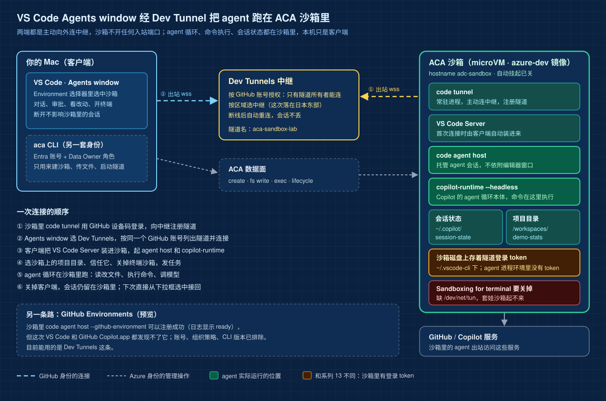
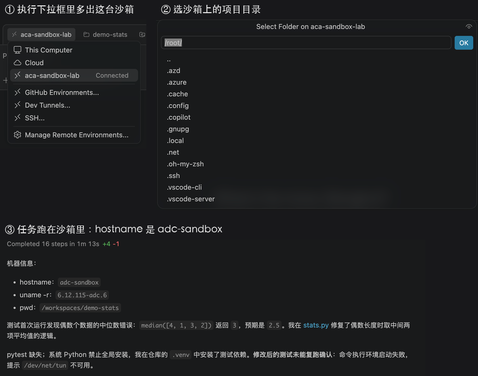
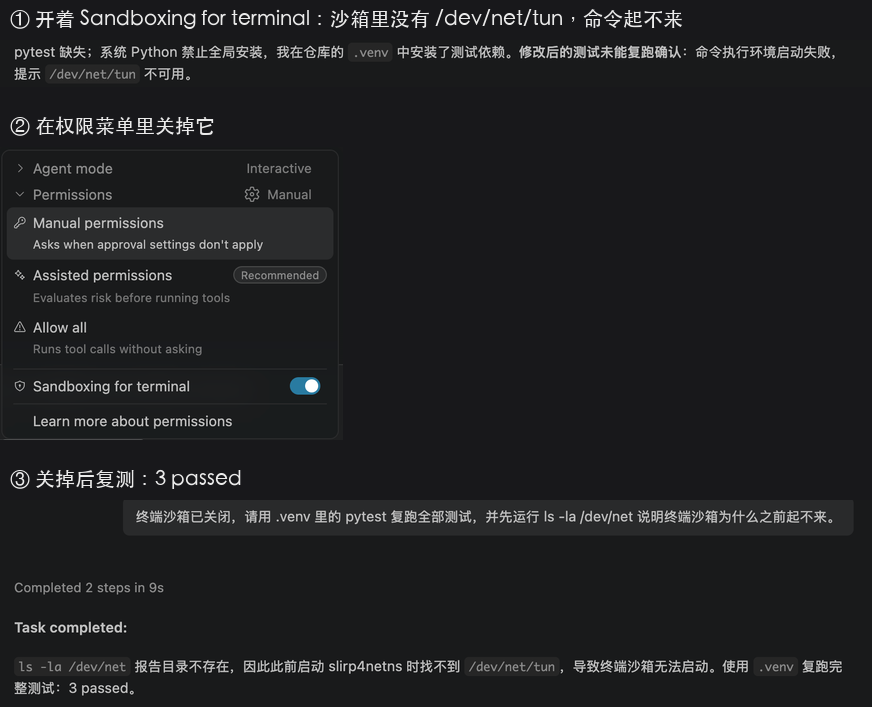

# Agent 基础设施系列 14：把 ACA 沙箱接进 VS Code Agents window

[系列 13](Agent基础设施系列13：把coding-agent装进ACA沙箱.md) 里，我把 Claude Code 装进 ACA 沙箱，本地用一个 `sbx` 脚本当遥控器。这种做法适合丢一个任务进去跑完就走，但想边看边聊、中途审批、随手开个终端就不方便了。

VS Code 的 Agents window 正好补上这一块：它的 Environment 选择器里，除了 This Computer 和 Cloud，还可以挂远程主机。我想要的效果是，在这个下拉框里像选本机一样选一台 ACA 沙箱，agent 就在那台沙箱里干活。这一篇记录怎么接、背后是怎么连的，以及几个必须知道的坑。

## 一、它是什么

Agents window 是 VS Code 里专门给 agent 会话用的窗口，和编辑器窗口分开。发起新会话时，输入框上方有一排选择器，最左边那个是 **Environment**，决定这个会话在哪台机器上跑：

- **This Computer**：在本机跑；
- **Cloud**：交给 GitHub 托管的云端环境跑；
- **已连接的远程主机**：比如 `aca-sandbox-lab · Connected`；
- **GitHub Environments… / Dev Tunnels… / SSH…**：连接一台新的远程主机。

第一眼看上去，这和多年前用 Remote-SSH 连远程开发机差不多：沙箱里跑着 `code tunnel`，VS Code 第一次连上时会自动装一份 VS Code Server 进去。连接这一层确实是同一套东西。但进沙箱看进程，多了两样 Remote-SSH 时代没有的：

- **`code agent host`**：一个独立、无界面的进程，专门托管 agent 会话，不依附于哪个编辑器窗口，空闲一段时间才会自己退出；
- **`copilot-runtime --headless`**：Copilot 的 agent 运行时本身，agent 的循环和它执行的命令都在这里。

会话记录也写在沙箱的 `~/.copilot/session-state/` 下，不在我的 Mac 上。所以 Remote-SSH 是"人"用一台远程机器，窗口一关事情就停；这里是 **agent 住在远程机器上**，本机的 Agents window 只是一个客户端，断开以后会话还在，下次选中这台主机就能接着聊。

这正是系列 13 的模式（agent 装进沙箱），只是遥控器从脚本换成了 VS Code 的界面。

## 二、连接是怎么建起来的



几个要点：

- **两端都是主动向外连。** 沙箱里的 `code tunnel` 主动连 Dev Tunnels 的中继，本机的 Agents window 也是主动连中继，沙箱不需要开任何入站端口。这次分到的中继在日本东部。
- **隧道归 GitHub 账号所有。** 登录隧道时用哪个 GitHub 账号，就只有这个账号能看到、能连。
- **管沙箱和用沙箱是两套身份。** 建沙箱、传文件、启动隧道，用的是 `aca` CLI，凭 Azure 的 Entra 账号和 sandbox group 上的 Data Owner 角色；连隧道、用 Copilot，凭的是 GitHub 账号。两者互不相干，也不需要是同一个人的同名账号。
- **断线会自动恢复。** 实测中本机有一阵解析不了中继域名（`ENOTFOUND jpe1.rel.tunnels.api.visualstudio.com`），客户端按指数退避一直重试，网络恢复后自动重连。服务端那时已经不记得这个客户端，客户端就重新初始化了一次连接，之前的会话照常可以继续。

## 三、操作手册

### 主机这一侧：让沙箱成为一台可连接的主机

**1. 建沙箱，关掉自动挂起。** 用自带 VS Code CLI 和 Copilot CLI 的公共镜像 `azure-dev`。默认空闲 600 秒会自动挂起，隧道连着的时候也可能被挂起，所以要关掉：

```bash
aca sandbox create --disk azure-dev --cpu 2000m --memory 4096Mi --label agent=vscode-tunnel
aca sandbox lifecycle set --id <沙箱 ID> --auto-suspend disable
```

关掉自动挂起，意味着这台沙箱会一直按运行状态计费，不用的时候要记得手动 `aca sandbox stop`。

**2. 把项目放进沙箱。** 比如放在 `/workspaces/<项目>`：可以在沙箱里直接 `git clone`，也可以本地打包后用 `aca sandbox fs write` 传进去再解开。

**3. 启动隧道。** 在沙箱里后台运行 `code tunnel`：

```bash
aca sandbox exec --id <沙箱 ID> -c 'cd /workspaces && nohup code tunnel --accept-server-license-terms --name aca-sandbox-lab > /root/tunnel.log 2>&1 &'
aca sandbox exec --id <沙箱 ID> -c 'cat /root/tunnel.log'
```

日志里会给出一个设备码。打开 `https://github.com/login/device` 输入它，**用和本机 VS Code 同一个 GitHub 账号**授权。日志里出现 `Tunnel: aca-sandbox-lab` 和一个 `vscode.dev/tunnel/...` 链接，就是注册好了。设备码大约 15 分钟有效，过期了重启这个进程就会生成新的。

### 客户端这一侧：在 Agents window 里选中它

1. **打开 Agents window**：编辑器标题栏上有入口，欢迎页上也有 "Try out the new Agents window"。
2. **New Session，点 Environment 选择器**（默认显示 This Computer），**第一次选 Dev Tunnels…**，选 GitHub 账号类型，浏览器里授权一次，再从列表里选 `aca-sandbox-lab`。以后它会直接以 `aca-sandbox-lab · Connected` 出现在下拉框里，不用再走这一步。
3. **选目录**：弹出 "Select Folder on aca-sandbox-lab"，列的是沙箱里的目录，输入 `/workspaces/<项目>` 确认，再在信任提示里选 Trust Folder。
4. **关掉 Sandboxing for terminal**：在输入框下方的权限菜单里，原因见下一节。
5. **核对位置再干活**：第一句先让它跑 `hostname`、`uname -r`、`pwd`。ACA 沙箱的主机名是 `adc-sandbox`，内核版本带 `adc` 后缀，对上了再发正式任务。



跑的还是系列 12 那个有 bug 的小仓库。这次 agent 在沙箱里自己发现系统 Python 禁止全局安装，就在仓库里建了 `.venv` 装依赖，修好 `median`，16 步、1 分 13 秒。

> [!NOTE]
> 幻灯片和截图里常见的另一个入口是标题栏右上角的天线图标（Remote Connections），它的作用是把**当前这台机器**共享出去，只在主机上用。客户端要连别的机器，用的是 Environment 选择器。

## 四、终端沙箱要关掉

第一次跑时，修好代码后的复测失败了，报错是 `/dev/net/tun` 不可用，输入框里还显示着 "(sandbox enabled)"。



原因在 VS Code 的文档里写得很清楚。**Sandboxing for terminal 是 harness 自带的终端沙箱**：agent 执行的每条命令都会被套上一层操作系统级的限制，管它能读写哪些文件、能连哪些地址。它在 Linux 上依赖 bubblewrap、slirp4netns、util-linux 和 iptables，网络隔离靠 slirp4netns，而 slirp4netns 需要 `/dev/net/tun`。文档给 Dev Container 场景列出的 Docker 参数里，就专门有一条 `--device /dev/net/tun`。

ACA 的 microVM 里没有 `/dev/net` 这个目录，bubblewrap 倒是装好了，但网络这一层起不来。文档还特别说明，依赖缺失时命令**不会**悄悄地在没有沙箱的情况下运行，而是直接失败，所以才会出现上面的报错。

关掉之后复测，3 个测试全部通过。这时候管 agent 的墙是 ACA 自己的：VM 边界管它逃不出去，沙箱外的出站策略管它连不连得出去。agent 已经整个住在 ACA 沙箱里了，再套一层终端沙箱是沙箱套沙箱，既多余，在这里也跑不起来。反过来，**agent 在本机跑时，这个开关要开着**。各种沙箱的区别和叠加规则，单独放在了[系列 15](Agent基础设施系列15：几种沙箱的区分.md)。

## 五、GitHub Environments 这条路

除了 Dev Tunnels，Environment 选择器里还有一个 **GitHub Environments…**（预览）。按文档的说法，主机注册成 GitHub Environment 以后，就能通过 GitHub 账号被发现，不止 VS Code，"supported Copilot clients" 也能连，浏览器版的 Agents window 也可以。

主机这一侧不需要界面，`code agent host` 有专门的参数：

```bash
code agent host --github-environment \
  --github-environment-root /workspaces/<项目> \
  --name <机器名> --accept-server-license-terms
```

在沙箱里跑起来、完成设备码登录后，日志显示 `GitHub environment ready`。我先后用 Stable 和 Insiders 两个版本的 CLI 各注册了一次，**两次都注册成功，但客户端都发现不了**：VS Code 的 GitHub Environments 列表一直是 "No online environments found."，GitHub Copilot.app 的 "Run on" 里也没有出现。

按顺序排除过的原因：

- **账号**：隧道、VS Code、GitHub Copilot.app 用的都是同一个 GitHub 账号；
- **组织策略**：这个功能对应的设置是 `chat.agentHost.githubEnvironments.enabled`，默认开启，受企业策略 `ChatAgentHostGitHubEnvironments` 控制，组织关闭预览功能时会被强制关掉。但我账号的 Copilot 授权信息里，预览功能和远程控制都是开着的；
- **版本**：换成和客户端同版本的 Insiders CLI 重新注册，结果一样。

还剩的可能是功能本身还在灰度：这个设置带有实验标记，底层发现服务（VS Code 和 GitHub Copilot.app 的日志里都叫 Mission Control）可能还没对我的账号放开。这一点我没法直接证实。**目前能确定可用的是 Dev Tunnels 这条路。**

顺带说一下 GitHub Copilot.app（GitHub 的独立客户端）。它的输入框下方也有一个 "Run on" 选择器，但在我这个版本里只有 This computer 和 Cloud 两项。从日志看，它的 Cloud 是 GitHub 自己托管的云端沙箱，发现模块只在找这类会话，没有去列远程主机。所以到写这篇时，能把 ACA 沙箱挂进下拉框的客户端，是 VS Code 的 Agents window。

## 六、和系列 13 的 sbx 比

两者都是"agent 装进沙箱"，差别在遥控器和几处细节：

| | 系列 13：sbx 脚本 | 这一篇：Agents window |
|---|---|---|
| 交互方式 | 一次发一个任务，跑完取结果 | 实时对话、中途审批、看改动、开终端 |
| 会话 | 每次 `claude -p` 一个，跑完就结束 | agent host 常驻，会话留在沙箱里可接续 |
| 沙箱生命周期 | 用完就挂起，按需从快照起 | 连着时不能挂起，要关自动挂起 |
| 凭据 | 模型 token 在沙箱外，由出站代理注入，沙箱里只有假值 | 沙箱磁盘上存着隧道登录的 GitHub token |
| 出站 | 默认拒绝，只放行模型端点和 pypi | 这次没有收紧，默认放开 |

凭据这一行要说清楚。隧道登录后，GitHub 的 token 存在沙箱的 `~/.vscode-cli/` 下；我检查过 `copilot-runtime` 进程的环境变量，里面没有 token 类的变量，客户端日志里则有一次针对 GitHub API 的认证记录。模型调用的授权具体是怎么传到沙箱里的，我没有核实到底。能确定的只是：**这条路上，沙箱里的代码有可能读到一份能代表你身份的 GitHub token**，不像系列 13 那样可以做到沙箱里只有假值。

出站这一行也是一样。这次的沙箱出站默认放开，没有验证隧道、VS Code Server 下载、Copilot 服务各需要放行哪些域名。要在生产上用，得先把这份清单测出来，再改成默认拒绝。

## 七、适合什么场景

**适合：**

- **想看着 agent 干活，但不想让它在本机跑**：长时间的交互式开发，代码、依赖、命令都留在云上；
- **换台设备接着聊**：会话在沙箱里，客户端断开再连回来，同一个会话还在；按文档的说法，换一台装了 VS Code 的电脑或用浏览器版的 Agents window 也能接回，这一点我没有实测；
- **本机跑不动的环境**：需要更多 CPU、内存，或者需要特定的 Linux 工具链。

**不适合：**

- **大批量、并发的任务**：一台沙箱一个常驻 agent host，还要关掉自动挂起，成本和管理都不划算，批处理用系列 13 的脚本或 API 更合适；
- **要求 key 绝不进沙箱**：这条路做不到，原因见上一节；
- **还没测清出站清单之前跑不可信代码**：出站默认放开，墙只剩 VM 边界这一层。

## 八、几个小坑

- **关掉自动挂起要写小写**：`--auto-suspend disable`，写成大写 `DISABLE` 会报参数错误。
- **`pkill -f` 会杀掉自己**：在 `aca sandbox exec` 里用 `pkill -f "code-insiders agent host"` 停进程，再在同一条命令里启动新的，会把执行这条命令的 shell 一起杀掉，后面的启动永远不执行。停和启要分成两次 exec。
- **VS Code 自动更新会重启**：Insiders 版更新后窗口全部重开，Agents window 要重新打开；远程会话不受影响，仍在会话列表里。
- **菜单容易误点**：权限菜单和 Agent mode 菜单是叠在一起的，点开关时差一点就会把模式切成 Autopilot，切完要留意输入框下方显示的模式。

## 相关阅读

- [Agent 基础设施系列 13：把 coding agent 装进 ACA 沙箱](Agent基础设施系列13：把coding-agent装进ACA沙箱.md)——用脚本当遥控器、key 不进沙箱
- [Agent 基础设施系列 15：几种沙箱的区分](Agent基础设施系列15：几种沙箱的区分.md)——终端沙箱、桌面 VM、厂商云沙箱与自己的云沙箱
- [Agent 基础设施系列 12：本地 coding agent 调用 ACA 沙箱](Agent基础设施系列12：本地coding-agent调用ACA沙箱.md)——agent 在本机、命令送进沙箱
- [Agent 基础设施系列 10：ACA Sandboxes](Agent基础设施系列10：ACA-Sandboxes.md)——sandbox group、镜像、出站代理

## 参考资料

- [Run and manage remote agent sessions](https://code.visualstudio.com/docs/agents/run/remote-agent-sessions)
- [Sandbox Copilot agent sessions](https://code.visualstudio.com/docs/agents/run/agent-sandboxing)
- [Run agent sessions in the cloud](https://code.visualstudio.com/docs/agents/run/cloud-sandbox-sessions)
- [Developing with Remote Tunnels](https://code.visualstudio.com/docs/remote/tunnels)
- [Azure Container Apps Sandboxes 文档站](https://sandboxes.azure.com/docs/sandboxes)
