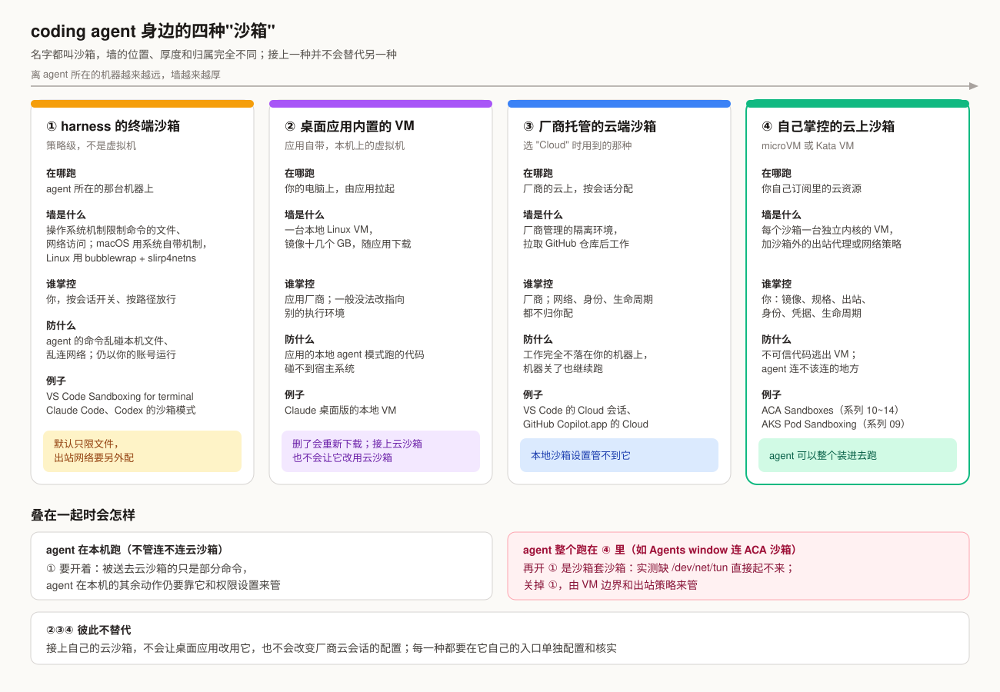

# Agent 基础设施系列 15：几种沙箱的区分

这几篇实践下来，我在同一个对话里先后碰到了好几种"沙箱"：VS Code 权限菜单里的 Sandboxing for terminal，Claude 桌面版在本机下载的那台 VM，Agents window 和 GitHub Copilot.app 里的 Cloud，还有我自己在 ACA 上建的 microVM。名字都叫沙箱，一开始很容易以为它们可以互相替代，比如接上 ACA 以后本地那些是不是就可以删了。实际上它们管的是不同的事。

## 一、harness 的终端沙箱

这是离 agent 最近的一层，**跑在 agent 所在的那台机器上**。agent 每执行一条终端命令，harness 都用操作系统机制给它套一层限制：能读写哪些路径、能连哪些网络地址，命令启动的子进程也一并受限。

VS Code 的文档把它的边界讲得很清楚：

- **它不是虚拟机**，也不是用户账号边界，被限制的命令仍以你的账号运行；它也不能替代终端安全软件；
- **它只管终端命令和它们的子进程**，不覆盖 agent 的每一个工具；
- **它默认不拦出站网络**，要限制连接得另外配置；
- **权限级别和沙箱是两回事**：选了 Allow all 或保存了某条命令的批准，并不会关掉已开启的沙箱，也不会让只读目录变得可写；
- **平台依赖**：macOS 15 以上不需要额外的包；Linux 需要 bubblewrap、slirp4netns、util-linux 和 iptables；依赖缺失时命令不会悄悄地在沙箱外运行，而是直接失败。

各家 harness 各管各的：VS Code 里的 Sandboxing for terminal 只作用于 Copilot 这个 harness；Claude Code、Codex 有自己的沙箱和权限配置，VS Code 文档也特意提醒，不要把某个权限模式当成"命令已经在沙箱里"的证明。

## 二、桌面应用内置的 VM

有些桌面应用自带一台本地虚拟机，给应用里的 agent 模式跑代码用。比如 Claude 桌面版，会在本机下载一套 Linux VM 镜像，体积十几个 GB。

这一层**由应用自己管**：什么时候启动、装了什么、能不能联网，都是应用决定的。我没有找到把它改指向其他执行环境的设置。手动删掉镜像，应用会重新下载，里面的会话数据也可能一起丢掉。它和我在云上建了什么沙箱没有关系。

## 三、厂商托管的云端沙箱

在 VS Code 的 Agents window 或 GitHub Copilot.app 里选 **Cloud**，用的就是这一层：会话交给厂商托管的云端环境，在那里拉取 GitHub 仓库开始工作，本机关掉也照样跑。

它的好处是什么都不用维护；代价是网络、身份、生命周期都由厂商决定。VS Code 的文档专门提醒两件事：一是**本地的沙箱和审批设置不会配置云端服务**，要看云端会话自己实际的控制项；二是关掉客户端、把任务标成完成，都不等于云端的计算资源被关掉了。

## 四、自己掌控的云上沙箱

ACA Sandboxes 和 AKS 的 Pod Sandboxing 属于这一层：**在自己的订阅里，每个沙箱一台带独立内核的 VM**。ACA 用的是 Cloud Hypervisor 起的 microVM，AKS 用的是 Kata。

和前三种最大的不同是：**能管的东西都在自己手里**。用哪个镜像、多大规格、出站放行哪些地址、凭据放在沙箱里还是由沙箱外的代理注入、什么时候挂起和删除，都可以自己定。系列 13 里"模型 token 不进沙箱、沙箱里只有假值"的做法，就是这一层才做得到的。

这一层又可以有两种用法：

- **agent 在本机，只把命令送进来跑**（[系列 12](Agent基础设施系列12：本地coding-agent调用ACA沙箱.md)）：沙箱只围住被送进来的那部分执行；
- **agent 整个住进来**（[系列 13](Agent基础设施系列13：把coding-agent装进ACA沙箱.md)、[系列 14](Agent基础设施系列14：把ACA沙箱接进VS-Code-Agents-window.md)）：agent 的循环、工具调用、会话状态都在墙里，本机只是遥控器或客户端。

## 五、叠在一起时会怎样

**agent 在本机跑，终端沙箱要开着。** 不管有没有接 ACA，agent 本身和它在本机做的事，都只能靠终端沙箱和权限设置来管。系列 12 里我必须额外禁止 agent 在本机跑 python，就是因为 skill 只是教它用沙箱，并不会阻止它在本地执行。

**agent 整个住进自己的云沙箱，终端沙箱应该关掉。** 这时候再开终端沙箱，就是在 ACA 的 microVM 里再套一层 bubblewrap。实测它直接起不来：ACA 的 microVM 里没有 `/dev/net` 目录，slirp4netns 拿不到 `/dev/net/tun`，命令全部失败。关掉以后，墙就是 ACA 自己的：VM 边界管它逃不出去，沙箱外的出站策略管它连不出去。前提是出站策略真的配了，ACA 默认出站是不限制的。

**桌面 VM、厂商云沙箱、自己的云沙箱彼此不替代。** 接上 ACA，不会让 Claude 桌面版改用 ACA，也不会改变 Cloud 会话的配置。每一种都要在它自己的入口单独配置、单独核实。

## 六、怎么选

按"代码能不能在本机跑"和"要不要自己管网络和凭据"两个问题来选：

- **代码可以在本机跑，只是想防误操作**：用 harness 的终端沙箱，配上合适的权限级别就够了。记得出站网络要单独限制。
- **代码不想在本机跑，也不想维护环境**：用厂商的 Cloud。接受它的网络和身份由厂商决定。
- **代码不想在本机跑，而且要自己定出站、凭据和数据位置**：用自己的云沙箱。要交互就像系列 14 那样接进 Agents window，要批量就像系列 13 那样用脚本或 API 驱动；agent 住进去以后，把终端沙箱关掉，把出站策略配严。

## 相关阅读

- [Agent 基础设施系列 14：把 ACA 沙箱接进 VS Code Agents window](Agent基础设施系列14：把ACA沙箱接进VS-Code-Agents-window.md)——终端沙箱在 ACA 里起不来的实测
- [Agent 基础设施系列 13：把 coding agent 装进 ACA 沙箱](Agent基础设施系列13：把coding-agent装进ACA沙箱.md)——key 不进沙箱的做法
- [Agent 基础设施系列 11：AKS 与 ACA 的沙箱选型](Agent基础设施系列11：AKS与ACA的沙箱选型.md)——Kata 与 microVM
- [Agent 基础设施系列 02：Kubernetes 上的 Agent 沙箱](../agent-runtime/Agent基础设施系列02：Kubernetes上的Agent沙箱.md)——Kata、gVisor、microVM 的隔离强度

## 参考资料

- [Sandbox Copilot agent sessions](https://code.visualstudio.com/docs/agents/run/agent-sandboxing)
- [Run agent sessions in the cloud](https://code.visualstudio.com/docs/agents/run/cloud-sandbox-sessions)
- [Copilot security in VS Code](https://code.visualstudio.com/docs/copilot/security)
- [Azure Container Apps Sandboxes 文档站](https://sandboxes.azure.com/docs/sandboxes)
