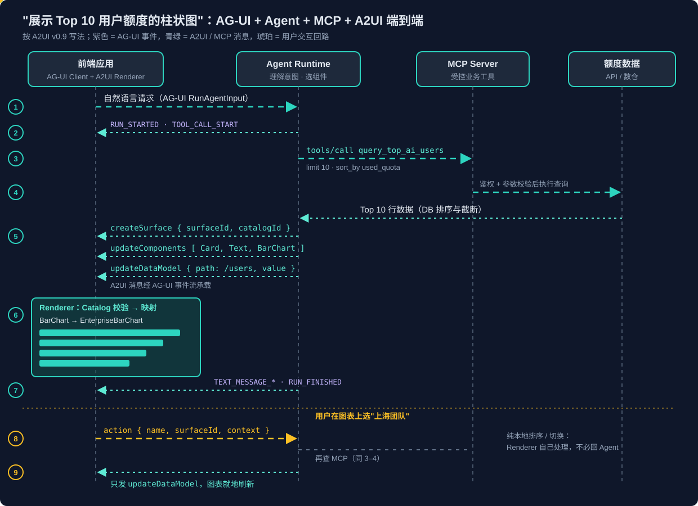
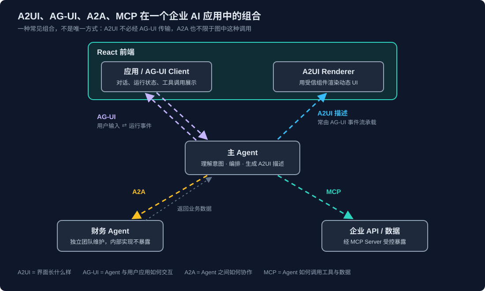

# A2UI 协议解析

## 结论先行

- **A2UI（Agent-to-User Interface）传的是"界面描述"而不是"界面代码"**：Agent 用 JSON 声明要哪些组件、绑定哪些数据，客户端只用自己注册过的组件渲染，不执行任何来自 Agent 的代码。它介于"前端写死页面"和"LLM 直接生成 HTML/JS"之间——**Agent 决定需要什么界面，客户端决定哪些界面可以被安全地渲染和操作**。
- **四个核心概念**：Surface（一块独立管理的 UI 区域）、Component（扁平列表 + id 引用的组件树）、Catalog（客户端允许 Agent 使用的组件契约）、Data Model（与结构分离、按路径绑定的数据）。再加上 Renderer 回传给 Agent 的 Action。
- **Renderer 是协议运行时，不是组件库**：它要解析消息、管理 Surface 生命周期、处理增量更新和数据绑定、路由用户操作；企业现有的 View Library / Design System 只是它最底层的组件实现。**有组件库 ≠ 有 A2UI Renderer**。
- **A2UI 管"画什么"，AG-UI 管"怎么交互"**：AG-UI 是 Agent 与前端之间的事件协议（运行生命周期、文本流、工具调用、状态同步），也是 A2UI 消息的主要承载通道之一；MCP 则在另一条链路上为 Agent 提供业务数据。
- **三个协议发起方不同**：A2UI 和 A2A 由 Google 发起，AG-UI 由 CopilotKit 发起，后来都以开放协议形式发展；A2A 已捐赠给 Linux Foundation。常见组合是 AG-UI + A2UI 先行，需要跨系统调用独立 Agent 时再引入 A2A。
- **版本现状**：生产稳定版是 **v0.9.1**，v1.0 处于 Candidate；官方 React / Lit / Angular / Flutter Renderer 均已稳定支持 v0.9.1，对 v1.0 的支持还在规划中。v0.8 的消息名与现在完全不同，读旧资料要注意。

## 一、A2UI 要解决什么问题

纯文本 Agent 在业务任务里会暴露一个问题：很多步骤本来更适合用界面完成。订机票时城市选择器、日期选择器、航班对比表、乘客表单、确认按钮，用自然语言一轮轮往返既慢又容易出错。但传统 Web 应用的 UI 是开发者提前写好的，Agent 的输出却只是文本。

**怎样让 Agent 动态决定呈现什么界面，又不让它直接控制浏览器或执行任意前端代码？** 这就是 A2UI 的出发点。三种做法对比：

| 维度 | 传统前端 | LLM 生成 HTML/JS | A2UI |
|---|---|---|---|
| UI 灵活性 | 取决于预先实现的页面 | 很高 | 取决于 Catalog 与协议能力 |
| 开发控制力 | 高 | 低，需额外沙箱约束 | 较高，组件实现由客户端掌握 |
| 执行任意代码 | 不需要 | 往往需要 | 协议禁止 |
| 跨平台复用 | 各端分别开发 | 各端分别生成 | 同一份描述交给各端 Renderer |
| 安全审查重点 | 常规软件安全流程 | 生成代码及其执行环境 | 组件白名单、消息校验、操作授权 |
| 适用场景 | 固定、复杂、稳定的业务 UI | 受控环境下的原型与开发辅助 | 需要按任务动态组合交互界面的 Agent 应用 |

A2UI 把职责拆开：**Agent** 根据任务决定展示什么；**客户端开发者**决定哪些组件可用、它们如何运行；**Renderer** 校验描述并渲染；**后端业务服务**执行真正的业务操作并做授权。

传统前端并没有过时——永远只有一个固定额度 Dashboard 的应用，直接写 React 组件最简单。A2UI 的价值在用户可以说"换成按团队聚合""改成折线图""再加一个使用率表格"这类需要**动态组合 UI** 的场景。

## 二、核心概念与消息

### 2.1 Surface、Component、Catalog、Data Model

- **Surface**：协议管理的一块 UI 区域，有自己的 id、组件结构和数据状态。一个 Agent 可以同时维护多个 Surface（比如一个图表区、一个表单区）。它不是某个 HTML 标签，也不是 React 组件本身。
- **Component**：组件以**扁平列表**下发，每个组件有 `id`，父子关系通过 `children` 引用 id 表达（类似邻接表）。好处是可以流式地逐个下发、局部更新某个组件，而不必每次重发整棵树。
- **Catalog**：客户端允许 Agent 使用的组件目录，规定有哪些组件、各自接受什么属性。官方有一个 Basic Catalog（Text、Button、Card、Row、Column、TextField 等基础组件），生产应用通常要**定义自己的 Catalog** 来对齐企业设计系统——比如 `CustomerSummary`、`OrderTable`、`BarChart`。`createSurface` 时用 `catalogId` 声明这块 Surface 用哪个 Catalog。
- **Data Model**：与组件结构分离的数据，组件通过路径（如 `/customer/name`）绑定。数据变了只发数据更新，结构不动。

> [!IMPORTANT]
> UI 的 Data Model 不是业务数据的权威来源。用户在界面上把发票金额从 1,000 改成 10,000，只是界面状态变了；只有后端经过授权和校验、真正执行业务操作之后，数据才算更新。

### 2.2 消息类型与版本演进

| 版本 | Agent → Renderer 消息 | Renderer → Agent |
|---|---|---|
| v0.8（旧） | `beginRendering`、`surfaceUpdate`、`dataModelUpdate`、`deleteSurface` | `userAction` |
| **v0.9.x（当前稳定）** | `createSurface`、`updateComponents`、`updateDataModel`、`deleteSurface` | `action` |
| v1.0（Candidate） | 在 v0.9 基础上新增 `actionResponse` 等，支持对客户端发起操作的同步响应 | `action` |

v0.9 的主要变化：`createSurface` 把"创建 Surface"从渲染中独立出来，并强制要求 `catalogId`；所有消息都带 `version` 字段；新增 `sendDataModel`，开启后 Renderer 每次发 action 时会把整个 Surface 的数据模型一起带上，Agent 能准确知道用户当时在界面上填了什么、选了什么。

**不同版本的示例不能混用**——网上不少文章仍是 v0.8 写法。

### 2.3 一次交互的消息序列（v0.9）

```json
{"version": "v0.9", "createSurface": {"surfaceId": "booking", "catalogId": "https://example.com/catalogs/basic.json"}}
{"version": "v0.9", "updateComponents": {"surfaceId": "booking", "components": [
  {"id": "root", "component": "Column", "children": ["header", "guests", "submit"]},
  {"id": "header", "component": "Text", "text": "预订餐厅"},
  {"id": "guests", "component": "TextField", "label": "人数", "value": {"path": "/reservation/guests"}},
  {"id": "submit_label", "component": "Text", "text": "提交"},
  {"id": "submit", "component": "Button", "child": "submit_label",
   "action": {"event": {"name": "submit_reservation", "context": {"guests": {"path": "/reservation/guests"}}}}}
]}}
{"version": "v0.9", "updateDataModel": {"surfaceId": "booking", "path": "/reservation", "value": {"guests": "2"}}}
```

用户点击提交后，Renderer 回传：

```json
{
  "version": "v0.9",
  "action": {
    "name": "submit_reservation",
    "surfaceId": "booking",
    "sourceComponentId": "submit",
    "timestamp": "2026-10-20T10:40:00Z",
    "context": {"guests": 4}
  }
}
```

以上为讲解用的精简示例，组件属性以所用 Catalog 的 Schema 为准。几点要注意：

- **用户输入只改本地数据模型，不触发网络请求**：在 TextField 里打字只更新 `/reservation/guests`，直到按钮触发 action 时，`context` 才按 path 取出当前值发回 Agent。
- **Action 是"声明一个操作名 + 上下文"，不是让前端执行代码**，Agent 收到后按自己的业务逻辑决定下一步。
- **组件也可以触发预注册的客户端函数**（`functionCall`，如格式校验、打开链接），同样只能调用客户端已注册的行为，Agent 无法注入新脚本。
- **一轮的结束由传输层标记**，协议本身不规定。消息常以 JSONL 流式下发，客户端可以边收边渲染：先出框架，再填数据。流式带来的代价是要处理顺序、重复消息、断线重连和非法组件定义。

## 三、Renderer：它是什么，协议规定了什么

### 3.1 Renderer 是协议运行时

官方用浏览器类比：A2UI 协议之于 Renderer，相当于 HTML 之于浏览器引擎；Agent 生成 A2UI 消息，相当于服务端生成 HTML。按职责可以拆成三层：

| 层 | 职责 |
|---|---|
| Protocol Runtime | 解析消息、校验 Schema、管理 Surface 生命周期、按顺序处理增量更新 |
| Component Adapter | 把协议里的组件类型映射到目标框架组件、解析数据绑定、把用户操作转成 action |
| View Library | 真正绘制界面的组件（企业 Design System、图表库等） |

这是逻辑划分，官方实现不一定拆成三个包。官方 Web 实现把前两层的共性部分抽成共享库 `@a2ui/web_core`（消息处理、Surface 状态、组件解析、数据绑定、类型与 Schema），React、Angular、Lit 三个 Renderer 复用它，各自只实现框架相关的渲染部分——**协议逻辑共享、UI 适配分开**，能减少不同 Renderer 之间的行为差异，这个设计值得借鉴。

### 3.2 协议对 Renderer 的要求

官方 Renderer 文档对客户端库的要求是：**缓冲并处理 A2UI 消息、实现 A2UI 生命周期、渲染组件、把用户操作路由回 Agent**。展开就是消息解析与校验、组件映射、Surface 与 Data Model 的状态管理、按序增量更新、数据绑定、用户交互回传；官方另有 Renderer Development Guide 指导自建，仓库里也带有 conformance 测试目录。

协议**不规定**组件长什么样：同一个 `Button`，React 端用企业按钮，Flutter 端用 Material 按钮，颜色、圆角、动画都可以不同。A2UI 追求的是**协议和交互语义的互操作，不是像素级一致**；要统一品牌风格，得另外定义 Design System 与主题规则。

### 3.3 Catalog、Renderer、View Library 的关系

```text
            A2UI Catalog（组件契约：有哪些组件、什么属性）
                  │
Agent ──A2UI 消息──▶ Renderer（解释协议、管理状态、映射组件）
                  │
                  ▼
            Enterprise View Library（真正绘制）
```

已有资产对照：

| 现有资产 | 是不是 A2UI Renderer | 还需要做什么 |
|---|---|---|
| 只有 React / Vue / Angular 组件库 | 不是 | 补协议处理、状态管理、数据绑定、事件回传 |
| 已有 JSON 驱动的动态表单/渲染引擎 | 不一定 | 核对是否符合目标版本的消息结构、生命周期与交互语义 |
| 官方 Renderer + 自定义组件 | 是 | 验证协议版本、Catalog 与行为兼容性 |

已有 React Design System 的企业，比较稳的路径是：选定协议版本 → 从现有组件里挑出适合动态组合的部分定义 Catalog（不必全量暴露，敏感组件限制属性和使用场景）→ 基于 `@a2ui/web_core` + `@a2ui/react` 写组件适配 → 建测试。**A2UI 不要求重做 UI 组件，要求的是一层能理解协议的 Renderer。**

### 3.4 现有实现

| Renderer | 平台 | v0.8 | v0.9.1 | v1.0 |
|---|---|---|---|---|
| React（`@a2ui/react`） | Web | 稳定 | 稳定 | 规划中 |
| Lit / Web Components（`@a2ui/lit`） | Web | 稳定 | 稳定 | 规划中 |
| Angular（`@a2ui/angular`） | Web | 稳定 | 稳定 | 规划中 |
| Flutter（GenUI SDK） | 移动 / 桌面 / Web | 稳定 | 稳定 | 规划中 |
| Jetpack Compose | Android | — | Alpha | 规划中 |
| SwiftUI | iOS / macOS | — | — | 规划中 |

社区还有 Vercel 的 json-render（基于 Zod Schema 渲染 A2UI Catalog）、React Native、ReactLynx 以及覆盖 iOS / Android / HarmonyOS 的 AGenUI 等实现，协议版本参差不齐。

**选型建议：生产上统一锁 v0.9.1**，后端 Agent、Catalog、Renderer 三方用同一版本，等官方 Renderer 支持 v1.0 再整体迁移。

## 四、案例：一句话生成 Top 10 用户额度柱状图

需求："展示 Top 10 用户的 AI 额度使用情况，用柱状图，按使用额度从高到低，同时显示额度上限和剩余额度。"



### 4.1 Agent 理解意图

Agent 把自然语言解析成查询对象（用户）、指标（已用额度）、数量（10）、排序（降序）、图表类型（柱状图）、附加字段（上限、剩余）。"额度"可能指已用、剩余、上限、token 消耗或费用，**存在实质歧义时应该追问，而不是让模型猜**；这里用户已经说了"使用额度"。

### 4.2 MCP 查询数据

不让 LLM 拼 SQL 直连生产库，而是由 MCP Server 提供受控工具：

```json
{
  "name": "query_top_ai_users",
  "description": "Query users ranked by AI quota consumption.",
  "inputSchema": {
    "type": "object",
    "properties": {
      "limit": {"type": "integer", "minimum": 1, "maximum": 10},
      "sort_by": {"type": "string", "enum": ["used_quota", "remaining_quota"]},
      "period": {"type": "string"}
    },
    "required": ["limit", "sort_by", "period"]
  }
}
```

Agent 调用 `tools/call`，参数 `{limit: 10, sort_by: "used_quota", period: "current_month"}`。排序和 Top-N 由数据库完成，MCP Server 负责校验调用者身份、数据访问范围和参数。**MCP 到这里任务就结束了**：它只交付数据，不决定 UI，也不画图。

### 4.3 Agent 生成 A2UI 消息

`BarChart` 不在 Basic Catalog 里，所以前提是企业已经在自定义 Catalog 中定义了它：

```json
{"version": "v0.9", "createSurface": {"surfaceId": "ai_usage_top10", "catalogId": "https://example.com/catalogs/enterprise-ui.json"}}
{"version": "v0.9", "updateComponents": {"surfaceId": "ai_usage_top10", "components": [
  {"id": "root", "component": "Card", "child": "col"},
  {"id": "col", "component": "Column", "children": ["title", "chart"]},
  {"id": "title", "component": "Text", "text": "Top 10 AI 额度使用情况"},
  {"id": "chart", "component": "BarChart", "data": {"path": "/users"},
   "categoryKey": "user_name", "valueKey": "used_quota", "orientation": "horizontal"}
]}}
{"version": "v0.9", "updateDataModel": {"surfaceId": "ai_usage_top10", "path": "/users", "value": [
  {"user_name": "Alice", "used_quota": 9500, "quota_limit": 10000, "remaining_quota": 500},
  {"user_name": "Bob", "used_quota": 8800, "quota_limit": 10000, "remaining_quota": 1200}
]}}
```

（数据为演示用，只列前两条；`BarChart` 及其属性来自假设的企业 Catalog。）消息里没有一行绘图代码：组件结构说"要显示什么"，数据模型说"现在显示的数据是什么"。

### 4.4 AG-UI 承载，Renderer 渲染

整个过程中前端通过 AG-UI 收到的事件大致是：`RUN_STARTED` → `TOOL_CALL_START` / `TOOL_CALL_ARGS` / `TOOL_CALL_END` / `TOOL_CALL_RESULT`（可以显示"正在查询额度…"）→ 承载 A2UI 消息的事件 → `TEXT_MESSAGE_START` / `CONTENT` / `END`（一句文字说明）→ `RUN_FINISHED`。

前端把 A2UI 载荷交给 Renderer：校验 `BarChart` 在 Catalog 内 → 映射到企业的 `EnterpriseBarChart`（底层可以是 Recharts 等图表库）→ 绑定 `/users` 数据 → 绘制。Catalog 外的组件一律拒绝或走设计好的降级。

### 4.5 后续交互

| 用户操作 | 处理路径 |
|---|---|
| 图表内切换升序 / 降序 | **前端本地处理**，数据已在手，不必回 Agent |
| "只看上海团队" | 通过 action 或新的用户消息交给 Agent → 再调 MCP → **只发 `updateDataModel`**，结构不变，图表就地刷新 |
| "换成表格""加一个筛选器" | Agent 用 `updateComponents` 改结构（前提是 Catalog 支持） |

**不是每个 UI 事件都要绕回 Agent**：纯展示和本地交互留在前端，能省延迟、省 token；需要理解自然语言、查企业数据、跑业务逻辑时才交给 Agent。

### 4.6 各环节职责

| 环节 | 输入 | 输出 |
|---|---|---|
| Agent / LLM | 自然语言、应用上下文、Catalog 能力 | 查询意图、工具调用、A2UI 描述 |
| MCP Client / Server | 受控参数 | 经过授权的业务数据 |
| AG-UI 集成 | Agent 运行事件、A2UI 载荷 | 前端事件流 |
| A2UI Renderer | A2UI 消息 | 组件树与数据绑定 |
| 企业图表组件 | 数据、图表属性 | 实际的柱状图 |

Agent 必须事先知道目标 Renderer 支持哪些组件（通过 Catalog 约定），否则生成了 `BarChart` 而前端没注册，也渲染不出来。

## 五、A2UI 与 AG-UI：边界在哪里

### 5.1 一张表区分

| 维度 | A2UI | AG-UI |
|---|---|---|
| 全称 | Agent-to-User Interface | Agent-User Interaction Protocol |
| 核心问题 | Agent 如何**描述**一个 UI | Agent 如何与前端应用**交互** |
| 协议核心 | 组件、结构、数据绑定、增量更新 | 事件：运行生命周期、消息流、工具调用、状态同步 |
| Agent → 前端 | UI 描述与数据更新 | 文本、运行状态、工具调用事件，也可承载 A2UI |
| 前端 → Agent | `action`（组件触发的操作） | 用户输入、状态与应用事件 |
| 能否单独使用 | 可以，走 A2A 或自定义传输 | 可以，不一定用 A2UI |

常见误解是"A2UI 只管 Agent → UI，AG-UI 管 UI → Agent"。不准确：**A2UI 自己就定义了 Renderer 到 Agent 的 action 消息**；AG-UI 也不只是传输层，它有一整套事件语义。关系上，**A2UI 类似 HTML，Renderer 类似浏览器，AG-UI 是面向 Agent 应用的事件通信协议**。AG-UI 与 A2UI 的定位细节可参考 [AG-UI 协议解析](AG-UI协议解析.md)。

### 5.2 AG-UI 的事件分类

| 类别 | 主要事件 | 用途 |
|---|---|---|
| Lifecycle | `RUN_STARTED`、`STEP_STARTED`、`STEP_FINISHED`、`RUN_FINISHED`、`RUN_ERROR` | 展示运行进度，不暴露 Agent 内部推理细节 |
| Text Message | `TEXT_MESSAGE_START` / `CONTENT` / `END` | 流式文本 |
| Tool Call | `TOOL_CALL_START` / `ARGS` / `END` / `RESULT` | 向前端呈现工具调用过程（参数按 delta 流式拼接） |
| State Management | `STATE_SNAPSHOT`、`STATE_DELTA`、`MESSAGES_SNAPSHOT` | 前后端共享状态同步（快照 + 增量） |
| Activity | Activity 系列 | 展示正在进行的活动进度 |
| Subagent | Subagent 系列 | 跟踪子 Agent 并标注其输出归属 |
| Special | `CUSTOM`、`RAW` | 承载自定义载荷 |

三种模式贯穿其中：Start-Content-End（流式内容）、Snapshot-Delta（状态同步）、Started-Finished/Error（生命周期）。

两个容易混的边界：

- **AG-UI 的 Tool Call 事件 ≠ MCP**。MCP 是 Agent 与工具服务器之间的调用协议；AG-UI 的工具事件只是把调用过程**展示**给前端。前端不应因为收到 `TOOL_CALL_START` 就自己去执行工具。
- **AG-UI 的应用状态 ≠ A2UI 的 Data Model**。前者可以存筛选条件、会话状态，后者是某个 Surface 里组件绑定的数据。两者可以关联，但不要默认完全同步，否则复杂度上来后会出现重复维护和更新顺序冲突。

### 5.3 A2UI 的传输方式

A2UI 本身与传输无关，任何能发 JSON 的通道都可以：

| 传输 | 状态 | 场景 |
|---|---|---|
| A2A | 稳定（通过 A2A 扩展） | 多 Agent 系统，远端 Agent 直接回 UI |
| AG-UI | 稳定 | 全栈 React / Vue / Angular 应用；AG-UI（CopilotKit）自动把 A2UI 消息转成 AG-UI 事件，并处理传输与状态同步 |
| MCP | v1.0 规范中定义了绑定 | 以工具输出 / 资源方式承载；另有 MCP Apps 互嵌的指南 |
| REST | 规划中 | 简单 HTTP 端点 |
| WebSocket / SSE | 提案 | 实时双向 / Web 流式 |

也就是说，用 CopilotKit 这类 AG-UI 实现时，A2UI 嵌入事件流已经有现成的集成，不用自己设计封装格式；自研 Agent 后端时才需要明确 A2UI 走 AG-UI 自定义事件还是独立通道，并约定好状态同步规则。**装了 AG-UI 不等于有了 A2UI Renderer，反之亦然**。

## 六、A2UI、AG-UI、A2A 的发起方与组合

### 6.1 发起方与生态

三个协议常被一起提起，但**并不是同一家公司开发的**：

| 协议 | 发起方 | 核心用途 | 当前生态特点 |
|---|---|---|---|
| A2UI（Agent-to-User Interface） | Google | Agent 如何声明式地描述 UI | Google 发起，CopilotKit 与开源社区参与贡献 |
| A2A（Agent2Agent） | Google | 不同 Agent 之间如何通信、协作 | 2025 年 6 月捐赠给 Linux Foundation，现归属其下的 Agentic AI Foundation（与 MCP 同一基金会），开放治理 |
| AG-UI（Agent-User Interaction） | CopilotKit | Agent 如何与前端应用交互 | 开放协议，已集成 LangGraph、CrewAI、Microsoft Agent Framework、Google ADK 等 Agent 框架 |

### 6.2 三者如何配合



以一个企业 AI 应用为例：React 前端通过 **AG-UI** 与主 Agent 交互；主 Agent 通过 **A2A** 委派独立维护的财务 Agent，通过 **MCP** 访问企业 API；拿到业务数据后，主 Agent 生成 **A2UI** 描述，交给前端的 A2UI Renderer 渲染成动态界面。

这只是一种组合方式：A2UI 不一定经 AG-UI 传输（也可以走 A2A，或自定义通道；REST、WebSocket、SSE 的官方绑定目前仍在规划或提案阶段），A2A 也不只用于图中这种调用。

一句话区分：**A2UI 描述界面应该是什么样子；AG-UI 处理 Agent 与用户应用之间的交互；A2A 处理 Agent 之间的通信与协作；MCP 处理 Agent 对工具与数据的调用。**

### 6.3 选型建议

前端动态 UI 与 Agent 交互是同一个应用内部的问题，**AG-UI + A2UI 是值得优先评估的组合**；只有当需要跨系统、跨团队调用独立运行的 Agent 时，再引入 A2A（企业侧的 A2A 落地见 [企业级 A2A 方案](企业级A2A方案：从微服务治理到Agent互操作层.md)）。这样可以避免把动态 UI、前端交互和 Agent 间通信混成一个问题。

## 七、安全与企业落地

### 7.1 安全：A2UI 让约束更容易落地，但不自动保证安全

- **组件白名单**：只渲染 Catalog 内的组件，未知组件拒绝或受控降级。如果企业自己往 Catalog 里放了 `ExecuteCommand` 这种组件，协议也救不了。
- **展示 ≠ 授权**：要分清三件事——Agent 能不能展示这个按钮、当前用户能不能看到它、当前用户能不能真正执行操作。**点击按钮只证明用户触发了一个 UI 操作，不证明他有权执行业务操作**；"按钮不显示"也不能当授权机制，恶意客户端可以直接构造请求。后端必须独立校验身份、权限和业务规则。
- **客户端回传的数据不可信**：Data Model 里带回来的客户 ID，后端要重新校验当前用户是否有权访问。
- **`sendDataModel` 的可见性**：开启后整个 Surface 数据模型会随 action 发给 Agent（以及中间的编排层），不要把不该让 Agent 看到的数据放进 Data Model。
- **数据最小化**：为了画一张卡片，只取卡片需要的字段，字段过滤在业务 API 层做。
- **Prompt Injection**：A2UI 限制了组件和交互能力，能减少一部分风险，但无法单独解决注入问题；工具调用的独立授权、敏感操作的人工确认、输出校验与审计仍然需要。
- **生成侧也要约束**：向模型提供 Catalog 及其语义，要求结构化输出，后端先做 Schema 与 Catalog 校验再下发。关键业务 UI 可以由确定性代码生成结构，模型只负责组件选择与内容组织。

### 7.2 企业 Agent 平台中的定位

把 A2UI 当成**动态 UI 协议层，而不是前端平台的替代品**。几条落地原则：

1. **MCP 是受控的业务工具层**：返回规范化业务数据，不返回 HTML 或 React 代码。
2. **Catalog 是受控的 UI 能力层**：由平台统一维护、映射到企业 Design System；业务部门可以申请扩展组件，但新组件要走开发、测试、安全审查和发布流程。
3. **AG-UI 负责交互集成**：运行生命周期、工具调用状态、文本流、错误事件，以及 A2UI 载荷的承载。
4. **协议版本统一管理**：全平台锁定一个 A2UI 版本，不允许各团队各用各的消息结构。
5. **评估 UI 质量，而不只是回答质量**：组件选择是否正确、数据是否绑定到正确字段、非法组件是否被拒绝、action 是否路由正确、错误与超时处理、多屏幕尺寸显示、无障碍、UI 操作是否遵循授权规则。

### 7.3 适合与暂不适合的场景

| 适合优先尝试 | 暂不建议 |
|---|---|
| 知识助手按问题动态生成查询表单 | 已有成熟、复杂的固定业务界面 |
| 按查询结果生成数据卡片、表格、图表 | 对像素级 UI 和复杂动画有严格要求 |
| 销售、数据分析助手按任务组合不同界面 | 高风险业务、需要高度确定的操作流程 |
| 多个 Agent 向同一前端提供动态 UI | 客户端缺乏可靠的 Renderer 与组件治理 |
| Web 与移动端复用同一份界面描述 | 团队尚未建立前端安全、版本与兼容性管理能力 |

跨平台复用也有边界：桌面端的复杂数据表格在移动端往往需要完全不同的布局，每个平台仍然要实现和维护自己的 Renderer 与组件。

还需要持续验证的几件事：不同 Renderer 的成熟度与兼容性、动态 UI 对复杂业务流程的承载能力、协议快速演进带来的维护成本、Catalog 治理成本，以及与传统前端相比是否真的降低了整体开发维护成本。

## 参考

- [A2UI 官网](https://a2ui.org/) 与 [a2ui-project/a2ui](https://github.com/a2ui-project/a2ui)
- [A2UI Concepts Overview](https://a2ui.org/concepts/overview)（各版本消息类型）
- [A2UI Protocol v0.9](https://a2ui.org/specification/v0.9-a2ui) 与 [A2UI Protocol v1.0（Candidate）](https://a2ui.org/specification/v1.0-a2ui)
- [Renderers (Client Libraries)](https://a2ui.org/reference/renderers/)、[Actions](https://a2ui.org/concepts/actions/)、[Transports](https://a2ui.org/concepts/transports/)
- [A2UI v0.9: What's New in Google's Generative UI Spec](https://www.copilotkit.ai/blog/a2ui-whats-new-in-google-generative-ui-spec)
- [AG-UI Events](https://docs.ag-ui.com/concepts/events) 与 [ag-ui-protocol/ag-ui](https://github.com/ag-ui-protocol/ag-ui)
- [Linux Foundation Launches the Agent2Agent Protocol Project](https://www.linuxfoundation.org/press/linux-foundation-launches-the-agent2agent-protocol-project-to-enable-secure-intelligent-communication-between-ai-agents) 与 [Agentic AI Foundation](https://aaif.io)
- 相关文章：[AG-UI 协议解析](AG-UI协议解析.md)、[企业级 A2A 方案：从微服务治理到 Agent 互操作层](企业级A2A方案：从微服务治理到Agent互操作层.md)
