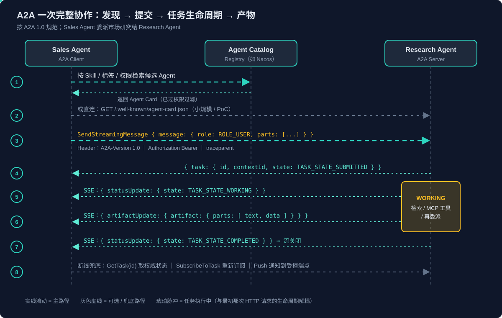
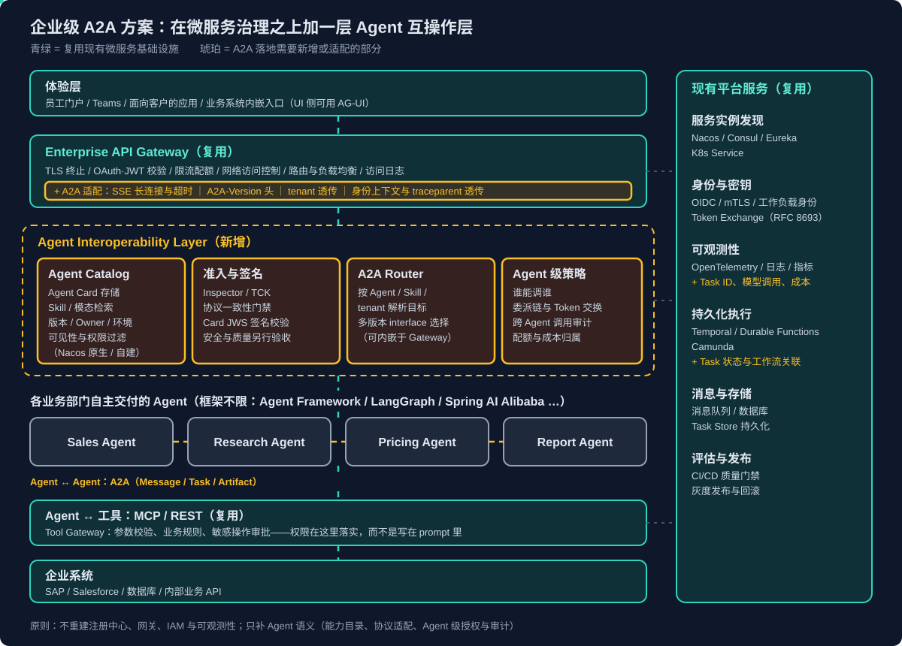

# 企业级 A2A 方案：从微服务治理到 Agent 互操作层

## 结论先行

- **A2A 和微服务治理要解决的问题高度同构**：发现、契约、调用、认证授权、追踪监控，一一都能对上。所以它**不该**被当成一套平行的新基础设施，而是叠在现有微服务治理之上的 **Agent 互操作层（Agent Interoperability Layer）**。
- **它真正新增的是"Agent 语义"的标准化**，不是传输能力：Agent Card（能力而非接口）、Task 生命周期（长任务、需补充输入、需认证）、Part/Artifact（多模态内容与产物）。这些用 REST + 自定义任务 API 都做得出来，A2A 的价值在于**让跨团队、跨框架、跨厂商的 Agent 不必各自发明一套**。
- **协议层已成型，中间件层还在拼装**：官方规范（1.0）、六种语言 SDK、Inspector 与 TCK 都已就绪；Registry 方面 Nacos 3.1+ 已原生支持 A2A Agent Card，但**官方尚无统一的 Registry API**；Gateway 基本是"现有网关 + A2A 适配"。
- **落地要点**：Registry 复用（Nacos 原生 / Consul·Eureka 挂元数据）+ 自定义一层 Registry 抽象接口防锁定；Gateway 复用并补 SSE、版本头、tenant 与身份透传；IAM、OpenTelemetry、工作流引擎全部复用，只补 Agent 维度的授权、Task 关联与成本指标。
- **一个容易踩的坑**：网上大量教程和部分平台仍是 0.3 写法（`message/send`、`kind`、`url`），1.0 已全面改名改结构，**0.3 客户端解析不了 1.0 的 Agent Card**。

## 一、A2A 在 Agent 协议栈中的位置

三个协议各管一个方向，互补而非竞争（详见 [AG-UI 协议解析](AG-UI协议解析.md)）：

| 协议 | 方向 | 核心抽象 | 典型场景 |
|---|---|---|---|
| MCP | Agent ↔ 工具/数据 | Tools、Resources、Prompts | Agent 查 CRM、调内部 API |
| **A2A** | **Agent ↔ Agent** | **Agent Card、Message、Task、Artifact** | **销售 Agent 委派研究 Agent** |
| AG-UI | Agent ↔ 用户界面 | Event 流 | 前端渲染 Agent 的流式输出与交互 |

发起方并不相同：A2A 与 A2UI 由 Google 发起，AG-UI 由 CopilotKit 发起。A2A 于 2025 年 4 月发布，同年 6 月捐赠给 Linux Foundation，现归属 Agentic AI Foundation（与 MCP 同一基金会），保持厂商中立的开放治理。三者的组合方式见 [A2UI 协议解析](A2UI协议解析.md)。

两条边界值得记住：

- **A2A 的前提是"对方是一个独立的 Agent"**，内部用什么框架、什么模型、调了哪些工具都不暴露（opaque）。如果几个步骤由同一团队开发、共享状态、延迟敏感，框架内部编排往往更简单，不必拆成 A2A 调用。
- **A2A 和 MCP 可以嵌套**：Sales Agent 通过 A2A 委派 Research Agent，Research Agent 内部再用 MCP 调检索工具，工具底下仍是 REST。

## 二、报文解剖：一次完整的 A2A 协作

以下全部按 **A2A 1.0** 规范书写，示例为讲解用的精简版，生产实现以所选版本的完整 Schema 校验。



### 2.1 发现：Agent Card

Agent Card 是 Agent 对外发布的"能力说明书"，默认放在 Well-Known URI：

```http
GET /.well-known/agent-card.json HTTP/1.1
Host: research.example.com
```

```json
{
  "name": "Market Research Agent",
  "description": "Researches markets, competitors, and industry trends.",
  "version": "1.2.0",
  "supportedInterfaces": [
    { "url": "https://research.example.com/a2a", "protocolBinding": "JSONRPC", "protocolVersion": "1.0" },
    { "url": "https://research.example.com/a2a/v03", "protocolBinding": "JSONRPC", "protocolVersion": "0.3" }
  ],
  "capabilities": { "streaming": true, "pushNotifications": true, "extendedAgentCard": true },
  "defaultInputModes": ["text/plain", "application/json"],
  "defaultOutputModes": ["text/plain", "application/json"],
  "skills": [
    {
      "id": "competitor-analysis",
      "name": "Competitor Analysis",
      "description": "Analyzes competitors, market position, and product strategies.",
      "tags": ["market-research", "competition"],
      "examples": ["Compare the competitive positions of Company A and Company B."]
    }
  ],
  "securitySchemes": { "...": "OAuth2 / OIDC / mTLS 声明" },
  "signatures": ["JWS 签名，防 Card 被篡改"]
}
```

几个容易混淆的点：

- **`supportedInterfaces` 是有序列表**，每项一种绑定（`JSONRPC` / `GRPC` / `HTTP+JSON`），各带自己的 `protocolVersion`；客户端从前往后找第一个自己支持的。一个 Agent 可以同时暴露 1.0 和 0.3 两个 interface，这就是 1.0 的向后兼容方案。
- **`protocolVersion` 和 `version` 是两回事**：前者是 A2A 协议版本（在 interface 里），后者是这个 Agent 应用自身的版本。
- **Skill 不是函数签名**。`competitor-analysis` 只声明"我能做竞争分析"，不规定 `analyze(company_a, company_b)` 这样的参数；调用方仍是发一条 Message，具体输入由 Agent 自己理解。
- **Well-Known URI 只是"约定的入口"，不是发现算法**：调用方仍得先知道域名。企业规模下要靠 Registry/Catalog，规范把 Well-Known、Registry/Catalog、预配置地址并列为三种发现方式。
- **认证类信息可放进 Extended Agent Card**：公开 Card 只给最少信息，认证后再通过 `GetExtendedAgentCard` 拿完整版（`capabilities.extendedAgentCard: true` 声明支持）。

### 2.2 提交：SendMessage 与 Part

```http
POST /a2a HTTP/1.1
Host: research.example.com
Content-Type: application/json
A2A-Version: 1.0
Authorization: Bearer <access-token>
```

```json
{
  "jsonrpc": "2.0",
  "id": "req-001",
  "method": "SendMessage",
  "params": {
    "message": {
      "messageId": "msg-001",
      "role": "ROLE_USER",
      "parts": [
        { "text": "Compare Company A and Company B in the enterprise AI market." },
        { "data": { "companyA": "Company A", "companyB": "Company B", "period": "2025-2026" },
          "mediaType": "application/json" },
        { "url": "https://files.example.com/requirements.pdf",
          "filename": "requirements.pdf", "mediaType": "application/pdf" }
      ]
    },
    "configuration": { "returnImmediately": true }
  }
}
```

- **`parts` 是 A2A 承载多模态的方式**。1.0 把 0.3 的 TextPart / FilePart / DataPart 统一成一个 `Part`，**按出现哪个字段区分类型**：`text`、`data`、`url`（文件引用）、`raw`（base64 内联二进制），配 `mediaType` 和 `filename`。
- **`data` 的业务 Schema 不归 A2A 管**：`companyA` 是什么意思，要靠调用双方约定。
- **`url` 引用文件不等于权限也传过去了**：接收方能不能访问、是否需要短期签名 URL、能不能跨区域，都要另行设计。
- **`returnImmediately`**：`true` 立即返回 Task 稍后再查，`false`（默认）阻塞到任务结束。

### 2.3 三个 ID 与 Task 生命周期

响应可能直接是 Message（快速问答），也可能是 Task（需要时间的工作）：

```json
{
  "jsonrpc": "2.0",
  "id": "req-001",
  "result": {
    "task": {
      "id": "task-5d2e",
      "contextId": "ctx-91af",
      "status": { "state": "TASK_STATE_WORKING", "timestamp": "2026-10-20T08:15:00.000Z" }
    }
  }
}
```

**三个 ID 不能混**：JSON-RPC 的 `id` 标识这一次 RPC 调用；`task.id` 标识这一个工作单元；`contextId` 把同一段协作里的多轮消息和多个任务串起来。Task 的意义就在于**它的生命周期和最初那次 HTTP 请求解耦**——请求结束了，任务还在跑。

| 状态（1.0） | 含义 | 类型 |
|---|---|---|
| `TASK_STATE_SUBMITTED` | 已提交 | 进行中 |
| `TASK_STATE_WORKING` | 执行中 | 进行中 |
| `TASK_STATE_INPUT_REQUIRED` | 需要调用方补充信息（多轮交互） | 中断 |
| `TASK_STATE_AUTH_REQUIRED` | 需要先完成认证 | 中断 |
| `TASK_STATE_COMPLETED` | 成功完成 | 终止 |
| `TASK_STATE_FAILED` | 执行失败 | 终止 |
| `TASK_STATE_CANCELED` | 被取消 | 终止 |
| `TASK_STATE_REJECTED` | Agent 拒绝执行 | 终止 |

`INPUT_REQUIRED` 和 `AUTH_REQUIRED` 是传统 REST 最难自然表达的两个状态：任务没失败，只是在等对方。调用方带上同一个 `taskId` + `contextId` 再发一条 `SendMessage` 即可续上。

### 2.4 拿结果：轮询、流式、推送与 Artifact

| 方式 | 方法 | 适用 |
|---|---|---|
| 轮询 | `GetTask` | 最简单；是**权威状态来源** |
| 流式 | `SendStreamingMessage` / `SubscribeToTask`（断线重订） | 分钟级任务，要看进度 |
| 推送 | `CreateTaskPushNotificationConfig` 注册回调端点 | 长时间任务，不想保持连接 |

流式走 SSE，每个 `data:` 里是一个 JSON-RPC 响应，`result` 按成员名区分事件类型：

```text
data: {"jsonrpc":"2.0","id":"req-004","result":{"task":{"id":"task-5d2e","status":{"state":"TASK_STATE_SUBMITTED"}}}}
data: {"jsonrpc":"2.0","id":"req-004","result":{"statusUpdate":{"taskId":"task-5d2e","status":{"state":"TASK_STATE_WORKING"}}}}
data: {"jsonrpc":"2.0","id":"req-004","result":{"artifactUpdate":{"taskId":"task-5d2e","artifact":{"artifactId":"art-1","name":"Market Analysis","parts":[{"text":"Company A ..."},{"data":{"companyA":{"strength":"distribution"}}}]},"index":0}}}
data: {"jsonrpc":"2.0","id":"req-004","result":{"statusUpdate":{"taskId":"task-5d2e","status":{"state":"TASK_STATE_COMPLETED"}}}}
```

- **Message、Task、Artifact 三分**：Message 用于交流（提问、补充、状态说明），Task 表示工作及其生命周期，Artifact 是工作产出——可以同时含给人看的文本和给下游 Agent 用的结构化数据。
- **A2A 的流式 ≠ 模型 token 流式**：它推的是任务状态与产物更新，不一定逐 token。
- **推送通知两条安全底线**：回调端点必须白名单受控（否则服务端向任意 URL 发请求就是 SSRF）；推送只做"提醒"，权威状态仍以 `GetTask` + 持久化的 Task 记录为准。

### 2.5 0.3 → 1.0 的主要改动（读旧资料必看）

| 项 | 0.3 | 1.0 |
|---|---|---|
| 方法名 | `message/send`、`message/stream`、`tasks/get`、`tasks/cancel`、`tasks/resubscribe` | `SendMessage`、`SendStreamingMessage`、`GetTask`、`CancelTask`、`SubscribeToTask`，新增 `ListTasks` |
| 类型区分 | 每个对象带 `kind` 字段 | 去掉 `kind`，按 JSON 成员名区分（`task` / `message` / `statusUpdate` / `artifactUpdate`） |
| Part | TextPart / FilePart / DataPart 三种类型，`mimeType` | 统一 Part，`text` / `data` / `url` / `raw` 四选一，`mediaType` |
| 枚举值 | `working`、`user` | `TASK_STATE_WORKING`、`ROLE_USER` |
| Agent Card | 顶层 `url` + `preferredTransport` + `protocolVersion` | `supportedInterfaces[]`，每项自带 binding 与版本 |
| 流结束 | `final: true` | 去掉 `final`，以流关闭表示终止 |
| 多租户 | 无，靠认证或 URL 路径隐式区分 | 请求与 interface 上原生 `tenant` 字段 |
| 安全 | 含 implicit / password 流 | 移除两者，新增 Device Code 流、PKCE 标记、Agent Card JWS 签名 |
| 错误 | 自定义 code + data | `google.rpc.Status` + `ErrorInfo`（`reason` / `domain`） |

> [!WARNING]
> 0.3 客户端会直接解析失败 1.0 的 Agent Card（`url` 字段搬进了 `supportedInterfaces`）。部分托管平台的 A2A 端点目前仍只支持 0.3 方法名，选型时要逐个确认对端版本，网关和 SDK 需按 interface 版本分别适配。

## 三、和微服务治理的区别与联系

### 3.1 概念对照

| 微服务体系 | 解决的问题 | A2A 中的对应 | 关系 |
|---|---|---|---|
| Eureka / Consul / Nacos | 服务实例发现 | Agent Card + Agent Registry/Catalog | **补充**：实例发现照旧，Catalog 管能力与契约 |
| OpenAPI / Swagger | 接口契约 | Agent Card（Skill、模态、能力、安全要求） | **不等价**：描述"能做什么"而非"有哪些 endpoint" |
| REST / gRPC | 服务间通信 | JSON-RPC / gRPC / HTTP+JSON 三种绑定 | **复用**：A2A 不发明传输层 |
| Request / Response | 同步调用 | Message | 相近 |
| 异步 Job / 长任务 API | 长时间运行 | Task 生命周期 | **标准化**：把各团队自定义的任务 API 收敛成协议概念 |
| 业务对象 / 文件 | 数据传递 | Part / Artifact | **标准化**：多模态内容的公共数据模型 |
| OAuth2 / OIDC / mTLS | 认证 | Agent Card 中的 `securitySchemes` 声明 | **复用**：协议只声明要求，不颁发不验证 Token |
| API Gateway | 入口、路由、限流 | 现有网关 + A2A 适配 | **复用 + 适配** |
| OpenTelemetry | Trace / Metrics / Logs | 现有体系 + Task 维度关联 | **复用 + 补指标** |

### 3.2 微服务"表达不好"的到底是什么

准确地说，**不是微服务架构表达不了模态、Message、Task 这些概念，而是它没有一套面向 Agent 互操作、跨框架统一的标准语义**：

| Agent 语义 | 微服务里相近的概念 | 为什么不完全等价 |
|---|---|---|
| 模态（Modality） | MIME type、媒体 API | `image/png` 只描述格式，不表达"这个 Agent 接受哪些输入模态、产出哪些"，也没有协商机制 |
| Message | HTTP 请求、MQ 消息 | Agent 消息由多个 Part 组成，挂在 context 与 task 上，属于多轮交互的一环 |
| Task | Async Job、Long-running Operation | 长任务大家都能做，但 `INPUT_REQUIRED` / `AUTH_REQUIRED` 这种"等对方"的中间态，每个团队自定义就互不相通 |
| Artifact | 响应体、文件 | 产物要同时服务人和下游 Agent，需要作为协作协议的一部分表达 |
| Skill / Capability | OpenAPI operation、注册元数据 | API 描述输入输出；Skill 描述能力，供其他 Agent **选择**而不只是调用 |

可以把问题分成三层看：**协议层**（怎么传消息、管任务）、**语义层**（消息/任务/模态/能力各代表什么，不同实现理解是否一致）、**治理层**（认证、授权、路由、追踪、审计）。传统微服务在协议层和治理层都很成熟，A2A 主要补的是语义层，并复用另外两层。

也要避免过度解读：A2A 解决的是**协议级互操作**，不是**语义理解**。Agent Card 写得再好，也不保证描述准确、不保证 Agent 真能把任务做好——能力匹配仍需要 Registry 检索、路由策略或 LLM 辅助选择，质量仍需要评估体系。

### 3.3 什么时候值得上 A2A

| 场景 | 是否需要 A2A |
|---|---|
| 应用调用一个模型 API | 不需要，直接用模型 API |
| 一个 Agent 调 CRM、数据库、搜索 | 优先 MCP 或普通 API |
| 少量 Agent、同一团队维护 | 未必，自定义 API 可能更简单 |
| 多个独立 Agent 跨团队、跨框架、跨厂商协作 | **值得**——收益来自统一交互契约 |
| 长任务需要持续返回状态、中途要补充输入 | **有价值**，可统一 Task 生命周期（但不是唯一方案） |

判断标准是**能否降低跨 Agent 的集成与治理成本**，而不是"它是新技术"。

## 四、微服务生态对 A2A 的支持现状

### 4.1 组件成熟度一览

| 层 | 现状 | 判断 |
|---|---|---|
| 协议规范 | A2A 1.0 | 已成型 |
| SDK | 官方 Python / Java / JS / Go / .NET / Rust | 已成型，Python 最活跃 |
| 协议一致性 | A2A Inspector（调试）、A2A TCK（兼容性测试套件） | 已有，生态在发展 |
| Agent Registry | Nacos 3.1+ 原生；Consul/Eureka 需适配；官方无统一 Registry API | **最大缺口之一** |
| Gateway | 现有 API Gateway 可代理，A2A 感知能力需补 | **另一缺口** |
| 认证授权 | 复用 OAuth2 / OIDC / mTLS / RBAC / OPA | 成熟，Agent 级策略需设计 |
| 可观测性 | 官方 Python / Java SDK 已有 OpenTelemetry 集成 | 可复用，需补 Agent 指标 |
| 持久化执行 | Temporal、Durable Functions、Camunda | 成熟，但与 Task 的关联需自建 |

一句话：**标准与 SDK 已基本成型，围绕它的企业级治理中间件还没有形成像 K8s + Nacos + Spring Cloud Gateway + OpenTelemetry 那样公认的组合**，需要复用现有产品自己拼。

### 4.2 Registry：Nacos 原生，Eureka / Consul 适配

**Nacos 3.1 起原生提供 A2A Registry**：Nacos 中的 Agent 对象直接对齐 A2A 的 AgentCard 定义（少量扩展），支持 AgentCard 与服务端点的发布和发现、命名空间隔离（同一命名空间内 `name` 唯一，可借此做环境或租户隔离）、版本管理，提供 HTTP API 与 gRPC SDK，并与 Spring AI Alibaba 深度集成——客户端会自动订阅 AgentCard 与端点、选择可用端点调用。AgentScope Runtime 也提供了对接 Nacos 的 `NacosAgentCardResolver`。当前限制：检索以 Agent 名称的精确与模糊匹配为主，按 Skill 标签、描述的多维检索还在规划中；多语言 SDK 支持程度也不一致。

**Eureka / Consul 有两种适配方式**：

- **方案 A：Agent Card 当服务元数据**——注册时在 metadata 里挂 `protocol: A2A`、`agent-card-url`、`skills`、`input-modes`。客户端先从注册中心拿地址，再拉 Card，再用 A2A Client 调用。轻量，适合"按名字找 Agent"的场景；但 Card 的发布流程、元数据与 Card 的一致性、版本、Skill 检索、权限过滤、缓存失效都得自己补。
- **方案 B：注册中心之上建 Agent Catalog**——注册中心只管实例和网络发现，Catalog 管 Card、Skill、模态、版本、Owner、访问策略。适合数百个 Agent 以上的规模。两者可以做在同一个服务里，不必部署三套系统。

**关键事实：官方目前没有统一的 Registry API**（A2A 路线图里的标准 Registry 协议仍在社区讨论中，Nacos 表示标准发布后会优先适配）。这意味着即使都"支持 A2A"，不同产品的注册中心也不能直接互换。建议在企业内部定义一层很薄的抽象，把具体实现关进适配器：

```text
registerAgent(agentCard)
getAgent(agentId)
searchAgents(criteria)        // skill / tag / modality / owner / tenant
listAgentVersions(agentId)
resolveEndpoint(agentId)      // 委托给 Nacos / Consul / K8s
```

这是企业自定义接口，不是 A2A 官方 API；底层先接 Nacos，将来换实现或迁到标准 Registry 协议，只改适配器。

> [!IMPORTANT]
> **Agent Registry 和服务实例发现不是一回事**。前者管能力与交互契约（一个 Agent 一张 Card），后者管运行实例与网络地址（一个 Agent 背后可能有多个实例）。Card 描述对外契约，网关或负载均衡再把请求路由到具体实例。

### 4.3 Gateway：先复用，再按需加 Agent 语义

可以分三层看网关要做的事：

| 层 | 能力 | 来源 |
|---|---|---|
| 传统网关能力 | TLS 终止、OAuth/JWT 校验、限流、网络访问控制、路由与负载均衡、日志指标 | 直接复用 |
| A2A 适配 | 正确代理 SSE 长连接与超时、gRPC 绑定；透传 `A2A-Version`、`tenant`、身份上下文与 `traceparent`；把 Task ID 写进访问日志 | 在现有网关上补 |
| Agent 语义治理 | 按 Agent / Skill / tenant 路由；按调用方与目标 Agent 设策略与配额；跨 Agent 调用审计；可见性控制 | 按需建设，可在网关或独立的 Agent 平台层 |

"能代理 HTTP"不等于"支持 A2A"：上线前必须实测流式响应、请求体处理、超时和身份传递。也不是每家企业都需要第三层——如果业务方已经明确要调哪个 Agent，从 Catalog 取 Card 后直接用 A2A Client 调用即可，不一定要独立的 Agent Gateway。只有需要统一入口、动态路由、统一授权与审计时，A2A-aware Gateway 才值得建。

### 4.4 Trace 与 Task：两个时钟

传统微服务一次调用对应一条 Trace；但一个 A2A Task 可能持续几分钟，期间多次消息交换、状态更新和下游 Agent 调用，**不能把整个 Task 当成一个同步 HTTP Span**。比较合理的关联方式：

- Trace / Span 表达每次调用与执行过程（`traceparent` 跨 Agent 透传）；
- A2A Task ID 关联任务生命周期；
- 业务 Correlation ID 关联更上层的用户请求；
- 在现有指标体系里补 Agent 维度：任务完成率、任务耗时、Agent 间交接次数、失败与重试率、token 消耗、模型延迟、单任务成本、评估分数。

### 4.5 Task 不是工作流引擎

A2A 定义了 Task 的状态模型，但**不负责持久化执行**。Research Agent 中途崩溃后：Task 状态是否落库？重启能否恢复？哪些步骤可安全重试？有副作用的操作如何避免重复执行？超时、取消、补偿怎么做？多实例间如何协调？这些要由 Agent Runtime + Task Store + Temporal / Durable Functions / Camunda 这类引擎来解决。

边界一句话：**A2A 管 Agent 之间的交互契约，工作流引擎管跨步骤的持久化执行与恢复**，两者配合，不能互相替代。

## 五、企业级 A2A 方案



### 5.1 四个新增组件

在现有微服务平台之上，真正要建的只有四块：

1. **Agent Catalog**：统一管理 Agent Card、Skill、模态、版本、Owner、环境与可见性；底层可接 Nacos 原生 Registry，或在 Consul/Eureka 之上自建；对外暴露企业自己的 Registry 抽象接口。检索时坚持 **"注册中心检索 + 权限过滤 + 语义匹配"**，不要把几百张 Card 一股脑丢给 LLM 自由挑——**发现能力与授权能力必须分开**，技术上最合适的 Agent 不代表当前调用方有权使用。
2. **A2A Gateway / Adapter**：复用现有网关，补齐协议适配（SSE、版本头、tenant、身份与 trace 透传），需要时再加按 Agent/Skill 的路由；1.0 与 0.3 并存期间负责按 interface 版本分流。
3. **Agent 级策略与审计**：回答"谁能调谁、代表谁调"。
4. **准入门禁**：Agent 接入 Catalog 前先过 A2A TCK 与 Inspector 的协议一致性测试，校验 Card 的 JWS 签名；但**协议兼容 ≠ 安全合规 ≠ 业务质量**，三者分开验收。

### 5.2 身份：三种身份与委派链

一次跨 Agent 调用至少涉及三种身份：发起请求的**用户**、正在调用的**Agent 工作负载身份**、实际访问 SAP / Salesforce 的**执行身份**。需要分别回答：用户有权提这个请求吗？Sales Agent 有权调 Research Agent 吗？Research Agent 有权读目标数据吗？后端 API 是否允许当前身份读这条资源？

> [!CAUTION]
> 不要把用户 Token 原样转给下一个 Agent，再假设它能凭此访问所有后端。Token 的受众（audience）、权限范围和委派关系都要按目标服务重新校验。

推荐做法：每个 Agent 有独立的工作负载身份；需要代表用户时，用设计过的 Token 交换（如 OAuth 2.0 Token Exchange）拿到受众收窄的新 Token；工具调用前在工具服务 / 策略执行层重新授权（**不能把 prompt 里的"不要访问其他部门数据"当成安全边界**）；审计日志同时记录用户、调用方 Agent、实际执行身份三者关系。面向客户的 Agent 与面向员工的 Agent 应使用不同的身份、网络与权限策略。

1.0 规范本身也补了几项企业级安全能力，可以直接用上：Agent Card JWS 签名（防 Card 被冒充或篡改）、原生 `tenant` 字段（一个端点服务多个租户）、Authorization Code + PKCE、Device Code 流、mTLS 声明。

### 5.3 实施路线：先做最小闭环

1. **选定注册中心**：已用 Nacos → 先评估原生 Agent Registry；已用 Eureka / Consul → 先用元数据 + Agent Card URL 轻量适配；无既有约束 → 按语言生态、部署环境、权限模型、维护成本选。同时定下企业 Registry 抽象接口。
2. **用官方 SDK 实现 A2A Client / Server**，不要自己定义消息、任务与流式格式；直接从 1.0 起步，需要对接 0.3 对端时再加一个 0.3 interface。
3. **复用网关、IAM、OpenTelemetry**，只补实际缺失的 A2A 感知能力；Task Store 落库，长任务接工作流引擎。
4. **最后再做高级治理**：Skill 级能力搜索、策略路由、跨租户授权、Agent 质量评估与成本控制。

### 5.4 要避免的几种做法

- **把 Agent Card 当普通服务元数据、把 A2A 当普通 HTTP 请求**，再另造一套独立的注册中心和网关——既没用上现有基础设施，又把 Agent 语义和实例管理混在一起。
- **把 Agent Registry 和服务实例发现混为一谈**，或把 A2A Task 当成 Durable Workflow。
- **为了用协议而用协议**：一个 Agent 加几个工具就能完成的事，拆成多 Agent 只会多出延迟、成本、故障点和调试难度。
- **一套 Agent 平台重建一套 IAM、日志与追踪**。

企业真正缺的通常不是又一套基础设施，而是一层**把 Agent 的能力、交互契约、身份权限、运行状态和业务质量纳入现有治理体系的控制层**。

## 参考

- [A2A Protocol Specification](https://a2a-protocol.org/latest/specification/) 与 [What's New in A2A Protocol v1.0](https://a2a-protocol.org/latest/whats-new-v1)
- [a2aproject/A2A](https://github.com/a2aproject/A2A)：规范与数据模型（`a2a.proto` 为规范性来源）
- 官方 SDK：[a2a-python](https://github.com/a2aproject/a2a-python)、[a2a-java](https://github.com/a2aproject/a2a-java)、[a2a-js](https://github.com/a2aproject/a2a-js)、[a2a-go](https://github.com/a2aproject/a2a-go)、[a2a-dotnet](https://github.com/a2aproject/a2a-dotnet)、[a2a-rs](https://github.com/a2aproject/a2a-rs)
- 协议测试：[A2A Inspector](https://github.com/a2aproject/a2a-inspector)、[A2A Technology Compatibility Kit](https://github.com/a2aproject/a2a-tck)
- [Linux Foundation Launches the Agent2Agent Protocol Project](https://www.linuxfoundation.org/press/linux-foundation-launches-the-agent2agent-protocol-project-to-enable-secure-intelligent-communication-between-ai-agents) 与 [Agentic AI Foundation](https://aaif.io)
- [A2A Backward Compatibility 讨论](https://github.com/a2aproject/A2A/discussions/1416)
- [Nacos Agent 管理（A2A Registry）](https://nacos.io/docs/latest/manual/user/ai/agent-registry) 与 [Nacos 3.1.0 发布说明](https://nacos.io/en/blog/release-310)
- [A2A Registry - 服务注册与发现（AgentScope Runtime）](https://runtime.agentscope.io/zh/a2a_registry.html)
- 相关文章：[AG-UI 协议解析](AG-UI协议解析.md)、[A2UI 协议解析](A2UI协议解析.md)、[Foundry Agent 三种形态对比与选型](../../../../Azure/Foundary-Agent/Foundry-Agent三种形态对比与选型.md)
