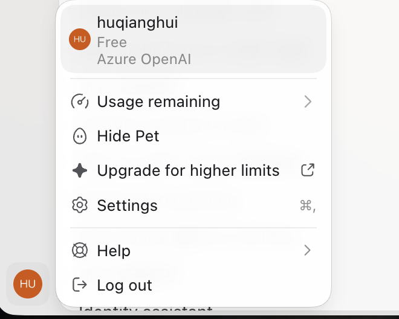

# Computer Use 与 Browser Use 系列九：三条执行路径对比

> 本篇在系列一的概念与产品形态、系列二的运行时接口、系列三的执行器实现和系列八的受控实验基础上，回答日常选型问题。工程趋势、历史实验与本轮验证分别标明；没有进行三条路径的同条件性能基准测试。

## 一、先把控制范围、接入方式与观察方式分开

Computer Use、Browser Use 和 Chrome Extension 并非三个完全并列的技术。Computer Use 在产品中可以是 GUI 控制的总类目，在技术讨论中也常指原生桌面控制；Browser Use 聚焦浏览器；Extension 是接入用户浏览器的方式。本文比较三条具体执行路径，避免名称混用。

| 维度 | 可选项 | 回答的问题 |
|---|---|---|
| 控制范围 | 原生桌面、浏览器页面 | 控制什么？ |
| 浏览器接入 | 独立／内置、扩展连接、受控 CDP 连接 | 怎样连接浏览器？ |
| 观察方式 | DOM、Accessibility Tree（AX）、截图 | 怎样知道当前状态？ |
| 动作方式 | 语义控件操作、页面命令、坐标和按键 | 怎样改变状态？ |
| 会话边界 | 独立 Profile、用户现有 Profile | 使用谁的登录环境？ |
| 显示形态 | Headed、headless、面板、预览 | 画面在哪里显示？ |

这些维度可以组合。Chrome 扩展可以执行结构化与视觉操作；原生桌面工具也可以读取 AX。Headless 不等于无登录态，headed 也不等于复用用户 Profile。

## 二、三条执行路径的实现原理

### 原生桌面 Computer Use

Agent 通过工具层访问操作系统 GUI。macOS 常见实现组合是 Accessibility API 读取控件，窗口／屏幕捕获提供像素，辅助功能动作或输入事件执行点击、输入、滚动。具体产品不必在每一步使用所有接口。

它可以跨 Chrome、原生应用与系统窗口。AX 可读时，按按钮或菜单语义定位可以降低坐标依赖；Canvas、图像和控件语义不足时使用截图。真实输入仍可能受到焦点、窗口状态及用户操作影响。

### 独立／内置浏览器 Browser Use

工具管理浏览器会话，通过浏览器控制接口读取 DOM、AX、文本或截图，执行页面定位、导航、填写与验证。独立浏览器与应用内置浏览器是不同产品形态，本文仅因其通常具有独立会话边界而合并比较。

内置浏览器不必是 headless，也不能从 Playwright 风格 API 名称推断浏览器内核或底层实现。具体观察、调试和上传下载能力，应以当前后端文档为准。

### Chrome Extension Browser Use

桌面应用／本地运行时与 Chrome 扩展协作，将目标标签页接入 Agent 的控制循环。一般扩展实现可使用扩展 API、content script、Native Messaging 或获准的调试能力；这些是可用机制，不代表本轮已追踪 Codex 每条命令的内部调用。

其主要价值是访问所连接 Chrome Profile 的现有标签页、网站会话和浏览器环境。模型提出动作，工具与策略层控制执行。扩展并不因为接入 Chrome 就自动变得更省 token，也不意味着每个操作都在系统屏幕上模拟鼠标。

## 三、多维度比较

| 维度 | 原生桌面 Computer Use | 独立／内置 Browser Use | Chrome 扩展 Browser Use |
|---|---|---|---|
| 范围 | 授权的应用、菜单、系统界面，可跨应用 | 浏览器页面与后端暴露的能力 | 所连接 Chrome 标签页及获准能力 |
| 观察 | 系统 AX、窗口／屏幕截图 | DOM、浏览器 AX、截图，取决于后端 | DOM、浏览器 AX、截图，取决于扩展与后端 |
| 执行 | 辅助功能动作、系统输入事件 | 页面定位器、浏览器命令、坐标动作 | 经扩展执行页面动作与标签页命令 |
| 登录状态 | 目标应用现有登录状态 | 通常使用独立 Profile，需单独建立会话 | 可使用用户 Chrome Profile 的网站会话 |
| 普通表单与列表 | 能完成，但可能增加焦点管理和观察轮次 | 语义完整时通常高效 | 语义完整时通常高效 |
| Canvas 与视觉布局 | 截图判断 | 浏览器截图判断 | 浏览器截图判断 |
| 系统窗口 | 更适合 | 依赖专门接口或用户接管 | 依赖专门接口或用户接管 |
| 页面改版 | 坐标敏感；AX 也受语义变化影响 | 标签与定位器稳定时影响较小 | 同左，扩展不消除改版影响 |
| 隔离性 | 本机桌面范围较广；VM 可隔离 | 独立 Profile／进程便于隔离 | 使用日常浏览器环境，用户活动更易干扰 |
| 故障来源 | 权限、焦点、遮挡、截图、AX 信息不足 | 浏览器连接、页面加载、定位器、登录 | 配对、Profile、扩展权限、身份检查、页面状态 |
| 适用场景 | 跨应用和系统 GUI | 本地调试、隔离实验、独立会话任务 | 已登录 SaaS 与已有标签页操作 |

“通常高效”是工程趋势，不能替代相同模型、相同任务和相同验收下的测量。

## 四、性能：模型判断与循环次数常常主导

总耗时可拆为：

> 初始化与认证 + 页面加载 + 各轮（观察 + 模型判断 + 动作执行 + 等待与验收）+ 清理

结构化网页操作往往能一次获得多个控件，减少观察与定位轮次。原生桌面路径可能增加窗口定位和焦点管理。但如果三条路径都使用同样精简的状态、同样的模型和动作策略，不能预设固定速度排名。

扩展增加连接与认证环节，也可能省掉登录准备。独立浏览器更容易保持重复实验的环境。网页加载、复杂模型推理或固定等待，可能远大于一次本地点击的时间。

系列八的 2026-09-27 实验保持系统 Browser、DOM 观察器、动作执行器和 writer 不变，只更换下一步判断模型：

| 任务 | Astra 判断 | Jev 判断 | 样本 |
|---|---:|---:|---|
| 筛选并选择商品 | 17.76 秒 | 6.10 秒 | 各组两次均值 |
| 填写并提交表单 | 23.71 秒 | 9.84 秒 | 各组两次均值 |

这是判断模型对照，不是桌面与扩展的性能对照。只有两类简单页面，不能外推真实网站一般成功率；桌面组当时没有有效同条件成绩。

## 五、Token、价格与任务成本分开看

Token 消耗包括工具说明、任务与历史上下文、状态观察、模型输出，以及模型可能计入 usage 的推理部分。

| 策略 | 成本特点 |
|---|---|
| 每步整张截图 | 持续产生图像输入成本，受模型和图像尺寸／处理规则影响 |
| 每步完整 DOM／AX 树 | 大表格、长文与重复导航会产生大量文本 token |
| 局部状态读取 | 只取目标字段、按钮与状态，通常减少无关输入 |
| 差量观察与句柄复用 | 减少重复输出，但需防止状态过期 |
| 导出到文件再按需读取 | 减少一次性上下文输入；后来读入的内容仍消耗 token |

因此不能断言“Computer Use 最费 token、Chrome 扩展最省”。精简 AX 桌面操作可能比反复读取巨大 DOM 更省；结构化网页任务也可能因不必要的全页快照而浪费上下文。

本轮 GitHub 文章提取返回 8,801 个字符，这是文本长度，不是模型计量的 token。核对 Issue 评论时，整页 DOM 包含大量历史评论并发生输出截断；针对目标评论读取更符合成本控制，但本轮没有测两种读取方式的实际 usage 差值。

系列八 Jev 组跨模型 token 总数约为 Astra 组的 1.9 倍，但按当时公开单价估算，任务费用更低。历史费用不是当前价格或账单。比较时应同时记录 input、cached input、output、推理 usage（若提供）、各模型单价、任务成功率与重试，不用 token 总数代替任务成本。

## 六、屏幕占用：显示、焦点与并发是三个问题

| 问题 | 原生桌面 Computer Use | 独立／内置 Browser Use | Chrome 扩展 Browser Use |
|---|---|---|---|
| 前台要求 | 系统输入通常依赖合适焦点；部分 AX 可不依赖前台 | DOM 动作通常无需系统前台；截图和特殊交互依后端 | DOM 动作通常无需 Chrome 始终前台；捕获与特殊动作依实现 |
| 显示器占用 | 本机 GUI 操作明显；VM／虚拟桌面可隔离 | 面板可见；headless 部署可无浏览器窗口 | 实际 Chrome 可能出现标签页、预览与控制提示 |
| 全局输入占用 | 系统鼠标键盘事件可能与人冲突 | 页面级动作通常不需要全局输入 | 页面级动作通常不需要全局输入 |
| 同页并发 | 焦点与输入目标容易改变 | 同时改变同页会冲突 | 用户切页、刷新、输入或接管可能中断任务 |
| 后台批量任务 | 更适合专用 VM／桌面 | 通常便于工程化与隔离 | 日常 Profile 状态与用户活动增加干扰 |

后台可操作不代表零屏幕占用或同页并发安全。浏览器可能节流后台标签页，截图也可能有可见性条件。本轮没有专测 Chrome 最小化、被遮挡或用户同时输入，不能承诺这些条件下持续正常。

视频任务应分别验收页面结构、真实像素和录屏。先前操作 Data Nexus 时出现过结构变化与原生截图画面不一致；后来取得新截图。结构读成功不能代替截图或连续录屏成功。

## 七、认证：账号身份与 model provider 分开

桌面 OpenAI／ChatGPT 身份、网站 Cookie／SSO 身份和 Azure OpenAI 模型凭据用途不同，但 Browser Use 的实现与桌面身份之间存在耦合。

**问题。** 官方仓库中的一份用户报告（见参考链接）指出：Chrome Browser Use 访问远程网址前，会先以 ChatGPT 身份请求一次 `site_status` 预检，判断目标站点是否允许访问。Codex Desktop 处于 API key／custom provider 模式时，这一预检拿不到可用的 ChatGPT token，浏览器操作在目标页面加载之前即失败，表现为 `Codex auth token is unavailable` 或 "Browser Use cannot determine if ... is allowed"。本例此前同样遇到该报错，且在 `nameSession()` 等首个浏览器操作时就已失败。

**处理。** 在 Codex Desktop 中登录 OpenAI／ChatGPT 账号（Free 档即可），模型 provider 保持 Azure OpenAI 不变，然后重启 Desktop。账号菜单随后同时显示账号、Free 档与 Azure OpenAI，即用户身份与 model provider 已经分离：

**结果。** 报错不再出现。Chrome Browser Use 依次完成命名会话、列出标签页、接管用户页并读取标题与 URL、提取渲染文本，以及导航到 example.com 并读到标题 "Example Domain"，全程使用官方 Chrome Browser Use 路径。这一 macOS 下的可用配置已补充到该 issue 的评论中（见参考链接）。

**结论：认证与 model provider 分开。** ChatGPT 账号承担桌面身份，供 Browser Use 的站点预检使用；Azure OpenAI 承担模型推理与计费。两者可以在同一个 Desktop 中共存，不必为了使用 Browser Use 而把模型切回 OpenAI。

| 职责 | 使用的凭据 |
|---|---|
| Browser Use 站点预检（`site_status`） | OpenAI／ChatGPT 账号（Free 档即可） |
| 模型推理与计费 | Azure OpenAI provider |
| 目标网站自身的登录态 | Chrome Profile 中的 Cookie／SSO |

本次验证没有隔离出具体生效的改动，也没有抓取身份检查与 `site_status` 的网络链路，或独立核验模型请求的目的地，因此不宜推广为所有 custom provider 环境的通用修复。同一 issue 中另有用户报告了 Windows 下的处理方式（保留 ChatGPT 登录、provider 改用 `env_key` 并增加 `requires_openai_auth`、额外处理代理），可作参照。

## 八、日常选择与后续测量

- 已登录的 GitHub、SharePoint：优先 Chrome 扩展，按需读取页面结构。
- 本地调试、响应式测试、可重复实验：优先独立／内置浏览器，保持会话边界明确。
- 原生应用、系统窗口、跨应用：原生桌面 Computer Use，AX 可读时先利用语义。
- 产品视频：Browser Use 驱动页面，独立确认截图、连续录屏与最终视频。

要得到可量化排名，应使用相同模型、任务、页面初始状态、视口和验收，并把冷启动、执行、验收、清理分别计时。分别统计成功率、重试、观察次数、截图／DOM 大小、模型 usage，以及前台占用时长。先进行少量重复验证，再扩大样本；没有有效任务结果的启动失败不能当作性能成绩。

## 参考与关联

- [Computer Use 与 Browser Use 系列一：概念与产品形态](Computer-Use与Browser-Use系列一：概念与产品形态.md)
- [Computer Use 与 Browser Use 系列二：Codex 浏览器运行时](Computer-Use与Browser-Use系列二：Codex浏览器运行时.md)
- [Computer Use 与 Browser Use 系列三：自己实现](Computer-Use与Browser-Use系列三：自己实现.md)
- [Computer Use 与 Browser Use 系列四：产品化](Computer-Use与Browser-Use系列四：产品化.md)
- [Computer Use 与 Browser Use 系列五：最佳实践](Computer-Use与Browser-Use系列五：最佳实践.md)
- [Computer Use 与 Browser Use 系列六：Codex CLI 与 App 的分界](Computer-Use与Browser-Use系列六：Codex-CLI与App的分界.md)
- [Computer Use 与 Browser Use 系列七：搜索与浏览器操作的分界](Computer-Use与Browser-Use系列七：搜索与浏览器操作的分界.md)
- [Computer Use 与 Browser Use 系列八：Jev 与 Codex 实践](Computer-Use与Browser-Use系列八：Jev与Codex实践.md)
- [Chrome Browser Use remote navigation depends on ChatGPT auth and breaks in API-key/custom-provider mode](https://github.com/openai/codex/issues/21710)
- [Windows 用户的认证与网络处理后续报告](https://github.com/openai/codex/issues/21710#issuecomment-6012021227)
- [macOS 下 ChatGPT 账号与 Azure OpenAI provider 共存的验证评论](https://github.com/openai/codex/issues/21710#issuecomment-6139534638)
