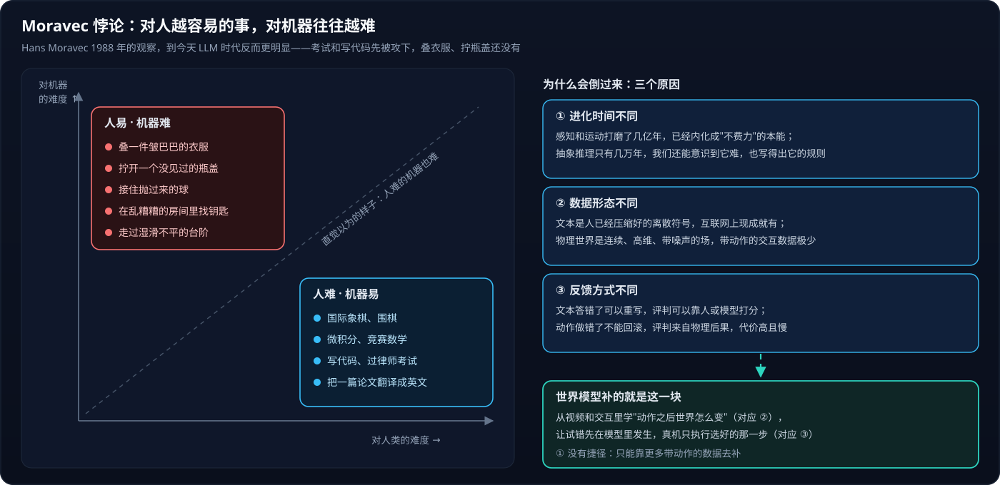
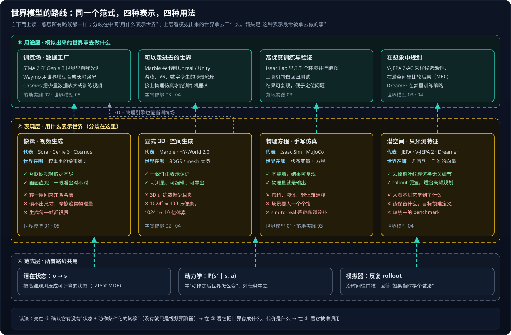
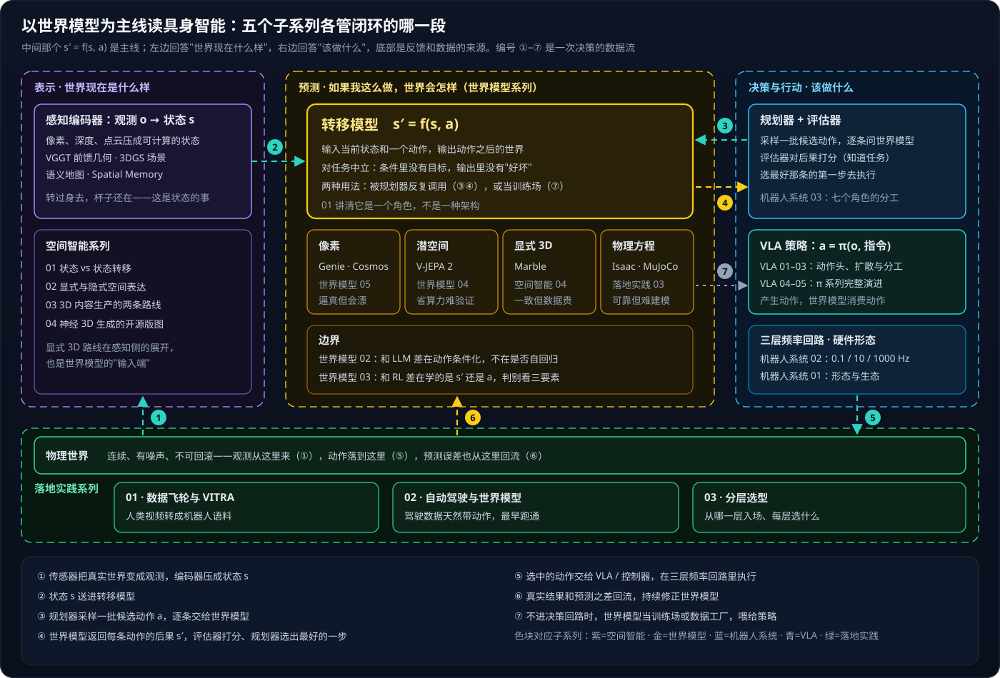

# 世界模型全景：读懂具身智能的主线

> 具身智能系列的第二篇导读。[具身智能全景](具身智能全景.md)从 LLM / Agent / RAG 的已有知识切入；本篇换一个入口，以世界模型为主线把五个子系列串起来。

最近看了一个讲世界模型的视频，从 1943 年的心智模型一路讲到 Genie 3 和 JEPA。看完我回头翻自己的具身系列：二十多篇文章，空间智能讲表示，世界模型讲预测，VLA 讲动作，机器人系统讲回路，落地实践讲数据——拆开看各讲各的，其实都在回答同一个问题：**如果我这么做，世界会怎样**。把这个问题放在中间，整个具身智能就有了一条主线。

## 一、一个八十年的老问题

人能预判桌边的水杯快要滑下去、推门时用多大力，是因为脑子里有一套从小通过感官交互建起来的"世界怎么运转"的表示。1943 年 Kenneth Craik 在《解释的本质》里把它叫作**"小规模的世界模型"**：智能体在真正动手之前，先在脑内把几种做法的后果排演一遍，再挑一个去做。

这个想法后来在两个工程领域分别长了出来。控制领域的 **MPC（Model Predictive Control）** 用显式动力学方程往前推 N 步、只执行第一步、下个周期再推一遍；机器人学的**前向模型**预测"施加这个力矩，下一刻传感器会读到什么"。两者共同的地方是：**模型是人写的**，写得出方程的系统才能用。

1990 年 Richard Sutton 提出 **Dyna** 架构，第一次让模型从数据里学：智能体学策略的同时学一个环境模型，预测 (s, a) → (s′, r)，再用这个模型生成的"想象经验"补充昂贵的真实交互。到这一步，"先在脑内推演"从认知科学的假说变成了强化学习里的一个具体模块。

2018 年 David Ha 和 Jürgen Schmidhuber 的论文 *World Models* 把这个词定了下来，也给出了最好记的结构：**V + M + C**。拿新手学打乒乓球来对照：

- **V（Vision）**：每秒几百万像素的画面，人不会逐像素记住，只留下球的位置、速度、拍面角度这些关键量——V 是一个 VAE，把画面压成几十维的潜变量；
- **M（Memory）**：接收 V 的潜变量和"我打算怎么挥拍"，回答"这么挥，球会往哪飞"——M 是一个 RNN，在潜空间里按动作预测下一个状态；
- **C（Controller）**：在 M 推演出来的"梦"里反复试，找到最好的挥法，到球台前只挥一次——C 小到只是一个线性层。

论文的赛车游戏实验里，策略完全在 M 生成的梦里训练，拿回真实环境照样能开。之后 Dreamer 系列把"在潜空间里想象几百万步来训练策略"做成了通用方法（DreamerV3 用一套超参数跑通 150 多个任务），MuZero 则让 reward 和 value 反过来塑造模型本身——这两条在[世界模型系列03](世界模型系列03：世界模型与强化学习的边界.md)里有专门的拆解。

2024 年之后的变化是质的：模型开始从**海量视频**里学。Sora 自称"世界模拟器"，Genie 从无标注视频里自己学出潜在动作，V-JEPA 干脆不生成像素只预测特征；2025 年 Genie 3 做到实时可交互，Cosmos 开源了整套世界基础模型平台，V-JEPA 2 能零样本驱动机械臂，World Labs 的 Marble 能生成可以导出的 3D 世界；到 2026 年，LeCun 离开 Meta 创办 AMI Labs、专门押注 JEPA 路线，Waymo 的驾驶、仿真、评估三套系统共用同一个基础模型，Google 把 Genie 3 做成了面向用户的 Project Genie。

回头看这八十年，问题一直没变，变的是两件事：**模型从哪来**（手写方程 → 从交互中学 → 从视频中学），以及**谁在调用它**（控制器 → RL 智能体 → 整个产业的训练和仿真基础设施）。

## 二、Moravec 悖论：为什么绕不开物理世界

1988 年 Hans Moravec 观察到一件反直觉的事：让计算机在智力测验、下棋上达到成人水平相对容易，让它拥有一岁孩子的感知和行动能力却很难，甚至做不到。人觉得难的，机器反而容易；人觉得不费力的，机器反而最难。

这个悖论到 LLM 时代反而更明显了。我日常用的 Agent 能写代码、读文档、做方案评审，但让一台机器人叠一件皱巴巴的衣服、拧开一个没见过的瓶盖，到今天仍然是前沿研究课题。我理解这背后有三层原因：

**进化时间不同。** 感知和运动被打磨了几亿年，已经内化成"不费力"的本能，我们意识不到它有多复杂，更写不出它的规则；抽象推理只有几万年历史，正因为它新，我们还能感到它难，也能把它的规则写下来、教给机器。

**数据形态不同。** 文本是人类已经替机器压缩好的离散符号，互联网上现成就有万亿 token；物理世界是连续、高维、带噪声的场，带着"动作 → 后果"标注的交互数据极少。拿离散 token 去拟合连续场，信息在 tokenizer 那一步就丢了一大块。

**反馈方式不同。** 文本答错了可以重写，好坏可以由人或模型来评；动作做错了不能回滚，评判来自物理后果，又贵又慢。

> [!IMPORTANT]
> Moravec 悖论说明的不是"LLM 不够大"，而是 LLM 学的东西里缺了一块：**动作之后世界怎么变**。世界模型正好补的是这一块——从视频和交互里学动力学，让试错先在模型里发生，真机只执行选好的那一步。

这也是几位重量级研究者批评"纯 LLM 路线"的共同出发点，只是各自的角度不同。LeCun 认为文本是人造的离散符号系统，堆规模只能做出更会说话的模型，物理理解还比不上一只猫，所以他另起炉灶做 JEPA；李飞飞把 LLM 形容成"黑暗中的文字匠人"，主张 AI 的基本单元应该从 token 换成像素和体素，目的从"表达"换成"观察和行动"；Sutton 的批评来自强化学习：LLM 没有明确的目标，也没有来自环境的客观对错信号，偏离了智能从交互中学习的基本路线。

我自己的判断是：世界模型不替代 LLM，而是补上 LLM 缺的那一半。二者的分工可以这么对照：

| | LLM | 世界模型 |
| --- | --- | --- |
| 预测什么 | 下一个 token：接下来最可能**说**什么 | 下一个状态：如果我这么**做**，世界会怎样 |
| 条件里有什么 | 之前的文本 | 当前状态 + **一个动作** |
| 输入输出 | 离散符号 | 连续、高维、有空间结构的观测或状态 |
| 主要数据 | 静态文本语料 | 视频、传感器流、带动作的交互轨迹 |
| 在系统里的位置 | 任务层规划、语义理解 | 被规划器高频调用的中间件，或当训练场 |

真实系统里两者已经在一起工作了：[机器人系统系列02](机器人系统系列02：Agent循环的物理形态.md)讲过，LLM 坐在 0.1–1 Hz 的任务层做分解和语义判断，世界模型和 VLA 在 10–50 Hz 的策略层处理连续动力学。Waymo 的基础模型里，基于 Gemini 训练的驾驶 VLM 负责理解"前方有辆车着火了"这类罕见语义，结构化的世界状态和传感器仿真负责物理上的推演。七个更细的分野见[世界模型系列02](世界模型系列02：世界模型与LLM的分野.md)。

## 三、判断一个东西是不是世界模型：三件事

"世界模型"这个词被用得很宽，我判断时只看三件事（[世界模型系列03](世界模型系列03：世界模型与强化学习的边界.md)第一节有完整论证）：

1. **表示（Representation）**：内部有没有一个关于世界的状态——物体在哪、什么关系、速度多少，可以是显式的 3D 场景，也可以是读不懂但够用的潜向量；
2. **预测（Prediction）**：能不能回答"**如果我采取动作 A**，世界接下来会怎样"——这一条是要害，没有动作输入的预测器只是视频预测或时间序列预测；
3. **规划（Planning）**：有没有人拿这些预测去比较候选动作、做决策——世界模型自己不做决策，但它的价值要在被规划器调用时才体现出来。

V + M + C 正好一一对应：V 负责表示，M 负责预测，C 负责规划和行动。这三件事也定义了世界模型在整个具身系统里的边界——它**消费动作、不产生动作**，**输出后果、不评判好坏**。"角色而非架构"这一层，[世界模型系列01](世界模型系列01：世界模型不是一种架构.md)用缓存类比讲得更细。

## 四、路线：同一个范式，四种表示

路线之争是世界模型最热闹的地方，也最容易被讲乱——媒体会把 Sora、Genie、Marble、V-JEPA 放在一起比"谁更像世界模型"，但它们的分歧根本不在一个层面上。我把它拆成三层来看：

### 1. 范式层：所有路线都一样

最底下是所有路线共用的骨架：把高维观测压成可计算的状态（Latent MDP），学状态在动作作用下怎么转移 P(s′ | s, a)，再提供一个可以沿时间反复推演、回答"如果当时换个做法"的模拟器。到这一层为止，Dreamer、Genie 3、V-JEPA 2-AC 没有区别。

### 2. 表现层：分歧在"用什么表示世界"

**像素路线**（Sora、Genie 3、Cosmos）是规模派的打法：用海量视频训练大容量扩散或自回归模型，让重力、光影、碰撞这些物理直觉隐式地编码进权重。它最大的优势是数据——互联网视频取之不尽；画面直观，人一眼能看出对不对。Genie 3 把"能看"推进到"能玩"：720p、24 帧实时生成，几分钟内保持一致，一分钟前看过的东西转回来还在。Project Genie 把它做成了产品，先用图像模型生成初始场景和角色，再由 Genie 3 让静态画面变成可以走进去的世界。代价也很清楚：物理只存在于像素的统计规律里，转一圈回来几何可能漂移，**读不出被遮挡物体的尺寸、摩擦系数这类机器人真正要用的量**，每一帧生成都很贵。这条路线的完整拆解见[世界模型系列05](世界模型系列05：像素路线与Cosmos.md)。

**显式 3D 路线**（Marble、HY-World 2.0）是李飞飞空间智能的主张——不是把世界"画出来"，而是把世界"建出来"。Marble 基于 3D Gaussian Splatting，从一张图片或一段文字生成有完整空间结构的场景，可以导出成 mesh 放进 Unreal / Unity。一致性不靠学，而是由表示保证：场景就在那里，转一圈回来当然还在，尺寸可以直接量。难点在三处：3D 训练数据要靠激光雷达和结构光扫描，比 2D 视频贵几个数量级；生成的网格要封闭、不穿模，布料、流体这类对象的动力学很难闭环；还有维度爆炸——1024 × 1024 的图片约 100 万像素，升到 1024³ 的体素就是 10 亿，算力直接涨三个数量级。工程上的折中办法是先在低分辨率下生成粗的 3D 表示再上采样，并把算力集中在智能体正在交互的那一小块区域。感知侧怎么建出显式 3D、什么任务才值得建，见[空间智能系列02](空间智能系列02：显式与隐式空间表达.md)；开源版图对标见[空间智能系列04](空间智能系列04：神经3D生成的开源版图.md)。

**潜空间路线**（JEPA、V-JEPA 2、Dreamer）走的是反方向。LeCun 的论点很锋利：在像素级还原每片云的飘动、每片树叶的纹理是浪费算力，决策只需要关键的因果结构——推一下球，只要知道它往哪滚、会不会撞上东西，不需要知道表面的反光。JEPA 由三部分组成：编码器把观测映射到潜空间，预测器在潜空间里预测未来的表示，再用一个目标编码器给出"真实未来"的编码，让预测和它对齐（同时要防止所有表示塌成一个点）。全程没有解码器，你从它那里拿不到一张图。好处是 rollout 便宜，适合规划器一秒调用几百上千次。它至今没有成为主流，卡在三件事上：**看不见**——人没有直观通道去确认它到底学到了什么物理；**目标难定义**——没有像素作为监督，"该保留什么、丢掉什么"很难在数学上写清楚；**缺 benchmark**——没有统一的度量，不同变体之间很难比。我在[世界模型系列04](世界模型系列04：潜空间路线与V-JEPA-2.md)里整理过一套从 t-SNE 到闭环规划的潜空间验证五步法，就是为了应对"看不见"这个问题。

**物理方程路线**（Isaac Sim、MuJoCo）是世界模型角色最经典的实现，只是不靠学：方程保证不穿墙、结果可复现，物理量本身就是输出；短板是布料、液体、软体难建模，场景要人一个个搭，sim-to-real 的差距要靠调参和域随机化去补。

四条路线各自押了什么注、押错的代价是什么，可以压成一张表：

| 路线 | 押注 | 赢了会怎样 | 押错的代价 |
| --- | --- | --- | --- |
| 像素 | 规模够大，物理会从视频里涌现 | 一个模型通吃仿真、内容、训练数据 | 永远读不出精确物理量，长时程漂移 |
| 显式 3D | 一致性必须由结构保证 | 可测量、可编辑的持久世界 | 被数据成本和算力拖住，动态部分要外接物理引擎 |
| 潜空间 | 决策只需要抽象的因果结构 | 用小得多的算力做高频规划 | 内部不可见，难评测、难审计 |
| 物理方程 | 关键物理必须是硬约束 | 可复现、可定位问题 | 复杂对象建不了模，场景生产慢 |

> [!TIP]
> 真正做产品时很少只选一条。Waymo 的世界模型把紧凑的结构化世界状态和传感器级仿真结合起来；Marble 生成 3D 场景、再接物理仿真；Cosmos 用像素路线生成训练视频、再交给手写仿真器验证。选路线时我会先问"我需要它输出什么"——要可读的物理量就离不开显式 3D 或方程，要高频规划就倾向潜空间，要海量逼真数据就用像素。

### 3. 用途层：模拟出来的世界拿去做什么

最上层看谁在调用它，这一层决定了路线选择对不对：

- **训练场与数据工厂**：SIMA 2 是最直接的例子——一个基于 Gemini 的智能体，放进 Genie 3 即时生成的、从没见过的世界里，由 Gemini 出任务、给评判，智能体靠试错自我改进，不需要额外的人工标注。Waymo 用基于 Genie 3 的世界模型合成龙卷风、路上遇到大象这类现实里几乎采不到的长尾路况；Cosmos 把少量仿真和真机数据放大成大批训练视频。
- **在想象中规划**：V-JEPA 2-AC 在潜空间里比较一批候选动作的后果，选最好的一步执行，MPC 式地滚动重规划；Dreamer 则让策略直接在梦里训练。
- **可以走进去的世界**：Marble 生成的场景导出到游戏引擎，成为游戏、VR、数字孪生的场景底座；要让机器人在里面训练，还得接上物理仿真。
- **高保真训练与验证**：Isaac Lab 里几千个环境并行跑强化学习，策略上真机之前在手写仿真器里做回归测试。

## 五、用世界模型串起整个具身系列

把 s′ = f(s, a) 放在中间，五个子系列各自管闭环的哪一段就清楚了：

一次决策的数据流是这样的：传感器把物理世界变成观测，编码器压成状态 s（①②，[空间智能系列](空间智能系列01：3D感知重建与世界模型.md)讲这一段）；规划器采样一批候选动作 a，逐条交给世界模型，拿回每条动作的预测后果 s′，评估器结合任务打分（③④，[世界模型系列](世界模型系列01：世界模型不是一种架构.md)和[机器人系统系列03](机器人系统系列03：角色与实现的分离.md)的角色分工）；选中的动作交给 VLA 或控制器在三层频率回路里执行（⑤，[VLA 系列](VLA系列01：输出架构演进.md)和[机器人系统系列02](机器人系统系列02：Agent循环的物理形态.md)）；真实结果和预测之差回流，持续修正世界模型（⑥）。世界模型还有一种不进决策回路的用法：当训练场或数据工厂，直接喂给策略（⑦，[世界模型系列05](世界模型系列05：像素路线与Cosmos.md)和[落地实践系列01](落地实践系列01：数据飞轮与VITRA.md)）。

按要解决的问题，我会这样进入这个系列：

- **想弄清世界模型到底是什么**：本篇 → [世界模型系列01](世界模型系列01：世界模型不是一种架构.md)（角色与四条路线）→ [02](世界模型系列02：世界模型与LLM的分野.md)（与 LLM）→ [03](世界模型系列03：世界模型与强化学习的边界.md)（与 RL）；
- **想深入某一条路线**：像素读[世界模型系列05](世界模型系列05：像素路线与Cosmos.md)，潜空间读[世界模型系列04](世界模型系列04：潜空间路线与V-JEPA-2.md)，显式 3D 读[空间智能系列01](空间智能系列01：3D感知重建与世界模型.md)→[02](空间智能系列02：显式与隐式空间表达.md)→[04](空间智能系列04：神经3D生成的开源版图.md)；
- **想知道世界模型和动作怎么接**：[机器人系统系列03](机器人系统系列03：角色与实现的分离.md)（VLA 里怎么"包含"世界模型）→ [VLA系列03](VLA系列03：扩散模型基础.md)（两条线共用的扩散机制）；
- **要做技术选型**：直接读[落地实践系列03](落地实践系列03：分层选型决策.md)，再按需回查。

## 六、落到产业：哪里已经在用

**自动驾驶最先跑通**，原因在[落地实践系列02](落地实践系列02：自动驾驶与世界模型.md)里讲过：驾驶数据天然带动作（方向盘、油门、刹车都有记录），量产车队又源源不断地提供数据。Waymo 现在的做法很有代表性：驾驶系统（Driver）、仿真器（Simulator）、评估器（Critic）共用同一个 Waymo Foundation Model，既不是纯端到端也不是传统模块化，中间保留了结构化的世界状态。好处有两个：出错时能定位是感知层还是预测层的问题；这些结构化状态又能驱动高保真仿真，让系统在虚拟世界里针对长尾危险场景大量推演。

**机器人**是世界模型最终要服务的地方，也是离成熟最远的。传统机器人靠工程师给每个任务硬编码轨迹，换个物体、换个光照就失灵；世界模型让机器人在抓取、拧盖、避障之前，先在模型里预演不同力度下物体会怎么动。V-JEPA 2-AC 已经能用不到百小时的机器人数据做到零样本抓放，但离"没见过的柔性物体也能稳定操作"还有很长的路，核心瓶颈仍然是带动作的真机数据。

**游戏与内容**是像素路线最先变现的地方。Genie 3 / Project Genie 让"开发者定义世界观和规则，引擎根据玩家交互实时生成下一秒的场景"有了雏形，Marble 则在给游戏和 VR 生产可以编辑的 3D 场景。

**Agent 训练场**可能是被低估的用途。无论是物理机器人还是数字世界里的 Agent，在真实环境里试错都贵、慢、有风险；世界模型提供一个高并发、低成本、出错不会伤人的试错空间。SIMA 2 在 Genie 3 世界里自我改进，就是这条路的早期样本。

**空间计算与可穿戴设备**我认为还更远一些：AR 眼镜如果能实时建出周围的三维空间、预判物体的运动和潜在危险，就从显示屏变成了随身的"世界理解引擎"，但这要求世界模型在端侧以极低功耗运行，目前还看不到。

## 七、风险：物理世界的幻觉更贵

世界模型把 AI 的决策从文本空间推进到物理世界，风险也跟着升了一级。我关心的是四类，以及在工程上能做什么：

| 风险 | 怎么发生 | 工程上能做的 |
| --- | --- | --- |
| 物理幻觉 | 模型估错摩擦系数、低估碰撞，在虚拟里不报错，下发到执行器就是机械臂撞击、车辆失控 | 边界内自主、绕开模型的安全监视器、关键物理用方程兜底、上真机前做回归 |
| 潜空间不可审计 | JEPA 类模型的推演全在高维向量里，审文本、看视频的办法都用不上 | 潜空间探针与闭环规划验证，评估器和验证器与世界模型分开 |
| 超真实合成内容 | 时空一致、物理合理的生成视频，让靠像素瑕疵和光影破绽的鉴伪方法失效 | 内容溯源与水印、生成端留痕 |
| 能力集中 | 高精度世界模型需要算力、传感器数据和工程体系，少数机构才建得起 | 开源基座（Cosmos、V-JEPA 2、HY-World）对冲，自己掌握后训练和数据 |

前两类和我做的事直接相关。**物理幻觉**本质上是 sim-to-real gap：LLM 的幻觉是编一段不存在的文字，世界模型的幻觉是编一个不存在的物理后果，而后者不会自己暴露——所以[具身智能全景](具身智能全景.md)里说的 bounded autonomy、[机器人系统系列02](机器人系统系列02：Agent循环的物理形态.md)里那个绕开模型的安全监视器，不是可选项。**潜空间不可审计**则意味着评估器、验证器必须是独立的角色，不能让世界模型自己说自己预测得对——这也是[机器人系统系列03](机器人系统系列03：角色与实现的分离.md)坚持"角色分离"的原因之一。

> [!WARNING]
> 世界模型越逼真，越容易让人误以为它"懂物理"。像素路线里画面合理不等于物理正确，潜空间路线里规划成功不等于表示可信。我判断一个世界模型能不能进决策回路，看的是它在真实闭环里的预测误差，而不是生成的画面有多好看。

## 参考

- Kenneth Craik, *The Nature of Explanation*（1943）
- Richard S. Sutton, *Dyna, an Integrated Architecture for Learning, Planning, and Reacting*（1991）
- [World Models（Ha & Schmidhuber, 2018）](https://worldmodels.github.io/)
- [Mastering Diverse Domains through World Models（DreamerV3）](https://arxiv.org/abs/2301.04104)
- [Moravec's paradox – Wikipedia](https://en.wikipedia.org/wiki/Moravec%27s_paradox)
- [Genie 3: A New Frontier for World Models – Google DeepMind](https://deepmind.google/discover/blog/genie-3-a-new-frontier-for-world-models/)
- [SIMA 2: An Agent that Plays, Reasons, and Learns With You in Virtual 3D Worlds – Google DeepMind](https://deepmind.google/blog/sima-2-an-agent-that-plays-reasons-and-learns-with-you-in-virtual-3d-worlds)
- [V-JEPA 2 – Meta AI](https://ai.meta.com/vjepa/)
- [Advanced Machine Intelligence Labs – Wikipedia](https://en.wikipedia.org/wiki/Advanced_Machine_Intelligence_Labs)
- [Marble – World Labs](https://marble.worldlabs.ai/)
- [NVIDIA Cosmos World Foundation Models](https://www.nvidia.com/en-us/ai/cosmos/)
- [Demonstrably Safe AI For Autonomous Driving – Waymo](https://waymo.com/blog/2025/12/demonstrably-safe-ai-for-autonomous-driving)
- [The Waymo World Model: A New Frontier For Autonomous Driving Simulation – Waymo](https://waymo.com/blog/2026/02/the-waymo-world-model-a-new-frontier-for-autonomous-driving-simulation)
