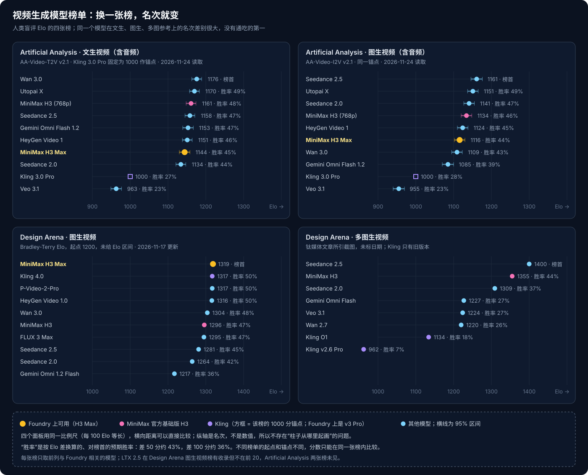
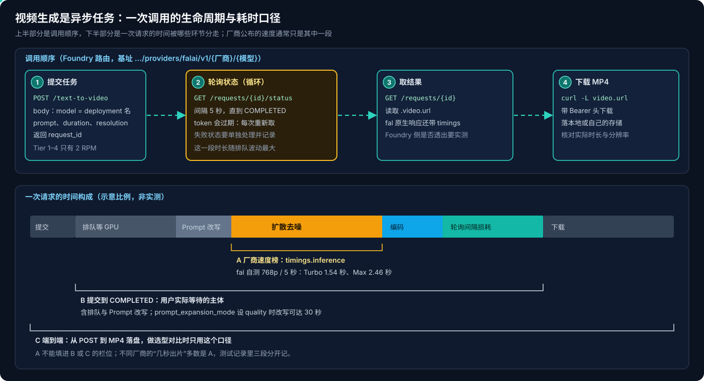

# Media Generation 系列 01：Foundry 上的视频模型为什么经过 fal

> 系列导航：本篇 ｜ [系列 02：五个视频模型对比](Media-Generation系列02：五个视频模型对比.md) ｜ [系列 03：视频模型的测试方案](Media-Generation系列03：视频模型的测试方案.md) ｜ [系列 04：十五秒开经偈短片](Media-Generation系列04：十五秒开经偈短片.md)

图片生成这两年基本成熟了。早期的六根手指、画面里的乱码字，现在都很少再碰到；gpt-image-2.6 之后还能直接出 GIF 和 SVG，图片这条线已经从"能不能用"走到了"怎么用得更顺"。

下面两张是我用 gpt-image-2.5-sunburst 生成的，专挑过去最容易出错的两处：中文文字和手。

 

**AI 生成图 · gpt-image-2.5-sunburst**　请求：quality `high`、1536×1024，每张只生成一次，没有挑选也没有修图，各用了三十多秒。左图要求一张雨夜街头的电影海报，片名「雨夜来信」、小字「十一月二十四日 · 首映」；右图要求一双手在信纸上用钢笔书写的近景。观察：海报上的两行中文与 Prompt 一字不差，字形端正，只有右侧霓虹招牌上有一片看不清的类文字纹理；右手握笔姿势正确，指节和指甲自然，左手按着纸边，拇指被遮住、看得到的四根手指也都正常。手指和中文字，正是前面说的早期图片模型最容易翻车的两处。

视频还没到这一步，但方向已经很清楚。AI 短剧和 AI 电影类 app（红果这类平台上已经有大量 AI 生成的短剧）进入了量产阶段，质量参差不齐，量却在快速上来。之前在 [世界模型系列](../Embodied%20AI/世界模型系列05：像素路线与Cosmos.md) 里从"模拟世界"的角度讨论过视频生成，那是更大的话题；这个系列只站在**媒体生成**的角度，看现在能直接调用的视频模型各自能做什么、怎么接、怎么测。

我平时的工作环境在 Azure 上，所以从 Microsoft Foundry 提供的视频模型入手。Sora 2 已经退役：OpenAI 的 Videos API 和全部 `sora-2` 版本在 2026-09-24 停止服务，Foundry 上最后一个 `sora-2` 版本（2025-12-08）的退役日是 2026-10-15。现在 Foundry 上的视频生成，换成了通过 fal 提供的五个模型。

## 市面上的格局：看几张榜

先看整个市场。视频模型目前主要靠人类盲评的 Elo 榜单来比较：同一个输入，两个模型各生成一段，评审选更好的那段，累计成分数。我把 Artificial Analysis 和 Design Arena 的几张榜放在一起，用同一个比例尺画出来：



从这几张榜能读出四件事：

- **头部挤成一团。** Artificial Analysis 文生视频榜前 8 名落在 25 分以内，每个模型的 95% 区间是 ±13 左右，彼此大面积重叠。第 1 名对第 8 名的预期胜率只有约 54%，这几名实际上分不出先后。
- **换一张榜，名次就变。** Seedance 2.5 在 Artificial Analysis 图生视频榜和 Design Arena 多图生视频榜都是第一，在 Design Arena 图生视频榜却排第 8。H3 Max 在 Design Arena 图生视频榜第一，在 Artificial Analysis 两张榜上都排第 9。文生、图生、多图参考是不同的任务，评审人群和计分方式也不一样，不存在通吃的第一。
- **头部基本是中国厂商。** 字节的 Seedance、阿里的 Wan、MiniMax 的 H3 和快手的 Kling 4.0 都在前列；Veo 3.1 已经落到 Kling 3.0 之后。
- **Foundry 上这五个的位置并不整齐。** H3 Max 在头部集团里；Foundry 的 Kling v3 Pro 对应榜上的 Kling 3.0 Pro，在 Artificial Analysis 被固定为 1000 分的锚点，比头部低 160 分上下（对榜首的预期胜率不到三成），快手的新旗舰 Kling 4.0 还没上 Foundry；LTX 2.5 不在任何一张榜的前列。

Elo 分数只能在同一张榜内比较：Artificial Analysis 以 Kling 3.0 Pro 为 1000 分锚点，Design Arena 从 1200 起算，两边的数字不能直接对照。读榜时我会先看三样东西：是哪个任务、什么时间、区间有多宽。差距落在区间以内的名次，我不当真。

[《MiniMax H3 追到身后，留给 Seedance 的安全身位不多了》](https://www.tmtpost.com/8106194.html) 一文引用的是 Design Arena 多图生视频榜的截图。在那张榜上，两者差 45 分，换算成预期胜率约 56%。这个说法在那一个任务上成立；原图的柱子不从零画起，尾部几根又被压成一样高，看上去差距比实际大得多。

## 模型在变复杂，也更贴近人的创作方式

那篇文章里还有一个判断我很认同：原生声音、多镜头、主体一致性，过去只要做好其中一两项，就能和对手拉开差距；现在这些能力加上多模态参考、动作控制、视频编辑，正在变成旗舰视频模型都要有的基础能力。

几家的官方说法可以对上。快手发布 Kling 3.0 时说，文生、图生、参考生成和视频内编辑被放进了同一个原生多模态架构。MiniMax 介绍 H3 时，专门回顾了以前视频模型的割裂状态——文生视频、图生视频、动作迁移、声音参考、视频编辑各是一个任务——H3 要做的是把它们放回同一个上下文，用自然语言描述素材之间、素材和成片之间的关系。按钛媒体文章的转述，Seedance 2.0 支持最多 9 张图、3 段视频、3 段音频作参考，Seedance 2.5 把单次生成拉到 30 秒、参考素材加到 50 份。Foundry 上的 H3 Max 也一样：一次请求最多 12 个参考文件，图、视频、音频各有各的角色。

这些变化归结起来，是模型**更整体了，模态融合得更深**。文字、图片、视频、声音不再分别进不同的模型，而是进同一个上下文；声音也不再是生成画面之后另配，LTX-2.5 一次前向就同时出画面和立体声，H3 Max 的每段输出都自带同步音轨。生成和编辑也合进了同一个模型。

模型一整体，就**更贴近人本来的创作方式**。做视频的人很少从一句话开始，手里通常已经有一堆素材：这个镜头的运镜参考那段片子，主角长这张照片的样子，配音要这段录音的声音，节奏卡这段音乐；做出来之后再说"第 17 秒那里改一下"，而不是整段重来。以前要把这些拆给不同的模型和工具，一步步串起来；现在可以把素材一起交给一个模型，用自然语言说清它们的关系，再在同一个模型里接着改。

厂商自己也是这么定方向的。MiniMax 在 H3 的官方博客里，把"参与内容生产全过程"写成了模型方向：要解决的不只是生成一条画面，还包括用自然语言继续承担修改和更复杂的任务。人的创作本来就是一个过程——找素材、出初版、看片、改细节、把几段接起来——视频模型正在从只管"出初版"这一步，往覆盖整个过程走。

能力合到一起，能覆盖的场景也就多了。广告、短剧、电商、教育这些行业，需要的恰恰是"保住人物、保住产品、跟上音乐、局部返工"这种组合能力，而不只是生成一段好看的画面。AI 短剧能进入量产，靠的也是这一点。

复杂度并没有消失，而是换了地方。输入从一句 Prompt 变成一组带角色的素材，素材怎么整理、角色怎么绑定、30 秒以上怎么衔接、局部错误怎么单独返工，都变成了新的工程问题。对接入方来说，API 的参数面也跟着变大：同一个 H3 Max，文生视频只要一个 `prompt`，Reference-to-Video 要分清首帧、参考图、参考视频、参考音频和目标音轨，Prompt 里还要用 `Image 1`、`Video 1` 指代它们。这也是我测试时不只比文生视频画质、还专门设计参考驱动用例的原因（见 [系列 03](Media-Generation系列03：视频模型的测试方案.md)）。

模型能承担的任务越复杂，模型之外的工作就越多。这些环节已经有工作流产品在接，钛媒体文章里提到的 LibTV 就是一例。底层模型越接近，用户留下来的理由也就越需要往模型之外延伸：素材库、角色管理、分镜和时间线编辑、局部返工、多模型调度，都是模型本身给不了的东西。对在云平台上搭视频应用的人来说也一样，真正要花功夫的不只是选哪个模型，还有模型外面这一层。

## 能力趋同，分发路线却分开了

模型能力越来越像，MiniMax 和字节维持领先的办法却走向了两头。这里没有谁对谁错，各家有各家的长处和短板，选的是适合自己的发展道路，技术道路也跟着不同：字节押的是更大规模的预训练和重投入的数据体系，MiniMax 押的是统一架构、开放权重，并且从设计早期就考虑多款国产芯片的适配。分开走的原因，在各自手里有什么。

MiniMax 有海螺、MiniMax Hub 和 API，官网披露模型和 AI 产品累计服务超过 3 亿个人用户、100 多万企业客户和开发者。但在视频内容产业里，它没有抖音和 TikTok，也没有字节那样能直接承接模型的大规模创作、分发和广告体系。所以 H3 走了开放权重：开发者可以自己部署和定制，芯片厂商可以做适配，推理平台和工作流产品可以把它接成默认模型。每多一个这样的节点，就多一条不依赖自己销售团队的触达路径。官方 API 仍然保留，开放和自营并行。

字节的情况正相反。Seedance 留在自己的产品体系里：即梦面向创作者，豆包和剪映面向大众用户，火山引擎对接广告、电商和内容制作客户，Gauth 把它带进教育。模型一做出来，第一个使用场景、第一批付费客户和第一手反馈都在自己家里。按钛媒体文章引述火山引擎负责人的说法，今年上半年 Seedance 贡献了火山 MaaS 收入的一半以上。

这两条路线直接决定了我在 Foundry 上能用到什么。H3 是开放权重，fal 才能在它上面做后训练、做推理优化，再作为 H3 Max / Turbo 进入 Foundry 的目录；Seedance 在几张榜上都排在头部，却不在 Foundry 这五个里。**一个模型能不能出现在云平台上，除了看它强不强，还要看厂商选的是哪种分发方式。**

开放权重也只是前提之一。Sand.ai 在 2026 年 8 月开源的 MAGI-2 Preview 就没有走到这一步：它是 114B 参数的 MoE，每个 token 只激活约 6B，画面和声音由同一个 Transformer 一次生成，权重、推理代码（Apache 2.0）和技术报告都已公开。但它只出 10 秒一种时长，先在 512×896 出预览、再放大到 1088×1920，自己部署要 8 张 Hopper GPU；现在放出的是未蒸馏版，预览阶段要走 100 步去噪，蒸馏版还没发布。我查了 fal 的模型目录：上一代 MAGI-1 在 2025 年 4 月上过 fal，三个端点现在都标成了 deprecated；MAGI-2 在 fal 上没有端点，也就进不了 Foundry。要用它，眼下只有 Sand.ai 自己的 API、Magi 产品，或者自己部署。H3 能进 Foundry，靠的不只是开放权重，还有 MiniMax 和 fal 的合作，以及 fal 在它上面做的后训练和推理优化。

## 名字里为什么有 fal

Foundry 模型目录里这五个模型的名字都带 fal 前缀，比如 `Fal-MiniMax-H3-Max`、`Fal-Kling-V3-Pro`。fal 不是模型公司，一次请求要经过四类角色，名字只露出了其中两个：


- **模型研发方**：快手（Kling）、Lightricks（LTX）、MiniMax（H3）。Kling 闭源；LTX-2.5 和 MiniMax H3 是开放权重。
- **后训练方**：H3 Max 和 H3 Max Turbo 不是 MiniMax 官方的 H3，而是 fal 在开放权重 H3 上做后训练的版本——加了针对提示遵循和美感的数据，大量算力花在可验证的 RL 任务上，架构也按 fal 自己的推理引擎重新设计。
- **推理服务方**：fal。请求队列、GPU 调度、面向扩散模型的推理引擎都在它那里，结果以 `request_id` 和结果 URL 的形式返回。
- **接入平台**：Microsoft Foundry。负责订阅开关、deployment、Entra ID 身份、计费和配额。

API 路径本身就把这层关系写出来了：

```text
https://{FOUNDRY_RESOURCE_NAME}.services.ai.azure.com/providers/falai/minimax/h3-max/text-to-video
```

`falai` 是推理服务方，`minimax` 是模型厂商，`h3-max` 是具体模型，`text-to-video` 是模态。向别人解释时我会把两个问题分开问：**谁开发了模型**，以及**谁在运行模型**。这两个答案不一定是同一家公司。

fal 本身是 2021 年由 Burkay Gur 和 Gorkem Yurtseven 创立的公司，总部在旧金山。名字是 Features and labels 的缩写，取自机器学习里的特征和标签，和 fail 没有关系。它较早托管了 Black Forest Labs 的 FLUX，现在原生平台上有 1500 多个图像、视频、音频、3D 模型。它和 Fireworks 同属第三方推理服务商，区别在负载：Fireworks 主要做 LLM 推理（prefill / decode、KV cache 这一套），fal 主要做扩散类媒体模型（多步去噪、不同分辨率与帧数的高维 latent）。MiniMax 在 2025-04-15 公布了与 fal 的合作。

## fal 这一段在 Microsoft 之外

这是接入前最需要先看清的一点。Microsoft Learn 的原文写得很直接：

> [!WARNING]
> Fal services are operated outside of Microsoft facilities. 部署这些模型即代表组织同意按 fal 服务条款使用，选择把组织数据共享给 fal 并让数据流出 Microsoft；Microsoft 的产品条款、DPA 与合规认证**不适用于** fal 这一段的使用。

所以"在 Foundry 里部署"不等于"继承 Azure 的数据保护边界"。这和 Foundry 上其他由 Azure 托管运行的模型不一样：请求和输入素材（参考图、参考视频、音频）都会交给 fal 处理。Kling 的 US Data Zone 说的是 Foundry 侧的数据处理范围；微软的集成公告里另外说明首批视频模型托管在美国。医疗、金融、政府这类客户在评估时，要按 fal 的服务条款单独过一遍数据驻留、保留期和合规要求，fal 有 SOC 2 也替代不了这一步。

另一个容易踩的点：**已有的 fal 账号、key 和 deployment 不能复用**。同一个模型在 Foundry 里要重新建 deployment，走 Foundry 的身份和计费。

## 部署：一个开关、两种部署类型、三种区域约束

启用分两步。先由订阅管理员在 Azure portal 的 **Preview features** 里注册 `Fal.EnableDeploy`（生效最多要 30 分钟），然后有 Foundry Owner 角色的人在模型目录里部署。部署类型按模型固定：

| 模型 | 部署类型 | 支持的模态 |
|---|---|---|
| Kling v3 Pro | US Data Zone | Text-to-Video、Image-to-Video |
| LTX 2.5 Fast | Global Standard PayGo | Text-to-Video、Image-to-Video |
| LTX 2.5 Pro | Global Standard PayGo | Text-to-Video、Image-to-Video |
| MiniMax H3 Max | Global Standard PayGo | Text-to-Video、Image-to-Video、Reference-to-Video |
| MiniMax H3 Max Turbo | Global Standard PayGo | Text-to-Video、Image-to-Video |

我在 East US 的项目里，LTX 和 MiniMax 四个 deployment 一次就成功了，显示版本 2026-11-02、状态 Succeeded。Kling 连着报了三次错，每次的原因都不一样：

1. **选了 Global Standard**：Kling 只提供 Data Zone Standard，这是选项选错。
2. **改成 Data Zone Standard 仍报 East US 不支持**：这是模型级的项目区域限制。通用的 Data Zone 文档里 East US 是支持区域，但那张表不代表 fal 的 Kling 也能在这里部署；Learn 的 fal 页面目前也没有列出 Kling 的可用项目区域。
3. **换到 West Central US 新建资源**：报错的资源类型是 `microsoft.insights/components`，卡住的是向导顺带创建的 Application Insights，不是模型。

三个报错对应三种区域概念：Foundry 资源和项目所在区域决定能部署什么；Data Zone 和 Global 决定推理数据在多大的地理范围里处理；附属资源有自己的区域表。看报错文本里的 resource type，基本就能分清卡在哪一层。

后来我换了一个 Foundry 资源，五个模型（含 Kling v3 Pro 和后加的 LTX 2.5 Fast）全部部署成功，本系列后面的样片都出自这个资源。

配额也要提前看。五个模型的速率限制都是 **Tier 1–4 每分钟 2 个请求**，Tier 5 起才到 40；免费层是 0。做批量测试时，2 RPM 会直接决定一轮测试要跑多久。

## 调用：提交、轮询、取结果、下载

视频生成不是 chat completion 那样一次请求一次响应，而是异步任务：



Learn 给出的示例（以 MiniMax H3 Max 文生视频为例）用的是 Entra 令牌，压缩后是这样：

```bash
BASE_URL="https://{FOUNDRY_RESOURCE_NAME}.services.ai.azure.com/providers/falai/v1/minimax/h3-max"
get_bearer() {
  az account get-access-token --scope 'https://cognitiveservices.azure.com/.default' \
    --query accessToken --output tsv
}

# 1. 提交，model 填自己的 deployment 名
REQUEST_ID=$(curl -s "${BASE_URL}/text-to-video" \
  -H 'Content-Type: application/json' -H "Authorization: Bearer $(get_bearer)" \
  --data '{"model":"{DEPLOYMENT_NAME}","prompt":"A cat climbing a tree.","duration":5,"resolution":"480P","prompt_expansion_mode":"disabled"}' \
  | jq -r '.request_id')

# 2. 轮询到 COMPLETED
until [ "$(curl -s "${BASE_URL}/requests/${REQUEST_ID}/status" \
  -H "Authorization: Bearer $(get_bearer)" | jq -r '.status')" = "COMPLETED" ]; do sleep 5; done

# 3. 取结果 URL，4. 下载
VIDEO_URL=$(curl -s "${BASE_URL}/requests/${REQUEST_ID}" \
  -H "Authorization: Bearer $(get_bearer)" | jq -r '.video.url')
curl -L "$VIDEO_URL" -H "Authorization: Bearer $(get_bearer)" -o video.mp4
```

几个实际接入时要留意的地方：

- **资源 Key 也能用**：除了 Entra 令牌，把 Foundry 资源的 Key 放进 `api-key` 请求头同样能通。我先做了一次探测：不带 Key 查询任务返回 401，带上 Key 查询一个不存在的任务返回 404，说明鉴权已经过了，只是任务不存在。
- **路由只认带 `v1` 的写法**：Learn 的模型列表写的是 `/providers/falai/{厂商}/{模型}/{模态}`，示例脚本用的是 `/providers/falai/v1/{厂商}/{模型}/{模态}`。我在同一个资源上两种都试了：带 `v1` 的提交、查询、取结果都正常；不带 `v1` 的查询 10 次全部返回 400，提交返回 `unknown_model`。
- **LTX 的查询路径和提交路径不一样**：提交时在模态后面多一段 `/pro` 或 `/fast`（如 `lightricks/ltx-2.5/text-to-video/pro`），查状态和取结果用的却是两者共用的 `lightricks/ltx-2.5/requests/{id}`。
- **参数名不统一**：LTX 和 MiniMax 的首帧叫 `image_url`，Kling 图生视频的首帧叫 `start_image_url`；分辨率的大小写也不一样（LTX 是 `1080p`，MiniMax 是 `1080P`）。完整 schema 要去 fal 的模型文档查。
- **素材可以是 URL，也可以是 data URI**：首帧、参考图通过 URL 字段传入；本地 JPEG 编成 data URI 直接放进请求体也能用。同一张图填充到 4、8、12、16、24 MiB 作首帧都正常出片；64 MiB 返回 502，128 MiB 传输出错，两次都没拿到任务 ID，后台有没有建任务、有没有计费都不清楚，所以我不把它当成确定的上限。十几 MiB 以上的素材，还是放到可访问的 HTTPS 地址更稳（[接口边界样片](https://huqianghui.github.io/mindforge/media-generation/probes.html)）。
- **数值类型要按各家 schema 传**：LTX 的固定时长必须是 JSON 数字，传字符串 `"6"` 会直接返回 400；Kling 的时长在 schema 里是 `"3"` 到 `"15"` 的字符串枚举。统一封装时不能把所有模型的 `duration` 都转成同一种类型。
- **速度数字先问口径**：厂商公布的"几秒出片"一般是推理那一段（fal 的 `timings.inference`），不含排队、Prompt 改写、编码和下载。我做对比时只用"从提交到 MP4 落盘"的端到端时间，其他口径单独记。

## Playground 和 API 不一定一致

后来在 Playground 里打开 Kling v3 Pro 的 deployment，添加图片的按钮是灰的，提示写着：

```text
This deployment does not support image-to-video or reference-to-video generation.
```

但 Learn 的模型表写着 Kling v3 Pro 支持 Image-to-Video，也给了 `/providers/falai/kling/v3/pro/image-to-video` 路由。两边说法冲突时，我把它们当作两条独立的记录：Playground 是界面观察，API 要实际发请求验证。

于是我绕过 Playground，在部署了五个模型的同一个资源上直接调图生视频路由，传了一张首帧、一张尾帧：

[](../../asset/media-gen-sample-kling-start-end-2026-11-24.mp4)

**Kling v3 Pro · 首尾帧图生（API 直连）**　请求：首帧和尾帧各一张本地 JPEG（data URI 传入），时长 3 秒，关闭音频。实际输出：1920×1080、24 fps、3.042 秒，无音轨。观察：灯具从首帧的远景一路推到尾帧的近景，造型和颜色都保住了。两张首尾帧是扁平插画，这条样片验证的是接口和构图衔接，不代表写实画质。上面是成片的无声循环预览，点击打开带声音的完整 MP4，在 GitHub 上会下载到本地播放。

API 收下了首尾帧，正常返回 MP4。Playground 的提示只是界面层的限制，**Kling 的图生视频在 Foundry 上可以通过 API 用**。Reference-to-Video 是另一回事——Foundry 上只有 H3 Max 提供，Kling 3.0 产品本身虽然有参考素材能力，但 Foundry 上没有开放。

这也是整个系列的一条基本原则：**每条能力都要写清是哪个平台、哪个模型版本、哪个 API**。Foundry、fal 原生平台、模型厂商自己的产品，三份能力清单并不相同；同一个平台上，界面和 API 也可能不一致。下一篇按这个原则把五个模型放在一起比较。

## 参考

- [Fal models on Microsoft Foundry (preview)](https://learn.microsoft.com/en-us/azure/foundry/how-to/fal-ai-models/enable-fal-models)
- [Building the next generation of multimodal AI experiences with fal in Microsoft Foundry](https://techcommunity.microsoft.com/blog/azure-ai-foundry-blog/building-the-next-generation-of-multimodal-ai-experiences-with-fal-in-microsoft-/4570032)
- [Model retirement schedule - Microsoft Foundry](https://learn.microsoft.com/en-us/azure/foundry/openai/concepts/model-retirement-schedule)
- [OpenAI API Deprecations](https://developers.openai.com/api/docs/deprecations)
- [MiniMax H3 Max by fal](https://fal.ai/minimax-h3-max)
- [MiniMax partners with fal.ai](https://www.minimax.io/news/minimax-partners-with-falai)
- [About fal](https://fal.ai/about)
- [MAGI-2 Preview: Scaling Video Generation Models Efficiently](https://sand.ai/blog/magi-2-preview)
- [SandAI-org/MAGI-2-preview](https://github.com/SandAI-org/MAGI-2-preview)
- [sand-ai/MAGI-2-preview](https://huggingface.co/sand-ai/MAGI-2-preview)
- [AA-Video-T2V Leaderboard](https://artificialanalysis.ai/video/leaderboard/text-to-video)
- [AA-Video-I2V Leaderboard](https://artificialanalysis.ai/video/leaderboard/image-to-video)
- [DesignArena Image to Video Leaderboard](https://www.designarena.ai/leaderboard/image-to-video)
