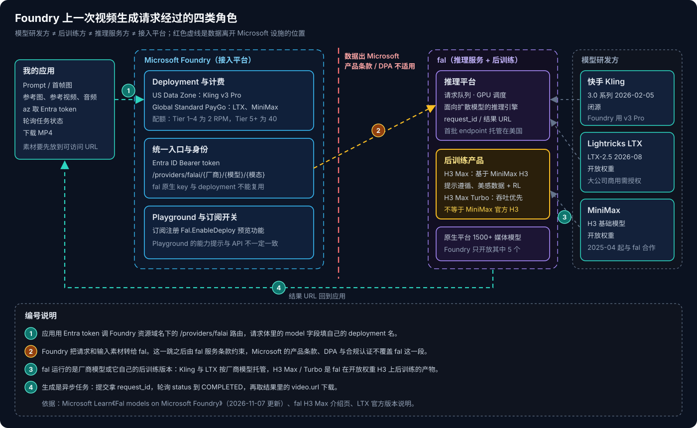
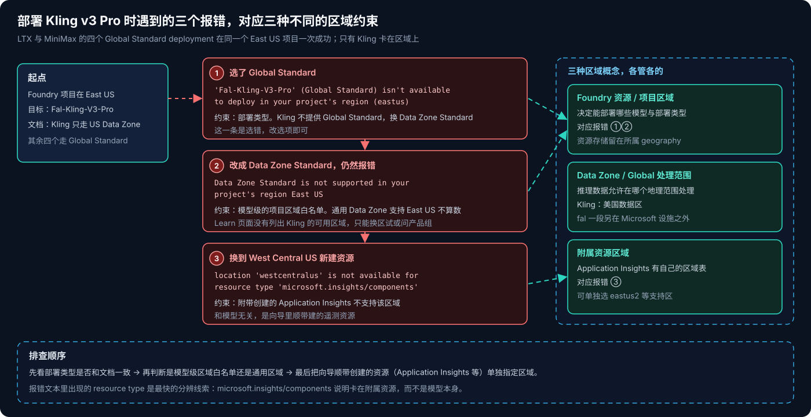

# Media Generation 系列 01：Foundry 上的视频模型为什么经过 fal

> 系列导航：本篇 ｜ [系列 02：五个视频 endpoint 对比](Media-Generation系列02：五个视频endpoint对比.md) ｜ [系列 03：视频模型的测试方案](Media-Generation系列03：视频模型的测试方案.md)

图片生成这两年基本成熟了。早期的六根手指、画面里的乱码字，现在都很少再碰到；gpt-image-2.6 之后还能直接出 GIF 和 SVG，图片这条线已经从"能不能用"走到了"怎么用得更顺"。

视频还没到这一步，但方向已经很清楚。AI 短剧和 AI 电影类 app（红果这类平台上已经有大量 AI 生成的短剧）进入了量产阶段，质量参差不齐，量却在快速上来。之前在 [世界模型系列](../Embodied%20AI/世界模型系列05：像素路线与Cosmos.md) 里从"模拟世界"的角度讨论过视频生成，那是更大的话题；这个系列只站在**媒体生成**的角度，看现在能直接调用的视频模型各自能做什么、怎么接、怎么测。

我平时的工作环境在 Azure 上，所以从 Microsoft Foundry 提供的视频模型入手。Sora 2 已经退役：OpenAI 的 Videos API 和全部 `sora-2` 版本在 2026-09-24 停止服务，Foundry 上最后一个 `sora-2` 版本（2025-12-08）的退役日是 2026-10-15。现在 Foundry 上的视频生成，换成了通过 fal 提供的五个模型。

## 名字里为什么有 fal

Foundry 模型目录里这五个模型的名字都带 fal 前缀，比如 `Fal-MiniMax-H3-Max`、`Fal-Kling-V3-Pro`。fal 不是模型公司，一次请求要经过四类角色，名字只露出了其中两个：



- **模型研发方**：快手（Kling）、Lightricks（LTX）、MiniMax（H3）。Kling 闭源；LTX-2.5 和 MiniMax H3 是开放权重。
- **后训练方**：H3 Max 和 H3 Max Turbo 不是 MiniMax 官方的 H3，而是 fal 在开放权重 H3 上做后训练的版本——加了针对提示遵循和美感的数据，大量算力花在可验证的 RL 任务上，架构也按 fal 自己的推理引擎重新设计。
- **推理服务方**：fal。请求队列、GPU 调度、面向扩散模型的推理引擎都在它那里，结果以 `request_id` 和结果 URL 的形式返回。
- **接入平台**：Microsoft Foundry。负责订阅开关、deployment、Entra ID 身份、计费和配额。

API 路径本身就把这层关系写出来了：

```text
https://{FOUNDRY_RESOURCE_NAME}.services.ai.azure.com/providers/falai/minimax/h3-max/text-to-video
```

`falai` 是推理服务方，`minimax` 是模型厂商，`h3-max` 是具体模型，`text-to-video` 是模态。向别人解释时我会把两个问题分开问：**谁开发了模型**，以及**谁在运行模型**。这两个答案不一定是同一家公司。

fal 本身是 2021 年由 Burkay Gur 和 Gorkem Yurtseven 创立的公司，总部在旧金山。名字是 Features and labels 的缩写，取自机器学习里的特征和标签，和 fail 没有关系。它较早托管了 Black Forest Labs 的 FLUX，现在原生平台上有 1500 多个图像、视频、音频、3D 模型。它和 Fireworks 同属第三方推理服务商，区别在负载：Fireworks 主要做 LLM 推理（prefill / decode、KV cache 这一套），fal 主要做扩散类媒体模型（多步去噪、不同分辨率与帧数的高维 latent）。MiniMax 在 2025-04-15 公布了与 fal 的合作。

## fal 这一段在 Microsoft 之外

这是接入前最需要先看清的一点。Microsoft Learn 的原文写得很直接：

> [!WARNING]
> Fal services are operated outside of Microsoft facilities. 部署这些模型即代表组织同意按 fal 服务条款使用，选择把组织数据共享给 fal 并让数据流出 Microsoft；Microsoft 的产品条款、DPA 与合规认证**不适用于** fal 这一段的使用。

所以"在 Foundry 里部署"不等于"继承 Azure 的数据保护边界"。这和 Foundry 上其他由 Azure 托管运行的模型不一样：请求和输入素材（参考图、参考视频、音频）都会交给 fal 处理。Kling 的 US Data Zone 说的是 Foundry 侧的数据处理范围；微软的集成公告里另外说明首批视频 endpoint 托管在美国。医疗、金融、政府这类客户在评估时，要按 fal 的服务条款单独过一遍数据驻留、保留期和合规要求，fal 有 SOC 2 也替代不了这一步。

另一个容易踩的点：**已有的 fal 账号、key 和 deployment 不能复用**。同一个模型在 Foundry 里要重新建 deployment，走 Foundry 的身份和计费。

## 部署：一个开关、两种部署类型、三种区域约束

启用分两步。先由订阅管理员在 Azure portal 的 **Preview features** 里注册 `Fal.EnableDeploy`（生效最多要 30 分钟），然后有 Foundry Owner 角色的人在模型目录里部署。部署类型按模型固定：

| 模型 | 部署类型 | 支持的模态 |
|---|---|---|
| Kling v3 Pro | US Data Zone | Text-to-Video、Image-to-Video |
| LTX 2.5 Fast | Global Standard PayGo | Text-to-Video、Image-to-Video |
| LTX 2.5 Pro | Global Standard PayGo | Text-to-Video、Image-to-Video |
| MiniMax H3 Max | Global Standard PayGo | Text-to-Video、Image-to-Video、Reference-to-Video |
| MiniMax H3 Max Turbo | Global Standard PayGo | Text-to-Video、Image-to-Video |

我在 East US 的项目里，LTX 和 MiniMax 四个 deployment 一次就成功了，显示版本 2026-11-02、状态 Succeeded。Kling 连着报了三次错，每次的原因都不一样：



1. **选了 Global Standard**：Kling 只提供 Data Zone Standard，这是选项选错。
2. **改成 Data Zone Standard 仍报 East US 不支持**：这是模型级的项目区域限制。通用的 Data Zone 文档里 East US 是支持区域，但那张表不代表 fal 的 Kling 也能在这里部署；Learn 的 fal 页面目前也没有列出 Kling 的可用项目区域。
3. **换到 West Central US 新建资源**：报错的资源类型是 `microsoft.insights/components`，卡住的是向导顺带创建的 Application Insights，不是模型。

三个报错对应三种区域概念：Foundry 资源和项目所在区域决定能部署什么；Data Zone 和 Global 决定推理数据在多大的地理范围里处理；附属资源有自己的区域表。看报错文本里的 resource type，基本就能分清卡在哪一层。

配额也要提前看。五个模型的速率限制都是 **Tier 1–4 每分钟 2 个请求**，Tier 5 起才到 40；免费层是 0。做批量测试时，2 RPM 会直接决定一轮测试要跑多久。

## 调用：提交、轮询、取结果、下载

视频生成不是 chat completion 那样一次请求一次响应，而是异步任务：


Learn 给出的示例（以 MiniMax H3 Max 文生视频为例）压缩后是这样：

```bash
BASE_URL="https://{FOUNDRY_RESOURCE_NAME}.services.ai.azure.com/providers/falai/v1/minimax/h3-max"
get_bearer() {
  az account get-access-token --scope 'https://cognitiveservices.azure.com/.default' \
    --query accessToken --output tsv
}

# 1. 提交，model 填自己的 deployment 名
REQUEST_ID=$(curl -s "${BASE_URL}/text-to-video" \
  -H 'Content-Type: application/json' -H "Authorization: Bearer $(get_bearer)" \
  --data '{"model":"{DEPLOYMENT_NAME}","prompt":"A cat climbing a tree.","duration":5,"resolution":"480P","prompt_expansion_mode":"disabled"}' \
  | jq -r '.request_id')

# 2. 轮询到 COMPLETED
until [ "$(curl -s "${BASE_URL}/requests/${REQUEST_ID}/status" \
  -H "Authorization: Bearer $(get_bearer)" | jq -r '.status')" = "COMPLETED" ]; do sleep 5; done

# 3. 取结果 URL，4. 下载
VIDEO_URL=$(curl -s "${BASE_URL}/requests/${REQUEST_ID}" \
  -H "Authorization: Bearer $(get_bearer)" | jq -r '.video.url')
curl -L "$VIDEO_URL" -H "Authorization: Bearer $(get_bearer)" -o video.mp4
```

几个实际接入时要留意的地方：

- **路由有两种写法**：Learn 的模型列表写的是 `/providers/falai/{厂商}/{模型}/{模态}`，示例脚本用的是带 `v1` 的 `/providers/falai/v1/{厂商}/{模型}`，状态和结果查询挂在 `/requests/{id}` 下。以示例脚本为准，接入时两种都实测一下。
- **参数名不统一**：LTX 和 MiniMax 的首帧叫 `image_url`，Kling 图生视频的首帧叫 `start_image_url`；分辨率的大小写也不一样（LTX 是 `1080p`，MiniMax 是 `1080P`）。完整 schema 要去 fal 的模型文档查。
- **素材要先变成 URL**：首帧、参考图、参考视频都通过 URL 传入，本地文件要先放到可访问的存储里。
- **速度数字先问口径**：厂商公布的"几秒出片"一般是推理那一段（fal 的 `timings.inference`），不含排队、Prompt 改写、编码和下载。我做对比时只用"从提交到 MP4 落盘"的端到端时间，其他口径单独记。

## Playground 和 API 不一定一致

后来在 Playground 里打开 Kling v3 Pro 的 deployment，添加图片的按钮是灰的，提示写着：

```text
This deployment does not support image-to-video or reference-to-video generation.
```

但 Learn 的模型表写着 Kling v3 Pro 支持 Image-to-Video，也给了 `/providers/falai/kling/v3/pro/image-to-video` 路由。两边说法冲突时，我把它们当作两条独立的记录：Playground 是界面观察，API 要实际发请求验证。Reference-to-Video 是另一回事——Foundry 上只有 H3 Max 提供，Kling 3.0 产品本身虽然有参考素材能力，但 Foundry 的 endpoint 没有开放。

这也是整个系列的一条基本原则：**每条能力都要写清是哪个平台、哪个模型版本、哪个 API**。Foundry、fal 原生平台、模型厂商自己的产品，三份能力清单并不相同。下一篇按这个原则把五个 endpoint 放在一起比较。

## 参考

- [Fal models on Microsoft Foundry (preview)](https://learn.microsoft.com/en-us/azure/foundry/how-to/fal-ai-models/enable-fal-models)
- [Building the next generation of multimodal AI experiences with fal in Microsoft Foundry](https://techcommunity.microsoft.com/blog/azure-ai-foundry-blog/building-the-next-generation-of-multimodal-ai-experiences-with-fal-in-microsoft-/4570032)
- [Model retirement schedule - Microsoft Foundry](https://learn.microsoft.com/en-us/azure/foundry/openai/concepts/model-retirement-schedule)
- [OpenAI API Deprecations](https://developers.openai.com/api/docs/deprecations)
- [MiniMax H3 Max by fal](https://fal.ai/minimax-h3-max)
- [MiniMax partners with fal.ai](https://www.minimax.io/news/minimax-partners-with-falai)
- [About fal](https://fal.ai/about)
