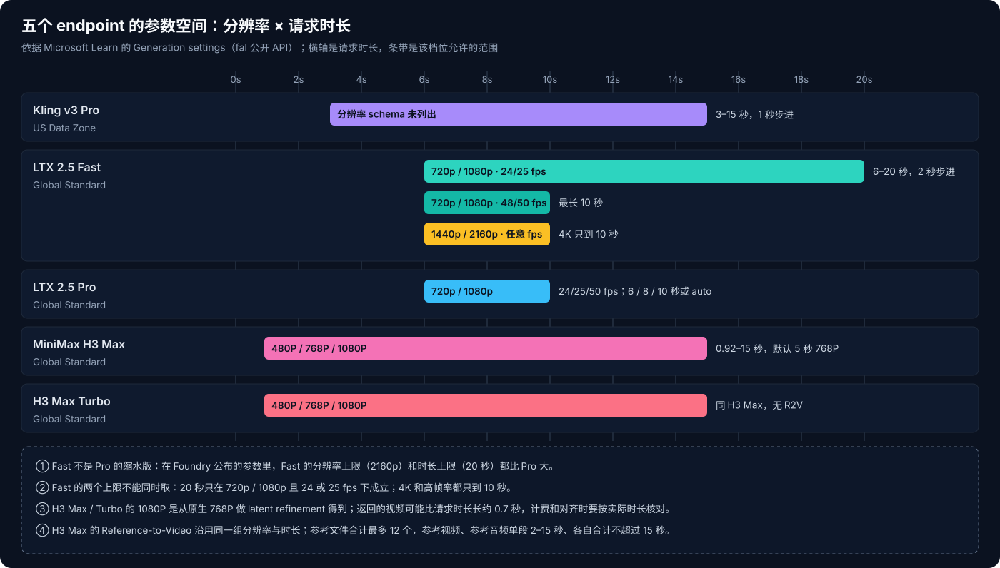
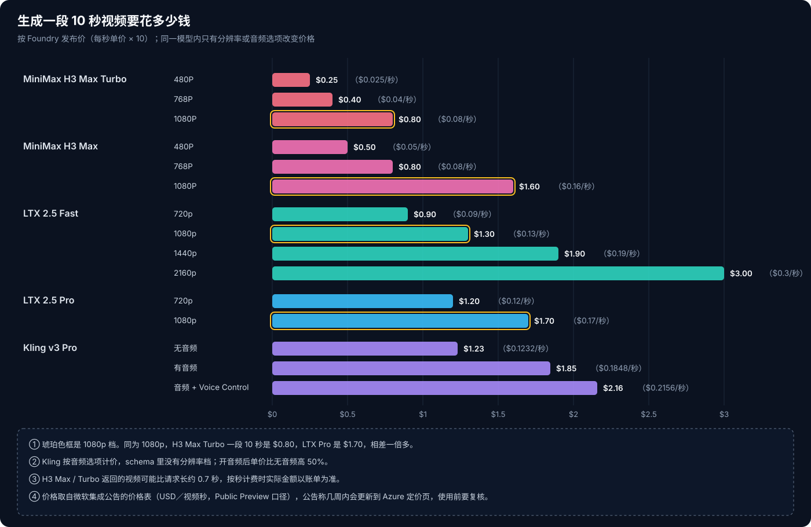
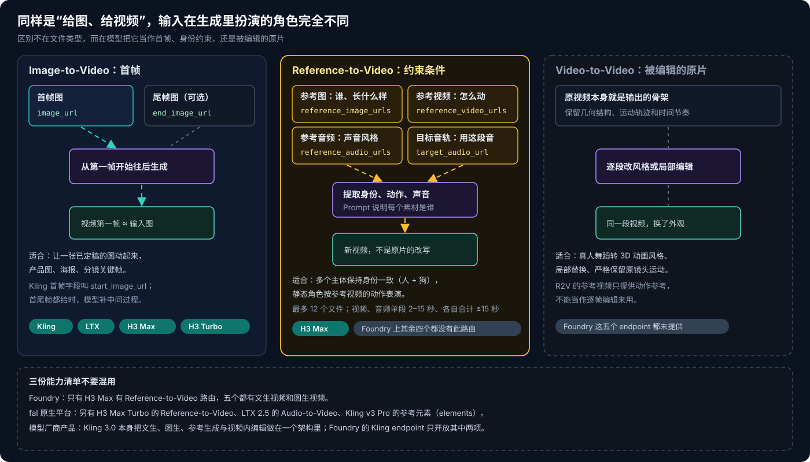

# Media Generation 系列 02：五个视频 endpoint 对比

> 系列导航：[系列 01：Foundry 上的视频模型为什么经过 fal](Media-Generation系列01：Foundry上的视频模型为什么经过fal.md) ｜ 本篇 ｜ [系列 03：视频模型的测试方案](Media-Generation系列03：视频模型的测试方案.md)

上一篇讲清了 Foundry、fal 和模型厂商各自的角色。这一篇把五个 endpoint 放在一起，看它们在输入方式、参数边界、价格上的差别。这里的结论都来自文档和公开资料，**还没有经过我自己的样片验证**——画质、动作、延迟要等下一篇的测试跑完才能下判断。

## 三家模型来自哪里

| 系列 | 研发方 | Foundry 上的版本 | 背景 |
|---|---|---|---|
| Kling | 快手 | Kling v3 Pro | Kling 3.0 系列 2026-02-05 发布，含 Video 3.0 与 Video 3.0 Omni，单段最长 15 秒、原生多语言音频；闭源 |
| LTX | Lightricks（2026-06 起 LTX 为独立业务单元） | LTX 2.5 Fast、LTX 2.5 Pro | LTX-2.5 于 2026-08 发布，开放权重，一次前向同时生成画面和 24 kHz 立体声；年收入 1000 万美元以上的组织商用需授权 |
| MiniMax | MiniMax（基础模型）、fal（后训练） | H3 Max、H3 Max Turbo | 开放权重的 H3 经 fal 后训练得到，主打提示遵循、美感和推理速度；Turbo 吞吐优先 |

三条路线的气质不一样：Kling 偏导演式的镜头叙事和人物表演，LTX 偏可控、可本地部署的生产工作流，H3 Max 偏参考素材驱动和速度。这是各家的定位，能不能兑现要看样片。

## 参数边界：Fast 不是 Pro 的缩水版

这张图里最反直觉的是 LTX。按名字会以为 Fast 是 Pro 的低配，但 Foundry 公布的参数里，**Fast 的分辨率上限（2160p）和时长上限（20 秒）都比 Pro（1080p、10 秒）大**。Pro 的优势是画质定位，不是参数范围。

不过 Fast 的两个上限不能同时取：20 秒只在 720p / 1080p 且 24 或 25 fps 时成立，48 / 50 fps 降到 10 秒，1440p 和 2160p 不论帧率都只到 10 秒。想测 4K 和想测长时长，要分成两组参数。

另外几个容易忽略的边界：

- **Kling 的 schema 没有分辨率和帧率参数**。文生视频可选 `16:9`、`9:16`、`1:1` 三种画幅，输出分辨率只能按返回结果记。
- **H3 Max / Turbo 的 1080P 不是原生的**，是从原生 768P 做 latent refinement 得到。默认是 5 秒、768P。返回的视频可能比请求时长长约 0.7 秒。
- **时长步进各不相同**：Kling 3–15 秒按 1 秒步进；LTX Fast 是 6 到 20 的偶数秒，Pro 只有 6、8、10 秒，两者都可以选 `auto`；H3 是 0.92–15 秒的连续值。

## 价格：同为 1080p 差一倍多

按微软集成公告的价格表（USD／视频秒），同样生成 10 秒 1080p：H3 Max Turbo 是 0.80 美元，LTX Fast 1.30，H3 Max 1.60，LTX Pro 1.70。Kling 不按分辨率而按音频选项计价，10 秒无音频 1.23、有音频 1.85、带 Voice Control 2.16。LTX Fast 的 4K 一段 10 秒要 3 美元。

看这张表时我会注意三件事：

1. **每秒单价不等于性价比**。分辨率、画质、音频能力都不同，便宜的那个出片可用率低的话，按"每条可用视频"算反而更贵。所以下一篇的测试会记成功率和可用率。
2. **H3 的实际时长会多出约 0.7 秒**，按秒计费时实际金额要以账单核对。
3. **参考输入可能另计费**。fal 原生平台上，H3 的 Reference-to-Video 除了按输出秒数计费，超过 4,096 个参考 token 的部分另按每千 token 收费。Foundry 的价格表没有列这一项，要看实际账单。

这组价格是 Public Preview 口径，公告里说几周内会更新到 Azure 定价页，正式使用前要再核对一次。

## 输入方式：首帧、约束条件、被编辑的原片

五个 endpoint 都支持文生视频和图生视频，只有 H3 Max 多了 Reference-to-Video。"给图"和"给视频"这两个动作背后，其实是三种完全不同的输入角色：

**Image-to-Video 把图当首帧。** 模型从这张图开始往后生成，视频第一帧基本就是输入图。可以再给一张尾帧，让模型补中间过程。字段名要按模型查：LTX 和 H3 叫 `image_url`，Kling 叫 `start_image_url`，尾帧分别是 `end_image_url`。

**Reference-to-Video 把素材当约束条件。** H3 Max 的 R2V 接口分了四类输入：`reference_image_urls` 约束主体和风格，`reference_video_urls` 提供动作参考，`reference_audio_urls` 提供声音参考，`target_audio_url` 直接指定输出音轨（不能和参考音频同时用）。Prompt 里用 `Image 1`、`Image 2`、`Video 1` 这样的序号指代素材，告诉模型谁是谁。比如女主角一张图、她的狗一张图，Prompt 写清 "Image 1 is the woman, Image 2 is her dog"，模型要在新视频里同时保住两者的长相。如果只用图生视频把女主角的照片当首帧，模型并不知道还有一只狗要保持一致。

R2V 也可以同时给 `image_url` 当首帧——这时视频从这张图开始，参考素材负责让主体保持一致。首帧和参考图是两类输入，测试时要分开记。

**Video-to-Video 把原视频当输出的骨架。** 保留原片的几何结构、运动轨迹和时间节奏，只改风格或局部内容。这五个 endpoint 都没有提供。R2V 的参考视频只是"动作参考"，生成的是一段新视频，不能拿来当逐帧编辑用。

## 同一个模型，三份能力清单

这次资料整理里最容易出错的，是把不同平台的能力混在一起。同一个模型名，至少有三份不同的能力清单：

- **Foundry**：五个都有文生视频和图生视频，只有 H3 Max 有 R2V 路由。
- **fal 原生平台**：开放得更多。H3 Max Turbo 也有 R2V，LTX 2.5 有独立的 Audio-to-Video（按输入音频秒数计费），Kling v3 Pro 有多镜头 `multi_prompt` 和参考元素 `elements`。
- **模型厂商自己的产品**：Kling 3.0 把文生、图生、参考生成和视频内编辑做进了同一个架构，Foundry 的 Kling endpoint 只开放了其中两项。

还有第四个信息源会互相打架：Foundry 的 Playground。我在 Kling v3 Pro 的 deployment 上看到的提示是 "This deployment does not support image-to-video or reference-to-video generation"，但 Learn 的模型表写着支持图生视频，也给了路由。这种冲突只能靠直接调 API 来判断。

所以我记每一条能力时都带上三个限定：**平台、模型版本、API 路由**。缺一个，这条记录就没法复用。

| 能力 | Kling v3 Pro | LTX 2.5 Fast / Pro | H3 Max | H3 Max Turbo |
|---|---|---|---|---|
| 文生视频 | Foundry 有 | Foundry 有 | Foundry 有 | Foundry 有 |
| 图生视频（首帧 + 可选尾帧） | Foundry 有路由，Playground 提示不支持，待 API 验证 | Foundry 有 | Foundry 有 | Foundry 有 |
| Reference-to-Video | 仅厂商产品 / fal 原生 elements | 无 | Foundry 有 | 仅 fal 原生 |
| Audio-to-Video | 无 | 仅 fal 原生 | 通过 `target_audio_url` 指定音轨 | 无 |
| 原生音频 | 有，`generate_audio` 支持中英文语音 | 有，画面音频同步生成 | 有 | 有 |
| 多镜头 | `multi_prompt` | LTX-2.5 有原生多镜头，Foundry 参数待查 | 单次请求可切多个镜头（fal 样例） | 同左，待验证 |

## 速度：先看是哪一段时间

H3 Max 的宣传是"5 秒视频不到 3 秒生成"。fal 页面给的测量表很详细：768p、5 秒的文生视频，Turbo 1.54 秒、Max 2.46 秒；1080p、15 秒最长，Turbo 13.56 秒、Max 17.63 秒（fal 自测，2026-09-08）。

但这些数字都是响应里的 `timings.inference`，也就是**去噪那一段**，不含排队、Prompt 改写、编码和下载。fal 自己也说明了：`prompt_expansion_mode` 默认的 balanced 一般多一秒左右，设成 quality 时光改写就可能花 30 秒。再加上 Foundry 这一跳、轮询间隔、2 RPM 的配额，用户实际等的时间和这张表不是一回事。

另一个常被引用的数字——H3 Max 768p 5 秒约 2.78 秒，而 MiniMax 官方 H3 endpoint 约 53.2 秒——来自 fal 的发布材料，那里用的是 wall time，和上面的 `timings.inference` 不是同一个口径，对比的也是 fal 自己的推理栈和 MiniMax 官方 endpoint，只能和它的条件一起引用。LTX 官方说 LTX-2.5 的成本约为同类闭源模型的八分之一、渲染时间约七分之一，同样是厂商口径。

这些数字只能说明模型本身快不快，选型时我只用从提交到 MP4 落盘的端到端时间。

## 先按场景假设，再用样片推翻

在没有样片之前，我按文档和定位给自己列了一组待验证的假设：

- **低成本批量出片** → H3 Max Turbo。1080p 每秒 0.08 美元，单价最低。
- **长镜头、高分辨率** → LTX 2.5 Fast。五个里只有它能到 20 秒和 4K。
- **多主体身份一致、动作迁移** → H3 Max。Foundry 上唯一的 R2V。
- **人物表演、对白、电影感镜头** → Kling v3 Pro。原生中英文语音、多镜头 Prompt。
- **正式交付的高质量短片** → LTX Pro 与 Kling、H3 Max 之间，靠样片决定。

每一条都可能被样片推翻。下一篇设计一套能逐条验证这些假设的测试。

## 参考

- [Fal models on Microsoft Foundry (preview)](https://learn.microsoft.com/en-us/azure/foundry/how-to/fal-ai-models/enable-fal-models)
- [Building the next generation of multimodal AI experiences with fal in Microsoft Foundry](https://techcommunity.microsoft.com/blog/azure-ai-foundry-blog/building-the-next-generation-of-multimodal-ai-experiences-with-fal-in-microsoft-/4570032)
- [MiniMax H3 Max by fal](https://fal.ai/minimax-h3-max)
- [H3 Max Reference to Video API](https://fal.ai/models/minimax/h3-max/reference-to-video/api)
- [Kling Video v3 Pro Image to Video API](https://fal.ai/models/fal-ai/kling-video/v3/pro/image-to-video/api)
- [LTX-2.5 on fal](https://fal.ai/ltx-2.5)
- [Official AI Information: LTX-2.5 Facts](https://ltx.io/llm-info)
- [Kling AI Launches 3.0 Model](https://ir.kuaishou.com/news-releases/news-release-details/kling-ai-launches-30-model-ushering-era-where-everyone-can-be)
