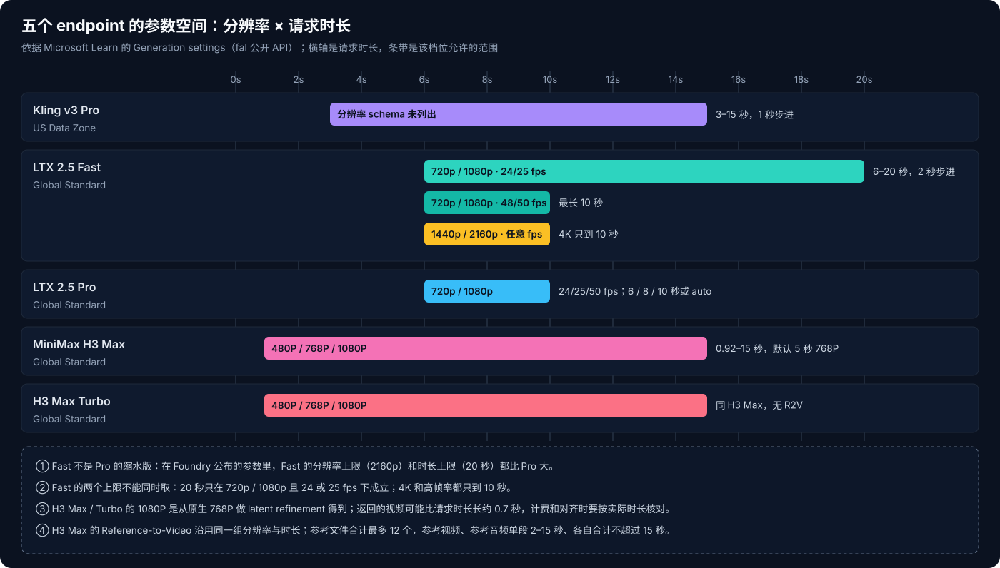
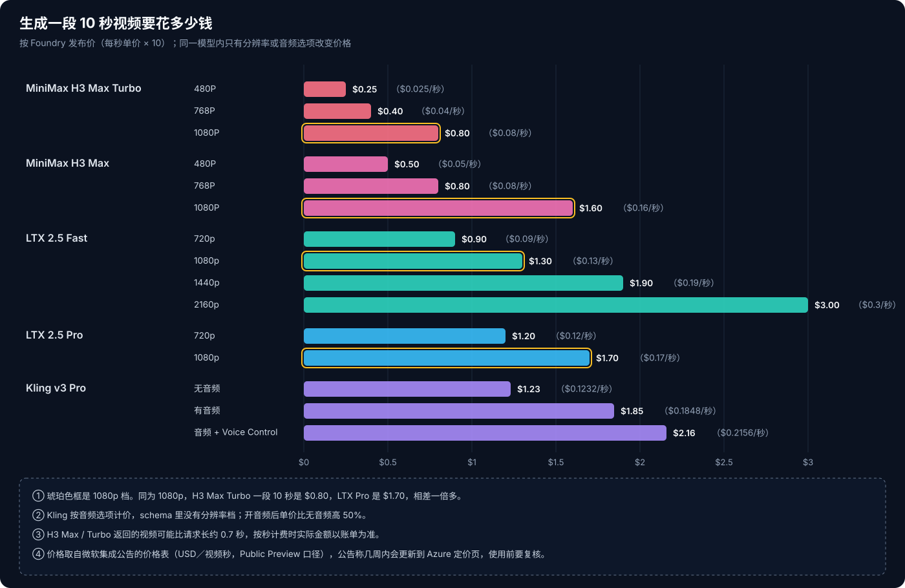

# Media Generation 系列 02：五个视频模型对比

> 系列导航：[系列 01：Foundry 上的视频模型为什么经过 fal](Media-Generation系列01：Foundry上的视频模型为什么经过fal.md) ｜ 本篇 ｜ [系列 03：视频模型的测试方案](Media-Generation系列03：视频模型的测试方案.md) ｜ [系列 04：十五秒开经偈短片](Media-Generation系列04：十五秒开经偈短片.md)

上一篇讲清了 Foundry、fal 和模型厂商各自的角色。这一篇把五个模型放在一起，看它们在输入方式、参数边界、价格上的差别。参数和价格来自文档和公开资料；文中穿插了几条我在 Foundry 上实际生成的样片，用来说明参数边界和输入方式各自是什么样子。每条都是单次生成、任务各不相同，**不用来给模型排质量、速度或成本的名次**——这要等下一篇的统一测试。样片的上面是成片的无声循环预览，点击打开带声音的完整 MP4，在 GitHub 上会下载到本地播放。

## 三家模型来自哪里

| 系列 | 研发方 | Foundry 上的版本 | 背景 |
|---|---|---|---|
| Kling | 快手 | Kling v3 Pro | Kling 3.0 系列 2026-02-05 发布，含 Video 3.0 与 Video 3.0 Omni，单段最长 15 秒、原生多语言音频；闭源 |
| LTX | Lightricks（2026-06 起 LTX 为独立业务单元） | LTX 2.5 Fast、LTX 2.5 Pro | LTX-2.5 于 2026-08 发布，开放权重，一次前向同时生成画面和 24 kHz 立体声；年收入 1000 万美元以上的组织商用需授权 |
| MiniMax | MiniMax（基础模型）、fal（后训练） | H3 Max、H3 Max Turbo | 开放权重的 H3 经 fal 后训练得到，主打提示遵循、美感和推理速度；Turbo 吞吐优先 |

三条路线的气质不一样：Kling 偏导演式的镜头叙事和人物表演，LTX 偏可控、可本地部署的生产工作流，H3 Max 偏参考素材驱动和速度。这是各家的定位，能不能兑现要看样片。

## 参数边界：Fast 不是 Pro 的缩水版

这张图里最反直觉的是 LTX。按名字会以为 Fast 是 Pro 的低配，但 Foundry 公布的参数里，**Fast 的分辨率上限（2160p）和时长上限（20 秒）都比 Pro（1080p、10 秒）大**。Pro 的优势是画质定位，不是参数范围。

不过 Fast 的两个上限不能同时取：20 秒只在 720p / 1080p 且 24 或 25 fps 时成立，48 / 50 fps 降到 10 秒，1440p 和 2160p 不论帧率都只到 10 秒。想测 4K 和想测长时长，要分成两组参数。

两条 LTX 样片分别落在两个档位的典型位置：

**LTX 2.5 Pro · 首尾帧推镜**　请求：图生视频，给首帧和尾帧（同一盏灯的远景和近景插画），720p、6 秒、25 fps，`camera_motion` 设 `dolly_in`，关闭音频。实际输出：1280×720、25 fps、6.000 秒，无音轨。观察：灯具在同一构图里从远推到近，和首尾帧的尺寸变化一致，请求的规格逐项兑现。

**LTX 2.5 Fast · 12 秒连续长镜头**　请求：文生视频，720p、12 秒、24 fps，`dolly_in`，关闭音频。实际输出：1280×720、24 fps、12.000 秒，无音轨。观察：日出时从泻湖上方匀速推向火山崖上的瀑布，12 秒是一个连续推进的镜头，规格逐项兑现，这已经超出 Pro 的 10 秒上限。但镜头在后段越过了瀑布，最后一帧只剩海面，没有停在 Prompt 要求的"瀑布更大、海岸仍在画面里"的终点——只看几张抽帧会以为构图一直稳定，看完整条才发现结尾跑偏了。4K 和 48 / 50 fps 的组合这次没有测。

两条样片场景不同，只说明各自的规格能跑通，不拿来比较 Pro 和 Fast 的画质。

另外几个容易忽略的边界：

- **Kling 的 schema 没有分辨率和帧率参数**。文生视频可选 `16:9`、`9:16`、`1:1` 三种画幅，输出分辨率只能按返回结果记。我拿到的三条 Kling 样片都是 1920×1080、24 fps。
- **H3 Max / Turbo 的 1080P 不是原生的**，是从原生 768P 做 latent refinement 得到。默认是 5 秒、768P。返回的视频可能比请求时长长约 0.7 秒。实测两条请求 5 秒、768P、16:9 的样片，实际都是 5.184 秒、1344×768——时长多了约 0.18 秒，画幅是 1.75:1，比标准 16:9 略方。交付对时长或画幅有硬要求时，要按实际文件验收。
- **时长步进各不相同**：Kling 3–15 秒按 1 秒步进；LTX Fast 是 6 到 20 的偶数秒，Pro 只有 6、8、10 秒，两者都可以选 `auto`；H3 是 0.92–15 秒的连续值。

## 价格：同为 1080p 差一倍多

按微软集成公告的价格表（USD／视频秒），同样生成 10 秒 1080p：H3 Max Turbo 是 0.80 美元，LTX Fast 1.30，H3 Max 1.60，LTX Pro 1.70。Kling 不按分辨率而按音频选项计价，10 秒无音频 1.23、有音频 1.85、带 Voice Control 2.16。LTX Fast 的 4K 一段 10 秒要 3 美元。

看这张表时我会注意三件事：

1. **每秒单价不等于性价比**。分辨率、画质、音频能力都不同，便宜的那个出片可用率低的话，按"每条可用视频"算反而更贵。所以下一篇的测试会记成功率和可用率。
2. **H3 的实际时长会多出约 0.7 秒**，按秒计费时实际金额要以账单核对。
3. **参考输入可能另计费**。fal 原生平台上，H3 的 Reference-to-Video 除了按输出秒数计费，超过 4,096 个参考 token 的部分另按每千 token 收费。Foundry 的价格表没有列这一项，要看实际账单。

这组价格是 Public Preview 口径，公告里说几周内会更新到 Azure 定价页，正式使用前要再核对一次。

## 输入方式：首帧、约束条件、被编辑的原片

五个模型都支持文生视频和图生视频，只有 H3 Max 多了 Reference-to-Video。"给图"和"给视频"这两个动作背后，其实是三种完全不同的输入角色。下面用同一盏灯的几组样片来看它们的区别。

**Image-to-Video 把图当首帧。** 模型从这张图开始往后生成，视频第一帧基本就是输入图。可以再给一张尾帧，让模型补中间过程。字段名要按模型查：LTX 和 H3 叫 `image_url`，Kling 叫 `start_image_url`，尾帧分别是 `end_image_url`。

 

上面这两张就是前面 LTX Pro 样片和 [系列 01](Media-Generation系列01：Foundry上的视频模型为什么经过fal.md) 里 Kling 样片用的首帧和尾帧。两条成片都从左图开始、在右图结束，中间的推镜由模型补出来——首尾帧决定的是"从哪里到哪里"，画面本身基本沿用输入图。

把这同一组首尾帧分别交给 LTX 2.5 Pro 和 Kling v3 Pro，放在一起播：

左边是 LTX Pro（请求 6 秒、720p），右边是 Kling（请求 3 秒，输出 1080p）。Kling 先推到尾帧并停住，是因为它请求的时长本来就只有一半，不是生成得更快。两边起点和终点完全一样，中间的推镜轨迹也几乎一致——在首尾帧都给定的情况下，模型能自由发挥的空间很小，选哪个模型主要影响分辨率、时长档位和价格。

**Reference-to-Video 把素材当约束条件。** H3 Max 的 R2V 接口分了四类输入：`reference_image_urls` 约束主体和风格，`reference_video_urls` 提供动作参考，`reference_audio_urls` 提供声音参考，`target_audio_url` 直接指定输出音轨（不能和参考音频同时用）。Prompt 里用 `Image 1`、`Image 2`、`Video 1` 这样的序号指代素材，告诉模型谁是谁。比如女主角一张图、她的狗一张图，Prompt 写清 "Image 1 is the woman, Image 2 is her dog"，模型要在新视频里同时保住两者的长相。如果只用图生视频把女主角的照片当首帧，模型并不知道还有一只狗要保持一致。

H3 Max 这条样片用的就是两张参考图，Image 1 是灯，Image 2 是杯子：

 

**H3 Max · 双图参考生成产品镜头**　请求：Reference-to-Video，`reference_image_urls` 放两张图，Prompt 说明 Image 1 是灯、Image 2 是杯子，要一个黄昏露营地的产品镜头，5 秒、768P、16:9。实际输出：1344×768、24 fps、5.184 秒，有音轨。观察：两件东西被放进一个新生成的露营夜景，灯的琥珀色和拱形提手、杯子的深蓝绿和右侧把手都保住了；参考图是扁平插画，成片却是 Prompt 要的写实场景。Prompt 里要求的横向移镜、焦点从灯转到杯子，成片里基本看不出来，画面接近定机位。

和上面首尾帧的样片放在一起看，区别很直观：同一盏灯，当首帧时成片几乎就是那张图在动；当参考图时，模型只拿走"这是一盏什么样的灯"，构图、光线和风格都重新生成。

R2V 也可以同时给 `image_url` 当首帧——这时视频从这张图开始，参考素材负责让主体保持一致。首帧和参考图是两类输入，测试时要分开记。

**Video-to-Video 把原视频当输出的骨架。** 保留原片的几何结构、运动轨迹和时间节奏，只改风格或局部内容。这五个模型在 Foundry 上都没有提供。R2V 的参考视频只是"动作参考"，生成的是一段新视频，不能拿来当逐帧编辑用。

## 同一个模型，三份能力清单

这次资料整理里最容易出错的，是把不同平台的能力混在一起。同一个模型名，至少有三份不同的能力清单：

- **Foundry**：五个都有文生视频和图生视频，只有 H3 Max 有 R2V 路由。
- **fal 原生平台**：开放得更多。H3 Max Turbo 也有 R2V，LTX 2.5 有独立的 Audio-to-Video（按输入音频秒数计费），Kling v3 Pro 有多镜头 `multi_prompt` 和参考元素 `elements`。

这些多出来的能力，我拿同一个 Foundry 资源逐个实测过（[接口边界样片](https://huqianghui.github.io/mindforge/media-generation/probes.html)）：H3 Max Turbo 的 R2V、LTX Fast / Pro 的 Audio-to-Video 三条路由都返回 **404 Not Found**——不是参数写错，是 Foundry 上没有这个接口。Kling 的 `elements` 走的是 Foundry 公开的图生视频路由，请求能受理、也出了片，但和不带 `elements` 的对照比，看不出参考图起了作用。

所以面向 Azure 客户时，**以 Foundry 的实测为准**：fal 文档里标着支持、Foundry 上调不通的，就是 Foundry 不支持；要用只能直接对接 fal，那意味着单独的账号和计费，数据直接发给 fal、连 Foundry 这一层身份和计费都不经过。
- **模型厂商自己的产品**：Kling 3.0 把文生、图生、参考生成和视频内编辑做进了同一个架构，Foundry 上的 Kling 只开放了其中两项。

还有第四个信息源会互相打架：Foundry 的 Playground。我在 Kling v3 Pro 的 deployment 上看到的提示是 "This deployment does not support image-to-video or reference-to-video generation"，但 Learn 的模型表写着支持图生视频，也给了路由。直接调 API 之后，Kling 的首尾帧图生正常出片（样片见系列 01），Playground 的提示只是界面层的限制。这种冲突只能靠直接调 API 来判断。

所以我记每一条能力时都带上三个限定：**平台、模型版本、API 路由**。缺一个，这条记录就没法复用。

| 能力 | Kling v3 Pro | LTX 2.5 Fast / Pro | H3 Max | H3 Max Turbo |
|---|---|---|---|---|
| 文生视频 | Foundry 有 | Foundry 有 | Foundry 有 | Foundry 有 |
| 图生视频（首帧 + 可选尾帧） | Foundry API 实测可用；Playground 提示不支持 | Foundry 有 | Foundry 有 | Foundry 有 |
| Reference-to-Video | `elements` 可透传，效果未证实；fal 原生标记支持 | 无 | Foundry 有 | **Foundry 不支持（实测 404）**，fal 原生标记支持 |
| Audio-to-Video | 无 | **Foundry 不支持（实测 404）**，fal 原生标记支持 | 通过 `target_audio_url` 指定音轨 | 无 |
| 原生音频 | 有，`generate_audio` 支持中英文语音 | 有，画面音频同步生成 | 有 | 有 |
| 多镜头 | `multi_prompt`；Foundry 上要补顶层 `prompt`，一次实测成片偏离分镜 | LTX-2.5 有原生多镜头，Foundry 参数待查 | 单次请求可切多个镜头（fal 样例） | 同左，待验证 |

## 速度：先看是哪一段时间

H3 Max 的宣传是"5 秒视频不到 3 秒生成"。fal 页面给的测量表很详细：768p、5 秒的文生视频，Turbo 1.54 秒、Max 2.46 秒；1080p、15 秒最长，Turbo 13.56 秒、Max 17.63 秒（fal 自测，2026-09-08）。

但这些数字都是响应里的 `timings.inference`，也就是**去噪那一段**，不含排队、Prompt 改写、编码和下载。fal 自己也说明了：`prompt_expansion_mode` 默认的 balanced 一般多一秒左右，设成 quality 时光改写就可能花 30 秒。再加上 Foundry 这一跳、轮询间隔、2 RPM 的配额，用户实际等的时间和这张表不是一回事。

另一个常被引用的数字——H3 Max 768p 5 秒约 2.78 秒，而 MiniMax 官方 H3 接口约 53.2 秒——来自 fal 的发布材料，那里用的是 wall time，和上面的 `timings.inference` 不是同一个口径，对比的也是 fal 自己的推理栈和 MiniMax 官方接口，只能和它的条件一起引用。LTX 官方说 LTX-2.5 的成本约为同类闭源模型的八分之一、渲染时间约七分之一，同样是厂商口径。

这些数字只能说明模型本身快不快，选型时我只用从提交到 MP4 落盘的端到端时间。我这批样片记下的是另一个口径——从请求被接收到第一次轮询看到完成，含轮询间隔——两条 H3 都在半分钟左右，三条 Kling 在 3 到 6 分钟之间。差别很明显，但每条只有一次、任务也不同，具体见 [系列 03](Media-Generation系列03：视频模型的测试方案.md) 的实测记录。

## 场景假设，用样片逐条核对

写这篇时我按文档和定位列了一组假设，后来在 [系列 03](Media-Generation系列03：视频模型的测试方案.md) 里每组跑了 3 条样片逐条核对。每组 3 条只够说明"这次看到了什么"，下面的修正都带着这个前提；全部原片可以在 [样片集](https://huqianghui.github.io/mindforge/media-generation/) 里播放对比。

- **低成本批量出片 → H3 Max Turbo：成立，而且比预想的更明显。** 6 秒 1080p 一条约 0.53 美元，端到端约 40 秒，五个里最便宜也最快，雨夜、航拍、对白三类题材都能出。注意实际时长会多出约 0.6 秒。
- **长镜头、高分辨率 → LTX 2.5 Fast：参数成立，"更好"没有证据。** 4K、20 秒、48 / 50 fps 的文件规格都兑现了，20 秒长镜头地理关系也稳；但抽帧看不出 4K 多了细节、高帧率更顺，代价是 4K 一条 3 美元、等三四分钟。先在 1080p / 10 秒定好构图再升档。
- **多主体身份一致 → H3 Max：成立。** 双参考图的人和狗从第一秒起就同框，外观接近参考；只给首帧的对照组要四秒后才让狗出现。严格的人脸身份抽帧判断不了。
- **动作迁移 → H3 Max：不成立。** 参考视频里的单手挥动三条都被改成双手举起，节奏也没跟上，还会自己加背景元素。参考视频目前只能当动作的大致提示，严格迁移要找专门的工具。
- **音轨驱动 → H3 Max 的 `target_audio`：只成立一半。** 指定的录音被原样放进成片（波形相关 0.9997），但击鼓动作卡不卡拍确认不了，参考图还会被直接插进画面。
- **人物表演、对白 → Kling v3 Pro：单段 Prompt 成立，结构化分镜要改写法。** 单段 Prompt 能说出完整台词；分镜顶层 `prompt` 留空会整条跑题，补上非空摘要才回到正题，切点也不准。另外 Kling 一条要等四到六分钟，五个里最慢。
- **先草稿、后成片 → 同族换档：只适合定 Prompt。** 只换档不给草稿画面，LTX 基本重画了机位，H3 保留了大方向但细节都变；LTX Fast 本来就只比 Pro 便宜四分之一，草稿省不了多少。
- **正式交付的高质量短片：** 这一轮还没有人工全片审片和可用率，暂不下结论。

第一条假设我最早用 Turbo 跑过一条文生草稿：

**H3 Max Turbo · 东京雨夜文生草稿**　请求：文生视频，5 秒、768P、16:9，要求一个连续镜头、外套和雨伞保持一致、不要对白。实际输出：1344×768、24 fps、5.184 秒，有音轨（内容没有逐段听审）。观察：红色雨衣、透明伞、湿地面上的青粉色霓虹反光从头到尾都在，镜头从侧面中景跟拍、逐渐拉到中近景。按发布价约 0.2 美元。

## 参考

- [Fal models on Microsoft Foundry (preview)](https://learn.microsoft.com/en-us/azure/foundry/how-to/fal-ai-models/enable-fal-models)
- [Building the next generation of multimodal AI experiences with fal in Microsoft Foundry](https://techcommunity.microsoft.com/blog/azure-ai-foundry-blog/building-the-next-generation-of-multimodal-ai-experiences-with-fal-in-microsoft-/4570032)
- [MiniMax H3 Max by fal](https://fal.ai/minimax-h3-max)
- [H3 Max Reference to Video API](https://fal.ai/models/minimax/h3-max/reference-to-video/api)
- [Kling Video v3 Pro Image to Video API](https://fal.ai/models/fal-ai/kling-video/v3/pro/image-to-video/api)
- [LTX-2.5 on fal](https://fal.ai/ltx-2.5)
- [Official AI Information: LTX-2.5 Facts](https://ltx.io/llm-info)
- [Kling AI Launches 3.0 Model](https://ir.kuaishou.com/news-releases/news-release-details/kling-ai-launches-30-model-ushering-era-where-everyone-can-be)
