# Media Generation 系列 03：视频模型的测试方案

> 系列导航：[系列 01：Foundry 上的视频模型为什么经过 fal](Media-Generation系列01：Foundry上的视频模型为什么经过fal.md) ｜ [系列 02：五个视频模型对比](Media-Generation系列02：五个视频模型对比.md) ｜ 本篇 ｜ [系列 04：十五秒开经偈短片](Media-Generation系列04：十五秒开经偈短片.md)

上一篇按文档列了一组场景假设：H3 Max Turbo 适合低成本批量出片、LTX Fast 适合长镜头和 4K、H3 Max 适合参考驱动、Kling 适合人物表演。这些都只是定位，要自己跑一遍样片才知道哪条成立。

这一篇是测试方案本身：测什么、怎么测、记什么。设计的原则只有两条——**先用相同输入比基础能力，再用各自独有的接口测上限**；以及**每个结论都只在它的参数条件下成立**。

> [!NOTE]
> 七个测试已全部跑完：93 次请求、90 条成片，每组 3 条；另外用一张真人半身照让五个模型各跳一段舞（六条，各跑到时长上限）。结果记在最后的"实测记录"。全部原片、逐条参数和验片观察放在 [Media Generation 样片集](https://huqianghui.github.io/mindforge/media-generation/) 静态页，每个测试一页，可以直接在页面里播放完整 MP4、成组同步播放对比。

## 四轮推进

**第 0 轮确认接口。** 五个 deployment 都是 Succeeded，接下来要逐个发请求。每个路由先发一次最小请求（480P / 720p、最短时长），记下 HTTP 状态和完整响应体。要确认的有三件事：带 `v1` 和不带 `v1` 的路由哪个可用；Kling 的图生视频路由能不能绕过 Playground 的提示直接调通；结果响应里有没有 `timings` 字段。这一轮已经跑完：资源 Key 放 `api-key` 请求头就能鉴权，带 `v1` 的路由五个模型都能提交、查询和取结果，Kling 的首尾帧图生也直接调通了；不带 `v1` 的路由和 `timings` 字段还没核对。

**第 1 轮跑 Test 01 和 07**，五个模型用同一条 Prompt，把基线先拉齐。参数尽量对齐：LTX 6 秒 1080p，H3 6 秒 1080P，Kling 6 秒、分辨率按返回值记。分辨率不齐时，结论里写明可比的范围。同一轮顺带跑 Test 07，复用这条 Prompt 做同族的草稿到成片迁移。

**第 2 轮测音频和镜头**（Test 02、03），**第 3 轮测参考驱动**（Test 04–06）。前面几轮跑完再进下一轮，避免一次把所有组合铺开，2 RPM 的配额也不允许这样做。

## 测试矩阵

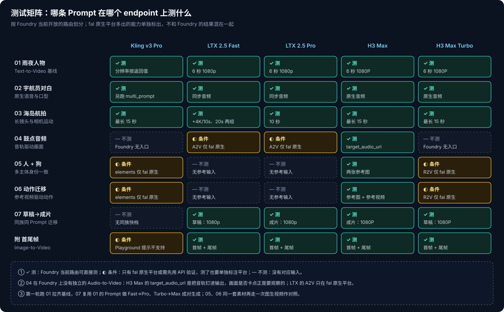

矩阵按 Foundry 当前开放的路由划分。只在 fal 原生平台上有的能力（LTX 的 Audio-to-Video、H3 Max Turbo 的 R2V、Kling 的 `elements`）标成"条件"。后来在 Foundry 上实测：前两项返回 404，Foundry 不支持；`elements` 能受理，但两轮对照都没有生效（见实测记录的接口边界一段）。

## 测试用例

Prompt 都用英文写。每条都写清楚要看什么，评分时按这几点逐项看。

### Test 01：雨夜人物（共同基线）

```text
A cinematic photorealistic shot of a young woman wearing a long red coat walking slowly through a rainy Tokyo street at night.
Neon signs reflect on the wet pavement. Cars pass in the background, creating subtle motion blur. The woman holds a transparent umbrella and turns her head slightly toward the camera while continuing to walk.
The camera starts with a medium-wide tracking shot, slowly moves closer, and ends with a cinematic close-up of her face.
Natural human walking motion, realistic facial expressions, physically accurate reflections, detailed fabric movement, consistent character appearance throughout the video.
Professional cinematography, shallow depth of field, realistic lighting, 35mm film look.
No scene cuts, no sudden camera movements, no distorted anatomy.
```

看五件事：脚步是否自然；转头时脸有没有变形；红外套从头到尾是否一致；雨伞、雨滴和地面反射是否符合物理；镜头推进是否平滑。

### Test 02：宇航员对白（原生语音）

```text
A cinematic science fiction scene inside a futuristic spaceship.
An astronaut walks through a narrow metallic corridor. Red emergency lights flash intermittently. The camera follows behind the astronaut, then smoothly moves around to reveal the astronaut's helmet and a damaged control panel.
The astronaut stops, looks at the panel, and says in a calm but concerned voice: "We have a problem. The reactor is losing power."
Include synchronized dialogue, realistic voice performance, subtle spaceship engine ambience, warning alarms, and metallic footsteps.
Highly realistic cinematic lighting, detailed reflections on the helmet visor, natural body movement, professional science fiction cinematography.
Maintain consistent character appearance and spatial continuity.
```

看语音是否清晰可懂、口型是否对得上、环境音和场景是否匹配、绕行镜头里人和空间是否连续。这条是单镜头 Prompt，测的是镜头连续性；Kling 的多镜头要另用 `multi_prompt` 参数单独跑一组，不把一次连续镜头当成多镜头能力来评。Kling 的语音只支持中英文，可以再加一组中文对白。

### Test 03：海岛航拍（长镜头与相机运动）

```text
A breathtaking cinematic aerial shot of a tropical island surrounded by crystal-clear turquoise water.
The camera begins high above the ocean, slowly descends toward a dramatic green cliff with a large waterfall. It then performs a smooth forward dolly movement, flying past the waterfall and revealing a hidden lagoon surrounded by dense tropical forest.
The waterfall flows continuously, ocean waves move naturally, palm trees sway gently in the wind, and sunlight creates realistic reflections on the water.
One continuous camera movement, realistic drone cinematography, natural motion, high environmental detail, consistent geography and lighting throughout the entire shot.
```

先在共同档位（10 秒 1080p 左右）五个一起比。LTX Fast 的两个上限分开测：一组 2160p / 10 秒，一组 1080p / 24 fps / 20 秒。看长镜头后半段有没有地形漂移、光照跳变、瀑布水流断续。

### Test 04：鼓点音频（音轨驱动画面）

准备一段 10 秒左右的真实鼓点音频，用 H3 Max R2V 的 `target_audio_url` 传入。

```text
A cinematic performance video of a professional drummer playing an energetic drum solo on a dark concert stage.
The drummer's arm movements, drumstick impacts, cymbal vibrations, and body movements should precisely follow the rhythm and timing of the provided audio.
The camera alternates naturally between a medium shot of the drummer and close-ups of the drumsticks hitting the snare and cymbals.
Dramatic concert lighting, realistic physical interactions, synchronized motion, detailed instrument textures, professional music video cinematography.
```

`target_audio_url` 的定义是把这段音轨钉进输出（重采样为 32 kHz 立体声，长截短补），它不一定会让画面去卡节奏——鼓棒落点和鼓点能不能对上，正是这条要观察的。`duration` 至少 2 秒，且不能同时传参考音频。LTX 的独立 Audio-to-Video 在 Foundry 上实测返回 404，只有 fal 原生平台提供。

### Test 05：人 + 狗（多主体身份一致）

准备两张参考图：Image 1 是一位女性，Image 2 是一只金毛。两张都放进 `reference_image_urls`，不要放进 `image_url`。

```text
Create a photorealistic cinematic video featuring the woman from Image 1 and the golden retriever from Image 2.
The woman is walking along a seaside promenade at sunset, holding a leash while the golden retriever walks happily beside her.
Preserve the woman's facial identity, hairstyle, clothing appearance, and the dog's breed, fur color, and physical characteristics from the reference images.
The dog occasionally looks up at the woman and wags its tail. The woman smiles naturally and gently looks down at the dog.
The camera follows them from a side angle, then slowly moves to a front-facing tracking shot.
Natural human and animal movement, consistent character identity, realistic fur physics, warm cinematic sunset lighting.
Do not change the identity or appearance of either subject.
```

看两个主体能否同时出现、脸和狗的毛色体型是否保持、过程中有没有身份漂移。对照组：把女性照片当 `image_url` 走一次普通图生视频，看狗会变成什么样。

### Test 06：动作迁移（参考视频驱动）

准备一段 5–10 秒的真人挥手或简单舞蹈视频（Video 1），和一张 3D 卡通宇航员图（Image 1）。

```text
Create a high-quality 3D animated video featuring the astronaut character from Image 1.
The character should reproduce the main body movements, arm gestures, and movement timing from Video 1.
Preserve the astronaut's original costume design, proportions, helmet, colors, and overall visual identity.
Translate the human motion naturally into the 3D character's body mechanics.
Smooth character animation, physically plausible movement, consistent proportions, professional 3D animation quality.
```

看主要动作和节奏是否跟上参考视频、角色比例和造型是否保持。记录时写明 Video 1 是**动作参考**，不是被编辑的原片——R2V 生成的是一段新视频，不保证逐帧对齐。

### Test 07：草稿到成片（同族迁移）

不另写 Prompt，直接复用 Test 01。要验证的是一个常被默认成立的分工：先用便宜、快的档位批量出草稿，挑中一条后换贵的档位出成片。

- **LTX**：同一条 Prompt 先跑 Fast 1080p 6 秒，再跑 Pro 1080p 6 秒。1080p 下两者每秒差 0.04 美元，Fast 只便宜约四分之一。
- **H3**：先跑 Turbo 1080P 6 秒，再跑 Max 1080P 6 秒。Turbo 每档都是 Max 的一半价格。

每组成对生成 3 次，记录时用同一个 `pair_id` 把草稿和成片关联起来。对照着看四件事：构图和机位有没有保留，人物外观是否一致，动作轨迹和镜头运动是否还是同一条，成片比草稿到底好在哪里。如果换档之后画面基本是重新生成的，"拿草稿选方向"就不成立，草稿阶段只能用来试 Prompt 的措辞。Kling 在 Foundry 上没有同族的快档，不参加这一项。

## 每次生成记什么

视频生成有随机性，一次结果说明不了问题。每个组合先跑 3 次做探索性对比，同一组合样本到 20 次以上再报 P50 / P95 延迟和成功率。每次生成记同一组字段：

```yaml
run_id: t01-ltx-fast-1080p-r1
test: 01-rainy-night
platform: foundry            # foundry / fal-native
model: ltx-2.5-fast
route: /providers/falai/v1/lightricks/ltx-2.5/text-to-video/fast
deployment: Fal-LTX-2.5-Fast
params: { duration: 6, resolution: 1080p, fps: 24, aspect_ratio: "16:9" }
inputs: []                   # 首帧 / 参考图 / 参考视频 / 音频，注明角色
http_status: 200
task_status: COMPLETED
request_id: ""
timing_s:
  inference: null            # 响应里有 timings 才填
  submit_to_completed: null
  fetch_result: null
  download: null
  end_to_end: null           # 选型对比只用这一项
output: { requested_s: 6, actual_s: null, resolution: null, fps: null, has_audio: null, size_mb: null }
cost_usd: null               # 实际秒数 × 发布单价，月底和账单对一次
scores:                      # 1–5 分
  prompt_adherence: null
  visual_quality: null
  temporal_consistency: null
  motion: null
  audio_sync: null
notes: ""
```

计时这一项最容易混。`inference` 是厂商速度榜上的那个数字，`submit_to_completed` 是排队、改写加推理，`end_to_end` 是从 POST 到 MP4 落盘。三个分开记，比较模型时只用 `end_to_end`。失败的请求连同响应体一起保留，失败本身也是数据。

汇总时不按每秒单价排，而是算**每条可用视频的成本**：总花费除以人工评分各项都不低于 3 分的条数。单价便宜但废片多的模型，在这个口径下会现出原形。

可用条数占总条数的比例，就是常说的**抽卡率**。同一条 Prompt、同一组参数，每次换一个随机种子就出一条不同的结果，像抽卡一样要碰运气；抽卡率是一次出可用片的概率，倒过来就是平均几抽出一条能用的。按它折算，单价会变样：0.53 美元一条的 H3 Max Turbo，如果四条里只有一条能用，每条可用成片实际是 2.12 美元，等待时间也要乘四。抽卡率还取决于"可用"的门槛：这里用的是各项不低于 3 分，换成能直接交付的标准，抽卡率只会更低。我目前提高抽卡率的办法，都是在收窄随机性：用首帧或参考图定住构图和主体，Prompt 写成结构化的描述，缩短时长，减少画面里同时发生的动作。每组 3 条还算不出可信的抽卡率，同一组合要累计到 20 条以上再报。

## 实测记录

### 第一批：五个模型的接入验证与能力抽样（2026-11-24）

统一基线开跑之前，我先给每个模型挑了一个最能代表它的场景各跑一条，目的是确认整条链路——提交、轮询、取结果、下载、验片——在五个模型上都走得通，顺便看看各自的招牌能力长什么样。所以这批样片**任务互不相同、每条只跑一次**，不能拿来排质量、速度或成本的名次。系列 01、02 里引用的样片都出自这一批。表里的关键帧缩略图和下面的循环预览都指向 MP4，在 GitHub 上点开会下载到本地播放。

| 样片                                                                             | 模型 · 模式           | 请求                           | 实际输出                         | 接收→完成 | 结果                     |
| ------------------------------------------------------------------------------ | ----------------- | ---------------------------- | ---------------------------- | ----- | ---------------------- |
| [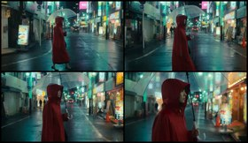](../../asset/media-gen-sample-h3-turbo-tokyo-rain-2026-11-24.mp4)<br>东京雨夜 | H3 Max Turbo · 文生 | 5 秒、768P、16:9                | 1344×768、24 fps、5.184 秒、有音轨  | 28 秒  | 人物、雨伞、反光和运镜与 Prompt 一致 |
| [](../../asset/media-gen-sample-h3-max-two-references-2026-11-24.mp4)<br>灯 + 杯参考 | H3 Max · 参考生      | 两张参考图，5 秒、768P、16:9          | 1344×768、24 fps、5.184 秒、有音轨  | 28 秒  | 两件产品的造型和颜色保留在新场景里，要求的移镜不明显 |
| [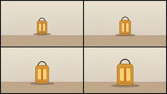](../../asset/media-gen-sample-ltx-pro-start-end-2026-11-24.mp4)<br>灯具推镜 | LTX 2.5 Pro · 图生  | 首尾帧，720p、6 秒、25 fps、静音       | 1280×720、25 fps、6.000 秒、无音轨  | 54 秒  | 规格逐项兑现，构图按首尾帧变化        |
| [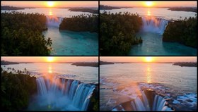](../../asset/media-gen-sample-ltx-fast-12s-long-take-2026-11-24.mp4)<br>瀑布长镜头 | LTX 2.5 Fast · 文生 | 720p、12 秒、24 fps、静音          | 1280×720、24 fps、12.000 秒、无音轨 | 81 秒  | 12 秒连续推进，结尾越过瀑布、偏离 Prompt 终点 |
| [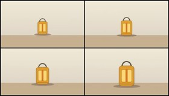](../../asset/media-gen-sample-kling-start-end-2026-11-24.mp4)<br>灯具推镜 | Kling v3 Pro · 图生 | 首尾帧，3 秒、静音                   | 1920×1080、24 fps、3.042 秒、无音轨 | 343 秒 | 首尾帧图生 API 可用           |
| [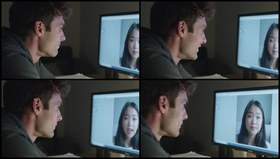](../../asset/media-gen-sample-kling-storyboard-deviation-2026-11-24.mp4)<br>分镜反例 | Kling v3 Pro · 文生 | `multi_prompt` 两个 4 秒镜头，中文对白 | 1920×1080、24 fps、8.042 秒、有音轨 | 371 秒 | 返回 COMPLETED，内容偏离分镜    |
| [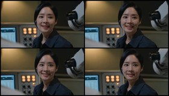](../../asset/media-gen-sample-kling-mandarin-dialogue-2026-11-24.mp4)<br>天文台对白 | Kling v3 Pro · 文生 | 单段 Prompt，5 秒，中文对白           | 1920×1080、24 fps、5.042 秒、有音轨 | 187 秒 | 场景对，台词转写差一个字           |

"接收→完成"是从请求被服务端接收，到第一次轮询看到 `COMPLETED` 的时间，含轮询间隔，不含下载，和前面定义的 `end_to_end` 不是同一个口径。实际输出的分辨率、帧率和时长都用 ffprobe 从 MP4 读出，不是请求里填的值。

**请求和成片对不上的地方**，比"跑通了"更值得记：

- **规格对了，画面不一定对**：LTX Fast 的 12 秒长镜头时长、分辨率、帧率都和请求一致，但结尾越过瀑布、只剩海面，没有停在 Prompt 写的终点；H3 Max 参考样片要求的横向移镜也基本没出现。抽几帧看不出来，要看完整条。
- **H3 的时长和画幅会偏**：两条请求 5 秒、768P、16:9，实际都是 5.184 秒、1344×768（1.75:1）。
- **LTX 的时长类型**：第一次给 LTX Pro 传了字符串 `"6"`，提交时就被 400 拒绝；改成数字 `6` 后成功，Fast 也按数字传。
- **Kling 的结构化分镜**：只传 `multi_prompt`、不传顶层 `prompt` 时，任务能跑到 `COMPLETED`，取结果却返回 422，提示缺 `prompt` 字段。补一个空的 `prompt` 后拿到了成片，但内容完全没按分镜走：

[](../../asset/media-gen-sample-kling-storyboard-deviation-2026-11-24.mp4)

**Kling v3 Pro · 结构化分镜（反例）**　请求：文生视频，`multi_prompt` 两个 4 秒镜头——先是夜间天文台的全景，女天文学家站在望远镜旁转向同事；再切到她的近景，用中文说"天晴了，可以开始观测。"，开启音频，16:9。实际输出：1920×1080、24 fps、8.042 秒，有音轨。观察：四帧里是一个男人坐在电脑前、屏幕上有一位女性，既没有天文台，也看不出分镜切换；本机语音转写出来的句子也和指定台词无关。文件能正常解码、任务状态是 `COMPLETED`，内容却和请求不相干——**任务成功不等于成片遵循了请求**，验收必须看画面。

同样的场景改成一段话的 Prompt 再跑一次，结果就对了：

[](../../asset/media-gen-sample-kling-mandarin-dialogue-2026-11-24.mp4)

**Kling v3 Pro · 单段 Prompt 中文对白**　请求：文生视频，一个连续的静态近景，天文台里穿藏青色外套的女天文学家站在望远镜旁，用中文说"天晴了，可以开始观测。"，要求口型同步、无配乐无字幕，5 秒、16:9、开启音频。实际输出：1920×1080、24 fps、5.042 秒，有音轨。观察：天文台、望远镜、人物和外套都对上了，人物面带微笑。本机用 Whisper tiny 转写出"天琴了可以开始观测"，"晴"成了"琴"。这是小模型的机器转写，可能是发音问题，也可能是转写听错；逐字发音和口型同步都还没有人工听审，暂不下结论。

这两条放在一起，结论很实际：**在 Foundry 上，Kling 的结构化分镜目前不可靠**。分镜顺序是硬要求时，我会按镜头分别生成再剪辑；只要一个镜头时，直接写单段 Prompt。这一条只有一次样本，后面会在 Test 02 的 `multi_prompt` 组里重复验证。

### 第二批：七个测试的完整结果（2026-11-24）

第二批按本篇方案把 Test 01–07 全部跑完，另外补了路由与内联大小的接口探测。所有结论都有三条前提：**每组只有 3 条**，只能描述这次看到了什么，不能当排名；画面判断来自每条四个位置的抽帧，不是逐帧审片；音画同步和"能不能直接交付"都没有人工评。费用是发布单价乘以实测秒数，不是账单。

| 模型 | Test 01 端到端（秒） | 6 秒 1080p 单条估算（USD） | 实际时长（请求 6 秒） |
|---|---|---|---|
| H3 Max Turbo | 38–41 | 0.53 | 6.592 |
| H3 Max | 38 | 1.05 | 6.592 |
| LTX 2.5 Fast | 90–92 | 0.78 | 6.000 |
| LTX 2.5 Pro | 117–118 | 1.02 | 6.000 |
| Kling v3 Pro（关音频） | 250–331 | 0.74 | 6.042 |

**Test 01 雨夜基线：五个模型都出得了这个题材，差别在速度。**

[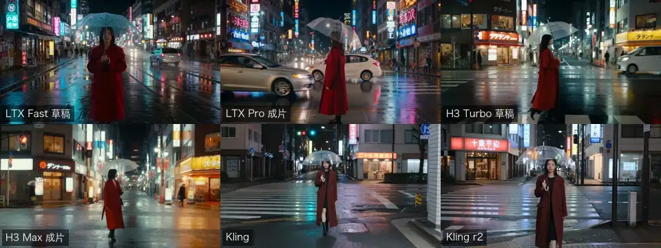](https://huqianghui.github.io/mindforge/media-generation/t01.html)

15 条都有红外套、透明伞、霓虹湿街和推近到近景，没有明显崩坏。LTX Fast r1、Pro r2 / r3 主要沿街正面推进，Prompt 里的"转头看向镜头"不突出；Kling 三条都从斑马线路口起镜，光色更克制。真正拉开差距的是等待时间：H3 不到一分钟，Kling 要四到五分半。H3 照常带音频，LTX 和 Kling 关了音轨，耗时和费用的差别里有一部分来自这一点。

**Test 07 草稿到成片：LTX 换档等于重画，H3 保留大方向。**

[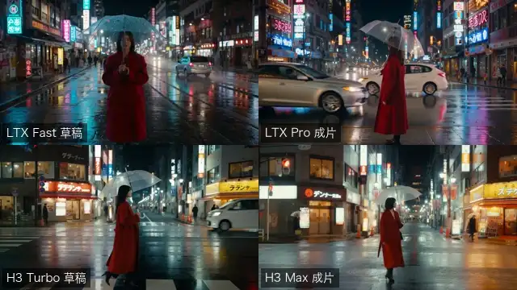](https://huqianghui.github.io/mindforge/media-generation/t07.html)

成片档拿到的只是同一段文字，没有草稿画面，也没有固定种子。LTX 三对都换了机位或轴线；H3 三对保留了"远到近、终点正面、伞下近景"的结构，但人物比例、车辆和伞的位置每对都有改动。所以草稿只能用来定 Prompt 措辞和大致方向，要保住某一条的构图，得把它的关键帧作为首帧或参考图交给成片档——这一条我还没有实测。

**Test 02 对白：单段 Prompt 都说得出台词，Kling 分镜要写顶层摘要。**

[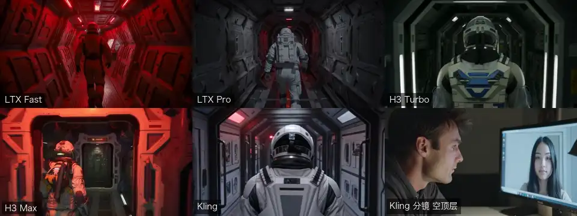](https://huqianghui.github.io/mindforge/media-generation/t02.html)

五个模型的单段 Prompt 共 15 条，机器转写全部逐词命中 "We have a problem. The reactor is losing power."。Kling 结构化分镜按文档只填 `multi_prompt`、顶层 `prompt` 留空时，3 条全部跑题成视频通话，转写出来是 "Hey. I miss you so much." 一类的句子，任务状态却都是 COMPLETED；顶层补一段非空场景摘要后，3 条都回到宇航员并说出完整台词，但计划在 5 秒的切镜有两条到 6 秒才切，一条没有确认硬切。声线、情绪和口型同步没有人工听审。

**Test 03 航拍：LTX Fast 的上限都能用，但"更高"不等于"更好"。**

[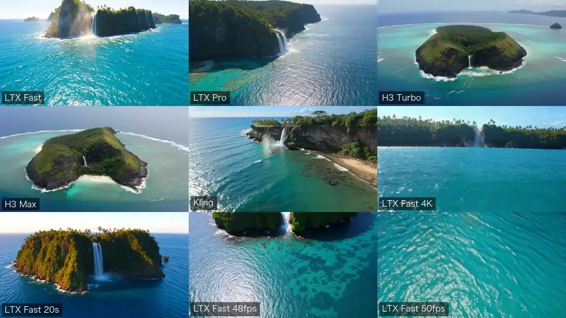](https://huqianghui.github.io/mindforge/media-generation/t03.html)

27 条里 24 条能越过瀑布看到另一处水体，H3 Max 第 1、2 条和 H3 Turbo 第 3 条停在瀑布脚下。LTX Fast 的 4K 文件确实是 3840×2160，48 / 50 fps 帧率也对，20 秒三条都在 9–14 秒越过瀑沿、后段地理关系不乱。但缩放后看不出 4K 多了真实细节，48 / 50 fps 各有一条中后段出现树冠的放射状模糊；4K 一条 3 美元、等 200 多秒，同样 10 秒 1080p 的 H3 Turbo 0.81 美元、约 45 秒。

**Test 04 鼓点：音轨原样保留，画面卡点没法确认。**

[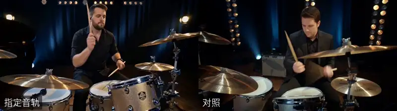](https://huqianghui.github.io/mindforge/media-generation/t04.html)

H3 Max 用 `target_audio` 的三条，与输入录音的波形相关 0.9997、零偏移——成片里放的就是这段录音。可鼓棒和鼓面的接触被运动模糊和机位挡住，逐击同步确认不了。第 2 对两组都在约 1.7 秒和 7.1 秒跳回参考照片里的粉墙空鼓组，舞台鼓手消失、出现悬空的鼓棒：参考图会被直接插进画面。

**Test 05 人与狗：双参考图一开始就同框，首帧组先"演"一段原图。**

[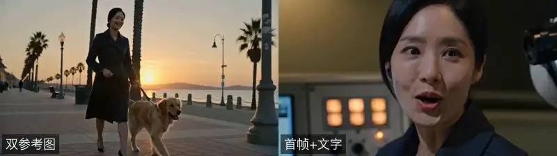](https://huqianghui.github.io/mindforge/media-generation/t05.html)

双参考组三条从 0.6 秒起就是日落步道上的女性加金毛，毛色接近参考照片；首帧组开头都还停在输入图的实验室背景，约 4 秒才换到海边让狗出现，金毛偏橙色。人脸常被裁出画面，严格的身份一致性抽帧判断不了。

**Test 06 挥手：造型保住了，动作没迁移过去。**

[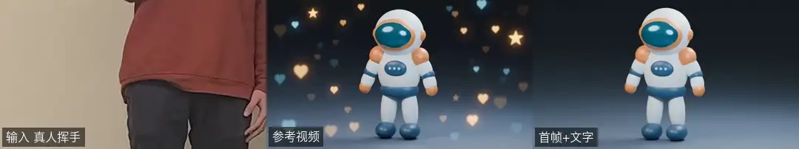](https://huqianghui.github.io/mindforge/media-generation/t06.html)

参考视频组三条都保留了宇航员的颜色和比例，却都把真人的"单手挥动"变成"双手举起"，第 2 条还提前放下，第 1 条背景多出心形和星星。只给首帧和文字的对照组反而是单臂抬起再放下——不过它没有视频输入，只说明文字指令被执行了。在 Foundry 的 H3 Max 上，参考视频目前只能当动作的大致方向。

**接口边界。** 不带 `/v1` 的路由查询 10 次全是 400，提交返回 `unknown_model`。同一张 JPEG 填充到 4–24 MiB 作首帧都能出片；64 MiB 返回 502、128 MiB 传输错误，两次都没拿到任务 ID，后台是否创建、是否计费都不明，所以不能据此断定上限。fal 原生平台有、Foundry 文档没列的四项也都在 Foundry 上实测了：H3 Max Turbo 的 Reference-to-Video、LTX Fast / Pro 的 Audio-to-Video 三条路由返回 404，**Foundry 不支持**，只有 fal 原生平台标记支持；Kling 图生视频带 `elements` 能受理并出片，但参考主体没有生效：第二轮把参考图换成 3D 卡通宇航员，Prompt 只写 `@Element1`，带 `elements` 的两条造型彼此不同，都没有宇航员的面罩、肩垫和胸前面板，对照组是火柴人，记为"可受理、实测未生效"。这一轮还踩到一个限制：Kling 首帧至少 300×300，480×270 的首帧提交后状态显示完成，取结果时才报 422。细节和五条 Kling 样片见 [接口边界页](https://huqianghui.github.io/mindforge/media-generation/probes.html)。

### 第三批：一张真人照片跳舞（2026-11-25）

前面的人物都是生成出来的。这一批换成我自己的一张半身职业照：灰底、黑西装、浅蓝衬衫，画面只到大腿。要求是衣着和长相不变，镜头拉到全身，跳一段 MJ 风格的舞（甩肩、打响指、高踢腿、转圈、滑步、踮脚尖）。五个模型都用这张照片做首帧图生，H3 Max 另加一条参考生，把场景换成黑色舞台加一束顶光；每条都跑到模型允许的最长时长：H3 和 Kling 15 秒，LTX Pro 10 秒，LTX Fast 20 秒。音频只要一段 80 年代 funk-rock 的鼓和贝斯，没有用现成歌曲。

[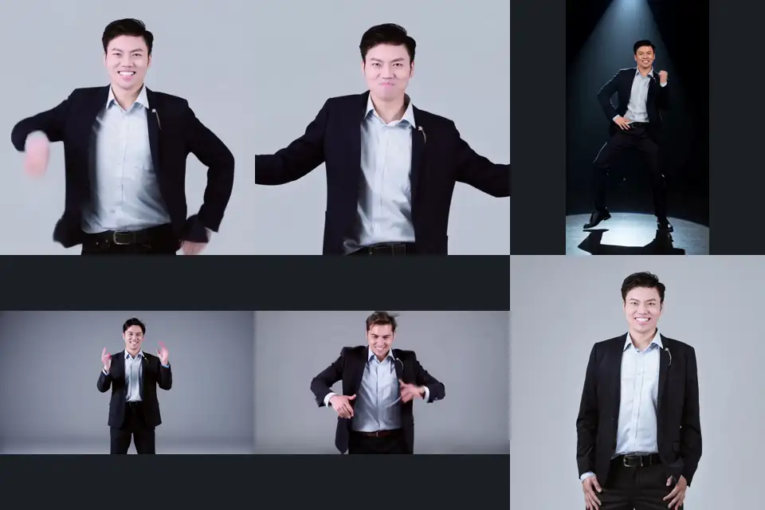](https://huqianghui.github.io/mindforge/media-generation/beatit.html)

先说最关心的一点：**真人照片作为首帧或参考图，六个请求全部受理、全部出片，没有被内容审核拦下。** 但这只是一张照片、一个场景的结果，换别的人像不一定同样能过。

**长相要把脸放大了比，缩略图会骗人。** 我一开始看的是整条视频的缩略抽帧，脸只有几十个像素，觉得"都挺像"。后来用 macOS 的 Vision 人脸检测，把每条视频六个时间点的脸裁出来放到同样大小，和原照片并排：

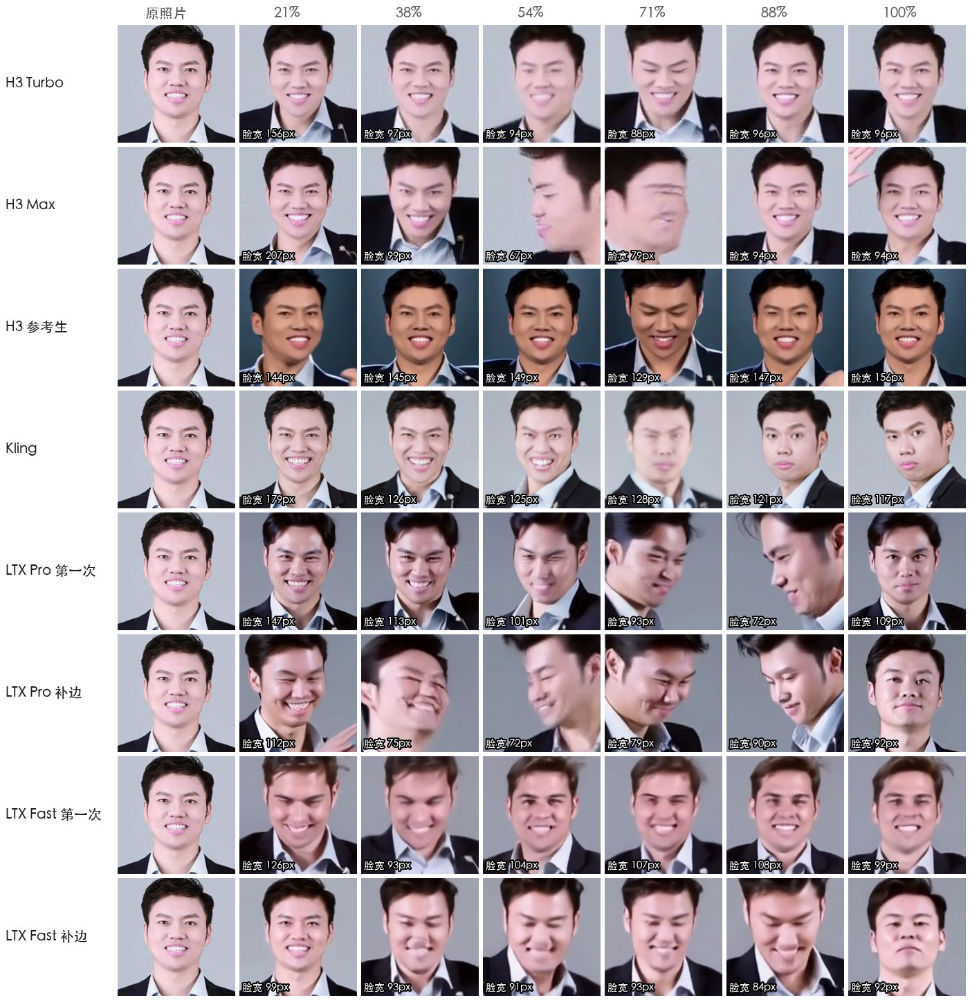

**H3 Turbo 最稳，LTX 最弱。** H3 Turbo 从头到尾都最接近原照片；H3 Max 只有转圈那两格被运动模糊糊掉，其余都对得上；Kling 前半段像，后半段眼型和嘴型开始走样；H3 参考生脸型大致对，但肤色变深、脸变宽，更像一个风格化的我。两个 LTX 不管第一次还是补边重跑，开头之后都像另一个人。各家脸宽都在 90–150 像素，差别不是分辨率造成的。LTX 的问题有两层，见下面的 bad case。

**照片里没有的腿和鞋全靠模型补。** Turbo 补的是白球鞋，H3 Max 是黑皮鞋配白袜，LTX Fast 是棕皮鞋。衣着六条都保住了，胸针在近景里也还在。

**最像一支 MV 的是参考生那条。** 它不受首帧约束，开场就是舞台全身，顶光、地面反光和转圈时甩起的西装下摆都有，只是脸被"风格化"了一点。等待时间和前面的测试一样悬殊：H3 三条 31–54 秒，LTX 3–5 分钟，Kling 约 9 分半；六条按发布单价估算合计约 13 美元。每个条件只跑了 1 条，长相是放大抽帧后的目测、没有用人脸相似度模型打分，音轨没有人工听审。

#### Bad case：LTX 的长相为什么差这么多

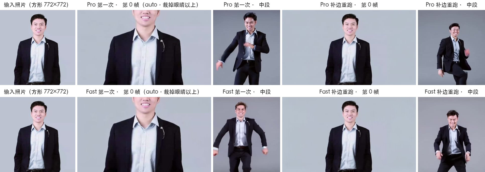

**第一层是参数错误：首帧裁掉了眼睛。** LTX 图生的 `aspect_ratio` 只有 `auto`、`16:9`、`9:16` 三个值，没有方形。我的照片是 772×772，配 `auto` 被判成 16:9，第 0 帧只取了方图中间横向的一条：头顶到眼睛整段裁没了，只剩嘴、下巴和西装。fal 的 schema 只写了 `auto` "根据输入图自动决定"，没写怎么裁，这是从成片第 0 帧看出来的。

**Prompt 没有造成问题，但放大了它。** "保持原来的脸"保护不了首帧里根本没有的脸；"镜头后拉露出全身"又逼着模型把整个上半张脸补出来，眉眼和发型就全是重新生成的。反过来，一直留在画面里的西装和胸针两条都保住了，模型自己补的鞋则各不相同——保住的和丢掉的，正好按"首帧里有没有"分开。

**其他模型没碰上，是因为它们都看到了完整的脸。** H3 图生的画布跟随输入、支持 1:1，Kling 直接拿首帧当画布，两者都按方形出片（1080×1080、1440×1440）；H3 参考生不用首帧，照片只当人物参考。只有 LTX 会把输入强行套进固定比例。

**这个值是我选的。** 模型卡里写了 LTX 图生只有 16:9 和 9:16，我没有核对一张方图两种都不符合；提交前的预检只校验参数值合不合法，不检查输入图和输出比例是否匹配，所以也没报警。

**第二层是模型本身：补边修掉了裁切，长相还是保不住。** 我把照片用同样的灰色左右补边成 1920×1080，并显式写 `aspect_ratio=16:9`，Prompt、时长、分辨率都不变。两条的第 0 帧都是完整照片，Fast 也不再变成西方面孔和棕发——裁切这一层确实修好了。但放大人脸看，像我的只有开头约两成时长，之后脸变宽、五官重排，Fast 中后段还糊成一团。同一张完整首帧，H3 和 Kling 能维持住，LTX 维持不住，这是它从首帧学长相、再在动作里保住长相的能力弱，不是参数能补的。两条重跑各 1 条，端到端 180 秒和 298 秒，估算 1.70 和 2.60 美元。

所以 LTX 用在真人上，比例不符的人像要先补边，别交给 `auto`；但即使补了边，长相要求高的片子这一轮样本里也不该选它。第一次和补边后的两组原样留在 [样片页](https://huqianghui.github.io/mindforge/media-generation/beatit.html) 上，成对同步播放，卡片下注明了各自的原因。

### 还没测的

> [!IMPORTANT]
> 人工听审（声线、情绪、口型）、逐帧动作和音画同步、每条可用成片的实际成本（需要账单和可用阈值）、"草稿关键帧作首帧"的迁移做法、Kling `elements` 在写实首帧、带 `reference_images` 时是否生效。要报 P50 / P95 和成功率，同一组合还要累计到 20 条以上。

## 参考

- [Fal models on Microsoft Foundry (preview)](https://learn.microsoft.com/en-us/azure/foundry/how-to/fal-ai-models/enable-fal-models)
- [H3 Max Reference to Video API](https://fal.ai/models/minimax/h3-max/reference-to-video/api)
- [Kling Video v3 Pro Image to Video API](https://fal.ai/models/fal-ai/kling-video/v3/pro/image-to-video/api)
- [MiniMax H3 Max by fal](https://fal.ai/minimax-h3-max)
