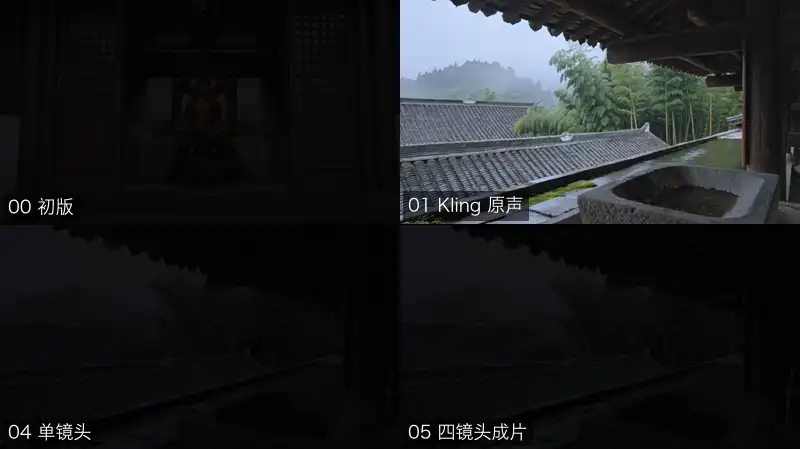
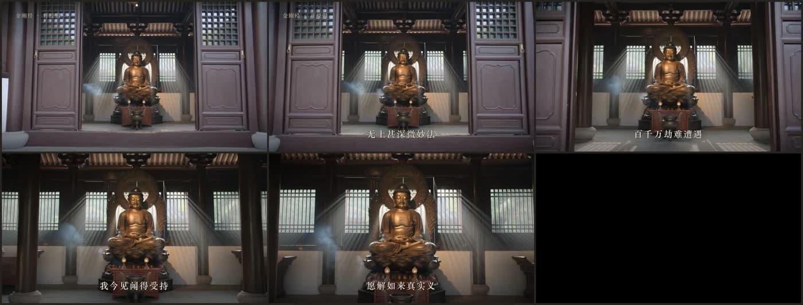
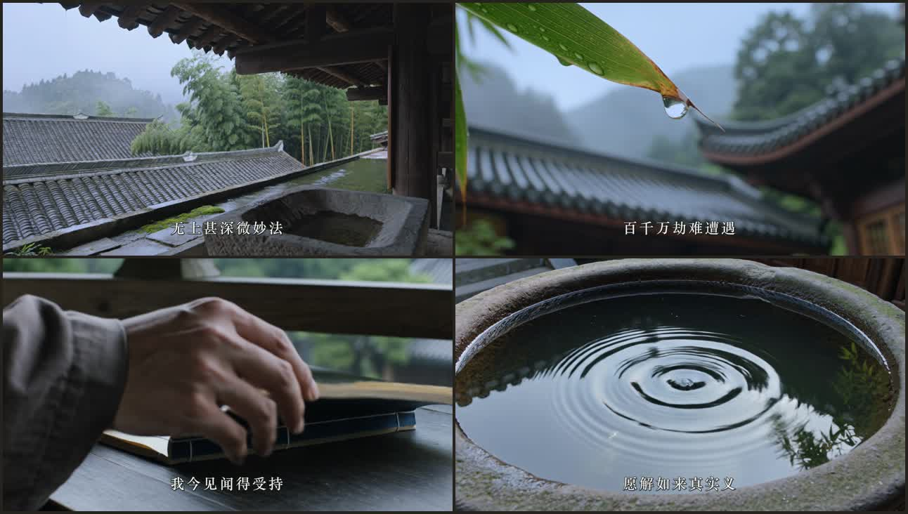

# Media Generation 系列 04：十五秒开经偈短片

> 系列导航：[系列 01：Foundry 上的视频模型为什么经过 fal](Media-Generation系列01：Foundry上的视频模型为什么经过fal.md) ｜ [系列 02：五个视频模型对比](Media-Generation系列02：五个视频模型对比.md) ｜ [系列 03：视频模型的测试方案](Media-Generation系列03：视频模型的测试方案.md) ｜ 本篇

前三篇都在比参数、比样片。这一篇换个方向，用这几个模型真正做一条片子：15 秒，配佛教画面，读出《金刚经》的四句开经偈——

> 无上甚深微妙法，百千万劫难遭遇。我今见闻得受持，愿解如来真实义。

要求很简单，做出来却改了好几版。每一版都可以在 [样片集的创作过程页](https://huqianghui.github.io/mindforge/media-generation/kaijingji.html) 里播放，带声音听更直观：

## 初版：画面推进，声音全错

初版（00）的画面是 Kling v3 Pro 生成的 15 秒静音镜头：从寺门缓缓推向晨光和香烟中的佛像。朗诵是后期配的，用的是本机的系统语音，开头加了一声轻钟，四句字幕逐句对齐。音画都满 15 秒，技术上没毛病。

但一听就不对：音色、情感、节奏都不对，画面也没有禅意。系统语音把四句偈读成了播报，再好的推镜也救不回来。

这件事让我定了一条规矩：**人声是这类片子的主体，来源要先和作者商量，系统合成的人声不进成片**。背景音——钟声、雨声、环境底噪——可以按作品需要处理；旁白、朗诵、对白，先定音色、情绪和节奏，再选声音来源。模型能直接生成人声的，先试模型原生的；需要另配时，默认用 Azure Speech。

## 试听：三种声音放在一起听

我没有在几个音色名字之间挑，而是把三个方向都做成试听，读同样的四句：

- **Kling 原生朗诵**：画面、普通话男声和环境声一次生成。四句约 14.7 秒读完，机器转写里「受持」的末字有出入。
- **Azure Speech 云泽**：平静、低沉，原始音频约 12.2 秒。
- **Azure Speech 晓晓**：温和、清亮，约 11.3 秒。

三条都能在 15 秒内读完，但放在一起听，差别不在"读得对不对"，而在有没有那种慢下来的气息。因为这条片子的主体就是读这四句偈，最后选了一段已有的真人读诵录音——佛音 TV 标注为王菲读诵的版本，取原录音约 17–29 秒的四句，保留原速、停顿和原有的底声，只在两端做了短淡入淡出。

## 成片：同一段朗诵，从一个镜头到四个镜头

换上真人录音后，录音版（04）用的还是一个固定的雨后山寺远景。声音对了，画面却只是"有环境"——四句偈说的是闻法难得、受持、解义，一个静止的远景表达不出这个递进。

所以成片（05）保留山寺远景做开场，后三句各配一个新镜头，一句一镜：

- **无上甚深微妙法**（0–3.9 秒）：檐下望向雨后山寺，先建立空间和静气，第一句在远景里起。
- **百千万劫难遭遇**（3.9–7.1 秒）：收到竹尖特写，一滴水悬着，给它留出等待，然后落下。
- **我今见闻得受持**（7.1–10.5 秒）：双手展开经册，让「受持」落在一个具体的动作上。
- **愿解如来真实义**（10.5–15 秒）：回到石盂，水面里的瓦檐倒影随涟漪变形——这是我对经中「相」的一点表达。

04 和 05 两版的音轨完全相同，时长都是 15 秒。对比两版能直接看到：**氛围只是起点，真正承载意思的是景别、动作和切点**。

## 几点做法

**逐镜生成，比一次生成分镜可控。** 三个新镜头是分别发的文生视频请求，每条 4 秒左右，回来后单独验收、单独修剪，切点放在朗诵的句间停顿上。我没有用 Kling 的结构化分镜一次出四个镜头——[系列 03](Media-Generation系列03：视频模型的测试方案.md) 的测试里，它在 Foundry 上要么跑题、要么切点不准。

**画面全部来自视频模型，后期只做剪接。** 四个镜头都是 Kling v3 Pro 的文生视频，没有用图片模型；字幕、切点和淡入淡出是后期用 FFmpeg 完成的。成片 1920×1080、24 fps、15.000 秒，音轨与 04 版逐包一致。

**声音来源要说清楚出处。** Azure Speech 的两段试听是合成音色；真人读诵来自公开的音频目录，署名以发布页面和曲目记录为准，我核对的是文件、时长和内容是否对得上。

## 参考

- [佛音 TV《金刚经》读诵唱诵音频目录](https://www.foyin.tv/down/2307.htm)
- [《Smiling Angel》曲目记录（MusicBrainz）](https://musicbrainz.org/release/16289b54-a532-4c9d-ad37-2b07a75dab54)
- [Media Generation 样片集 · 开经偈创作过程](https://huqianghui.github.io/mindforge/media-generation/kaijingji.html)
