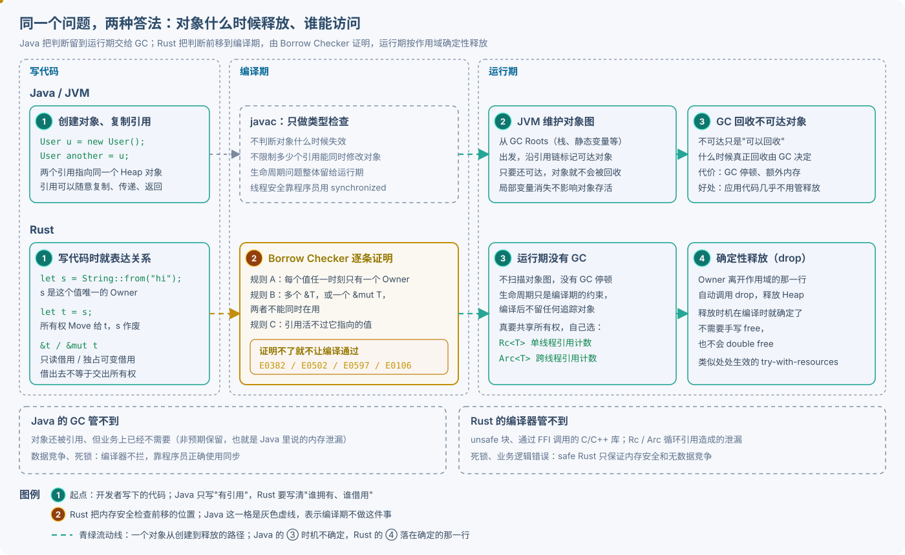
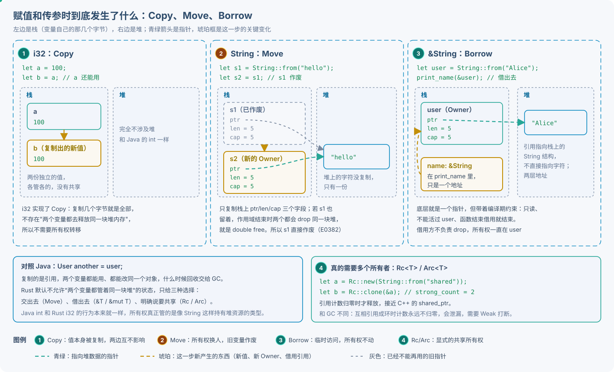
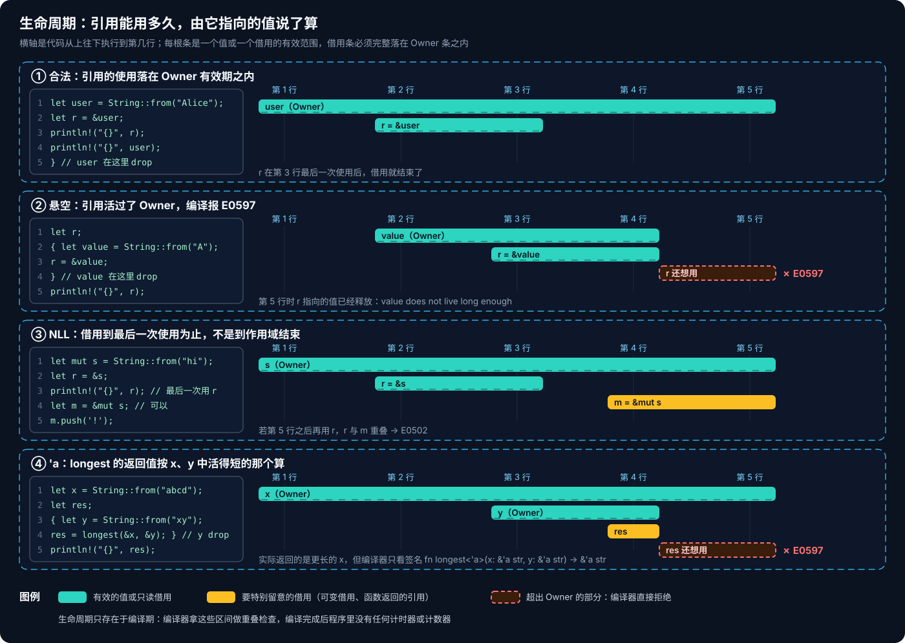

# Rust 学习系列 01：从 JVM 视角理解所有权

最近看的几个 AI 基础设施项目都在往 Rust 走。LiteLLM 正在把网关的热路径逐步迁到一个 Rust 核心上：Rust 只负责请求和响应的格式转换、流式分块、token 计数这类纯数据处理，Python 继续管网络 I/O、鉴权和日志；官方的基准里，每个请求的网关开销从 Python 路径的约 7.5ms 降到约 0.05ms（[Migrating LiteLLM to Rust](https://docs.litellm.ai/blog/litellm-rust-launch)）。我之前研究过的 RTK 也是一个 Rust 写的单二进制，零运行时依赖，每条命令的处理开销不到 10ms（见 [Caveman 与 RTK 对比](../tool/Caveman/Caveman与RTK对比.md)）。

我写了十几年 Java，对 JVM 很熟，但 Rust 里的 Ownership、Borrowing、Lifetime 一开始读得很吃力。后来发现卡住我的不是语法，而是 Java 让我从来不用回答的一个问题：**没有 GC 的情况下，谁来保证程序不会去访问一块已经释放的内存？** 所以这一篇不从语法讲起，而是从 JVM 和 Rust 的内存管理模型差异讲起。环境搭建和 Cargo 的用法放在 [Rust 开发环境与 Cargo 构建指南](../tool/rtk/Rust开发环境与Cargo构建指南.md)。

文中的 Rust 代码都实际编译过，报错的例子贴的是编译器给出的真实错误码。

## 一、Rust 为什么会出现：浏览器里的内存问题

Rust 起源于 Mozilla：2006 年前后是员工 Graydon Hoare 的个人项目，2009 年 Mozilla 正式资助，2010 年公开，2021 年成立 Rust Foundation 后，治理逐渐独立于 Mozilla。Mozilla 要它，是因为浏览器底层大量用 C/C++ 写，而浏览器每天都在处理来自不可信网页的输入——HTML、CSS、JavaScript、图片，任何一个解析器里的内存错误，都可能被恶意页面利用。

我一开始没想明白的是：**内存已经 free 了，为什么还会被访问到？这不是内存泄漏吗？** 两者其实是反过来的：

- **Use-after-free**：内存已经释放了，程序还在用旧指针访问它
- **Memory Leak**：内存不再需要了，却一直没有释放

关键在于，`free()` / `delete` 只是告诉内存分配器"这块地址可以再分配给别人了"，既不会把内容清零，也不会把指向它的指针置空。旧指针里的地址还在，内容也可能还在，但原来那个对象的生命周期已经结束了。分配器随时可能把这块地址交给一个新对象：

```cpp
int* ptr = new int(100);
delete ptr;
int* another = new int(200);  // 可能恰好复用了 ptr 原来的地址
std::cout << *ptr;            // 未定义行为：可能读到 200、旧数据，或者崩溃
```

浏览器漏洞里常见的利用手法就是这个思路：先诱导浏览器释放某个对象，再让攻击者控制的数据占住这块内存，最后触发旧指针的访问。

**那 `free()` 为什么不顺手把其他指针清掉？** 因为它做不到，也不该做。C/C++ 的普通指针就是一个存地址的变量，不记录还有谁指向同一块内存。指针可能散落在栈、堆、全局变量、其他对象的字段、容器内部，甚至 CPU 寄存器里。要找全它们，就得维护一套全局的引用追踪——这正是 C/C++ 想避免的运行时开销，指针复制应该和复制一个整数一样便宜。C++ 后来用 `shared_ptr` 做了引用计数，但那是库层面的约定，原始指针照样允许你犯错。

C/C++ 里最典型的几类问题，以及 Java 和 Rust 各自怎么处理：

| 问题 | C/C++ 里的样子 | Java 的处理 | Rust 的处理 |
| --- | --- | --- | --- |
| Use-after-free | `delete` 后继续用旧指针 | 应用代码没法手动释放对象，GC 只回收不可达对象 | 借用不能活过 Owner，编译期拒绝（E0597） |
| Double free | 同一块内存 `delete` 两次 | 不存在 | 一个值只有一个 Owner，赋值即 Move，旧变量作废（E0382） |
| Dangling pointer | 返回局部变量的地址 | 对象只要还被引用就不会被回收 | 返回指向局部变量的引用直接编译不过（E0106） |
| Buffer overflow | 写入超出数组长度 | 运行时数组越界检查，抛异常 | 运行时边界检查，越界就 panic，不会默默写坏内存 |
| Data race | 两个线程无同步地读写同一变量 | 靠程序员用对 `synchronized` / `volatile` | `&mut` 独占规则加上 `Send` / `Sync`，safe Rust 里编译不过 |

## 二、两种答法：运行期的 GC 和编译期的 Borrow Checker

Java 和 Rust 要解决的是同一个问题：对象什么时候可以释放，在它有效期间谁能访问它。区别在于由谁、在什么时候回答。



**Java 把问题留到运行期。** 引用可以随意复制、传递、返回，javac 只做类型检查，不关心对象什么时候失效。JVM 从 GC Roots（线程栈、静态变量等）出发沿引用链标记可达对象，只要可达就不回收；不可达只代表"可以回收"，真正什么时候回收由 GC 决定。代价是 GC 停顿和额外的内存，换来的是应用代码几乎不用操心释放。

**Rust 把问题前移到编译期。** 写代码时就要表达清楚：这个值的 Owner 是谁，借出去的是只读还是可变，借用能用到哪里。Borrow Checker 按三条规则逐一验证，验证不了就不让编译通过：

1. 每个值在任一时刻只有一个 Owner
2. 同一时刻，要么有多个 `&T`，要么只有一个 `&mut T`，两者不能同时在用
3. 引用活不过它指向的值

通过之后，运行期就不需要 GC 了：Owner 离开作用域的那一行，编译器插入的 `drop` 会释放它拥有的资源。这叫确定性析构——释放时机在编译时就定了。有点像 Java 的 try-with-resources，但它对所有值都生效，不只是文件和 Socket。

## 三、Ownership：Move 防的是 double free

先看一段 Java 程序员会觉得理所当然、在 Rust 里却编译不过的代码：

```rust
let user1 = String::from("Alice");
let user2 = user1;
println!("{} {}", user1, user2);
// error[E0382]: borrow of moved value: `user1`
```

`let user2 = user1` 在 Java 里是复制引用，两个变量指向同一个对象；在 Rust 里是 **Move**：所有权从 `user1` 转给 `user2`，`user1` 从此作废。

但下面这段又能正常运行：

```rust
let a = 100;
let b = a;
println!("{} {}", a, b);  // 100 100
```

我当时的疑问是：Java 的 `int` 本来就在栈上复制，不在堆上分配，Rust 的 `i32` 不也一样吗？这里会不会有"两个 Owner"？其实两者行为完全一样：`a` 和 `b` 各持有一份独立的值，没有共享任何东西，也就谈不上两个 Owner。`i32` 实现了 `Copy` trait，复制那几个字节就是全部，复制完两份互不相干。

**所有权真正要管的，是像 `String` 这样持有堆资源的类型。**



Rust 的 `String` 在栈上是三个字段：指向堆的 `ptr`、`len`、`capacity`，字符数据在堆上。`let s2 = s1` 只复制栈上这三个字段，堆上的字符只有一份。如果 `s1` 也继续有效，两个变量离开作用域时都会去 `drop` 同一块堆内存，这就是 double free。所以 Rust 的选择是：栈上的字段照样复制，但旧变量直接作废，只剩一个 Owner 负责释放。

这不等于 Rust 不让共享。真需要多个所有者时，要自己明确选一种管理方式：单线程用 `Rc<T>`，跨线程用 `Arc<T>`，都是引用计数，计数归零才释放，和 C++ 的 `shared_ptr` 接近：

```rust
let a = Rc::new(String::from("shared"));
let b = Rc::clone(&a);
println!("{} {} count={}", a, b, Rc::strong_count(&a));  // shared shared count=2
```

> [!NOTE]
> 和 Java 对照着记：Java 里每个对象变量本质上都是"共享所有权"，由 GC 兜底；Rust 默认不允许"两个变量都管着同一块堆"的状态，只给三种选择——交出去（Move）、借出去（`&T` / `&mut T`）、明确说要共享（`Rc` / `Arc`）。

函数传参也遵循同样的规则。`fn print_user(user: String)` 会把所有权拿进函数，函数结束时 `String` 就被释放了，调用方的变量也跟着作废。想要调用完还能接着用，就得借。

## 四、Borrowing：&T 是带编译期约束的指针

```rust
fn print_name(name: &String) { println!("read: {}", name); }
fn append_name(name: &mut String) { name.push_str(" & Rust"); }

fn main() {
    let mut name = String::from("Alice");
    print_name(&name);        // 只读借用
    append_name(&mut name);   // 可变借用
    println!("owner still has: {}", name);  // Alice & Rust
}   // name 在这里 drop
```

整个过程：`main` 创建 `String` 并成为 Owner；`print_name` 拿到只读借用，只能读，函数结束借用就结束；`append_name` 拿到可变借用，可以修改，结束后借用同样结束；所有权一直在 `main`，最后由它释放。全程没有 GC，也没有手写 `free`。

我刚开始把 `&` 和 Scala 的不可变（`val`）联系在一起，其实它们是两个维度：

- **可变性**：数据能不能改。Rust 的 `let` 默认不可变、`let mut` 可变，这一层和 Scala 的 `val` / `var` 相近
- **所有权**：谁拥有数据、谁只是临时访问。`&` 讲的是这一层，Scala 里没有对应的概念，因为 JVM 上的对象都由 GC 管

`&user` 是不是传指针？底层确实就是一个地址，不复制 `String`。要注意的是它指向的是栈上那个 `String` 结构本身，结构里的 `ptr` 再指向堆上的字符，所以是两层地址。和 C/C++ 原始指针的区别在于它带着编译期约束：被引用的数据必须有效，引用不能活过数据，`&T` 不能修改数据，`&mut T` 必须独占。可以记成"指针加上一组静态检查"，运行时不会多出什么权限对象。

为什么不能同时有 `&T` 和 `&mut T`？因为一边在读、一边在改，读的那一方可能看到改了一半的状态。单线程里这表现为迭代器失效之类的问题，多线程里就是数据竞争：

```rust
let mut v = String::from("Hello");
let r1 = &v;
let r2 = &mut v;
println!("{}", r1);
// error[E0502]: cannot borrow `v` as mutable because it is also borrowed as immutable
```

这条规则约束的是借用**实际在用的那段**，不是变量的整个作用域。现在的 Rust 用 NLL（Non-Lexical Lifetimes）计算借用范围：只读借用在最后一次使用后就结束了，之后再拿可变借用是允许的。下面生命周期图里的 ③ 就是这种情况。

## 五、Lifetime：引用能用多久，由它指向的值决定

Java 程序员很少想生命周期，因为对象的寿命和局部变量的作用域是脱钩的：方法里 `new` 出来的对象 return 出去，局部变量没了，只要返回值还引用着它，GC 就不会回收。Rust 没有 GC 去扫描对象图，所以只能静态地证明一件事：**引用的有效期不能超过它所引用数据的有效期**。



图里的四个场景：

1. **合法**：`r` 的使用完全落在 `user` 的有效期内
2. **悬空**：内层作用域结束时 `value` 已经 drop，外面的 `r` 还想用，编译报 `value does not live long enough`（E0597）
3. **NLL**：`r` 在第 3 行最后一次使用后借用就结束了，第 4 行拿 `&mut s` 没有冲突；要是第 5 行之后还用 `r`，两个借用就重叠了，报 E0502
4. **生命周期标注**：见下面的 `longest`

C++ 里"返回局部变量的地址"这种写法，Rust 在函数签名这一步就拦下了：

```rust
fn get_value() -> &String {
    let value = String::from("Alice");
    &value
}
// error[E0106]: missing lifetime specifier
// help: this function's return type contains a borrowed value,
//       but there is no value for it to be borrowed from
```

需要把对象交给调用方时，直接返回值本身，也就是转移所有权，效果上和 Java 返回对象引用差不多：

```rust
fn create_user() -> String { String::from("Alice") }
```

**`'a` 标注的是什么？** 看这个函数：

```rust
fn longest<'a>(x: &'a str, y: &'a str) -> &'a str {
    if x.len() > y.len() { x } else { y }
}
```

函数可能返回 `x`，也可能返回 `y`，编译器只看签名，没法知道运行时是哪一个。去掉 `'a` 会报 E0106，help 说得很直白：返回类型里有借用，但签名没说是从 `x` 还是 `y` 借的。加上 `'a` 等于声明：返回值能用的范围，不超过 `x` 和 `y` 共同有效的那一段。

图里的 ④ 是我自己验证这句话时写的例子：`x` 是更长的 `"abcd"`，实际返回的就是 `x`，`y` 在内层作用域结束时就 drop 了。直觉上返回值指向的 `x` 还活着，应该没事，但编译器照样报 `` `y` does not live long enough ``——它按签名做检查，不会去推测运行时走哪个分支。

关于生命周期，有三点我觉得要先记牢：

- **它只存在于编译期**。生命周期是编译器做检查用的约束，编译完成后程序里没有任何计时器、计数器或元数据
- **`'a` 不会让任何值活得更久**，它只描述输入和输出之间的关系
- **生命周期不等于作用域**。作用域是变量在代码里可见的范围，生命周期是引用实际有效的范围，NLL 让后者常常比前者短

## 六、并发：Send、Sync 和 `Arc<Mutex<T>>`

同样的所有权规则延伸到多线程。把数据交给新线程，用 `move` 闭包转移所有权，原线程就不能再用了：

```rust
let data = String::from("Hello");
let h = thread::spawn(move || println!("{}", data));
println!("{}", data);
// error[E0382]: borrow of moved value: `data`
```

多个线程要共享并修改同一份数据，就组合 `Arc`（跨线程共享所有权）和 `Mutex`（互斥访问）：

```rust
let counter = Arc::new(Mutex::new(0));
let hs: Vec<_> = (0..4).map(|_| {
    let c = Arc::clone(&counter);
    thread::spawn(move || { *c.lock().unwrap() += 1; })
}).collect();
for h in hs { h.join().unwrap(); }
println!("counter={}", *counter.lock().unwrap());  // counter=4
```

背后是两个 marker trait：`Send` 表示这个类型的值可以安全地转移到另一个线程，`Sync` 表示可以通过共享引用被多个线程同时访问。`Rc<T>` 的计数不是原子操作，所以它不是 `Send`，想把它传进 `thread::spawn` 会直接编译失败（E0277：`Rc<i32>` cannot be sent between threads safely）。这一点 Java 做不到：`HashMap` 被多个线程误用，编译器不会报任何错。

| 想做的事 | Java | Rust |
| --- | --- | --- |
| 互斥修改共享数据 | `synchronized` / `ReentrantLock` | `Mutex<T>`，数据包在锁里面，不拿锁就碰不到 |
| 原子计数 | `AtomicInteger` | `AtomicI32` 等 |
| 多线程共享一个对象 | 直接共享引用，GC 兜底 | `Arc<T>` |
| 类型是否线程安全 | 靠文档和约定 | `Send` / `Sync`，编译器检查 |

> [!WARNING]
> safe Rust 消除的是**数据竞争**，不是所有并发问题。死锁、加锁顺序不当、业务层面的竞态条件依然可能出现，这部分和 Java 一样要靠设计。

## 七、内存泄漏：GC 语言里它到底指什么

这部分是我原来理解有偏差的地方。回到 C++ 的例子：

```cpp
void process() {
    int* ptr = new int(100);
}   // ptr 没了，堆上那 4 个字节还在，再也找不到它们
```

这是最典型的泄漏：唯一的指针丢了，内存还处于已分配状态，程序再也没法释放它。Java 里这种情况不会发生，对象一旦不可达，GC 就有机会回收它。

Java 也会内存泄漏，常拿来举例的是一个不断 `add` 的 `static List`。但我觉得只看这段代码下不了结论：如果它是一个业务上就需要长期保留的缓存，它只是在正常增长；没有容量上限可能导致 OOM，但 OOM 和泄漏不是一回事。

问题出在泄漏的定义上。"对象还被引用，但业务上已经不需要"——这听起来是业务属性，而不是技术属性。更准确的说法是分两层：

- **技术事实**：对象仍然可达，所以 GC 不能回收它，内存被持续保留（retention）
- **是否构成泄漏**：要对照程序**预期的**生命周期来判断——这块数据本应在什么时候结束

| 概念 | 含义 |
| --- | --- |
| Memory Leak（手动管理语言） | 分配的内存没有释放，甚至已经失去释放它的能力，如丢失了唯一指针 |
| Memory Leak（GC 语言） | 非预期的对象保留（unintentional object retention）：本该结束的对象，因为多余的引用关系一直可达 |
| Memory Retention | 对象仍被引用，因此内存继续保留；可能是预期的，也可能不是 |
| Memory Bloat | 内存占用持续膨胀，原因可能是泄漏、缓存增长，也可能只是业务量大 |

两种语境下机制不同，结果是一样的：程序一直占着本不该再占的内存。所以我现在这样记：**GC 能保证不可达的对象最终有机会被回收，但不能保证业务上已经不需要的对象一定变得不可达。** 解决办法也就不在 GC 那里，而在数据结构设计上：给缓存加容量上限、设 TTL、用 LRU 之类的淘汰策略，业务结束时主动移除引用。

Rust 也不承诺不泄漏。`Rc` / `Arc` 互相引用成环时，计数永远降不到零，就会泄漏，要用 `Weak` 把环打断；`std::mem::forget` 甚至是一个 safe 函数。Rust 保证的是内存安全，不保证资源一定被回收。

## 八、Rust 的保证到哪里为止

> [!IMPORTANT]
> Rust 提供的是内存安全保证，不是"没有 bug"的保证。下面三个地方，编译器的检查会停下来：
>
> - **`unsafe` 块**：可以解引用裸指针、调用不安全的外部函数，相应的安全责任回到程序员身上。它不会关掉所有检查，只是放开了编译器无法证明的那几类操作
> - **FFI**：Rust 调用的 C/C++ 库内部照样可能有 use-after-free、缓冲区溢出，Rust 管不到
> - **逻辑层面**：泄漏、死锁、业务错误

这也是为什么 Firefox 至今仍有大量 C++ 代码：Rust 是被逐步引入到合适的组件里，而不是整体重写。LiteLLM 的迁移也是同样的思路，一次只迁一条路由，Rust 核心默认关闭，遇到不支持的请求就回落到原来的 Python 路径。

## 九、我的学习顺序

对有 Java 背景的人，我不打算一开始就把语法学全，而是按这个顺序来：

1. **Ownership 与 Move**：彻底弄明白 `let b = a` 什么时候是 Move、什么时候是 Copy
2. **Borrowing 与 Borrow Checker**：`&T` 和 `&mut T`，以及为什么有些看起来合理的引用组合不被允许
3. **Lifetime 与生命周期省略规则**：什么时候编译器能自己推出来，什么时候必须写 `'a`
4. **智能指针**：`Box<T>`（堆上的单一所有权）、`Rc<T>` / `Arc<T>`（共享所有权）、`RefCell<T>`（把借用检查推迟到运行时）、`Mutex<T>`
5. **Send / Sync 与并发**

光看概念效果有限，我给自己定了一个对照练习：同一组场景分别用 Java 和 Rust 各写一遍，看 GC 和编译器各自怎么处理——

1. 两个变量共享同一个对象
2. 一个函数修改另一个函数拥有的对象
3. 函数返回一个引用
4. 两个线程共享并修改同一个对象
5. 对象释放后，还有别的引用想访问它

其中第 3 个最值得做，Java 为什么不需要声明生命周期、Rust 为什么离不开它，在这个场景里看得最清楚。

参考资料：

- [The Rust Programming Language：Understanding Ownership](https://doc.rust-lang.org/book/ch04-00-understanding-ownership.html)——所有权、借用、切片三章，入门最该精读的部分
- [Microsoft Learn：Take your first steps with Rust](https://learn.microsoft.com/en-us/training/paths/rust-first-steps/)——带练习的入门路径
- [Migrating LiteLLM to Rust](https://docs.litellm.ai/blog/litellm-rust-launch)——一个 Python 项目渐进迁到 Rust 核心的真实做法

Java 的 GC 回答的是"这个对象什么时候可以回收"；Rust 要在编译期回答的是"这个对象归谁、谁能访问、访问到什么时候为止"。后一个问题把内存管理变成了一个类型系统问题，这是 Rust 最值得琢磨的地方。
