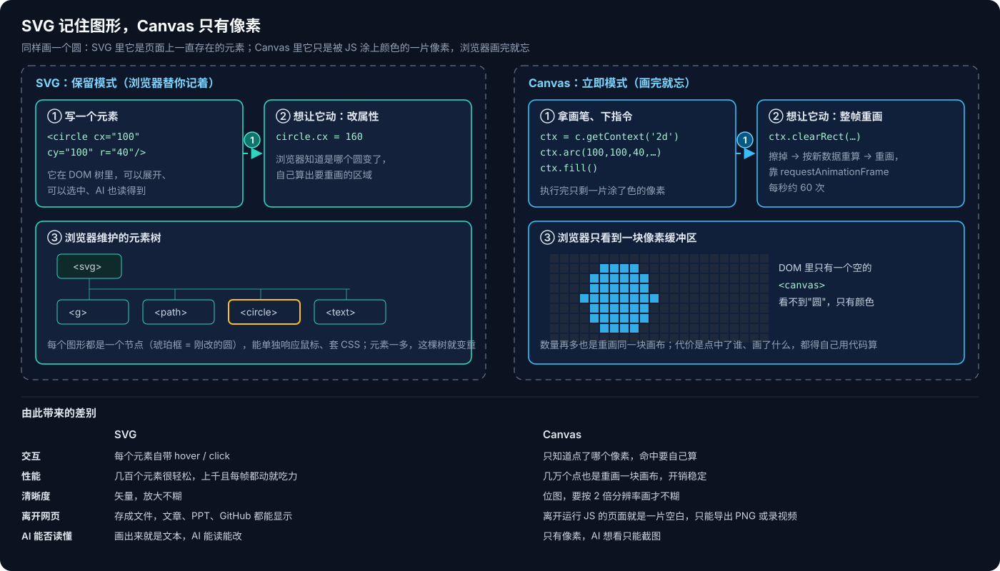
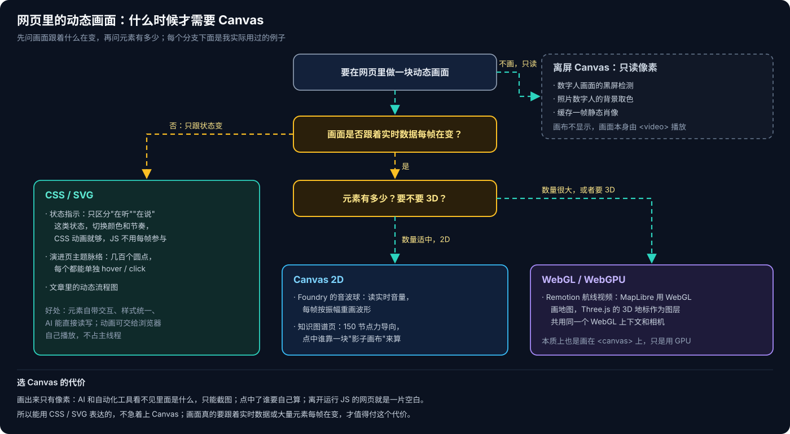

# Canvas 实践：从数字人到知识图谱

写 [SVG 实践：我和 AI 之间的视觉语言](SVG实践：我和AI之间的视觉语言.md) 的时候，我反复碰到另一个东西：Canvas。我的知识图谱页用的是它，Foundry 里会跟着声音起伏的音波球用的是它，做数字人应用时也绕不开它。这篇把我用到 Canvas 的地方串起来，讲清楚它和 SVG 有什么不同，以及我在什么情况下才用它。

## 一、Canvas 是什么

Canvas 是 HTML5 里的一个元素 `<canvas>`，加上一套用 JS 在上面画图的接口。它最早是 Apple 在 2004 年为 macOS 的 Dashboard 小组件和 Safari 做的，后来被写进了 HTML5 标准，现在所有主流浏览器都支持。

用法是先在页面上放一块画布，再用 JS 拿到"画笔"来画：

```html
<canvas id="c" width="400" height="200"></canvas>
<script>
  const ctx = document.getElementById('c').getContext('2d');
  ctx.fillStyle = '#2dd4bf';
  ctx.beginPath();
  ctx.arc(100, 100, 40, 0, Math.PI * 2);  // 在 (100,100) 画一个半径 40 的圆
  ctx.fill();
</script>
```

这段代码执行完，画布上那一片像素被涂成了青绿色，仅此而已，浏览器并不记得"这里有一个圆"。同样一个圆，在 SVG 里写成 `<circle cx="100" cy="100" r="40"/>`，它就是页面上一直存在的一个元素。

这就是两者最根本的区别：**SVG 会记住画了什么，Canvas 只记住画出来的像素**。



由此带来的差别，我在实际使用中都碰到过：

- **想让东西动起来**：SVG 改一个属性，浏览器知道是哪个元素变了；Canvas 要把整块画布擦掉、按新数据重算、再全部重画，靠 `requestAnimationFrame` 每秒做大约 60 次。
- **鼠标交互**：SVG 的每个元素自带 hover、click；Canvas 只知道你点了哪个像素位置，点中的是哪个对象要自己算。
- **元素很多时**：SVG 每个图形都是一个 DOM 节点，几千个一起动就吃力；Canvas 画一百个点和画几万个点都是重画同一块画布，开销稳定。
- **清晰度**：SVG 是矢量，放大不糊；Canvas 是位图，一般要按 2 倍分辨率画，在高分屏上才不糊。
- **离开网页**：SVG 能存成文件，放进文章、PPT、GitHub 都能显示；Canvas 离开运行 JS 的页面就是一片空白，只能导出 PNG 或录成视频。

`getContext()` 传入不同的参数，拿到的是不同的画笔：`'2d'` 是最常用的平面绘图；`'webgl'` 调用显卡来画，能做 3D 和大量元素；`'webgpu'` 是更新一代的 GPU 接口。所以 WebGL、WebGPU 其实也是画在 `<canvas>` 上的，只是换了一支更强的画笔。

## 二、数字人：Canvas 用来读画面

我做过一个带数字人的语音 Agent 应用。很多人以为数字人是画在 Canvas 上的，其实不是：数字人是服务端渲染好的视频，通过 WebRTC 传到浏览器，由一个 `<video>` 元素播放。

但这个应用里确实用了 Canvas，用法和画图正好相反：**它是一块不显示的画布，用来从视频里抽一帧、读像素**。我用它做了三件事。



### 检测黑屏

上线后遇到过一次：界面显示"正在说话"，数字人那块却是全黑的，只有角落里一个时间戳。查下来，连接本身一切正常：解码的帧数在涨，字节在流，网络连接也没断。所有判断"数字人连上了"的指标都满足，所以自动恢复机制没有触发，页面也没有切换到备用画面。

问题在于，"有帧在到"不等于"画面正常"。连接层的指标看不出帧里是什么，只能直接去看像素。做法是：

```js
const canvas = document.createElement('canvas');   // 不挂到页面上
canvas.width = 32;
canvas.height = 18;
const ctx = canvas.getContext('2d', { willReadFrequently: true });

function frameLuma(video) {
  ctx.drawImage(video, 0, 0, 32, 18);               // 把当前帧缩小画进来
  const { data } = ctx.getImageData(0, 0, 32, 18);  // 读出 576 个像素
  let sum = 0;
  for (let i = 0; i < data.length; i += 4) {
    sum += 0.299 * data[i] + 0.587 * data[i + 1] + 0.114 * data[i + 2];
  }
  return sum / (data.length / 4);                   // 平均亮度，0~255
}
```

每秒抽一帧，平均亮度不超过 8 就记一次空帧，连续 3 次（大约 3 秒）判定画面已经失效，切换到备用画面。这里有几个取舍：

- **先缩小再读**：缩到 32×18 只有 576 个像素，读起来几乎没有开销；画面里只有一个小时间戳时，平均亮度也依然接近黑色，不会被几颗亮点带偏。
- **每秒一次，不是每帧都抽**：这个检测和视频解码共用浏览器主线程，抽得太勤会和解码抢资源。
- **只判断"是不是空的"，不判断"够不够亮"**：数字人站在白色背景前，正常画面的平均亮度在 100 以上，黑帧接近 0，中间的距离很大。阈值不跟具体内容挂钩，就不用为每个数字人单独调。
- **连续多次才判定**：单独一次黑帧可能只是解码器卡了一下，或者视频元素刚刚接上。

### 给照片数字人取背景色

照片数字人的画面是一个 512×512 的方块（两类数字人头像的区别见 [Voice Live 系列 05：两类数字人头像](../../../Azure/VoiceLive/Voice-Live系列05：两类数字人头像.md)）。我希望方块周围的页面填成和它背景一样的颜色，看起来没有边框。

最直接的做法是把页面背景设成请求给服务端的那个颜色，但实际效果是方块外面多了一圈淡淡的框。原因是视频经过 H.264 编码和 4:2:0 色度采样以后，颜色会偏几个单位，屏幕上显示出来的和请求的并不完全一样。

所以改成从画面自己身上取色：把帧缩到 64×64 画进 Canvas，只取左右边缘 3% 的列、上方 65% 的高度（再往下肩膀可能会碰到边缘），每个颜色通道取中位数。如果边缘颜色太分散，说明有别的东西碰到了边缘，就保留上一次的颜色；变化小于 3 个单位也不更新，免得编码噪声让背景一直闪。

### 缓存一帧静态肖像

数字人从发起连接到画面出来要等几秒。为了让用户一进来就能看到人，每次连上 2 秒后，我会把当前画面按宽 480 画进 Canvas，用 `toDataURL('image/jpeg', 0.75)` 存进浏览器本地存储。下次进入时先显示这张肖像，实时画面到了再淡入覆盖（这部分的延迟优化写在 [Voice Live 系列 03：数字人出场延迟优化](../../../Azure/VoiceLive/Voice-Live系列03：数字人出场延迟优化.md) 里）。

存之前必须先用黑屏检测确认这一帧不是黑的。肖像会在下次最先显示，如果存了一张黑的，一次临时故障就会变成每次进入都是黑屏。

还有一个前提：Canvas 读别的来源的图片时，如果是跨域的，画布会被标记为"污染"，之后就不能再读像素，也不能 `toDataURL`。WebRTC 的视频流不会污染画布，所以上面三件事都能做。

最后，页面上永远只显示三者之一：实时数字人、缓存的肖像，或者音波球。黑屏不在这三种之内。弱网时怎么切换，见 [Voice Live 系列 12：数字人弱网表现](../../../Azure/VoiceLive/Voice-Live系列12：数字人弱网表现.md)。

## 三、音波球：什么时候才需要 Canvas

在 Foundry 的 Voice Live Playground 里，那个会跟着声音起伏的紫色音波球，审查元素是一个空的 `<canvas>`（我在 [浏览器动态内容的计算光谱](浏览器动态内容的计算光谱.md) 里拆过它）。它用 Web Audio 读取实时音量，每帧按振幅重画：

```js
const ctx = canvas.getContext('2d');
const audioCtx = new AudioContext();
const analyser = audioCtx.createAnalyser();
analyser.fftSize = 256;
audioCtx.createMediaStreamSource(stream).connect(analyser);
const data = new Uint8Array(analyser.frequencyBinCount);

function draw() {
  analyser.getByteFrequencyData(data);
  const level = data.reduce((a, b) => a + b, 0) / data.length / 255;  // 当前音量，0~1
  ctx.clearRect(0, 0, canvas.width, canvas.height);
  ctx.beginPath();
  ctx.arc(canvas.width / 2, canvas.height / 2, 60 + level * 40, 0, Math.PI * 2);
  ctx.fillStyle = '#7c3aed';
  ctx.fill();
  requestAnimationFrame(draw);   // 下一帧再来一遍
}
draw();
```

判断要不要用 Canvas，关键看画面跟着什么在变。音波球如果只是用颜色和节奏区分"在听""在说"这几种状态，CSS 动画就够了：浏览器可以自己播放，JS 不用每帧参与。要像 Foundry 这样让波形跟着真实音量起伏，就得每帧读一次音量、每帧重画一次，这时才需要 Canvas。代价是 JS 每秒要跑大约 60 次，还要把远端的 WebRTC 音频接进 Web Audio 做分析，多一条链路。

在数字人页面上用 Canvas 做音波球，这个代价要算进去：主线程上已经有视频解码、WebRTC 和每秒一次的黑屏检测在跑。音波球只在没有数字人画面时才显示，不显示的时候就用 `cancelAnimationFrame` 停掉重画循环，不让它在后台空转。

所以我的判断标准是：**画面只跟着状态变，用 CSS 或 SVG 就够了；要跟着实时数据每帧变化，才需要 Canvas**。

## 四、知识图谱页：元素多、每帧都在动

我的个人知识库网站上有一个知识图谱页，现在是 150 个节点、527 条关系，用力导向布局：节点之间像有弹簧和斥力，每一帧都要更新所有节点的位置，直到整张图稳定下来。

这个规模用 SVG 其实也能跑，但节点和关系还会继续增长，所以我选了基于 Canvas 的图谱库（`react-force-graph-2d`）。同一个网站的演进页用的是 SVG，因为那里只有几百个圆点，而且每个都要单独响应鼠标。

Canvas 不知道自己画了哪些节点，那鼠标悬停和点击是怎么判断的？这个图谱库用了一个常见的办法：在后台再放一块不显示的"影子画布"，把每个节点用一个独一无二的颜色画上去。鼠标在哪个位置，就去影子画布上读那个像素的颜色，按颜色反查是哪个节点。这和数字人那里一样，都是"画布不显示、只用来读像素"。

README 里放不了这个页面，因为 GitHub 显示 README 时会去掉 JS，而 Canvas 没有 JS 就是一片空白。所以 README 里用的是一张预先算好坐标的动态 SVG，点击跳到网站看可交互的版本。

## 五、WebGL：地图上的 3D 地标

做 [Remotion 系列 03：从洛杉矶飞到上海](../remotion/Remotion系列03：从洛杉矶飞到上海.md) 的航线视频时，用到了 Canvas 的另一支画笔 WebGL。MapLibre 用 WebGL 画地图，东方明珠的 3D 模型用 Three.js 画。我没有把两块画布叠在一起，而是把 3D 模型做成 MapLibre 的一个自定义图层，和地图共用同一个 WebGL 上下文和相机投影，这样塔才能固定在地图坐标上，跟着镜头一起移动、缩放。

Remotion 渲染视频时，是用无头浏览器一帧一帧截图再合成的，所以 Canvas 和 WebGL 画出来的内容也能进视频，前提是画面按帧号来画，而不是跟着真实时间跑（见 [Remotion 系列 01：Agent Skills 与帧号驱动渲染](../remotion/Remotion系列01：Agent-Skills与帧号驱动渲染.md)）。

## 六、Canvas 对 AI 不友好

和 SVG 比，Canvas 有一个对我影响很大的缺点：AI 看不见里面是什么。

SVG 画出来就是文本，AI 能直接读、直接改。Canvas 画出来只有像素，在 DOM 里只是一个空标签。做 Computer Use、Browser Use 这类浏览器自动化时，碰到 Canvas 页面就读不到页面结构，只能退回截图识别（见 [Computer Use 与 Browser Use 系列三：自己实现](../../AI/computer-use/Computer-Use与Browser-Use系列三：自己实现.md)）。

数字人那边也一样。判断嘴型有没有跟上模型说的话，帧计数器回答不了，因为服务端在不说话时也会渲染待机动画，"有帧在到"不等于"嘴在说这句话"。最后我是直接从连接上取下视频轨和音轨，用 `MediaRecorder` 录成一个文件，人去看。

所以我写代码时会把判断逻辑和 Canvas 分开：读像素这一步放在组件里，"亮度多少算黑帧""边缘颜色怎么取中位数"写成纯函数，传进去一组像素数组就能出结果。这样不用真的起一块画布、接一路视频流，就能写单元测试。

## 七、怎么选

把上面这些例子放在一起，我的选择顺序是这样的：



1. 先问画面跟着什么变。只跟着状态变（比如只区分"在听""在说"的状态指示、流程图的阶段），用 CSS 或 SVG。
2. 要跟着实时数据每帧变化，再看元素有多少：数量适中的 2D 画面用 Canvas 2D，比如音量驱动的音波球、力导向的知识图谱；数量很大或者要 3D，用 WebGL 或 WebGPU，比如地图和 3D 模型。
3. 如果只是要分析画面，比如检测黑屏、取颜色、截一帧，用一块不显示的离屏 Canvas 读像素。

Canvas 的代价是画出来只有像素：AI 看不见，点中谁要自己算，离开网页就没了。所以能用 CSS 或 SVG 表达的，我不急着上 Canvas；画面真的要跟着实时数据或大量元素每帧变化，才值得付这个代价。

**相关阅读**：

- [SVG 实践：我和 AI 之间的视觉语言](SVG实践：我和AI之间的视觉语言.md)——文章、网页、PPT 里怎么和 AI 一起用 SVG
- [浏览器动态内容的计算光谱](浏览器动态内容的计算光谱.md)——从 SVG 到 Canvas 再到云端渲染的数字人
- [Voice Live 系列 12：数字人弱网表现](../../../Azure/VoiceLive/Voice-Live系列12：数字人弱网表现.md)——弱网时画面、声音和音波球之间的切换
