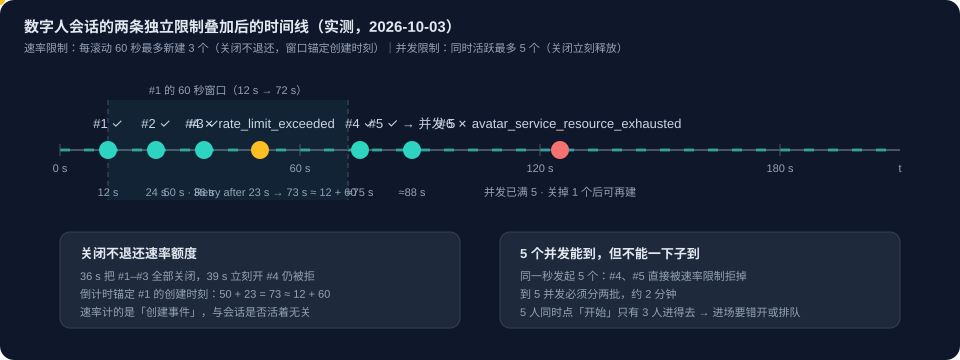
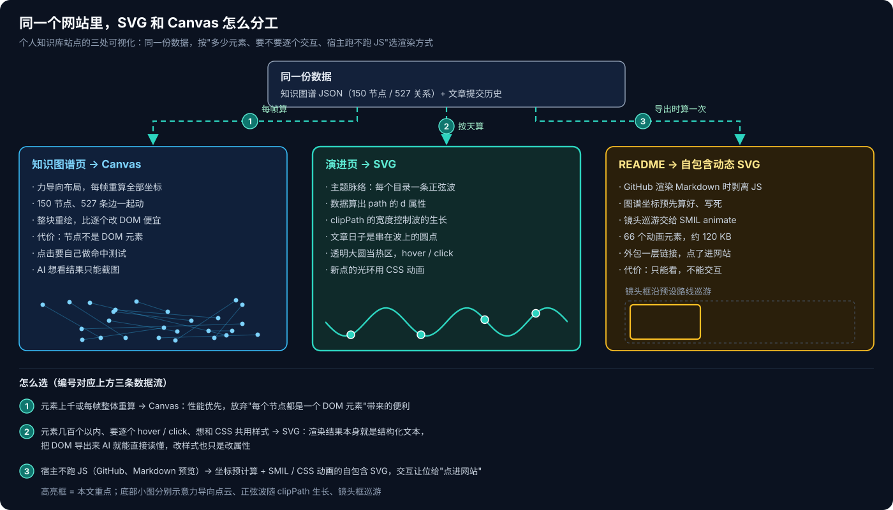
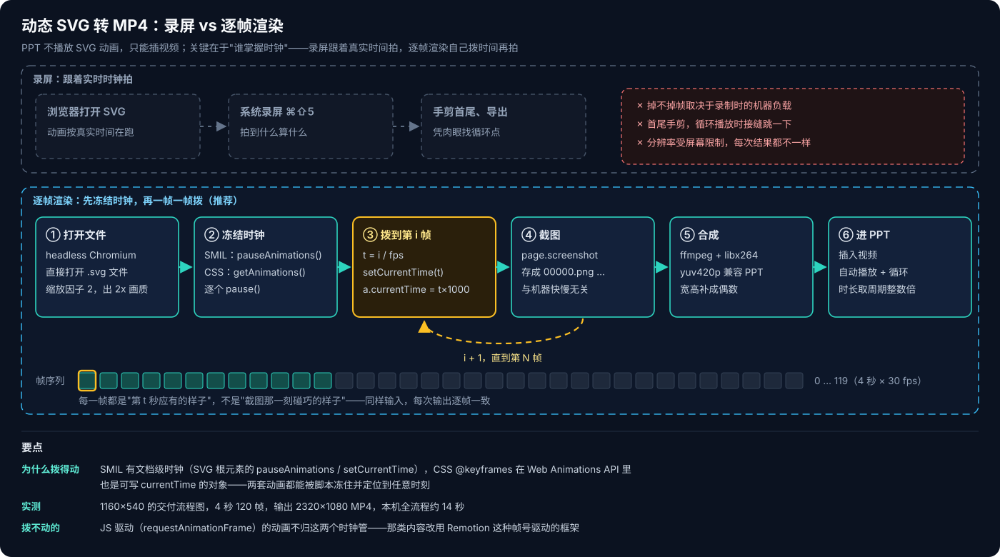

# SVG 实践：我和 AI 之间的视觉语言

最近看到一个视频《SVG 是最好的 AI 编程语言》，说 SVG 对人是图、对 AI 是文本，是人和 AI 都擅长的表达方式。这和我的体会一致。过去两个多月，我几乎每天都在和 AI 一起画 SVG：技术文章里的流程图、个人知识库网站上的可视化、PPT 里的动画，用的都是它。SVG 的原理（是什么、动画怎么动、边界在哪里）在 [动态 SVG 全景](动态SVG全景.md) 里写过，这里只讲这三个场景里我是怎么用的。



## 一、为什么是 SVG

我选 SVG，是因为它同时照顾到了我和 AI 两边。

对我来说，看图比读代码快得多。一张流程图哪里挤、哪里漏了一步、颜色有没有表达出状态，看一眼就知道；同样的信息写成几百行 XML，我没法评审。

对 AI 来说，PNG 是像素，它能看但改不了；SVG 是文本，`<rect x="390" y="130">`、`<path d="M650 190 H690 V260">` 这些坐标都写得明明白白，AI 读得懂、改得动，改完我还能用 `git diff` 一行行看改了什么。

所以分工很自然：我看图提意见，AI 改文本，两边改的是同一个文件，中间不需要任何设计工具。现在这个知识库里有约 140 张 SVG，嵌在 88 篇文章里，单张多在 5~16 KB。这些图我几乎没有手动调过坐标，给 AI 的只有一句话需求和一张参考样例。

## 二、文章里的流程图

我写技术文章时，流程、时间线、阶段进度都画成动态 SVG。颜色按状态分：已完成的环节是青绿色的流动光带，当前环节是琥珀色的呼吸脉冲，还没开始的是灰色虚线。读者不看正文，也能看出事情进行到了哪一步。

### 把规范写下来

一开始每次画图都要交代一遍颜色、字号、布局，画出来的风格也不统一。后来我把这些要求写进了 Agent 的规则文件，每次画图自动带上：

- 三种状态各用什么颜色、什么动画；
- 字号下限：正文 13px、节点标签 15px、标题 18px，画布宽度不少于 1000；
- 信息要够密：用虚线框分区，卡片里写清职责和关键参数，数据流用 ①②③ 编号，底部图例逐条解释；
- 再指定一张已经画得好的 SVG 作参考，告诉 AI"照这个密度画"。

有了这些，我每次只需要说一句"把这一节的四个阶段画成流程图，当前在第三步"，剩下的大部分都由规范定好了，AI 只需要考虑具体怎么排布。

### 写完先渲染成 PNG 检查

改图的时候，我会截图给 AI，告诉它哪里要改。但我后来发现还有一个反方向的问题：AI 写 SVG 时，自己看不到画出来是什么样子。它输出的只是坐标，比如"这行字从 x=1100 开始"，这行字实际有多宽，它只能估算。中文字宽、字体替换、`text-anchor` 的对齐方式，都会让估算出现偏差。

我早期有一张芯片交付流程图，底部图例的第三项和右侧的"来源"说明，按坐标算是分开的，渲染出来却压在了一起：


这种问题我一眼就能看到，AI 只读坐标却发现不了。所以现在每张图都多走一步：写完先用 `rsvg-convert` 渲染成 PNG，让 AI 读这张图检查，有重叠、出框就改，改完再渲染，直到没有问题才放进文章。

```bash
rsvg-convert -w 1400 asset/xxx.svg -o /tmp/xxx.png
```

### 长文本不要压在节点上

时间轴类的图还有一个常见问题：节点之间的距离有限，错误码、说明文字一长，就会压到相邻节点上。我的做法是节点上只放短标签（如 `#4 ✗`），长说明放到轴下方，用引线分行排开：右侧事件放上面一行，左侧事件放下面一行，这样引线不会穿过其他行的文字。文字多的时候就加宽画布或者拆行，不缩小字号。



### 为什么不用 Mermaid 或图片

Mermaid 在 Obsidian 和 GitHub 上都能渲染，但它是静态的，样式也不好控制，表达不了"当前进行到哪一步"。直接用 PNG 图片的话，AI 就改不了了，改个颜色都要重新出图。动态 SVG 只用 SMIL 和 CSS、不写 JS，在 Obsidian 和 GitHub 上都能直接播放动画，而且还是文本，AI 随时能改，所以我写文章时都用它。

## 三、网页里的 SVG

在网页里，SVG 不只是设计稿：浏览器本身就能渲染它，它就是页面上最终显示的内容。

我的个人知识库有一个 GitHub Pages 站点，同一份数据（知识图谱 JSON 和文章的提交历史）在三个地方用了三种不同的画法：



### 演进页：按数据画 SVG

演进页有一个"主题脉络"视图：每个目录主题是一条正弦波，发过文章的日子是波上的圆点，波会随着时间轴播放慢慢长出来。这个视图全部用 SVG 实现：

- React 组件根据日期算出每个点的坐标，拼成 `<path>` 的 `d` 属性，画出波形；
- 波的生长不是每次重算路径，而是给 `<path>` 套一个 `clipPath`，播放时只改裁剪区域的宽度；
- 圆点只有 6~8px，很难点中，所以每个圆点外面都叠了一个透明的大圆，鼠标悬停显示当天的文章，点击选中；
- 新出现的圆点会有一圈 CSS 动画光环。

这里用 SVG 而不用 Canvas，是因为元素只有几百个，每个点都要单独响应鼠标，样式也要和页面的 CSS 一致。另外，SVG 画出来的是 DOM，导出来 AI 就能直接读懂页面上画了什么；Canvas 画出来只是像素，AI 想看结果只能截图。

### 知识图谱页：用 Canvas

知识图谱页有 150 个节点、527 条关系，用力导向布局，每一帧都要更新所有节点的位置。这个规模用 SVG 其实也能跑，但节点和关系还会继续增长，SVG 里每个图形都是一个 DOM 节点，数量上去以后每帧一起动会越来越吃力，所以我选了基于 Canvas 的图谱库，给后面留余量。

### README：GitHub 上不能跑 JS

GitHub 显示 README 时会去掉 JS，网站上那张能交互的图谱放不进来。我的办法是把图谱坐标提前算好写进 SVG，"镜头巡游"效果用 SMIL 的 `<animate>` 实现，导出成一张约 120 KB、含 66 个动画元素的 SVG，外面再包一层链接，点击就跳到网站上看可交互的版本。README 里的图只能看不能点，但动画还在。

### 先画图，再写代码

做网页时，我习惯先让 AI 把页面结构和数据流向画成 SVG，确认没问题再写组件。写托管应用那组系列文章时也是这样：先用一张图画出"一份仓库、五个 JSON、七个页面"的数据同步流程，再一页页讲实现（见 [Copilot Managed Runtime 系列 07：零 Connector 的分析页面](../../../Azure/Copilot-Managed-Runtime/Copilot-Managed-Runtime系列07：零Connector的分析页面.md)）。这张图既是给读者的说明，也是我自己的设计稿，还是给 AI 的上下文。

先画图的好处是改起来便宜：改一张 SVG 只要改几行文本，而让 AI 反复改带业务逻辑的组件代码、每次还要跑起来看效果，来回的次数要多得多。

## 四、PPT 里的 SVG

PPT 是最难用上 SVG 动画的地方。PowerPoint 和 Keynote 都能插入 SVG，但只显示静态图形，SMIL 和 CSS 动画都不会播放。所以我在 PPT 里分两种情况处理。

### 静态图：转成 PNG

做 PPT 时，我按图的类型分开处理：

- 柱状图、折线图、饼图用 PPT 自带的图表生成，数据可以编辑，别人拿到 pptx 还能改数；
- 流程图、循环图、时间线、金字塔、同心圆这类 PPT 图表画不了的，让 AI 写成 SVG，再按 2 倍分辨率转成 PNG 放进去，投影时不会糊。

这样做和写文章时一样：AI 能写能改，配色也能和文章里的图保持一致。PowerPoint 365 也可以直接插入 SVG，右键"转换为形状"后还能拆开编辑，需要现场微调时这样更方便。

### 动画：逐帧渲染成 MP4

要在 PPT 里保留动画，只能插视频。最简单的办法是在浏览器里打开 SVG，用系统录屏。但录屏是按真实时间拍的，会不会掉帧要看当时电脑忙不忙，开头结尾要手动剪，循环播放时接缝处还会跳一下。

我现在的做法是先把 SVG 里的动画全部暂停，再一帧一帧地把时间拨到指定位置截图，最后用 ffmpeg 把截图合成视频。



之所以能这样做，是因为 SVG 的两种动画都可以用脚本控制时间：

- SMIL 动画（`<animate>`、`<animateMotion>`）由 SVG 根元素统一计时，用 `pauseAnimations()` 暂停，用 `setCurrentTime(t)` 跳到第 t 秒；
- CSS 的 `@keyframes` 动画可以用 `document.getAnimations()` 全部取出来，逐个 `pause()`，再设置 `currentTime`。

整个脚本不到 30 行：

```python
# 逐帧把动态 SVG 渲染成 MP4：暂停 SMIL 与 CSS 动画，按帧设定时间后截图
import sys, subprocess, pathlib
from playwright.sync_api import sync_playwright

svg, out = pathlib.Path(sys.argv[1]).resolve(), sys.argv[2]
seconds, fps, scale = float(sys.argv[3]) if len(sys.argv) > 3 else 6, 30, 2
frames = pathlib.Path("/tmp/svg2mp4/frames"); frames.mkdir(parents=True, exist_ok=True)
for f in frames.glob("*.png"): f.unlink()

with sync_playwright() as p:
    b = p.chromium.launch()
    page = b.new_page(device_scale_factor=scale)
    page.goto(svg.as_uri(), timeout=60000)
    w, h = page.evaluate("""() => { const s = document.documentElement;
        const vb = s.viewBox.baseVal; return [vb.width || s.width.baseVal.value, vb.height || s.height.baseVal.value]; }""")
    page.set_viewport_size({"width": int(w), "height": int(h)})
    for i in range(int(seconds * fps)):
        t = i / fps
        page.evaluate("""t => { const s = document.documentElement;
            s.pauseAnimations(); s.setCurrentTime(t);
            document.getAnimations().forEach(a => { a.pause(); a.currentTime = t * 1000; }); }""", t)
        page.screenshot(path=str(frames / f"{i:05d}.png"))
    b.close()

subprocess.run(["ffmpeg", "-y", "-loglevel", "error", "-framerate", str(fps), "-i", str(frames / "%05d.png"),
                "-c:v", "libx264", "-pix_fmt", "yuv420p", "-vf", "pad=ceil(iw/2)*2:ceil(ih/2)*2", out], check=True)
```

用法是 `python3 svg2mp4.py chart.svg chart.mp4 4`。我用一张 1160×540 的流程图试过，生成 4 秒、120 帧、2320×1080 的 MP4，在我的电脑上大约 14 秒。

用的时候有几点要注意：

- 视频格式用 `yuv420p`，PowerPoint 和各种播放器对它的兼容性最好。它要求宽高都是偶数，脚本里的 `pad` 会自动补齐；
- 视频时长要取动画周期的整数倍。比如光带 1.2 秒一圈、脉冲 2.4 秒一次，时长就取 2.4 秒的倍数，PPT 里循环播放才不会在接缝处跳；
- 要直接打开 `.svg` 文件，不要用 `` 包一层。`` 里的 SVG 是隔离的，脚本控制不了它的动画；
- 用 `requestAnimationFrame` 写的 JS 动画，上面两种方法都控制不了。这类动画要从一开始就按帧号来写，可以参考 [Remotion 系列 01：Agent Skills 与帧号驱动渲染](../remotion/Remotion系列01：Agent-Skills与帧号驱动渲染.md)。

这样，文章里画好的动态 SVG 可以直接转成视频放进 PPT，不用为 PPT 再画一遍。

## 五、SVG 不适合的地方

用了这么久，也碰到过不少 SVG 不合适的情况：

- **照片类内容**：SVG 里放照片只能嵌入位图，文件小、能改这两个优点都没了，不如直接用图片或视频；
- **元素很多、每帧都在动**：这种情况更适合 Canvas。知识图谱页现在 150 个节点、527 条关系，用 SVG 其实也能跑，但力导向布局每帧都要更新全部位置，而且节点还会继续增长，所以选了基于 Canvas 的图谱库；
- **大段文字**：SVG 的文字不会自动换行，每一行都要单独写一个 `<text>`，文字多时要提前拆好行，这也是 AI 最容易算错的地方；
- **只认图片的地方**：社交平台、PPT 放映、导出 PDF 都不支持 SVG 动画，最后都得转成 PNG 或 MP4。

## 六、小结

用下来，我和 AI 的分工就是各看 SVG 的一面：我看图，判断内容对不对、好不好看；AI 看文本，把我的意见改成坐标、路径和样式。SVG 正好把这两面放在同一个文件里。只有一步不能省：AI 写完之后，要先渲染成图片自己检查一遍。

**相关阅读**：

- [动态 SVG 全景](动态SVG全景.md)——SVG 原理、动画机制、能力边界与 Lottie 对比
- [Canvas 实践：从数字人到知识图谱](Canvas实践：从数字人到知识图谱.md)——Canvas 和 SVG 的区别，以及什么时候才需要 Canvas
- [浏览器动态内容的计算光谱](浏览器动态内容的计算光谱.md)——从 SVG 到 Canvas 再到云端渲染，计算放在哪里
- [Remotion 系列 01：Agent Skills 与帧号驱动渲染](../remotion/Remotion系列01：Agent-Skills与帧号驱动渲染.md)——JS 动画转视频的帧号驱动思路
