# Remotion 系列 01：Agent Skills 与帧号驱动渲染

> 系列导航：本篇 ｜ [系列02：快速上手——Codex 工作流、PPT 动画对照、五层功能与渲染方式](Remotion系列02：快速上手.md) ｜ [系列03：简单实践篇——从洛杉矶飞到上海，用地图与 3D 地标完成一段视频](Remotion系列03：从洛杉矶飞到上海.md)
>
> 工具能力部分依据两者官方文档与仓库说明整理（2026-10-13）。

## 引言：程序化视频的两条路线

"用代码生成视频"（programmatic video）适合模板化、数据驱动和批量生产的视频场景：同一套版式替换文案与素材，即可产出成百上千条视频。随着 coding agent 普及，这类工具又多了一个用途——由 agent 根据自然语言需求直接编写视频工程。

目前社区中最常被并列讨论的是两个开源项目：

- **Remotion**：以 React 组件描述视频画面，生态成熟，是程序化视频领域的代表性框架。
- **HyperFrames**：HeyGen 开源（Apache 2.0），以纯 HTML/CSS/JS 描述画面，定位为"Write HTML. Render video. Built for agents."。

二者的最终产物都是视频文件，渲染原理也相近（浏览器逐帧截图后由 FFmpeg 编码），差异主要体现在编写方式、动画库接入方式与嵌入式播放能力上。本文依次梳理这几个维度，并在最后解释支撑这类框架的核心约束：**帧号驱动渲染**。

## 起步：项目脚手架与 Agent Skills

社区中常见的起步命令有三条，分属两个框架。

**Remotion**

```bash
npx skills add remotion-dev/skills   # 安装 Remotion 官方 Agent Skills
npx create-video@latest              # 初始化 Remotion 项目（不含 skills）
```

**HyperFrames**

```bash
npx skills add heygen-com/hyperframes   # 安装 HyperFrames Agent Skills
```

`create-video` 是 Remotion 官方脚手架，也可以用 `bun create video` 调用，后者会询问是否一并安装 skills。HyperFrames 不使用 `create-video`，项目的创建与渲染由 `hyperframes` CLI 完成。两套 skills 均遵循 [Agent Skills](https://www.remotion.dev/docs/ai/skills) 开放标准，可同时安装，适用于 Claude Code、Codex、Cursor 等 agent。

## 技术栈：React 与纯 HTML

### Remotion：视频是帧号的函数

Remotion 所用的 React 即 Meta 开源的前端框架 [React](https://react.dev)。区别在于驱动画面的输入：普通网页中，组件根据状态与用户交互渲染界面；在 Remotion 中，组件根据**当前帧号**渲染画面。组件通过 `useCurrentFrame()` 获取帧号，再借助 `interpolate()`、`spring()` 等工具计算这一帧中元素的位置、透明度与文字内容。整段视频因此可以理解为一个从"帧号"到"画面"的函数。

导出时，Remotion 在无头 Chromium 中逐帧渲染组件并截图，最后由 FFmpeg 合成为视频文件。使用 Remotion 的前提是掌握 React 的基本写法（JSX、组件、props）。

### HyperFrames：带数据属性的 HTML 文件

HyperFrames 的 composition 是带有数据属性的 HTML 文件，不依赖 React，也没有专有的时间轴格式。一个 `index.html` 无需构建即可在浏览器中直接预览；渲染由 `@hyperframes/engine`（基于 Puppeteer 与 FFmpeg 的可 seek 页面捕获引擎）完成。官方给出的主要理由是：LLM 生成 HTML 比生成框架组件更稳定，agent 无需学习额外的 DSL。

| 维度 | Remotion | HyperFrames |
|---|---|---|
| 编写方式 | React 组件（JSX / TypeScript） | HTML / CSS / JS，无框架依赖 |
| 学习门槛 | 需要 React 基础 | 具备网页开发基础即可 |
| 动画写法 | 框架内置的帧号驱动 API | 接入外部动画库，由 adapter 统一控制 |
| 渲染 | 无头 Chromium + FFmpeg | Puppeteer + FFmpeg |
| 分布式渲染 | Remotion Lambda | `@hyperframes/aws-lambda` |
| 定位 | 开发者编写视频，生态成熟 | 面向 agent 生成，强调 HTML 原生 |

## 交互式视频：先区分两类需求

"交互式视频"在讨论中常被混用，实际上对应两类不同的需求。首先应明确：两个框架导出的都是 MP4 等视频文件，**视频文件本身无法响应鼠标或输入**。

**第一类是参数化视频**：用户先提交输入（姓名、模板、数据），系统据此生成一段定制视频。视频本身不可交互，只是内容由输入决定。Remotion 通过 `inputProps` 向 composition 传参，并提供服务端批量渲染；HyperFrames 同样以数据驱动生成 HTML 后渲染。两者在这类需求上能力相当，选择取决于编写与部署偏好。

**第二类是实时交互**：播放过程中画面随用户操作即时变化。此时内容不能是视频文件，而必须在浏览器中实时运行，本质上是"以视频形态呈现的网页"。这依赖两个框架各自的嵌入式播放器。

### 嵌入式播放器对比

| 维度 | Remotion Player（`@remotion/player`） | HyperFrames Player（`@hyperframes/player`） |
|---|---|---|
| 形态 | React 组件，composition 直接渲染在宿主页面中 | Web Component `<hyperframes-player>`，composition 运行在 Shadow DOM 内的沙箱 iframe 中 |
| 宿主要求 | React 应用 | 任意网页或前端框架 |
| 传入用户输入 | 通过 `inputProps` 实时传入，属于正式支持的用法 | 提供 `setRuntimeData()`，但文档仅列出名称，未给出参数与示例；同源时可通过 `iframeElement` 直接操作 composition DOM，跨域只能使用播放器 API |
| composition 内响应事件 | composition 即 React 组件，事件处理沿用 React 常规写法 | 文档未涉及；受 iframe 隔离，同源时可自行添加事件监听 |
| 播放控制与事件 | 播放、暂停、跳转及相应事件 | `play()` / `pause()` / `seek()`、`ready` / `timeupdate` / `ended` 等事件，另支持 `range-start` / `range-end` 区间播放与 `scenes` 场景列表 |
| 交互相关属性 | — | `disable-click-to-play`：点击不再切换播放状态，交由宿主页面处理 |

由此可以得到以下判断：

- **由宿主页面控制播放**（页面上的按钮、表单驱动播放器）：两者均可满足，HyperFrames 不绑定 React，接入更轻量。
- **用户输入实时改变画面内容**：Remotion 的 `inputProps` 是有文档保障的路径，更为确定；HyperFrames 的 `setRuntimeData()` 尚待实测验证。
- **交互是主体、视频只是表现形式**：可直接采用 GSAP、Framer Motion 等网页动画方案，未必需要视频框架。

无论哪个框架，实时交互产生的状态都**无法直接导出为固定视频**。常见做法是交互版本仅在网页中播放；需要导出时，将用户操作记录为参数，再进行一次参数化渲染。这一限制源于下文的帧号驱动约束。

## 动画库生态：GSAP、Lottie 与 Three.js

HyperFrames 支持通过 adapter 接入 GSAP、CSS 动画、Lottie、Three.js、Anime.js、WAAPI 或自定义运行时。其中 GSAP 与 Lottie 代表了两种不同的二维动画生产方式，Three.js 则把画面扩展到三维。

| | GSAP | Lottie |
|---|---|---|
| 性质 | JavaScript 动画库（GreenSock），以代码编写动画 | 动画文件格式及其播放器（Airbnb 开源） |
| 动画来源 | 开发者以代码描述补间，例如某元素在 0.8 秒内淡入并上移 40px | 设计师在 After Effects 中制作，经 Bodymovin 插件导出为 JSON，前端以 `lottie-web` 播放 |
| 核心能力 | 补间（tween）与时间轴（timeline）：对多段动画进行编排、串联与重叠，可控制 DOM、SVG、Canvas 的任意数值属性 | 高保真还原矢量动画，体积小、缩放无损 |
| 典型场景 | 网站开场动画、滚动触发动画（ScrollTrigger）、逐字出现的文字效果、多元素复杂编排 | 加载动画、图标动效、插画动画、空状态与引导页 |
| 分工 | 开发者主导 | 设计师主导，开发者负责播放与控制 |

概括而言，GSAP 解决"以代码编排动画"，Lottie 解决"在产品中播放设计师完成的动画"。Lottie 与 SVG 动画的边界，可参见 [动态 SVG 全景](../picture/动态SVG全景.md)。

### Three.js：浏览器中的实时三维渲染

[Three.js](https://threejs.org) 是基于 WebGL（以及 WebGPU）的三维图形库，将着色器、缓冲区等底层 GPU 接口封装为场景（Scene）、相机（Camera）、网格（Mesh）、材质（Material）、光源（Light）与渲染器（Renderer）等对象。在程序化视频中，它承担二维动画库难以实现的效果：产品三维展示与转台、Logo 立体动画、三维数据可视化、粒子效果与镜头运动。

与 GSAP、Lottie 不同，Three.js 本质上是**渲染器**而非动画库：它不提供补间与时间轴，动画通常写在渲染循环中——每次 `requestAnimationFrame` 回调读取时钟（如 `THREE.Clock` 的 `getElapsedTime()`），更新物体变换后重新绘制。[React Three Fiber](https://r3f.docs.pmnd.rs)（R3F）是 Three.js 的 React 渲染器，以声明式 JSX 组织场景，其 `useFrame()` 钩子同样以每次刷新的时间差驱动动画。因此在这几类库中，Three.js 对时钟的依赖最深，接入视频框架时需要替换的正是这一渲染循环。

两个框架的接入方式如下：

- **Remotion**：官方包 `@remotion/three` 基于 R3F 提供 `<ThreeCanvas />`，使 `useCurrentFrame()` 等钩子可以在三维画布内使用；动画应以 `useCurrentFrame()` 计算，而不是写在 R3F 的 `useFrame()` 中。该包还提供基于 `WebGPURenderer` 的 `<ThreeWebGPUCanvas />`，以及把 Remotion 视频作为纹理的 `useVideoTexture()` / `useOffthreadVideoTexture()`。工程上有两点需要注意：Chromium 默认的 OpenGL 渲染器不支持 Three.js，需要将 GL 选项设为 `angle`（新项目的配置文件已包含该设置，服务端渲染则需在 `renderMedia()` 等调用中显式传入 `chromiumOptions`）；`<Sequence>` 默认渲染一个 `<div>`，在 `<ThreeCanvas />` 内使用时需设置 `layout="none"`。
- **HyperFrames**：从 `@hyperframes/core` 的运行时类型定义看，运行时为 Three.js / WebGPU 等 GPU adapter 提供"按指定时间重绘"的接口，并通过 `window` 上的 `hf-seek` 事件推送 seek 时间。composition 应以该时间而非 `performance.now()` 渲染画面，其余写法保持原生 Three.js 即可。

同为三维，Three.js 与 Blender 分属两类渲染：前者在浏览器中实时光栅化，适合轻量、可嵌入网页的三维画面；后者以 Cycles 等离线渲染器追求画质，适合独立的三维动画制作，可参见 [Blender 系列01：为什么是 Blender](../3D-blender/Blender系列01：为什么是Blender.md)。

### Remotion 中能否使用这些库

可以使用，但前提是动画必须**由帧号驱动，而非由系统时钟驱动**（原因见下一节）。两个框架的差异在于接入方式：

| 动画库 | Remotion | HyperFrames |
|---|---|---|
| Lottie | 官方包 `@remotion/lottie`，按帧号控制 | 内置 adapter：调用 `lottie.loadAnimation()` 后将实例加入 `window.__hfLottie`，由 adapter 统一 seek |
| Three.js | 官方包 `@remotion/three`（基于 R3F 的 `<ThreeCanvas />`），以 `useCurrentFrame()` 替代 `useFrame()` | GPU adapter：按 seek 时间重绘，监听 `hf-seek` 事件 |
| GSAP | 官方包 `@remotion/gsap`：内部创建暂停的 GSAP 时间轴，并按当前帧 seek | 内置 adapter：时间轴以 `paused: true` 创建并注册到 `window.__timelines`，由引擎逐帧 seek |
| CSS 动画 / transition | 不推荐，官方建议改用 `useCurrentFrame()` 计算 | 通过 adapter 支持 |
| 自定义运行时 | 自行以帧号驱动 | 实现 `FrameAdapter` 接口（`getDurationFrames()` / `seekFrame()`） |

Remotion 提供自有的动画范式，并为主流库提供官方集成包，其余库需自行编写"帧号 → seek"的衔接代码；HyperFrames 不规定动画写法，而以 adapter 层统一接管各个库的时间轴。后者与"面向 agent"的定位一致：LLM 本就熟悉 GSAP 与 CSS 的常规写法，无需掌握帧号驱动的编程模型。adapter 对各库的支持完整度仍有待实测。

## 原理：时钟驱动与帧号驱动

### 两种时间源

视频播放始终以帧和 fps 为单位，这一点并无分歧。问题出在**生成**视频的阶段：每一帧画面依据什么时间来计算。

网页动画库（GSAP、CSS 动画、默认模式下的 Lottie）以及 Three.js 的渲染循环，都以**系统时钟**计算动画进度：

> 进度 =（当前时钟 − 动画开始时刻）÷ 动画时长

在浏览器中实时观看时，这一方式完全正确：时钟推进多少，画面就变化多少。

### 导出时的失效

导出 30fps 视频时，第 N 帧应对应视频中的第 N/30 秒。但截图引擎生成每一帧需要经历"渲染 → 截图 → 编码"，单帧耗时可达 200ms 甚至更长，远大于 1/30 秒（约 33ms）。若动画仍以时钟计算进度，导出结果将与预期严重偏离：



以一段 1 秒的淡入为例，时钟驱动下动画在第 5 帧（视频时间约 0.17 秒）即已完成。此外，单帧耗时随画面复杂度波动，动画速度随之忽快忽慢，每次导出的结果也不一致。

### 帧号驱动的解法

帧号驱动不读取时钟，而是直接以帧号计算进度：

> 进度 =（帧号 ÷ fps）÷ 动画时长

引擎请求第 2 帧时，动画即定位到视频时间 0.067 秒时应有的状态；这一帧的截图耗时 0.2 秒还是 2 秒，均不影响画面。其过程类似定格动画的拍摄：两次拍摄之间可以从容调整，但每一格的位移严格按照分镜进行。

帧号驱动还带来一项工程收益：任意一帧都可以独立计算，因此可以将不同帧段分配给多台机器**并行渲染**，Remotion Lambda 与 `@hyperframes/aws-lambda` 均基于这一性质。时钟驱动的动画则必须从头顺序播放，无法拆分。HyperFrames 文档所强调的确定性（"same input, same frames, same output"）也由此而来，它使渲染结果可用于 CI 与回归测试。

### 时钟驱动为何存在

既然帧号驱动更适合导出，主流动画库为何默认采用时钟驱动？原因在于它们是为**实时运行**的场景（网页、App 界面、游戏）设计的，而在这些场景中，时钟驱动才是正确的选择。

**其一，设备帧率不统一且不稳定。** 浏览器在每次屏幕刷新时回调动画（`requestAnimationFrame`），刷新率由设备决定：常规显示器为 60Hz，高刷新率屏幕为 120Hz 或 144Hz，负载较高时还会掉帧。若实时场景以帧号驱动，例如规定"60 帧完成淡入"，同一动画在 60fps 设备上耗时 1 秒，在 120fps 设备上缩短为 0.5 秒，在 30fps 设备上则延长为 2 秒。时钟驱动保证动画时长在所有设备上一致：设备性能高则绘制更多帧、更加流畅，性能低则绘制较少帧，但总时长不变。早期部分游戏将速度与 CPU 循环次数绑定，在更快的计算机上运行速度失控，这是帧数绑定速度的典型教训；此后游戏引擎普遍改为基于时间差（delta time）计算。

**其二，实时场景不存在"总帧数"。** 网页动画通常由用户操作随时触发——点击展开菜单、滚动至某处显示图片——多个动画可能并行，也可能中途被打断。它们并不共享一条从第 0 帧开始的统一时间轴，"已经过去多少时间"是最自然的公共参照。

**其三，需要与真实世界同步。** 音频、视频播放与用户输入均按真实时间发生，动画若要与之对齐（例如画面跟随音乐节拍），只能共享同一时钟。

### 实时渲染与离线渲染

上述差异的本质，是实时渲染与离线渲染对正确性的不同定义：

| | 实时渲染 | 离线渲染 |
|---|---|---|
| 典型场景 | 网页、App 界面、游戏 | 电影特效、Blender 渲染、视频导出 |
| 正确性要求 | 动画在真实时间中的时长正确 | 每一帧画面正确，计算耗时不限 |
| 适用的时间源 | 系统时钟 | 帧号 |

GSAP、CSS 动画、Lottie 与 Three.js 面向实时场景，默认依赖时钟；Remotion 与 HyperFrames 承担的是离线渲染，因而需要将它们转换为帧号驱动——Remotion 让开发者直接以帧号编写动画，HyperFrames 则先暂停各库的时钟，再按帧号 seek。这种转换之所以可行，是因为这些库内部本就是"根据给定时间点计算画面"，该时间点既可以取自系统时钟，也可以由外部指定。以 Blender 为代表的三维离线渲染流程同样遵循帧号驱动。

## 小结：选型要点

| 场景 | 倾向 |
|---|---|
| 团队熟悉 React，需要成熟生态与有文档保障的实时交互嵌入 | Remotion |
| 以 agent 生成为主，希望直接复用 HTML、GSAP、CSS 等常规写法 | HyperFrames |
| 宿主不是 React 应用，只需嵌入播放并由页面控制 | HyperFrames |
| 用户输入后生成定制视频（参数化） | 两者均可，按编写与部署偏好选择 |
| 交互是主体、无需导出视频 | 直接采用网页动画方案 |

两者的共同前提是帧号驱动：理解了"导出时画面只能由帧号决定"，也就理解了它们各自的 API 设计、动画库接入方式，以及交互状态为何无法直接导出。

## 参考链接

- [Remotion 官方文档](https://www.remotion.dev/docs)
- [Remotion Agent Skills](https://www.remotion.dev/docs/ai/skills)
- [remotion-dev/skills](https://github.com/remotion-dev/skills)
- [Remotion Player](https://www.remotion.dev/docs/player)
- [@remotion/lottie](https://www.remotion.dev/docs/lottie)
- [@remotion/three](https://www.remotion.dev/docs/three)
- [@remotion/gsap](https://www.remotion.dev/docs/gsap)
- [heygen-com/hyperframes](https://github.com/heygen-com/hyperframes)
- [@hyperframes/player](https://hyperframes.heygen.com/packages/player)
- [GSAP](https://gsap.com)
- [Lottie](https://airbnb.io/lottie/)
- [Three.js](https://threejs.org)
- [React Three Fiber](https://r3f.docs.pmnd.rs)
- [React](https://react.dev)
