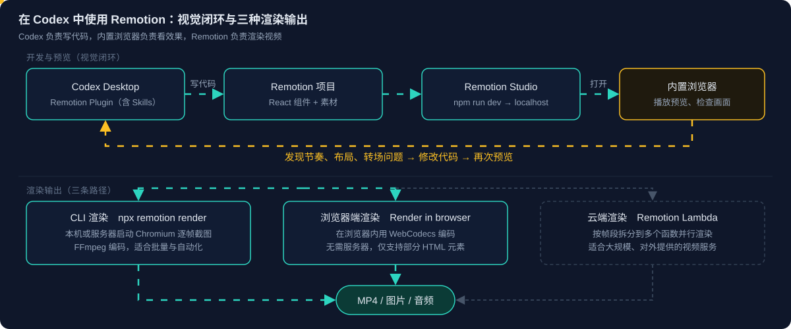

# Remotion 系列 02：快速上手

> 系列导航：[系列01：Agent Skills、交互式播放与帧号驱动渲染](Remotion系列01：Agent-Skills与帧号驱动渲染.md) ｜ 本篇 ｜ [系列03：简单实践篇——从洛杉矶飞到上海，用地图与 3D 地标完成一段视频](Remotion系列03：从洛杉矶飞到上海.md)
>
> 依据 Remotion 官方文档整理（2026-10-13）。

[系列01](Remotion系列01：Agent-Skills与帧号驱动渲染.md) 讨论了选型与帧号驱动原理，本篇聚焦上手：在 Codex 中如何搭起工作流，Remotion 的动画与 PPT 有何异同，初学时需要掌握哪几层功能，以及渲染相关的几个基本概念。

## 一、在 Codex 中上手

### 需要准备什么

| 组件 | 是否需要单独安装 | 说明 |
|---|---|---|
| Remotion Plugin | 需要 | 在 Codex 中安装，是 agent 调用 Remotion 的入口 |
| Remotion Agent Skills | 不需要 | Plugin 已包含，无需再执行 `npx skills add` |
| `create-video` | 不需要全局安装 | 新建项目时通过 `npx create-video@latest` 执行，Codex 可代为完成 |
| Node.js | 需要 | 运行项目、预览与渲染的环境 |
| Remotion Studio | 不需要 | 项目自带的本地 Web 应用，`npm run dev` 即启动 |

### 三步跑通

1. **安装 Plugin**：在 ChatGPT 桌面应用中打开 Plugins，搜索 Remotion 并安装（参见 [Codex Plugin](https://www.remotion.dev/docs/ai/codex-plugin)）。
2. **创建项目**：在 Codex 中输入 `$remotion`，接受 Plugin 提示后描述想要的视频，例如 `$remotion Create a 15-second product intro video`。
3. **启动预览**：项目中执行 `npm run dev`，启动 Remotion Studio（默认 `localhost:3000`，端口被占用时会顺延，以启动日志为准）。

### 用内置浏览器形成视觉闭环

Codex Desktop 的内置浏览器可以直接打开本地 Studio 地址。由此形成一个闭环：Codex 编写代码，内置浏览器播放预览，Codex 根据画面发现问题后修改代码，再次预览。可以直接这样提示：

> 用内置浏览器打开 Remotion Studio，检查动画节奏、布局和转场；发现问题就修改代码并再次检查。



### 最佳实践

- **项目复用**：一个 Remotion 项目可以持续迭代，不必每做一个视频就重新 `create-video`；只有需要独立项目时才新建。
- **分工明确**：Codex 负责代码，内置浏览器负责视觉检查，Remotion 负责渲染。浏览器预览与最终导出是两件事。
- **需求用帧和顺序描述**：向 agent 描述动画时给出时长、先后顺序与节奏（如"标题在 0.5 秒内弹入，1 秒后副标题淡入"），比描述"更有动感"更容易一次做对。
- **导出按场景选路径**：单次导出可用 Studio 的 Render in browser；批量与自动化用 CLI `npx remotion render`（需指定 Composition ID 与输出路径）。

## 二、与 PPT 动画的对照

Remotion 中的 transform、transition 等动作与 PPT 动画概念相通，可以直接映射：

| PPT | Remotion | 作用 |
|---|---|---|
| 飞入、浮入 | `transform: translateX / translateY` | 移动 |
| 放大、缩小 | `transform: scale` | 缩放 |
| 旋转 | `transform: rotate` | 旋转 |
| 淡入、淡出 | `opacity` | 透明度 |
| 持续时间、开始时间 | 帧区间（`durationInFrames`、`from`） | 时序 |
| 平滑开始 / 结束 | `Easing` | 速度曲线 |
| 弹跳 | `spring()` | 弹簧式运动 |
| 动画顺序 | `<Sequence>` | 编排先后 |
| 幻灯片切换 | `<TransitionSeries>` | 场景转场 |

需要区分两种 "transition"：CSS 的 `transition` 由浏览器按真实时间自动过渡，在 Remotion 中不应使用（原因见系列01 的帧号驱动一节）；场景之间的转场则由 `@remotion/transitions` 的 `<TransitionSeries>` 实现。

本质区别在于：**PPT 是在时间轴上配置动画，Remotion 是用代码定义画面随帧号变化的规律。** 由此带来几项优势：

- **数据驱动**：100 根柱子的图表无需逐个配置动画，一个循环即可依次错开入场。
- **参数化与复用**：同一模板替换文案、数据、配色，批量产出不同视频。
- **适合 AI 生成**：动画就是代码，agent 可以直接生成、修改并复查。
- **可版本管理**：视频工程进 Git，改动可追溯、可评审。

```tsx
// 五根柱子依次错开 5 帧入场
const values = [20, 45, 30, 80, 60];
const heights = values.map((v, i) =>
  interpolate(frame - i * 5, [0, 20], [0, v], { extrapolateRight: "clamp" }),
);
```

## 三、初学者应掌握的五层功能

| 层 | 关键 API | 解决的问题 |
|---|---|---|
| 1. 视频定义 | `<Composition>`（宽高、`fps`、`durationInFrames`） | 视频是什么规格、多长 |
| 2. 时间 | `useCurrentFrame()`、`useVideoConfig()` | 当前是第几帧 |
| 3. 动画计算 | `interpolate()`、`spring()`、`Easing` | 这一帧的属性值是多少 |
| 4. 场景编排 | `<Sequence>`、`<Series>`、`<TransitionSeries>` | 内容何时出现、如何切换 |
| 5. 绘制 | CSS / SVG / Canvas，复杂场景用 WebGL / WebGPU | 画面用什么技术画出来 |

其中第 3 层的两个函数最常用：

- **`interpolate()`** 是数值映射："第 0 到 30 帧，透明度从 0 到 1"。适合平移、渐变、进度条。
- **`spring()`** 是弹簧物理模拟：根据帧号算出带有加速、超调、回弹的数值，默认从 0 到 1，超调时可能略大于 1。`config` 中 `damping`（阻尼）越大回弹越少，`stiffness`（刚度）越大运动越快，`mass`（质量）越大越迟缓。适合弹性入场、缩放。

```tsx
const frame = useCurrentFrame();
const { fps } = useVideoConfig();
const scale = spring({ frame, fps, config: { damping: 12 } });     // 弹入
const opacity = interpolate(frame, [0, 30], [0, 1]);               // 淡入
return <h1 style={{ transform: `scale(${scale})`, opacity }}>Hello</h1>;
```

两者都只是"根据帧号计算一个数"，再由 React 应用到样式上，因此任意一帧都可以独立渲染。

## 四、渲染：图形技术与渲染位置

讨论渲染时常把三个维度混在一起，应先分开：

| 维度 | 回答的问题 | 选项 |
|---|---|---|
| 图形技术 | 画面怎么画 | DOM / CSS、SVG、Canvas 2D、WebGL、WebGPU |
| 渲染位置 | 在哪里算出每一帧 | 客户端（用户浏览器）、服务端（本机 / 服务器 / 云函数） |
| 输出方式 | 如何编码成视频 | Studio、CLI、Node.js API、Lambda |

**WebGL 与 WebGPU 是图形技术，不等于客户端渲染。** 服务端渲染时 Chromium 同样可以使用 WebGL 绘制画面，只是硬件加速是否可用取决于运行环境。

### WebGL 与 WebGPU

| | WebGL | WebGPU |
|---|---|---|
| 定位 | 成熟的浏览器 GPU 图形接口（OpenGL ES 风格） | 新一代图形与通用计算接口 |
| 通用计算 | 需借助着色器技巧 | 原生支持 compute shader |
| 适用 | Web 3D、粒子、着色器特效（Three.js 默认基于它） | 大规模粒子模拟、GPU 计算、复杂 3D |
| 环境支持 | 普遍 | 不能假设所有渲染环境都已支持 |

普通的文字、图片、图表与转场用 React + CSS 即可，无需引入 GPU 技术；只有当主体是 3D 场景或大规模粒子时，WebGL / WebGPU 才有价值。

### 客户端渲染与服务端渲染

| | 服务端渲染 | 客户端渲染 |
|---|---|---|
| 执行位置 | 本机或服务器上的 Node.js + Chromium | 用户浏览器 |
| 编码 | FFmpeg | WebCodecs |
| 入口 | `npx remotion render`、`@remotion/renderer`、Remotion Lambda | Studio 的 Render in browser、`@remotion/web-renderer` |
| 依赖 | 需要 Node 环境或云函数 | 无需服务器，浏览器需支持 WebCodecs |
| 限制 | 功能完整 | 仅支持部分 HTML 元素 |
| 适用 | 批量、自动化、对外的视频服务 | 单次导出、在网页内让用户直接生成视频 |

参见 [Client-side rendering](https://www.remotion.dev/docs/client-side-rendering)。

## 补充：商业授权

Remotion 并非 MIT 许可：个人与 3 人以内的公司可免费商用；4 人以上的组织需要 Company License，分为按席位计费的 Remotion for Creators（本地编码与 prompt 制作视频）和按渲染次数计费的 Remotion for Automators（视频编辑器、prompt-to-video 等自动化产品），另有 Enterprise License。具体价格与条款以 [Remotion 授权页](https://www.remotion.pro/license) 为准。

## 参考链接

- [Remotion 官方文档](https://www.remotion.dev/docs)
- [Codex Plugin](https://www.remotion.dev/docs/ai/codex-plugin)
- [Remotion Agent Skills](https://www.remotion.dev/docs/ai/skills)
- [Client-side rendering](https://www.remotion.dev/docs/client-side-rendering)
- [@remotion/transitions](https://www.remotion.dev/docs/transitions)
- [Remotion Licensing](https://www.remotion.pro/license)
