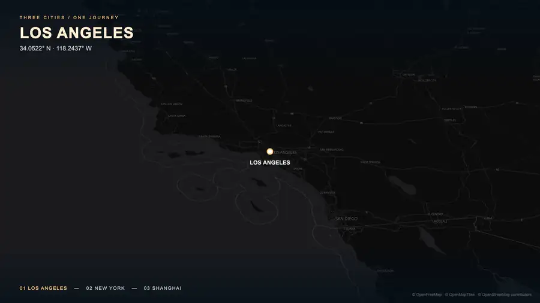
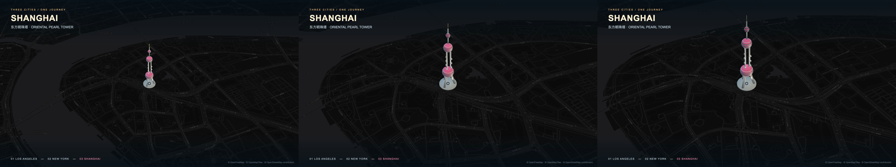
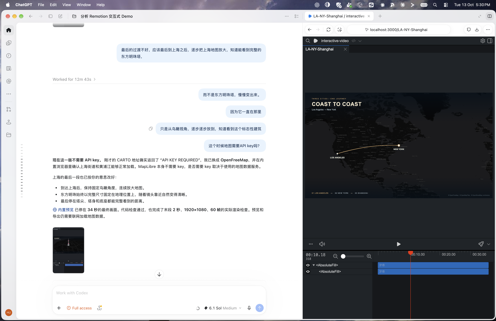

# Remotion 系列 03：从洛杉矶飞到上海

> 系列导航：[系列01：Agent Skills、交互式播放与帧号驱动渲染](Remotion系列01：Agent-Skills与帧号驱动渲染.md) ｜ [系列02：快速上手——Codex 工作流、PPT 动画对照、五层功能与渲染方式](Remotion系列02：快速上手.md) ｜ 本篇
>
> 实现与验证日期：2026-10-13。

[系列02](Remotion系列02：快速上手.md) 介绍了 Remotion 的五层功能和 Codex 工作流。这一次从一个具体画面开始：镜头先对准洛杉矶，逐渐拉远；一条航线从洛杉矶延伸到纽约，镜头跟随航线前进；接着飞到上海，最后从鸟瞰视角逐步靠近陆家嘴，看到完整的东方明珠塔。

这个案例适合入门后的第一次综合实践：不是只做标题淡入，而是让时间轴、真实地图、地理路径和一个3D模型共同完成叙事。

## 一、先看成品



这张动图（animated WebP）展示完整 36 秒作品并无限循环，没有声音；清晰版本见 [1080p MP4](../../../asset/remotion-la-ny-shanghai-2026-10-13.mp4)。动图不需要运行 React、Remotion 或地图服务，打开文章即可播放；部分阅读器开启省流或减少动画设置时可能不会自动播放。

最后的镜头强调一个空间关系：**东方明珠一直在那里，变化的是镜头与它的距离。** 因此塔没有逐段长出来，也没有从另一个画面淡入。地图越放越近，塔自然从远处的小物体变成可以辨认的建筑。



## 二、从需求到分镜

主体 composition 名为 `LA-NY-Shanghai`，规格为1920×1080、30fps、1080帧，共36秒。

| 时间 | 镜头与内容 | 用什么控制 |
|---|---|---|
| 0—4秒 | 以洛杉矶为中心拉远 | 地图中心固定，zoom 从7到3.25 |
| 4—11秒 | LA→NY航线逐渐延伸，镜头跟随线头 | Turf 路径截取 + 地图中心更新 |
| 11—13秒 | 停留纽约，进一步拉远 | zoom 从3.25到2.15 |
| 13—23秒 | NY→Shanghai，沿大圆路线前进 | 第二段路线、距离进度、经度连续处理 |
| 23—34秒 | 对准上海持续放大 | 中心固定在地标附近，zoom 到16.1 |
| 34—36秒 | 停在完整东方明珠的构图 | 相机保持最终状态 |

地图保持45°的俯视倾角与0° bearing。这里的“鸟瞰”是固定倾角的空中视角，足以看见塔的高度；没有在结束时绕塔旋转，也没有切到地面视角。

## 三、实际用了哪些组件和技术

| 组件 / 技术 | 本案例的作用 | 对应文件 |
|---|---|---|
| React + TypeScript | 组织视频组件、图层、标题与状态 | `src/Root.tsx`、`src/Journey.tsx` |
| Remotion `Composition` | 注册视频，定义宽高、fps和时长 | `src/Journey.tsx` |
| `AbsoluteFill` | 让地图、渐变遮罩、标题和署名叠在同一画面 | `src/Journey.tsx` |
| `useCurrentFrame()`、`useVideoConfig()` | 获取当前帧与视频规格，计算视频时间 | `src/Journey.tsx`、`src/PearlScene.tsx` |
| `interpolate()`、`Easing` | 计算路线进度、地图zoom与辅助标记透明度 | `src/Journey.tsx` |
| `useDelayRender()` | 导出时等待地图 / 模型加载与当前帧地图就绪 | 地图与模型组件 |
| MapLibre GL JS | 绘制街道地图、文字、路线和地理坐标系 | `src/Journey.tsx` |
| OpenFreeMap | 提供暗色地图样式、矢量瓦片、字体和sprite | HTTPS地图资源 |
| Turf | 大圆路线、路线长度、指定距离位置和截取线段 | `src/Journey.tsx` |
| Blender + Python | 用球体、圆柱、圆环等构造风格化东方明珠 | `blender/oriental_pearl.py`、`.blend` |
| glTF / GLB + `GLTFLoader` | 从建模工具向浏览器传递模型和材质 | `public/models/oriental-pearl.glb` |
| Three.js | 相机、光源和3D模型渲染 | `src/PearlMapLayer.ts` |
| MapLibre custom 3D layer | 让模型与地图共用WebGL画布和相机投影 | `src/PearlMapLayer.ts` |
| `@remotion/three` + React Three Fiber | 独立模型预览composition中的3D场景 | `src/PearlScene.tsx` |
| Remotion Studio | 在Codex内置浏览器预览、拖时间轴和发起导出 | 本地Studio |
| FFmpeg / ffprobe | 转成循环动图、检查视频规格和解码、抽帧观察 | 导出后处理 |

主片与独立模型预览的实现不同。独立的 `Oriental-Pearl-3D` 使用 `<ThreeCanvas>`；主片为了让塔固定在地图坐标上，使用 MapLibre custom layer 和原生 Three.js，直接共享地图的 WebGL context。这不是把两块画布在视觉上拼到一起。

本案例没有使用 WebGPU、GSAP、Lottie，也没有加入音轨。最初研究的 Remotion 官网 interactive demo 支持拖拽、播放和声音，但本次完成的是地图旅行视频，使用 Studio 操作时间轴，没有实现自定义 `@remotion/player` 应用或卡片拖拽。

## 四、把系列02的五层功能用起来

| 五层功能 | 这次如何落地 |
|---|---|
| 视频定义 | 一个36秒的主composition，另有11秒的独立模型预览 |
| 时间 | 帧号除以fps得到秒，所有镜头与航线使用同一个时间来源 |
| 动画计算 | 用clamp与三次缓动计算进度，得到地图中心、zoom和路线长度 |
| 场景编排 | 主片一直保留同一地图场景，通过时间区间切换镜头状态和标题；最终没有使用Sequence换场 |
| 绘制 | React DOM绘制标题；MapLibre绘制地图与路线；Three.js绘制地标 |

并不是每一层都必须调用对应的所有API。这个镜头需要保持空间连续，直接在一个场景里移动相机比“地图结束后切换到塔的展示页”更符合需求。

## 五、航线为什么能画出来，镜头为什么能跟随

路线和镜头分开计算。首先由起终点生成大圆路线，再求路线总长度。当前帧的进度决定已经走了多远：

```tsx
const seconds = frame / fps;
const progress = interpolate(seconds, [4, 11], [0, 1], {
  extrapolateLeft: 'clamp',
  extrapolateRight: 'clamp',
  easing: Easing.inOut(Easing.cubic),
});
const traveled = totalDistance * progress;
const visibleLine = turf.lineSliceAlong(route, 0, Math.max(0.001, traveled));
const position = turf.along(route, Math.max(0.001, traveled));
```

随后把截取的路线传给地图的 GeoJSON source，把当前地理位置传给地图相机。每一帧都是“先算应有的状态，再绘制”，不是让地图自己按真实时钟播放 `flyTo()`。

纽约到上海还遇到一个地理坐标问题：路径向西经过跨日期变更线，终点可能表示成−238.5002°，与121.4998°是同一个地理位置。若相机使用西侧世界副本，模型却仍放在东侧副本，画面里就会找不到塔。最终让路径、相机经度和模型所在的世界副本保持一致。

## 六、Blender 与 Remotion 怎样配合

Blender负责生成可编辑的资产。Python脚本构造塔的底座、支腿、柱体、球体、观景环和尖顶，共34个模型对象，导出为GLB；`.blend` 保留完整建模工程。这个模型是为案例服务的风格化表达，不是测绘级建筑复原。

浏览器通过 `GLTFLoader` 加载GLB。MapLibre用Mercator坐标表达地理位置，Three.js模型则有自己的轴向与单位，因此需要做三件事：

1. 将glTF的Y-up转换为地图的高度方向。
2. 把模型放在121.4998° E、31.2397° N。
3. 按约468米高度转换模型单位，再乘入地图相机投影矩阵。

主片中的模型尺寸不随帧号变化。每帧只是更新地图相机与地理图层，然后由Three.js绘制塔。Blender没有负责渲染主片的1080帧，主片的3D画面是在浏览器中绘制的。

最初实现曾让地图淡出，再让独立塔模型逐段出现。看起来有动画，却破坏了地理叙事：塔本来就一直在那里。根据画面反馈，最终把模型放回地图中，把“物体入场”改成“镜头靠近”。这也是本次最有价值的修改：先判断到底是物体运动、相机运动，还是场景切换，再选择动画手段。

## 七、Codex工作流怎样形成闭环

从 `npx create-video@latest` 开始，在 `interactive-video/` 创建工程；再添加地图、路线和3D依赖，注册新的composition。需求逐步明确，Codex也逐步修改实现：先完成LA→NY，再延伸到上海，再加入Blender地标，最后根据画面反馈调整上海镜头。

预览始终应在当前Codex应用的内置浏览器中进行：

```bash
cd interactive-video
npm ci
npm run dev -- --no-open
```

打开启动日志给出的地址，例如 `http://localhost:3000/LA-NY-Shanghai`。`--no-open` 避免自动唤起系统浏览器。内置浏览器只是承载Studio的界面，视频仍由本地工程提供。

可复用的需求描述是：

> 使用Remotion best practices。新增地图composition：先以LA为中心拉远，再画LA到NY的航线，让相机跟随线头；随后到上海。东方明珠始终以完整尺寸固定在地图上，到上海后保持鸟瞰角度逐步放大，直到整座塔完整可见。所有动画由帧号决定，预览和Render界面使用Codex内置浏览器。

这里不要求一次提示完成一切。先做出能预览的版本，用具体画面判断问题，再修正，是这个工作流的关键。

## 八、实际遇到的问题

| 问题 | 最终处理 | 经验 |
|---|---|---|
| 初始化时安装的预发布版缺少所用的 API | 将 Remotion 各运行包统一固定到同一稳定版本，保留 lockfile | 新项目先验证版本兼容；各 `@remotion/*` 包版本必须一致 |
| MapLibre worker加载失败 | 从已安装包提供本地worker及共享模块 | worker与库版本要配套，不能只复制一个worker文件 |
| CARTO地址返回“API KEY REQUIRED” | 换成OpenFreeMap dark矢量地图 | MapLibre不需要key，是否需要key取决于底图服务 |
| 上海画面找不到塔 | 让模型与相机使用同一个经度世界副本 | 跨日期变更线要同时处理路线、相机和模型 |
| 地图到塔的转场不自然 | 取消换场 / 生长，把塔固定在地图上 | 先澄清空间关系，再选择动画 |
| Studio跳帧后短暂缺少瓦片 | 等待加载，导出使用delayRender与地图idle同步 | delayRender约束导出截图，不会自动暂停Studio播放 |

OpenFreeMap官方说明公共实例无需注册或API key。本案例保留了OpenFreeMap、OpenMapTiles、OpenStreetMap署名。无需key不等于离线：制作和渲染仍需联网获取瓦片、字体与样式，导出后的动图和MP4不再请求地图服务。

## 九、导出与文章嵌入

本次在Studio的 **Render on the server** 界面发起渲染，选择H.264、ANGLE图形后端、并发1。虽然按钮位于内置浏览器，实际渲染位置是本机Node.js / 无头Chromium。这对应系列02的服务端路径；不能因为“在浏览器里点击”就称为WebCodecs客户端渲染。



整个流程都在 Codex 中完成：左侧对话提出需求与修改意见，Codex 改写代码；右侧内置浏览器打开本地 Remotion Studio，实时预览、拖动时间轴并发起渲染，无需切换到系统浏览器或其他工具。

先用末段2秒验证3D与地图，再导出完整36秒主片。导出完成后，用 FFmpeg 把 MP4 转成文章用的动图。先转成 GIF（800 像素宽、10fps、256 色）时体积约 35MB：地图瓦片细节多，GIF 的压缩效率很低。改为 animated WebP（900 像素宽、12fps、无限循环）后约 6MB，画质反而更好，GitHub 与 Obsidian 都能直接播放。原作品没有音轨，动图本身也不支持声音。

```bash
ffmpeg -i la-ny-shanghai-full.mp4 -vf "fps=12,scale=900:-2:flags=lanczos" \
  -c:v libwebp -lossless 0 -q:v 60 -compression_level 6 -loop 0 -an out.webp
```

Markdown 中用普通图片语法嵌入即可：

```markdown

```

对允许HTML的网站，也可以用体积更小、色彩更完整的MP4：

```html
<video autoplay muted loop playsinline controls width="900">
  <source src="asset/remotion-la-ny-shanghai-2026-10-13.mp4" type="video/mp4">
</video>
```

但文章平台可能过滤video标签，浏览器自动播放也有策略限制；GitHub Markdown通常不按这段HTML提供自动循环视频。因此本篇以动图作为正文的直接展示，MP4 作为清晰版本。

全片验收：实际导出为H.264、1920×1080、30fps、1080帧、36秒；全片解码无错误。抽帧覆盖了LA拉远、两段航线与上海放大，末段另有2秒连续渲染检查。文章动图为 900×506、12fps、432 帧，循环标记为无限循环。地图运动中的文字可能随zoom调整排布；这是地图标注的行为，不等于已保证所有平台和帧都逐像素一致。

## 十、从这个案例还能扩展什么

后续可以把城市、停留时长和地标路径提取为props，用同一模板制作不同旅行视频；也可以加入按时间轴同步的音轨。若需要官网demo那样在播放中拖拽、修改内容，再接入Remotion Player并把交互状态传给composition。

这些是可继续实现的方向。本次已完成的是一段由真实地图、两段航线和一个固定3D地标组成的地图旅行作品，以及适合文章循环展示的动图。

## 参考资料

- [Remotion Composition](https://www.remotion.dev/docs/composition)
- [Remotion useCurrentFrame](https://www.remotion.dev/docs/use-current-frame)
- [Remotion interpolate](https://www.remotion.dev/docs/interpolate)
- [Remotion delayRender与预览缓冲的区别](https://www.remotion.dev/docs/delay-render)
- [Remotion Three.js集成](https://www.remotion.dev/docs/three)
- [MapLibre GL JS](https://maplibre.org/maplibre-gl-js/docs/)
- [Turf greatCircle](https://turfjs.org/docs/api/greatCircle)
- [OpenFreeMap服务说明与视频署名要求](https://openfreemap.org/)
- [Blender glTF导出](https://docs.blender.org/manual/en/latest/addons/import_export/scene_gltf2.html)
- [最初研究的Remotion官网interactive demo源码](https://github.com/remotion-dev/remotion/blob/main/packages/promo-pages/src/components/homepage/Demo/index.tsx)
