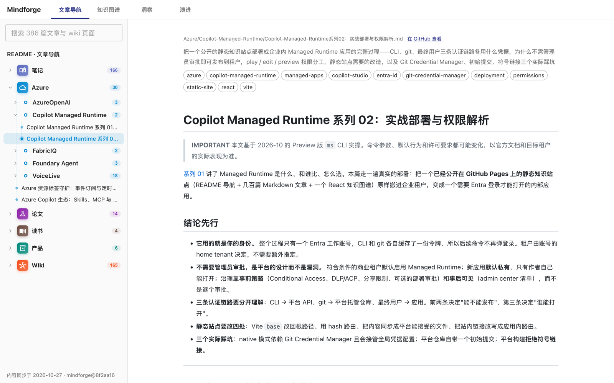
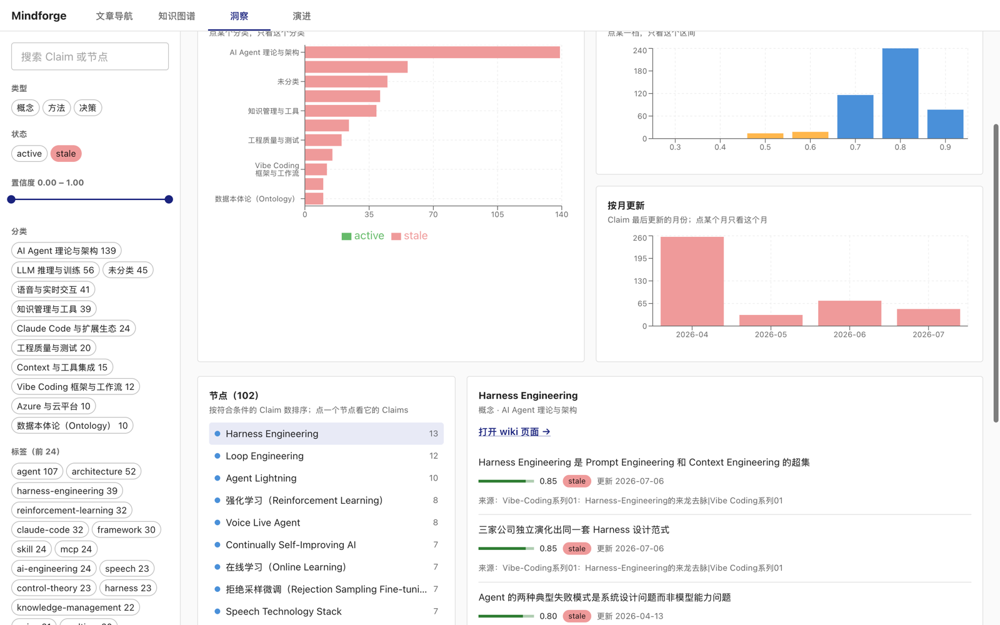
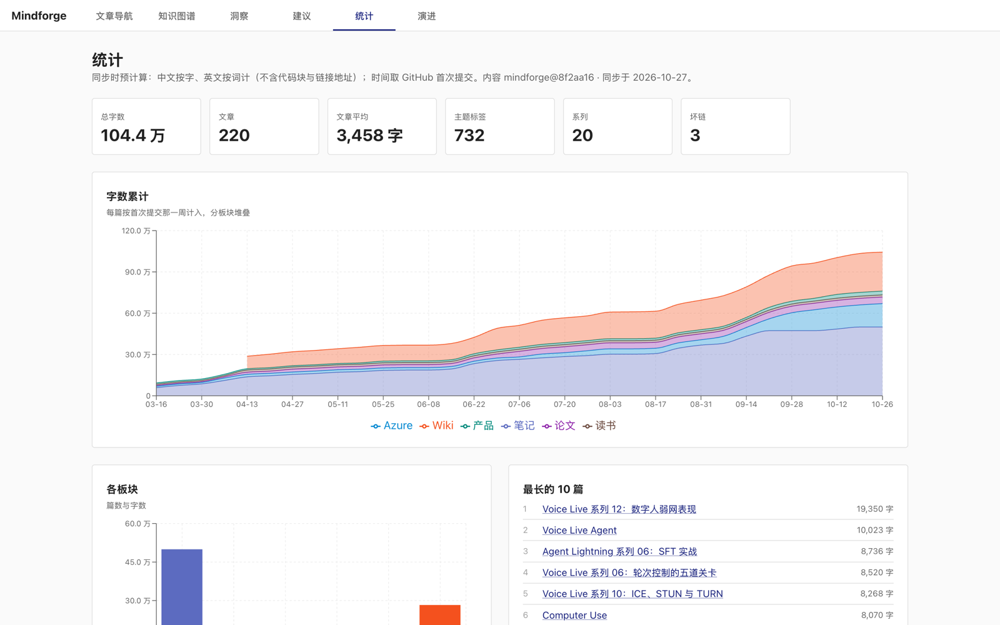

# Mindforge

> A personal knowledge forge — notes on AI engineering, cloud architecture, philosophy of technology, and the craft of building with modern tools.

This vault captures reading notes, technical deep-dives, and reflections from an architect's perspective. Topics span AI-native development workflows, context engineering, ontology-driven data platforms, and DevOps practices.

## 在线浏览 / Browse Online

The whole knowledge base is published as a website: [huqianghui.github.io/mindforge/wiki](https://huqianghui.github.io/mindforge/wiki/). Nothing to install — it has six pages: 知识图谱, 文章导航, 洞察, 建议, 统计 and 演进. Click any screenshot or title below to open it.

### 概览统计

<!-- STATS:START (auto-generated by wiki/scripts/export-graph.py — do not edit by hand) -->
| 维度 | 数量 |
|------|------|
| 文章与笔记 | 235（Notes 166 / paper 14 / book 4 / product 6 / Azure 45） |
| 日记 | 171 |
| Wiki 页面 | 117 concepts + 22 methods + 8 decisions |
| Claims（带证据的论断） | 806 |
| 知识图谱 | 147 节点 / 516 关系 / 9 种关系类型 |

> 统计由 `wiki/scripts/export-graph.py` 自动生成，更新于 2026-10-28。
<!-- STATS:END -->

### 知识图谱

<a href="https://huqianghui.github.io/mindforge/wiki/#/graph"></a>

**[View Live Graph](https://huqianghui.github.io/mindforge/wiki/#/graph)** — Interactive force-directed visualization of the personal knowledge wiki, covering concepts, methods, decisions, and their typed relations. Click any node to inspect its claims, confidence scores, and connections. Filter by node type, relation type, or search by keyword.

### 其他页面

<table>
<tr>
<td width="50%" valign="top">
<a href="https://huqianghui.github.io/mindforge/wiki/"></a><br />
<b><a href="https://huqianghui.github.io/mindforge/wiki/">文章导航</a></b>：article reader with a directory tree and title search. Browse all articles here.
</td>
<td width="50%" valign="top">
<a href="https://huqianghui.github.io/mindforge/wiki/#/insights"></a><br />
<b><a href="https://huqianghui.github.io/mindforge/wiki/#/insights">洞察</a></b>：claim-level filtering by type, status, confidence and month; click a chart bar to filter, then drill down to the source article.
</td>
</tr>
<tr>
<td width="50%" valign="top">
<a href="https://huqianghui.github.io/mindforge/wiki/#/suggestions"></a><br />
<b><a href="https://huqianghui.github.io/mindforge/wiki/#/suggestions">建议</a></b>：rule-based cards, each with its evidence and a suggested action.
</td>
<td width="50%" valign="top">
<a href="https://huqianghui.github.io/mindforge/wiki/#/stats"></a><br />
<b><a href="https://huqianghui.github.io/mindforge/wiki/#/stats">统计</a></b>：word counts, tag distribution, series completeness and link health.
</td>
</tr>
<tr>
<td width="50%" valign="top">
<a href="https://huqianghui.github.io/mindforge/wiki/#/timeline"></a><br />
<b><a href="https://huqianghui.github.io/mindforge/wiki/#/timeline">演进</a></b>：git-history timeline with a knowledge tree that grows day by day.
</td>
</tr>
</table>

---

## 本地使用 / Use Locally

把仓库拉到本地后，它是一个 **Obsidian 个人知识库（Personal Knowledge Compiler）**，由三层构成：

- **文章与笔记**（`Notes/` `Azure/` `paper/` `book/` `product/`）—— 长文与阅读笔记
- **日记**（`daily-work-item/`）—— 每日工作流水
- **LLM Wiki**（`wiki/`）—— 从日记与文章中编译出的结构化知识：概念 / 方法 / 决策 + 带证据和置信度的 Claims

### 1. 语义搜索（qmd）

本地混合搜索引擎（BM25 + 向量 + LLM 重排），已索引全部 `.md` 文件：

```bash
qmd query "如何做知识提取"              # 推荐：智能扩展 + 语义 + 重排
qmd search "RAFT" -c mindforge         # 纯关键词，找专有名词最快
qmd get qmd://mindforge/wiki/index.md  # 直接取文档
```

索引数据存于 `~/.cache/qmd/index.sqlite`（不进 git，源文件始终是本 vault）。改动内容后跑 `qmd embed` 刷新向量。

### 2. 知识图谱与站点数据

- **在线版**：见上方 [在线浏览](#在线浏览--browse-online)；站点数据在构建期由 `wiki/visualizer/scripts/sync-content.py` 从本仓库生成
- **数据源**：`wiki/wiki-graph.json`（节点 + 关系 + 分类）；可视化前端在 `wiki/visualizer/`
- **重新生成**：`python3 wiki/scripts/export-graph.py`（扫描 concepts/methods/decisions 重建 JSON）；顶部动态总览图由 `python3 wiki/scripts/render-graph-svg.py` 从该 JSON 渲染

### 3. 阅读 Wiki

入口 `wiki/index.md`——含完整的概念 / 方法 / 决策索引。知识以 **Claim** 为单元：每条论断带证据来源、置信度（0.0~1.0）、生命周期状态（active / conflicting / outdated / stale）。9 种类型化关系（implements / grounds / extends / …）定义见 `wiki/_relations.md`。不想在本地跑的话，可以直接用 [在线浏览](#在线浏览--browse-online) 里的知识图谱和洞察页查看同样的内容。

### 4. 维护命令（Claude Code skills）

`/extract-knowledge` 提取知识 · `/evolve-wiki` 演进维护 · `/detect-conflict` 查冲突 · `/knowledge-gap` 找差距 · `/weekly-review` 周报。完整工作流见 `wiki/index.md`。

---

## License

Personal knowledge notes. Feel free to reference with attribution.
