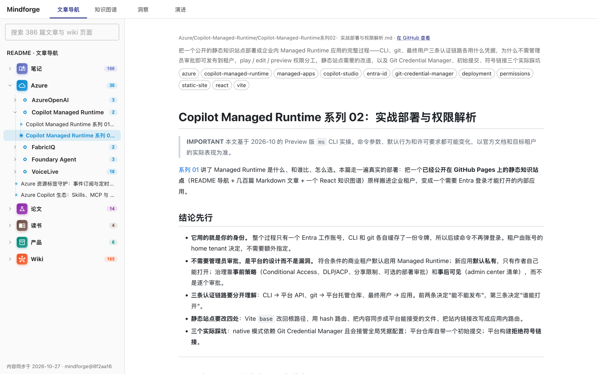
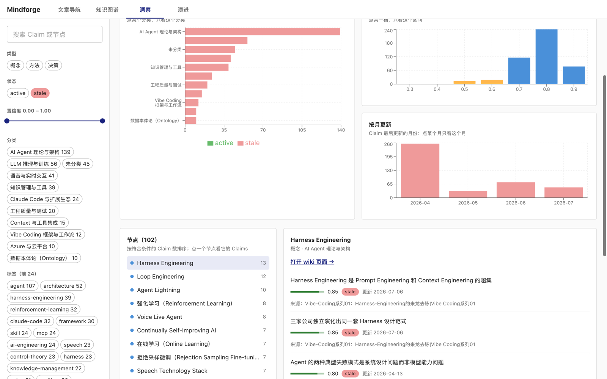
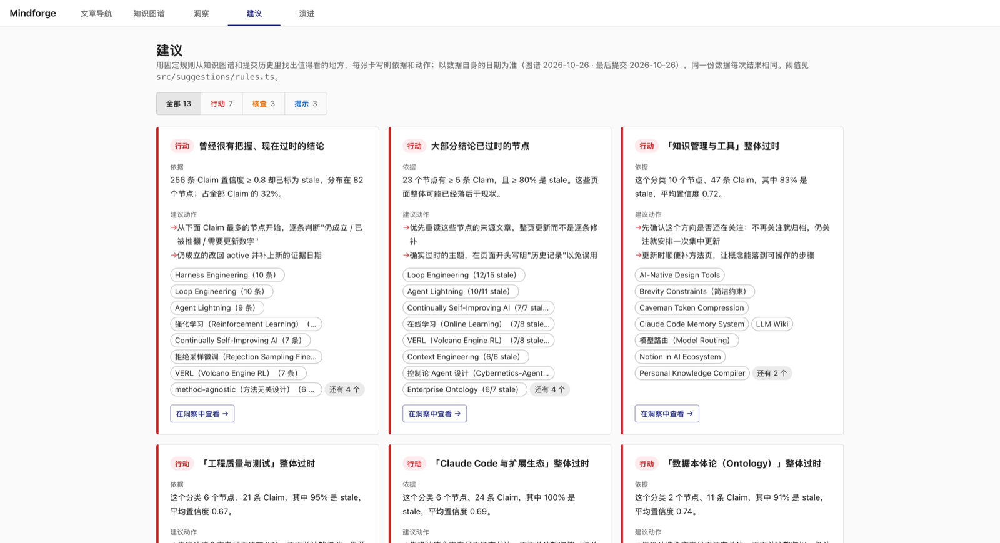
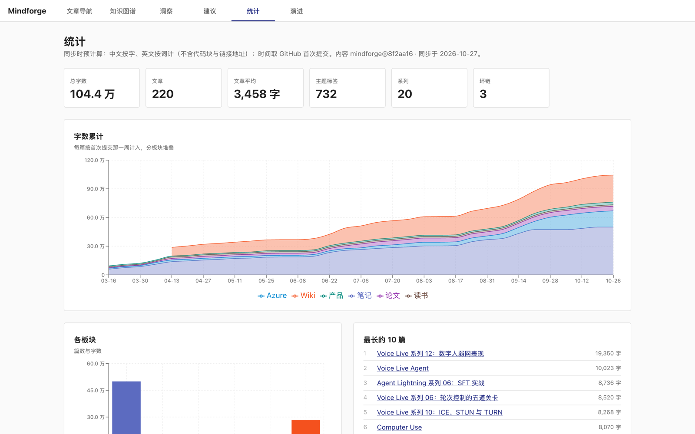
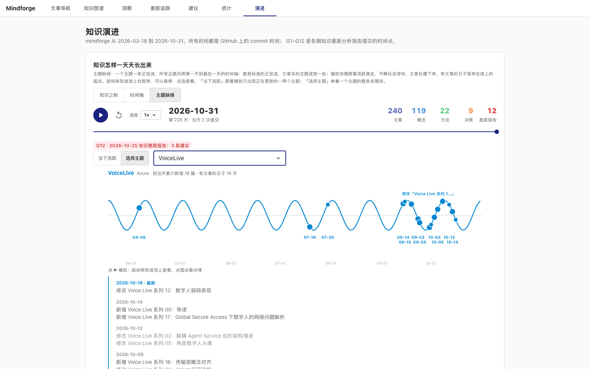

# Mindforge

> A personal knowledge forge — notes on AI engineering, cloud architecture, philosophy of technology, and the craft of building with modern tools.

This vault captures reading notes, technical deep-dives, and reflections from an architect's perspective. Topics span AI-native development workflows, context engineering, ontology-driven data platforms, and DevOps practices.

## 在线浏览 / Browse Online

The whole knowledge base is published as a website: [huqianghui.github.io/mindforge/wiki](https://huqianghui.github.io/mindforge/wiki/). Nothing to install — it has six pages: 知识图谱, 文章导航, 洞察, 建议, 统计 and 演进. Click any screenshot or title below to open it.

### 概览统计

<!-- STATS:START (auto-generated by wiki/scripts/export-graph.py — do not edit by hand) -->
| 维度 | 数量 |
|------|------|
| 文章与笔记 | 250（Notes 173 / paper 14 / book 4 / product 6 / Azure 53） |
| 日记 | 180 |
| Wiki 页面 | 125 concepts + 22 methods + 9 decisions |
| Claims（带证据的论断） | 886 |
| 知识图谱 | 156 节点 / 553 关系 / 9 种关系类型 |

> 统计由 `wiki/scripts/export-graph.py` 自动生成，更新于 2026-11-07。
<!-- STATS:END -->

### 知识图谱

<a href="https://huqianghui.github.io/mindforge/wiki/#/graph"></a>

**[View Live Graph](https://huqianghui.github.io/mindforge/wiki/#/graph)** — Interactive force-directed visualization of the personal knowledge wiki, covering concepts, methods, decisions, and their typed relations. Click any node to inspect its claims, confidence scores, and connections. Filter by node type, relation type, or search by keyword.

### 其他页面

<table>
<tr>
<td width="50%" valign="top">
<a href="https://huqianghui.github.io/mindforge/wiki/"></a><br />
<b><a href="https://huqianghui.github.io/mindforge/wiki/">文章导航</a></b>：article reader with a directory tree and title search. Browse all articles here.
</td>
<td width="50%" valign="top">
<a href="https://huqianghui.github.io/mindforge/wiki/#/insights"></a><br />
<b><a href="https://huqianghui.github.io/mindforge/wiki/#/insights">洞察</a></b>：claim-level filtering by type, status, confidence and month; click a chart bar to filter, then drill down to the source article.
</td>
</tr>
<tr>
<td width="50%" valign="top">
<a href="https://huqianghui.github.io/mindforge/wiki/#/suggestions"></a><br />
<b><a href="https://huqianghui.github.io/mindforge/wiki/#/suggestions">建议</a></b>：rule-based cards, each with its evidence and a suggested action.
</td>
<td width="50%" valign="top">
<a href="https://huqianghui.github.io/mindforge/wiki/#/stats"></a><br />
<b><a href="https://huqianghui.github.io/mindforge/wiki/#/stats">统计</a></b>：word counts, tag distribution, series completeness and link health.
</td>
</tr>
<tr>
<td width="50%" valign="top">
<a href="https://huqianghui.github.io/mindforge/wiki/#/timeline"></a><br />
<b><a href="https://huqianghui.github.io/mindforge/wiki/#/timeline">演进</a></b>：git-history timeline with a knowledge tree that grows day by day.
</td>
<td width="50%" valign="top">
<a href="https://huqianghui.github.io/mindforge/wiki/#/timeline"></a><br />
<b><a href="https://huqianghui.github.io/mindforge/wiki/#/timeline">主题脉络</a></b>：the third view on 演进. Each topic (article directory) is a sine wave on one shared time axis, with a dot on each day it gained or changed articles. 当下活跃 shows only the topics updated during playback; 选择主题 replays one topic's whole history.
</td>
</tr>
</table>

---

## 本地使用 / Use Locally

把仓库拉到本地后，它是一个 **Obsidian 个人知识库（Personal Knowledge Compiler）**，由三层构成：

- **文章与笔记**（`Notes/` `Azure/` `paper/` `book/` `product/`）—— 长文与阅读笔记
- **日记**（`daily-work-item/`）—— 每日工作流水
- **LLM Wiki**（`wiki/`）—— 从日记与文章中编译出的结构化知识：概念 / 方法 / 决策 + 带证据和置信度的 Claims

### 1. 语义搜索（qmd）

本地混合搜索引擎（BM25 + 向量 + LLM 重排），已索引全部 `.md` 文件：

```bash
qmd query "如何做知识提取"              # 推荐：智能扩展 + 语义 + 重排
qmd search "RAFT" -c mindforge         # 纯关键词，找专有名词最快
qmd get qmd://mindforge/wiki/index.md  # 直接取文档
```

索引数据存于 `~/.cache/qmd/index.sqlite`（不进 git，源文件始终是本 vault）。改动内容后跑 `qmd embed` 刷新向量。

### 2. 知识图谱与站点数据

- **在线版**：见上方 [在线浏览](#在线浏览--browse-online)；站点数据在构建期由 `wiki/visualizer/scripts/sync-content.py` 从本仓库生成
- **数据源**：`wiki/wiki-graph.json`（节点 + 关系 + 分类）；可视化前端在 `wiki/visualizer/`
- **重新生成**：`python3 wiki/scripts/export-graph.py`（扫描 concepts/methods/decisions 重建 JSON）；顶部动态总览图由 `python3 wiki/scripts/render-graph-svg.py` 从该 JSON 渲染

### 3. 阅读 Wiki

入口 `wiki/index.md`——含完整的概念 / 方法 / 决策索引。知识以 **Claim** 为单元：每条论断带证据来源、置信度（0.0~1.0）、生命周期状态（active / conflicting / outdated / stale）。9 种类型化关系（implements / grounds / extends / …）定义见 `wiki/_relations.md`。

每条 Claim 还标有**证据类型**（产品与服务 / 实测经验 / 理论（长效））和最近一次**复核**记录（结论 + 依据链接）：产品与实测类超过 60 天未更新会标 stale、由 `/revalidate` 拿证据复核；理论类标为长效，不按日期过期，只在出现反面证据时重审。不想在本地跑的话，可以直接用 [在线浏览](#在线浏览--browse-online) 里的知识图谱和洞察页查看同样的内容。

### 4. 学习路径

`wiki/paths/` 把网状的图谱排成有先后顺序的学习路径，目前 6 条：微软 AI 三支柱、语音 Agent 与实时交互、Harness 工程与 Agent 架构、强化学习与后训练、Agent 自我改进、个人知识编译（PKC）。每条路径：

- **站点**：每站列出要读的 wiki 页与原文、前置站点、预计用时，以及 3~4 条「学到什么程度算会」
- **前沿站**：知识差距报告里与本领域相关、还没进 wiki 的新变化，「算会」统一是"能说出它改变了哪一站的哪条结论"
- **题库**：`<路径>.quiz.md`，按站点分组的场景 / 辨析 / 解释题，每题带参考要点与出处（目前三支柱已有 55 题，其余路径陆续补）
- **信号源**：frontmatter 的 `gap_topics` 与 `signals` 声明这个领域关联哪些知识差距主题、该盯哪些外部信源

企业内部的 Managed Runtime 版本（[mindforge-managed-app](https://github.com/huqianghui/mindforge-managed-app)，需 Entra 登录）有两个对应页签：

- **学习**：首页是本周推荐（必须掌握 / 重磅热点 / 适合延伸三栏），下面是各条路径；按站点阅读、勾选「算会」、间隔复习自测（可选 AI 点评），进度按登录用户保存，可导出学习记录流回知识差距分析
- **周报**：每周的公开周报（`wiki/weekly/<ISO 周>.md`，每周日由 `/loop-weekly` 生成）——新文章、wiki 变化、知识复核结果、重磅热点、下周推荐；往期周报与差距追踪也在这里

周报只含公开信息，日记、任务完成率等私人内容不进周报。

### 5. 维护命令（Claude Code skills）

- `/extract-knowledge`：从日记和文章中提取知识
- `/evolve-wiki`：演进维护，按日期标记 stale（理论（长效）类除外）
- `/revalidate`：按证据复核 stale——先分证据类型（产品 / 实测 / 理论），再给出确认 / 修订 / 降级 / 退役 / 待定，改知识本身的结论先经人工裁决
- `/learning-path`：生成或刷新一条学习路径与题库；不带参数时按库内厚度、知识差距热度和工作主线推荐候选领域
- `/detect-conflict`：查冲突论断
- `/knowledge-gap`：找知识差距
- `/wiki-query`：跨页查询
- `/weekly-review`：每周回顾

后台循环（cron 定时无人值守运行；每个循环本身就是一个命令，也可以随时手动触发）：

- 每天：收割新文章——`/loop-harvest`
- 周六：图谱保鲜——`/loop-hygiene`
- 周日：复核一批 stale——`/loop-revalidate`（优先产品与服务类；确认类自动写回，修订 / 降级 / 退役留待人工裁决）
- 周日：周度复盘与热点雷达——`/loop-weekly`

想按 cron 的方式跑（带运行日志和失败自检），用 `.claude/loops/run-loop.sh <命令名>`，例如 `.claude/loops/run-loop.sh loop-weekly`；`touch .claude/loops/.loop-disabled` 可暂停全部循环。

完整工作流见 `wiki/index.md`。

---

## License

Personal knowledge notes. Feel free to reference with attribution.
