# Mindforge

> A personal knowledge forge — notes on AI engineering, cloud architecture, philosophy of technology, and the craft of building with modern tools.

This vault captures reading notes, technical deep-dives, and reflections from an architect's perspective. Topics span AI-native development workflows, context engineering, ontology-driven data platforms, and DevOps practices.

## Wiki Knowledge Graph

<a href="https://huqianghui.github.io/mindforge/wiki/"></a>

**[View Live Graph](https://huqianghui.github.io/mindforge/wiki/)** — Interactive force-directed visualization of the personal knowledge wiki, covering concepts, methods, decisions, and their typed relations.

Click any node to inspect its claims, confidence scores, and connections. Filter by node type, relation type, or search by keyword.

---

## 使用手册 / How to Use

本仓库是一个 **Obsidian 个人知识库（Personal Knowledge Compiler）**，由三层构成：

- **文章与笔记**（`Notes/` `Azure/` `paper/` `book/` `product/`）—— 长文与阅读笔记
- **日记**（`daily-work-item/`）—— 每日工作流水
- **LLM Wiki**（`wiki/`）—— 从日记与文章中编译出的结构化知识：概念 / 方法 / 决策 + 带证据和置信度的 Claims

### 概览统计

<!-- STATS:START (auto-generated by wiki/scripts/export-graph.py — do not edit by hand) -->
| 维度 | 数量 |
|------|------|
| 文章与笔记 | 220（Notes 166 / paper 14 / book 4 / product 6 / Azure 30） |
| 日记 | 169 |
| Wiki 页面 | 117 concepts + 22 methods + 8 decisions |
| Claims（带证据的论断） | 806 |
| 知识图谱 | 147 节点 / 516 关系 / 9 种关系类型 |

> 统计由 `wiki/scripts/export-graph.py` 自动生成，更新于 2026-10-26。
<!-- STATS:END -->

### 1. 语义搜索（qmd）

本地混合搜索引擎（BM25 + 向量 + LLM 重排），已索引全部 `.md` 文件：

```bash
qmd query "如何做知识提取"              # 推荐：智能扩展 + 语义 + 重排
qmd search "RAFT" -c mindforge         # 纯关键词，找专有名词最快
qmd get qmd://mindforge/wiki/index.md  # 直接取文档
```

索引数据存于 `~/.cache/qmd/index.sqlite`（不进 git，源文件始终是本 vault）。改动内容后跑 `qmd embed` 刷新向量。

### 2. 浏览知识图谱

- **在线**：[View Live Graph](https://huqianghui.github.io/mindforge/wiki/) —— 力导向交互图，点节点看 Claims / 置信度 / 关联，支持类型筛选与关键词搜索
- **数据源**：`wiki/wiki-graph.json`（节点 + 关系 + 分类）；可视化前端在 `wiki/visualizer/`
- **重新生成**：`python3 wiki/scripts/export-graph.py`（扫描 concepts/methods/decisions 重建 JSON）；顶部动态总览图由 `python3 wiki/scripts/render-graph-svg.py` 从该 JSON 渲染

### 3. 阅读 Wiki

入口 `wiki/index.md`——含完整的概念 / 方法 / 决策索引。知识以 **Claim** 为单元：每条论断带证据来源、置信度（0.0~1.0）、生命周期状态（active / conflicting / outdated / stale）。9 种类型化关系（implements / grounds / extends / …）定义见 `wiki/_relations.md`。

### 4. 维护命令（Claude Code skills）

`/extract-knowledge` 提取知识 · `/evolve-wiki` 演进维护 · `/detect-conflict` 查冲突 · `/knowledge-gap` 找差距 · `/weekly-review` 周报。完整工作流见 `wiki/index.md`。

---

## Articles


### Notes/AI

- [Agentic Engineering：质量与成本一体化](Notes/AI/Agentic-Engineering：质量与成本一体化.md)
- [去除 AI 味](Notes/AI/去除AI味.md)

### Notes/AI/AI-coporation

- [与 AI 相处之道：从工具到认知伙伴](Notes/AI/AI-coporation/与AI相处之道：从工具到认知伙伴.md)
- [与 AI 相处之道二：内容工程师](Notes/AI/AI-coporation/与AI相处之道二：内容工程师.md)
- [构建 AI Native CSU Team](Notes/AI/AI-coporation/构建AI-Native-CSU-Team.md)
- [FDE 职业进化论](Notes/AI/AI-coporation/FDE职业进化论.md)

### Notes/AI/Context-Engineering

- [Context Engineering vs MCP：导航](Notes/AI/Context-Engineering/Context%20Engineering%20vs%20MCP/Context-Engineering-vs-MCP-MOC.md)
- [Context Engineering 综述读书笔记](Notes/AI/Context-Engineering/A%20Survey%20of%20Context%20Engineering%20for%20Large%20Language%20Models/Context-Engineering综述读书笔记.md)
- [Context Engineering vs. Model Context Protocol](Notes/AI/Context-Engineering/A%20Survey%20of%20Context%20Engineering%20for%20Large%20Language%20Models/Context-Engineering-vs-Model-Context-Protocol.md)
- [MCP vs CLI：重新审视 MCP](Notes/AI/Context-Engineering/MCP-vs-CLI：重新审视MCP.md)
- [Context7：实时获取最新文档的 MCP Server](Notes/AI/Context-Engineering/Context7：实时获取最新文档的MCP-Server.md)

### Notes/AI/Claude-Code

- [Claude Code 系列 01：核心概念与设计哲学](Notes/AI/Claude-Code/Claude-Code系列01：核心概念与设计哲学.md)
- [Claude Code 系列 02：learn-claude-code](Notes/AI/Claude-Code/Claude-Code系列02：learn-claude-code.md)
- [Claude Code 系列 03：Agent、Subagent 与 Teammate](Notes/AI/Claude-Code/Claude-Code系列03：Agent、Subagent与Teammate.md)
- [Claude Code 系列 04：Command、Skill 与 Agent](Notes/AI/Claude-Code/Claude-Code系列04：Command、Skill与Agent.md)
- [Claude Code 系列 05：六层记忆体系](Notes/AI/Claude-Code/Claude-Code系列05：六层记忆体系.md)
- [Claude Code 系列 06：Plugin 生态与开发](Notes/AI/Claude-Code/Claude-Code系列06：Plugin生态与开发.md)
- [Claude Code 系列 07：Harness 分层架构](Notes/AI/Claude-Code/Claude-Code系列07：Harness分层架构.md)
- [Harness 实践：从 Memory 失效到记忆治理](Notes/AI/Claude-Code/Harness实践：从Memory失效到记忆治理.md)

### Notes/AI/agent

- [OpenCLI：万物皆可 CLI](Notes/AI/agent/OpenCLI：万物皆可CLI.md)
- [从 Skill Pattern 到 Agent Runtime](Notes/AI/agent/从Skill-Pattern到Agent-Runtime.md)
- [Agent 搜索三剑客：Exa、Tavily 与 Context7](Notes/AI/agent/Agent搜索三剑客：Exa、Tavily与Context7.md)
- [Agent-Reach 与 OpenCLI](Notes/AI/agent/Agent-Reach与OpenCLI.md)
- [Agent 范式与人类问题处理模式](Notes/AI/agent/Agent范式与人类问题处理模式.md)
- [AutoResearch 概念澄清](Notes/AI/agent/AutoResearch概念澄清.md)
- [OpenClaw 架构解读](Notes/AI/agent/OpenClaw架构解读.md)
- [InkOS：AI 小说创作中的 Harness](Notes/AI/agent/InkOS：AI小说创作中的Harness.md)
- [Hermes Agent 与 OpenClaw 对比](Notes/AI/agent/Hermes-Agent与OpenClaw对比.md)
- [Agent Harness 五平台对比](Notes/AI/agent/Agent-Harness五平台对比.md)

### Notes/AI/agent/protocol

- [AG-UI 协议解析](Notes/AI/agent/protocol/AG-UI协议解析.md)
- [A2UI 协议解析](Notes/AI/agent/protocol/A2UI协议解析.md)
- [企业级 A2A 方案：从微服务治理到 Agent 互操作层](Notes/AI/agent/protocol/企业级A2A方案：从微服务治理到Agent互操作层.md)

### Notes/AI/computer-use

- [Computer Use 与 Browser Use 系列一：概念与产品形态](Notes/AI/computer-use/Computer-Use与Browser-Use系列一：概念与产品形态.md)
- [Computer Use 与 Browser Use 系列二：Codex 浏览器运行时](Notes/AI/computer-use/Computer-Use与Browser-Use系列二：Codex浏览器运行时.md)
- [Computer Use 与 Browser Use 系列三：自己实现](Notes/AI/computer-use/Computer-Use与Browser-Use系列三：自己实现.md)
- [Computer Use 与 Browser Use 系列四：产品化](Notes/AI/computer-use/Computer-Use与Browser-Use系列四：产品化.md)
- [Computer Use 与 Browser Use 系列五：最佳实践](Notes/AI/computer-use/Computer-Use与Browser-Use系列五：最佳实践.md)
- [Computer Use 与 Browser Use 系列六：Codex CLI 与 App 的分界](Notes/AI/computer-use/Computer-Use与Browser-Use系列六：Codex-CLI与App的分界.md)
- [Computer Use 与 Browser Use 系列七：搜索与浏览器操作的分界](Notes/AI/computer-use/Computer-Use与Browser-Use系列七：搜索与浏览器操作的分界.md)
- [Computer Use 与 Browser Use 系列八：Jev 与 Codex 实践](Notes/AI/computer-use/Computer-Use与Browser-Use系列八：Jev与Codex实践.md)
- [Computer Use 与 Browser Use 系列九：三条执行路径对比](Notes/AI/computer-use/Computer-Use与Browser-Use系列九：三条执行路径对比.md)

### Notes/AI/agent-lightning

- [Agent Lightning 系列 01：用 APO 做 Prompt Tuning](Notes/AI/agent-lightning/Agent-Lightning系列01：用APO做Prompt-Tuning.md)
- [Agent Lightning 系列 02：框架全景](Notes/AI/agent-lightning/Agent-Lightning系列02：框架全景.md)
- [Agent Lightning 系列 03：自定义算法与 Trainer 集成](Notes/AI/agent-lightning/Agent-Lightning系列03：自定义算法与Trainer集成.md)
- [Agent Lightning 系列 04：APO 源码剖析](Notes/AI/agent-lightning/Agent-Lightning系列04：APO源码剖析.md)
- [Agent Lightning 系列 05：SFT 路线剖析](Notes/AI/agent-lightning/Agent-Lightning系列05：SFT路线剖析.md)
- [Agent Lightning 系列 06：SFT 实战](Notes/AI/agent-lightning/Agent-Lightning系列06：SFT实战.md)
- [Agent Lightning 系列 07：强化学习与 VERL 入门](Notes/AI/agent-lightning/Agent-Lightning系列07：强化学习与VERL入门.md)
- [Agent Lightning 系列 08：RL 实战](Notes/AI/agent-lightning/Agent-Lightning系列08：RL实战.md)
- [Slime 与 VERL 架构对比](Notes/AI/agent-lightning/Slime与VERL架构对比.md)
- [Prompt 优化工具选型](Notes/AI/agent-lightning/Prompt优化工具选型.md)
- [Prompt 优化成熟度阶梯](Notes/AI/agent-lightning/Prompt优化成熟度阶梯.md)
- [Agent Lightning 算法深解：APO](Notes/AI/agent-lightning/Agent-Lightning算法深解：APO.md)

### Notes/AI/evaluation

- [Evaluator 概念全景](Notes/AI/evaluation/Evaluator概念全景.md)
- [从 Evaluator 到 Reward Function](Notes/AI/evaluation/从Evaluator到Reward-Function.md)

### Notes/AI/ms-swift

- [ms-swift 全景](Notes/AI/ms-swift/ms-swift全景.md)

### Notes/AI/SkillOpt

- [SkillOpt 系列 01：源码篇](Notes/AI/SkillOpt/SkillOpt系列01：源码篇.md)
- [SkillOpt 系列 02：快速上手](Notes/AI/SkillOpt/SkillOpt系列02：快速上手.md)
- [SkillOpt 系列 03：提示词调优实战](Notes/AI/SkillOpt/SkillOpt系列03：提示词调优实战.md)
- [SkillOpt 系列 04：APO 与 SkillOpt 联合展望](Notes/AI/SkillOpt/SkillOpt系列04：APO与SkillOpt联合展望.md)

### Notes/AI/Recursive-Self-Improvement

- [RSI 系列 00：递归自我改进总览](Notes/AI/Recursive-Self-Improvement/RSI系列00：递归自我改进总览.md)

### Notes/AI/Loop-Engineering

- [Loop Engineering 概念澄清](Notes/AI/Loop-Engineering/Loop-Engineering概念澄清.md)
- [Loop Engineering 实践：知识库外循环](Notes/AI/Loop-Engineering/Loop-Engineering实践：知识库外循环.md)

### Notes/AI/Graph-Engineering

- [Graph Engineering 的三重含义](Notes/AI/Graph-Engineering/Graph-Engineering的三重含义.md)

### Notes/AI/spec-kit

- [Spec Kit 系列 00：SDD、TDD 与 V-Model 融合](Notes/AI/spec-kit/Spec-Kit系列00：SDD、TDD与V-Model融合.md)
- [Spec Kit 系列 01：整体认识](Notes/AI/spec-kit/Spec-Kit系列01：整体认识.md)

### Notes/AI/vibe-coding

- [Vibe Coding 系列 01：Harness Engineering 的来龙去脉](Notes/AI/vibe-coding/Vibe-Coding系列01：Harness-Engineering的来龙去脉.md)
- [Vibe Coding 系列 02：架构师视角的 Harness 实践](Notes/AI/vibe-coding/Vibe-Coding系列02：架构师视角的Harness实践.md)
- [Vibe Coding 系列 03：AI-Native 开发实践](Notes/AI/vibe-coding/Vibe-Coding系列03：AI-Native开发实践.md)
- [Vibe Coding 系列 04：流程框架选择指南](Notes/AI/vibe-coding/Vibe-Coding系列04：流程框架选择指南.md)
- [Vibe Coding 系列 05：大项目落地困局](Notes/AI/vibe-coding/Vibe-Coding系列05：大项目落地困局.md)
- [Vibe Coding 系列 06：GSD 项目规模分级](Notes/AI/vibe-coding/Vibe-Coding系列06：GSD项目规模分级.md)
- [Vibe Coding 系列 07：Coding Agent 时代的代码复用](Notes/AI/vibe-coding/Vibe-Coding系列07：Coding-Agent时代的代码复用.md)
- [Vibe Coding 系列 08：三层插件架构](Notes/AI/vibe-coding/Vibe-Coding系列08：三层插件架构.md)
- [Claude Code 双插件搭配：superpowers 与 gstack](Notes/AI/vibe-coding/references/Claude-Code双插件搭配：superpowers与gstack.md)（外部参考）
- [Gstack、Superpowers 与 Compound Engineering 对比](Notes/AI/vibe-coding/references/Gstack、Superpowers与Compound-Engineering对比.md)（外部参考）
- [Vibe Coding 系列 09：开源框架融合实践](Notes/AI/vibe-coding/Vibe-Coding系列09：开源框架融合实践.md)
- [Vibe Coding 系列 10：oh-my-claude-code](Notes/AI/vibe-coding/Vibe-Coding系列10：oh-my-claude-code.md)
- [Vibe Coding 系列 11：架构测试全景](Notes/AI/vibe-coding/Vibe-Coding系列11：架构测试全景.md)
- [Vibe Coding 系列 12：测试环境即代码](Notes/AI/vibe-coding/Vibe-Coding系列12：测试环境即代码.md)
- [Vibe Coding 系列 13：控制论指导 Harness Engineering](Notes/AI/vibe-coding/Vibe-Coding系列13：控制论指导Harness-Engineering.md)
- [Vibe Coding 系列 14：Harness 框架的 Skill 化收敛](Notes/AI/vibe-coding/Vibe-Coding系列14：Harness框架的Skill化收敛.md)

### Notes/AI/voice

- [Speech 技术全景](Notes/AI/voice/Speech技术全景.md)
- [Speech Out 深入：从 G2P 到 SSML](Notes/AI/voice/Speech-Out深入：从G2P到SSML.md)
- [WebSocket 与 WebRTC 深度对比](Notes/AI/voice/WebSocket与WebRTC深度对比.md)

### Notes/AI/RAG

- [qmd 与 Foundry IQ 的 RAG 能力对比](Notes/AI/RAG/qmd与Foundry-IQ的RAG能力对比.md)

### Notes/AI/inference

- [线性注意力时代的推理架构之一：Hybrid 架构](Notes/AI/inference/线性注意力时代的推理架构之一：Hybrid架构.md)
- [线性注意力时代的推理架构之二：Prefix Caching](Notes/AI/inference/线性注意力时代的推理架构之二：Prefix-Caching.md)
- [线性注意力时代的推理架构之三：vLLM 与 SGLang](Notes/AI/inference/线性注意力时代的推理架构之三：vLLM与SGLang.md)
- [SGLang 与 vLLM 的基因之争](Notes/AI/inference/SGLang与vLLM的基因之争.md)
- [Scaling Agentic AI with NVIDIA Dynamo on Azure](Notes/AI/inference/Scaling-Agentic-AI-with-NVIDIA-Dynamo-on-Azure.md)
- [Qwen3.8-Flash 与 GLM-5.3-Flash 的降本解剖](Notes/AI/inference/Qwen3.8-Flash与GLM-5.3-Flash的降本解剖.md)

### Notes/AI/hardware

- [OpenAI Jalapeño 推理芯片解读](Notes/AI/hardware/OpenAI-Jalapeño推理芯片解读.md)

### Notes/AI/Design-Tools

- [Pencil 设计工具上手指南](Notes/AI/Design-Tools/Pencil设计工具上手指南.md)
- [在 Obsidian 中绘制 Azure 架构图](Notes/AI/Design-Tools/在Obsidian中绘制Azure架构图.md)

### Notes/DevOps

- [tmux 与 Claude 远程交互实践](Notes/DevOps/tmux与Claude远程交互实践.md)

### Notes/FinOps

- [FinOps 系列 01：从 token 价格到任务花费](Notes/FinOps/FinOps系列01：从token价格到任务花费.md)
- [FinOps 系列 02：数据飞轮与 RSI](Notes/FinOps/FinOps系列02：数据飞轮与RSI.md)
- [FinOps 系列 03：落地提纲](Notes/FinOps/FinOps系列03：落地提纲.md)

### Notes/Embodied AI

具身智能系列按五条主线组织，总导读（含阅读地图）：

- [具身智能全景](Notes/Embodied%20AI/具身智能全景.md)

**空间智能系列（空间层）**

- [空间智能系列 01：3D 感知重建与世界模型](Notes/Embodied%20AI/空间智能系列01：3D感知重建与世界模型.md)
- [空间智能系列 02：显式与隐式空间表达](Notes/Embodied%20AI/空间智能系列02：显式与隐式空间表达.md)
- [空间智能系列 03：3D 内容生产的两条路线](Notes/Embodied%20AI/空间智能系列03：3D内容生产的两条路线.md)
- [空间智能系列 04：神经 3D 生成的开源版图](Notes/Embodied%20AI/空间智能系列04：神经3D生成的开源版图.md)

**世界模型系列（认知层）**

- [世界模型系列 01：世界模型不是一种架构](Notes/Embodied%20AI/世界模型系列01：世界模型不是一种架构.md)
- [世界模型系列 02：世界模型与 LLM 的分野](Notes/Embodied%20AI/世界模型系列02：世界模型与LLM的分野.md)
- [世界模型系列 03：世界模型与强化学习的边界](Notes/Embodied%20AI/世界模型系列03：世界模型与强化学习的边界.md)
- [世界模型系列 04：潜空间路线与 V-JEPA 2](Notes/Embodied%20AI/世界模型系列04：潜空间路线与V-JEPA-2.md)
- [世界模型系列 05：像素路线与 Cosmos](Notes/Embodied%20AI/世界模型系列05：像素路线与Cosmos.md)

**机器人系统系列（系统层）**

- [机器人系统系列 01：硬件形态与生态地图](Notes/Embodied%20AI/机器人系统系列01：硬件形态与生态地图.md)
- [机器人系统系列 02：Agent 循环的物理形态](Notes/Embodied%20AI/机器人系统系列02：Agent循环的物理形态.md)
- [机器人系统系列 03：角色与实现的分离](Notes/Embodied%20AI/机器人系统系列03：角色与实现的分离.md)

**VLA系列（行动层）**

- [VLA 系列 01：输出架构演进](Notes/Embodied%20AI/VLA系列01：输出架构演进.md)
- [VLA 系列 02：扩散与 Transformer 的分工](Notes/Embodied%20AI/VLA系列02：扩散与Transformer的分工.md)
- [VLA 系列 03：扩散模型基础](Notes/Embodied%20AI/VLA系列03：扩散模型基础.md)
- [VLA 系列 04：π0、FAST 与 Hi Robot](Notes/Embodied%20AI/VLA系列04：π0、FAST与Hi-Robot.md)
- [VLA 系列 05：π0.5 与实时分块](Notes/Embodied%20AI/VLA系列05：π0.5与实时分块.md)

**落地实践系列（落地层）**

- [落地实践系列 01：数据飞轮与 VITRA](Notes/Embodied%20AI/落地实践系列01：数据飞轮与VITRA.md)
- [落地实践系列 02：自动驾驶与世界模型](Notes/Embodied%20AI/落地实践系列02：自动驾驶与世界模型.md)
- [落地实践系列 03：分层选型决策](Notes/Embodied%20AI/落地实践系列03：分层选型决策.md)

### Notes/tool

- [Agent = Model + Harness](Notes/tool/Agent=Model+Harness.md)
- [用 Skill-Creator 打造 CSA 演示工具](Notes/tool/用Skill-Creator打造CSA演示工具.md)
- [CodexSaver：基于 MCP 的模型路由](Notes/tool/CodexSaver：基于MCP的模型路由.md)
- [Typeless 深度解析](Notes/tool/Typeless深度解析.md)
- [Dev Tunnels 实践：本地服务公网调试](Notes/tool/Dev-Tunnels实践：本地服务公网调试.md)
- [POML 深度解析](Notes/tool/POML深度解析.md)

### Notes/tool/3D-blender

- [Blender 系列 01：为什么是 Blender](Notes/tool/3D-blender/Blender系列01：为什么是Blender.md)
- [Blender 系列 02：操作入口与官方 MCP 安装](Notes/tool/3D-blender/Blender系列02：操作入口与官方MCP安装.md)
- [Blender 系列 03：虎式坦克实战](Notes/tool/3D-blender/Blender系列03：虎式坦克实战.md)
- [Blender 系列 04：人物面试动画实战](Notes/tool/3D-blender/Blender系列04：人物面试动画实战.md)

### Notes/tool/codex

- [Codex Desktop 系列 01：接入 Azure OpenAI GPT-6](Notes/tool/codex/Codex-Desktop系列01：接入Azure-OpenAI-GPT-6.md)
- [Codex Desktop 系列 02：gpt-5.4-mini 与三条暗线](Notes/tool/codex/Codex-Desktop系列02：gpt-5.4-mini与三条暗线.md)
- [Codex Desktop 系列 03：bundled 的真正含义](Notes/tool/codex/Codex-Desktop系列03：bundled的真正含义.md)
- [Codex Desktop 系列 04：Computer Use 藏身之处](Notes/tool/codex/Codex-Desktop系列04：Computer-Use藏身之处.md)
- [Codex Desktop 系列 05：模型条目里的 Harness](Notes/tool/codex/Codex-Desktop系列05：模型条目里的Harness.md)
- [Codex Desktop 系列 06：ModelInfo 字段手册](Notes/tool/codex/Codex-Desktop系列06：ModelInfo字段手册.md)
- [Codex Desktop 系列 07：用 Jev 做模型与推理强度路由](Notes/tool/codex/Codex-Desktop系列07：用Jev做模型与推理强度路由.md)

### Notes/tool/image&container

- [Skopeo 实战：不装 Docker 的镜像搬运](Notes/tool/image&container/Skopeo实战：不装Docker的镜像搬运.md)
- [OCI 镜像工具生态](Notes/tool/image&container/OCI镜像工具生态.md)

### Notes/tool/notes

- [Notion 学习笔记](Notes/tool/notes/Notion学习笔记.md)
- [cmux 使用笔记](Notes/tool/notes/cmux使用笔记.md)

### Notes/tool/Orca

- [Orca 使用笔记：多 Agent 编排与远程互动](Notes/tool/Orca/Orca使用笔记：多Agent编排与远程互动.md)
- [Orca 使用笔记二：Computer Use 与 Codex CLI](Notes/tool/Orca/Orca使用笔记二：Computer-Use与Codex-CLI.md)

### Notes/tool/picture

- [动态 SVG 全景](Notes/tool/picture/动态SVG全景.md)
- [浏览器动态内容的计算光谱](Notes/tool/picture/浏览器动态内容的计算光谱.md)

### Notes/tool/remotion

- [Remotion 系列 01：Agent Skills 与帧号驱动渲染](Notes/tool/remotion/Remotion系列01：Agent-Skills与帧号驱动渲染.md)
- [Remotion 系列 02：快速上手](Notes/tool/remotion/Remotion系列02：快速上手.md)
- [Remotion 系列 03：从洛杉矶飞到上海](Notes/tool/remotion/Remotion系列03：从洛杉矶飞到上海.md)

### Notes/tool/rtk

- [RTK 系列 01：Rust Token Killer 简介](Notes/tool/rtk/RTK系列01：Rust-Token-Killer简介.md)
- [RTK 系列 02：源码深度解析](Notes/tool/rtk/RTK系列02：源码深度解析.md)
- [RTK 系列 03：个性化优化引擎](Notes/tool/rtk/RTK系列03：个性化优化引擎.md)
- [Rust 开发环境与 Cargo 构建指南](Notes/tool/rtk/Rust开发环境与Cargo构建指南.md)

### Notes/tool/Caveman

- [Caveman 深度解析](Notes/tool/Caveman/Caveman深度解析.md)
- [Caveman 与 RTK 对比](Notes/tool/Caveman/Caveman与RTK对比.md)

### Notes/pkc

- [PKC 系列 01：从日记到知识库](Notes/pkc/PKC系列01：从日记到知识库.md)
- [PKC 系列 02：个人知识编译器进化](Notes/pkc/PKC系列02：个人知识编译器进化.md)

### Azure

- [Azure Copilot 生态：Skills、MCP 与 Agents 的协作](Azure/Azure-Copilot生态：Skills、MCP与Agents的协作.md)
- [Azure 资源标签守护：事件订阅与定时扫描的自动修复](Azure/Azure资源标签守护：事件订阅与定时扫描的自动修复.md)

#### Azure/Copilot-Managed-Runtime

- [Copilot Managed Runtime 系列 01：托管环境对比与选型](Azure/Copilot-Managed-Runtime/Copilot-Managed-Runtime系列01：托管环境对比与选型.md)
- [Copilot Managed Runtime 系列 02：实战部署与权限解析](Azure/Copilot-Managed-Runtime/Copilot-Managed-Runtime系列02：实战部署与权限解析.md)

#### Azure/AzureOpenAI

- [Prompt Cache 系列 01：两代缓存框架对比](Azure/AzureOpenAI/Prompt-Cache系列01：两代缓存框架对比.md)
- [Prompt Cache 系列 02：显式断点与 Cache Write 计费](Azure/AzureOpenAI/Prompt-Cache系列02：显式断点与Cache-Write计费.md)
- [Prompt Cache 系列 03：Luna 图文缓存实测](Azure/AzureOpenAI/Prompt-Cache系列03：Luna图文缓存实测.md)

#### Azure/fabricIQ

- [Microsoft Fabric IQ 与本体论](Azure/fabricIQ/Microsoft-Fabric-IQ与本体论.md)
- [Fabric IQ 本体管理实操](Azure/fabricIQ/Fabric-IQ本体管理实操.md)

#### Azure/VoiceLive

- [Voice Live 系列 00：导读](Azure/VoiceLive/Voice-Live系列00：导读.md)
- [Voice Live 系列 01：Agent 实现架构](Azure/VoiceLive/Voice-Live系列01：Agent实现架构.md)
- [Voice Live 系列 02：解耦 Agent Service 后的架构演进](Azure/VoiceLive/Voice-Live系列02：解耦Agent-Service后的架构演进.md)
- [Voice Live 系列 03：数字人出场延迟优化](Azure/VoiceLive/Voice-Live系列03：数字人出场延迟优化.md)
- [Voice Live 系列 04：GPT-Live-1 对数字人方案的影响](Azure/VoiceLive/Voice-Live系列04：GPT-Live-1对数字人方案的影响.md)
- [Voice Live 系列 05：两类数字人头像](Azure/VoiceLive/Voice-Live系列05：两类数字人头像.md)
- [Voice Live 系列 06：轮次控制的五道关卡](Azure/VoiceLive/Voice-Live系列06：轮次控制的五道关卡.md)
- [Voice Live 系列 07：重复致谢排查](Azure/VoiceLive/Voice-Live系列07：重复致谢排查.md)
- [Voice Live 系列 08：应答门控](Azure/VoiceLive/Voice-Live系列08：应答门控.md)
- [Voice Live 系列 09：脚本朗读的机制化](Azure/VoiceLive/Voice-Live系列09：脚本朗读的机制化.md)
- [Voice Live 系列 10：ICE、STUN 与 TURN](Azure/VoiceLive/Voice-Live系列10：ICE、STUN与TURN.md)
- [Voice Live 系列 11：自建 TURN 中继](Azure/VoiceLive/Voice-Live系列11：自建TURN中继.md)
- [Voice Live 系列 12：数字人弱网表现](Azure/VoiceLive/Voice-Live系列12：数字人弱网表现.md)
- [Voice Live 系列 13：数字人配额与限流](Azure/VoiceLive/Voice-Live系列13：数字人配额与限流.md)
- [Voice Live 系列 14：模型接入的三条路径](Azure/VoiceLive/Voice-Live系列14：模型接入的三条路径.md)
- [Voice Live 系列 15：realtime 模型与数字人](Azure/VoiceLive/Voice-Live系列15：realtime模型与数字人.md)
- [Voice Live 系列 16：传输层概念对齐](Azure/VoiceLive/Voice-Live系列16：传输层概念对齐.md)
- [Voice Live 系列 17：Global Secure Access 下数字人的网络问题解析](Azure/VoiceLive/Voice-Live系列17：Global-Secure-Access下数字人的网络问题解析.md)

#### Azure/Foundary-Agent

- [Foundry Agent 三种形态对比与选型](Azure/Foundary-Agent/Foundry-Agent三种形态对比与选型.md)
- [Foundry Toolbox 与 Skills 解析](Azure/Foundary-Agent/Foundry-Toolbox与Skills解析.md)
- [Entra Agent ID 的双层身份模型](Azure/Foundary-Agent/Entra-Agent-ID的双层身份模型.md)

### book

- [本体论：从哲学到计算机科学](book/本体论：从哲学到计算机科学.md)
- [西方本体论的当代转折](book/西方本体论的当代转折.md)
- [控制论相关概念澄清](book/控制论相关概念澄清.md)
- [控制论与科学方法论](book/控制论与科学方法论.md)

### product

- [Palantir Ontology 的工程实践](product/Palantir-Ontology的工程实践.md)
- [Palantir 数据本体论：从概念到产品](product/Palantir数据本体论：从概念到产品.md)
- [Accio Work：阿里跨境 AI Agent 工作台解读](product/Accio-Work：阿里跨境AI-Agent工作台解读.md)
- [摄像头 ReID：越用越准的评估设计](product/摄像头ReID：越用越准的评估设计.md)
- [TypeSafe Jev：可校准的决策原语](product/TypeSafe-Jev：可校准的决策原语.md)
- [Global Secure Access：微软 SSE 的设计与实时媒体问题](product/Global-Secure-Access：微软SSE的设计与实时媒体问题.md)

### paper

- [论文阅读：How AI Impacts Skill Formation](paper/2026-03-18-How-AI-Impacts-Skill-Formation.md)
- [论文阅读：The Bitter Lesson](paper/2026-03-21-The-Bitter-Lesson.md)
- [论文精读：Continually Self-Improving AI](paper/2026-03-22-Continually-Self-Improving-AI.md)
- [论文精读：企业级实时语音 Agent](paper/2026-04-06-企业级实时语音Agent.md)
- [论文解读：Meta-Harness](paper/2026-04-16-Meta-Harness.md)
- [论文阅读：噪声环境下的 VAD 与语义端点检测](paper/2026-04-27-噪声环境下的VAD与语义端点检测.md)
- [论文阅读：简洁约束逆转模型性能层级](paper/2026-04-29-简洁约束逆转模型性能层级.md)
- [论文精读：AgenticRAG](paper/2026-05-28-AgenticRAG.md)
- [论文阅读：RAFT 拒绝采样微调](paper/2026-06-28-RAFT拒绝采样微调.md)
- [论文阅读：SkillOpt](paper/2026-07-01-SkillOpt.md)
- [论文阅读：CL-RL 全景与 JitRL](paper/2026-07-06-CL-RL全景与JitRL.md)
- [论文阅读：LifeSkill](paper/2026-07-07-LifeSkill.md)
- [论文解读：语言模型中的全局工作空间](paper/2026-07-23-语言模型中的全局工作空间.md)
- [论文初读：Dream-RSI](paper/2026-09-22-Dream-RSI.md)

---

## License

Personal knowledge notes. Feel free to reference with attribution.
