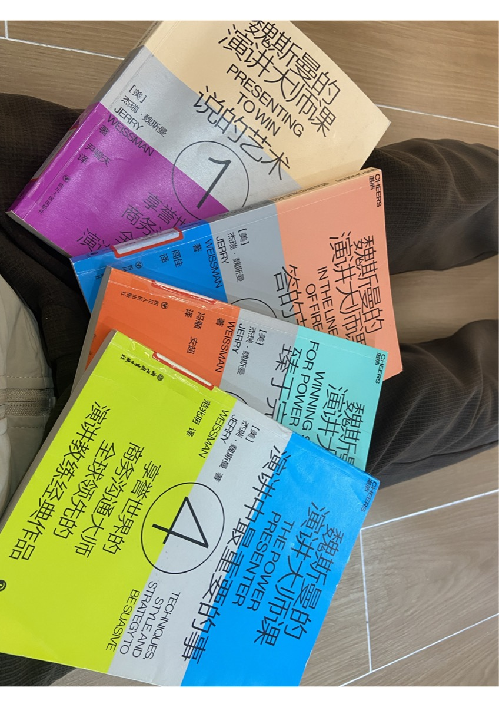
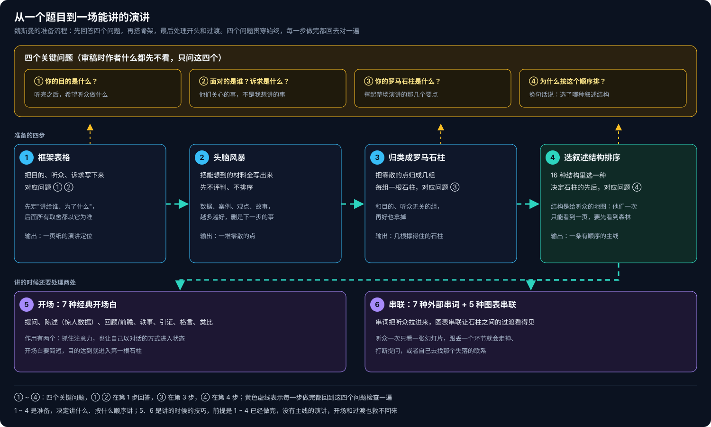

# 魏斯曼演讲大师课读书笔记：结构、开场与串联

最近听到一位领导对我讲 AI 演进的那些分享表示赞许。高兴之余我也意识到，自己讲东西的方法一直是在实践里摸出来的，从来没有系统学过。这周在图书馆看到杰瑞·魏斯曼（Jerry Weissman）的"演讲大师课"系列，就借回来读了。

这个系列一共四册：

1. **第 1 册《说的艺术》**（Presenting to Win）：怎么把一场演讲从零搭起来，结构、开场、过渡；
2. **第 2 册《答的艺术》**（In the Line of Fire）：怎么应对提问，尤其是尖锐的问题；
3. **第 3 册**（Winning Strategies for Power Presentations）：一系列实战案例和策略；
4. **第 4 册《演讲中最重要的事》**（The Power Presenter）：站在台上时的表达，包括肢体、声音和节奏。

四册我都翻了一遍，拍下来的重点基本在第 1 册，这篇笔记也以它为主。读的时候最大的感受是：书里很多做法我已经在用了，写系列文章、画架构图、做分享时都用过，只是一直没有名字，也说不清为什么这么做有效。这篇就按书里的顺序，把这些名字和我自己的做法对上号。

## 一、先问四个问题

书里前几章教的步骤是：先做框架表格，然后头脑风暴和归类，最后用特定的结构把要点排列成合乎逻辑的顺序。作者把这些步骤提炼成**四个关键问题**：

1. **你的目的是什么？**
2. **你面对的是谁？他们的诉求又是什么？**
3. **你的罗马石柱是什么？**
4. **为什么要用特定的顺序排列罗马石柱？换句话说，你选用哪种结构？**

"罗马石柱"是书里对演讲要点的叫法：撑起整场演讲的那几根柱子。

让我印象最深的是作者讲的一个习惯：每次客户请他审核演讲稿，他什么都不看、什么都不听，先问这四个问题，和每个客户的每场讨论都从这里开始。他建议读者也这样：每一次演讲都先问自己这四个问题，并一一回答。

回头看，我准备得好的那些分享，其实都先回答过前两个问题，只是没有写下来：

- **目的**：讲给领导，是想让他对一条技术路线有判断，还是想要资源；讲给客户，是让他理解架构，还是让他做选型；
- **听众和诉求**：同样讲 agent runtime，平台架构师关心每一层用什么，安全团队关心凭据在哪里、谁能撤销，业务负责人关心值不值得自建。我的系列文章导读里专门有"按角色读"一节，就是在回答这个问题。

后两个问题我以前想得少。我习惯先把材料堆出来，再一边写一边调顺序。书里的做法是倒过来的：先归类出石柱，选好结构，再往石柱里填材料。这样不容易写到一半发现两节在讲同一件事。

## 二、16 种叙述结构

为什么要先选结构，书里讲得很透。写演讲的人看得到整片森林，听众却不可能做到这一点：他们看演讲的视角就像站在林中，每次只能看到一棵树，一次只能看一张幻灯片。每一棵树你都可以讲得绘声绘色，但讲到下一棵时，如果没有说清它和前一棵的联系，听众就得自己去推测，又没有机会回头再看，只能费力去记、去找。

这时听众会出现三种情况：

- 陷入"目光呆滞"；
- 打断演讲，要求进一步解释；
- 不再专心听讲，努力找出失落的那一环。

三种都不好。作者的结论是："千万别让听众思考！"这里的思考，指的是让听众自己去拼结构。所以要先把各部分的关系理清楚，再呈现给听众，带他们走出森林、俯瞰全景。作者把排列石柱的方法叫作**叙述结构**（Flow Structures），一共 16 种，说这 16 种几乎囊括了所有可能碰到的演讲话题。

书里是按编号平铺的。我为了好记，按用途把它们分成四组：

- **按顺序排**（模块、历时、物理、空间）：内容本身有先后或位置，听众最容易跟上；
- **按论证排**（问题-解决、议题-对策、机遇-手段、以退为进）：要说服别人接受一个判断；
- **按展示排**（形式-功能、特色-利益、案例研究、比较-对比、矩阵图表）：把一个东西讲清楚；
- **按组织排**（平行结构、自问自答、数字榜单）：要点之间关系松散，靠形式组织起来。

对照下来，我最常用的是四种：

- **历时型**：讲 AI 的演进几乎都是这个结构，从过去走到现在，再看下一步。领导那次肯定的也是这类分享。排障类文章里我也常画一张时间线，把"什么时候改了什么、什么时候坏的"摆出来；
- **问题-解决型**：排障文章的骨架就是现象、原因、修法；
- **比较-对比型**：选型文章、"A 与 B 的分工"这类标题，都是它；
- **矩阵图表型**：多维对比表，以及"哪些事在哪边做"那种对照表。

还有几种我也在用，只是没意识到：

- 系列文章导读里说"每篇都能单独读"，这是**模块型**；
- 画"一个请求从浏览器到后端要过哪几道"的图，这是**物理型**；
- 分层架构图是**空间型**；
- 一节"还缺哪些"后面接一节"我会怎么做"，是**议题-对策型**。

读完之后我要改的一点：**数字榜单型**最省事，"三件事""四块缺口"顺手就写出来，但它把一串联系不密切的点并列，最不容易让人记住。以后只在要点确实互不相关时用，能找到先后关系或因果关系的，换成历时型或问题-解决型。

## 三、开场、串词与图表串联

结构定下来之后，书里讲的是现场的两处：开头怎么把人拉进来，石柱之间怎么过渡。

### 7 种开场白

作者建议用一段简短的开场白引起听众注意，这样做也有助于自己以一种舒服的对话形式开始演讲。7 种经过实战检验的开场方式是：

1. **提问式**：向听众发问；
2. **陈述式**：说出一组惊人的数据或一段鲜为人知的事实；
3. **回顾/前瞻式**：回首过去，或向前展望；
4. **轶事式**：说一个简短、温暖的小故事；
5. **引证式**：从可靠的来源引用一段有利于你的话；
6. **格言警句式**：用大家都熟悉的俗语开始；
7. **类比式**：借由两种看似不相关的东西，理清一个复杂、晦涩或模糊的主题。

我写文章的开头，最常用的是陈述式和轶事式：用一个实测数字，或者一件刚发生的小事（比如"同事截图问我，菜单怎么没了"），直接把读者带进问题。讲 AI 演进时，回顾/前瞻式是自然而然的。提问、引证、格言、类比这四种，我在文章里几乎没用过，在现场其实更好用，尤其是开场直接提一个问题，让听众先在心里给出自己的答案。

### 7 种外部串词

外部串词是把内容和眼前这群人连起来的办法：

1. **直接指称**：点名提及听众中的一位或几位；
2. **间接指称**：提到与你和听众都有关联的人、公司或组织；
3. **提问**：直接向一位或几位听众提问题；
4. **时事化**：联系当下发生的事；
5. **当地化**：提到与演讲地有关的信息；
6. **引用资料**：引用能支持你观点的相关资料；
7. **量身定制开场 PPT**：用一页写有听众、演讲地点和日期的幻灯片开始演讲。

写文章时，时事化和引用资料我一直在用：刚发布的模型、刚开源的项目、官方文档的链接。点名、提问、当地化这几种只有现场才有，**这是演讲比写文章多出来的一层**，也是我最需要练的。把文章直接搬上台讲，最容易丢掉的就是这一层。

### 5 种图表串联技巧

这一部分对上号最多，几乎每一条我都在画图时用过，只是一直叫它们"配色规范"和"路线图"：

1. **缓冲页**：各主要部分之间插入分隔页，简单、利落地过渡。我的系列文章有一篇导读，长文章每节开头先放一张总图，作用都是这个；
2. **色标或索引**：以重复出现的符号或图片为标志，用不同颜色表示不同部分。我画图有固定配色，已完成的用青绿、正在做的用琥珀，读者扫一眼就知道状态；
3. **符号**：用可辨识的记号表示各点之间的关系。图里用 ①②③ 标数据流，正文按编号解释；
4. **基准项**：连续的 PPT 中重复出现的部分，创造出前后相继的感觉。导读里的系列路线图每写一篇就加一站，就是这个作用；
5. **预期空间**：为接下来的内容预留空白，先吊起听众的胃口，再满足他们的期望。路线图上用灰色虚线标"规划中"的那几站就是。

## 四、我接下来要练的

读完对照下来，结构和图表这两块我已经有不错的底子，缺的是现场：

1. **每次准备都先写下四个问题的答案**，尤其是第 3、4 个：石柱是哪几根，选哪种结构，写在一页纸上再动手做幻灯片；
2. **开场换一种**：下一次分享试试提问式或类比式，不再总从数据或故事开始；
3. **串词留出现场的位置**：准备时就想好在哪根石柱上点名、提问、联系当地，不要等到台上临场发挥；
4. **少用数字榜单**：能找到先后或因果关系的，换成历时型或问题-解决型。

四册都翻过一遍，这篇只整理了第 1 册。第 2 册讲怎么回答尖锐提问，第 4 册讲台上的表达，这正是我现在更缺的两块，准备下一场分享时再对着它们练。

## 参考资料

- 杰瑞·魏斯曼，《魏斯曼的演讲大师课 1：说的艺术》（Presenting to Win）
- 杰瑞·魏斯曼，《魏斯曼的演讲大师课 2：答的艺术》（In the Line of Fire）
- 杰瑞·魏斯曼，《魏斯曼的演讲大师课 3》（Winning Strategies for Power Presentations）
- 杰瑞·魏斯曼，《魏斯曼的演讲大师课 4：演讲中最重要的事》（The Power Presenter）
