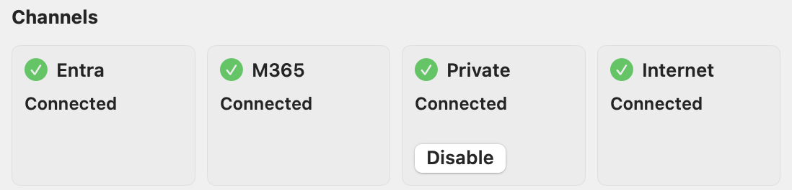
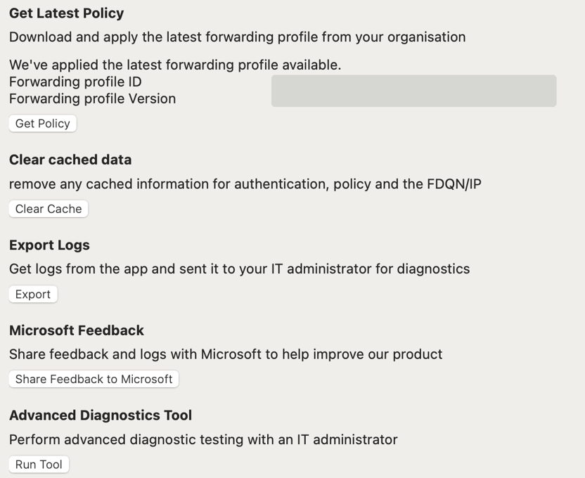
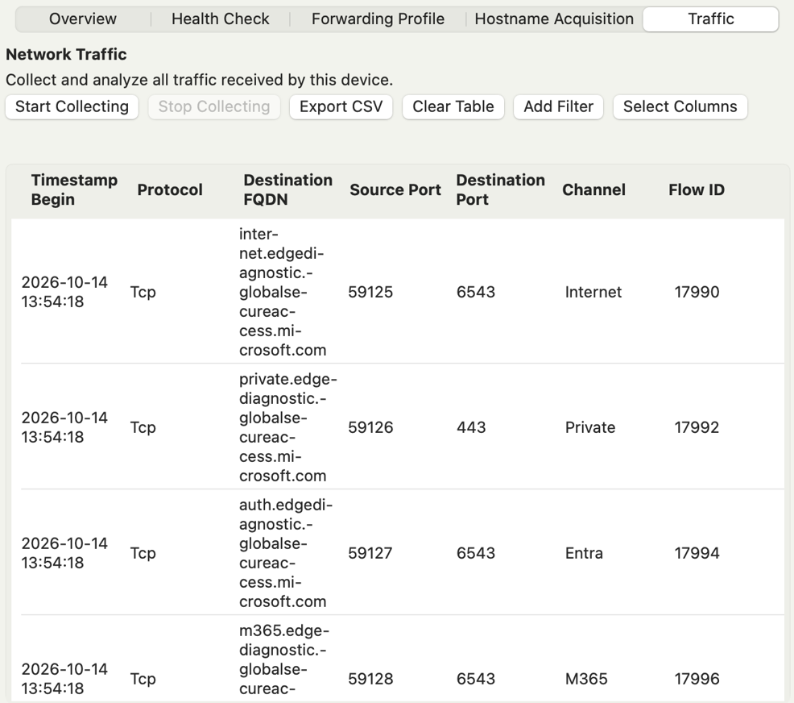
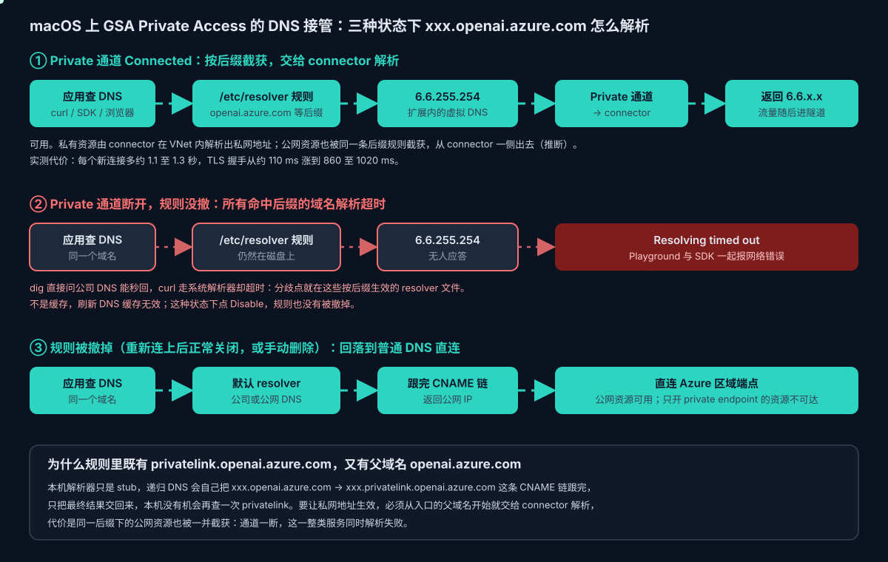

# Global Secure Access：微软 SSE 的设计与实时媒体问题

> 本文分两部分：前半部分介绍 Global Secure Access（下称 GSA）的产品设计，以官方文档为准；后半部分是实际排查中遇到的两个问题，一是 UDP 实时媒体（第五至七节），二是 Private Access 的 DNS 规则残留与性能开销（第八节），以及由此延伸的分析和部署建议。排查细节见 [Voice Live 系列 17：Global Secure Access 下数字人的网络问题解析](../Azure/VoiceLive/Voice-Live系列17：Global-Secure-Access下数字人的网络问题解析.md)。
>
> 标注约定：**（文档）** 来自 Microsoft Learn；**（实测）** 在开启 GSA 的 macOS 设备上复现过；**（推断）** 由现象推出，未证实。

## 一、产品定位

GSA 是微软的 **SSE（Security Service Edge，安全服务边缘）** 方案，也是 Microsoft Entra 管理中心里统一的入口名称，包含两个产品（文档）：

| 产品 | 作用 | 对应的传统设备 |
|---|---|---|
| **Microsoft Entra Internet Access** | 基于身份的 SWG（Secure Web Gateway），保护对互联网和 SaaS 的访问：网页分类过滤、FQDN 过滤、TLS 检查、威胁情报、DLP 等 | 出口代理、上网行为管理 |
| **Microsoft Entra Private Access** | ZTNA（零信任网络访问），不用传统 VPN 就能访问内网应用，按应用授权，支持任意 TCP 和 UDP 端口 | 远程接入 VPN |
| Internet Access for Microsoft services | Microsoft 365 等微软服务的直连与增强：合规网络检查、通用租户限制、源 IP 还原 | — |

设计原则是零信任的三条：最小权限、显式验证、假设已被攻破。服务从微软的广域网交付，文档称覆盖 70 个区域、190 多个边缘节点。

和传统 VPN、出口代理相比，GSA 最大的不同是**把网络访问策略和身份绑定**：每个连接都带着"谁、用什么设备、设备是否合规、风险多高"的上下文，可以直接在 Conditional Access 里写策略。比如"只有经过 GSA 的合规网络才能登录某个应用"（Compliant network check），或者"禁止登录非本公司的租户"（Universal Tenant Restrictions），这些都是传统网络设备做不到的。

授权上（文档）：Microsoft 流量 profile 包含在 Entra ID P1/P2 里；Internet Access 和 Private Access 需要单独许可，或者 Microsoft Entra Suite。

## 二、流量怎么进入 GSA：四个转发 profile

GSA 不是"所有流量都进隧道"，而是由管理员配置的**流量转发 profile** 决定接管哪些流量（文档）：

| Profile | 接管什么 | 说明 |
|---|---|---|
| **Microsoft Entra**（系统 profile） | Entra 登录、Graph、证书校验等身份流量 | 只要启用了任何 profile 就自动开启，优先级最高，管理员在门户里看不到 |
| **Microsoft** | Teams、SharePoint Online、Exchange Online 等 | 按 workload 分组，每组可以选"转发"或"绕过（bypass）" |
| **Private Access** | Quick Access 和 Private Access 企业应用定义的内网资源 | 只能通过客户端接管；可以建多个自定义 profile，分用户和平台 |
| **Internet Access** | 由一组 FQDN 正则和 IP 构成的"公共互联网" | 不包含 Microsoft profile 已覆盖的目标；支持自定义 bypass |

评估顺序：**Microsoft → Private Access → Internet Access**，都不匹配的流量不进 GSA，直接走本地网络（文档）。

两种接入方式：
- **客户端**：Windows、macOS、iOS、Android 都有，支持全部 profile，Conditional Access 只对装了客户端的用户生效。
- **远程网络（Remote network）**：分支机构用 IPsec 隧道把整个网点的流量接进来，无需客户端，但不支持 Private Access。

## 三、客户端是怎么截获流量的

### 3.1 Windows 与 macOS 用的是两种不同的机制

| 平台 | 截获方式（文档） | 含义 |
|---|---|---|
| Windows | **轻量过滤（LWF）驱动** | 文档特别说明，很多 SSE 产品以 VPN 连接的形式集成，GSA 不是，所以能和其他 VPN 共存 |
| macOS | **系统扩展 + 透明应用代理** | 安装时需要批准系统扩展 `com.microsoft.globalsecureaccess.tunnel`；MDM 配置里是 `VPNType: TransparentProxy`、`ProviderType: app-proxy` |

macOS 的透明应用代理是苹果 Network Extension 框架提供的能力：系统把应用的 TCP 连接和 UDP socket 作为一条条"流"交给扩展，扩展决定是自己转发（送进隧道），还是交还系统直接走网络（文档）。在 macOS 上，一条 UDP 流对应应用的一个 UDP socket，流里的每个数据报各自带着目标地址。这一点和后面的问题直接相关：GSA 客户端按第一个数据报的目标处理整条流（5.5 节，日志实测）。

### 3.2 DNS 接管与合成 IP

按 FQDN 写的规则（比如 `*.contoso.com` 走 Private Access），要求客户端在 DNS 这一步就认出目标。所以客户端会接管 DNS：
- macOS 客户端会**绕过系统的安全 DNS**（DoH、DoT），以便按 FQDN 执行转发策略；Windows 和移动端则要求用户关闭安全 DNS（文档）。
- 命中规则的域名，客户端返回一个**合成 IP**（实测是 `6.6.0.0/16` 段），发往这个地址的流量再被引入隧道。这个机制第三方分析里有详细描述（[Tunnel Vision: Breaking Microsoft Global Secure Access](https://ar0x.com/posts/what-is-gsa)）。
- 在一个开启了 Internet Access 全量接管的租户下，实测**所有测试过的域名**都被解析成了合成 IP，包括 `example.com`。
- macOS 上 Private Access 的 DNS 后缀，是以 `/etc/resolver/<后缀>` 文件的形式写进系统的，每个文件把一个后缀指向扩展内的虚拟 DNS `6.6.255.254`（实测）。这批文件在通道异常时可能残留，见第八节。

### 3.3 其他值得知道的行为（文档）

- **IPv6 不进隧道**：客户端只隧道 IPv4，IPv6 直接走本地网络；要全部接管，需要把网卡设为 IPv4 优先。
- **源 IP 变成边缘节点的 IP**：被隧道的流量，目标网站看到的源地址是 GSA 边缘节点，会影响依赖地理位置的服务。微软服务可以开启"源 IP 还原"。实测中 STUN 返回的公网地址就是 GSA 的出口段，不是公司出口。
- **连不上云端时的回落**：按匹配规则的 hardening 值，要么直接连互联网，要么阻断。
- **用户可以暂停或禁用**：托盘菜单有 Pause（10 分钟）和 Disable，都需要填写业务理由并重新登录，理由会被记录；管理员可以隐藏这两个按钮。
- **诊断工具**：Collect Logs、Advanced Diagnostics Tool，以及可以开启 verbose 日志和网络抓包。

### 3.4 在客户端里看状态和流量

macOS 客户端的主窗口（托盘图标 → 打开）分 Connections、Settings、Troubleshooting、About 四页。**Connections** 页的 Channels 区域，显示这台设备启用了哪些通道。下图四个通道都是 Connected，说明租户同时给这台设备下发了 Microsoft 365、Private Access 和 Internet Access 三个 profile（Entra 通道是系统自动开启的）。这也解释了为什么在这台设备上所有测试过的域名都被解析成了合成 IP。



**Troubleshooting** 页有五个操作：Get Latest Policy（立即拉取最新转发策略，并显示当前策略的 ID 与版本号；客户端日志里每条流的 `PolicyVersion` 就是这个版本号）、Clear cached data（清除认证、策略和 FQDN/IP 缓存）、Export Logs（导出日志给 IT）、Microsoft Feedback（把反馈和日志直接发给微软），以及 Advanced Diagnostics Tool（点 Run Tool 打开）。排查时如果怀疑策略刚改过，先点 Get Policy，再复现。



**Troubleshooting → Advanced Diagnostics** 是排查时最有用的工具，有 Overview、Health Check、Forwarding Profile、Hostname Acquisition、Traffic 五个标签页。其中：
- **Forwarding Profile**：当前下发的转发规则，可以查某个域名或 IP 归哪个 profile；
- **Hostname Acquisition**：哪些域名被 DNS 层认领、分到了哪个合成 IP；
- **Traffic**：点 Start Collecting 后，实时列出每条流的协议、目标 FQDN、端口、**Channel**（Entra、M365、Private、Internet）和 Flow ID，可以导出 CSV。



Traffic 页的数据和客户端日志 `/Library/Logs/Microsoft/globalsecureaccessclient/` 是同一套：日志里的 `channelName`、`flowId` 对应这里的 Channel、Flow ID 两列，日志还多记了每条流的转发决定和扩展建 socket 的细节（5.5 节）。排查某个应用时，先在 Traffic 页确认它的流归哪个 Channel，再到日志里按 Flow ID 看完整过程。

## 四、UDP：文档里写明的薄弱环节

文档的已知限制里，和 UDP 有关的有这几条：

| 限制（文档） | 范围 |
|---|---|
| **UDP isn't supported on this platform yet** | Internet Access |
| QUIC 不支持，UDP 80/443 不能隧道（建议在浏览器关闭 QUIC，回落到 TCP 上的 HTTPS） | Internet Access（Windows、macOS）；Private Access 和 Microsoft 365 workload 支持 QUIC |
| 除 Exchange Online 外，不支持隧道 QUIC；"播放高质量视频偶尔会卡顿" | iOS 客户端 |

也就是说，GSA 的 Internet Access 本质上是一个**以 TCP（HTTP/HTTPS）为中心的 Web 网关**，UDP 支持不完整。另一方面，微软自己的 [Microsoft 365 网络连接原则](https://learn.microsoft.com/en-us/microsoft-365/enterprise/microsoft-365-network-connectivity-principles)要求延迟敏感的流量（Optimize 类，包括 Teams 媒体的 UDP 3478 到 3481）**绕过代理和 VPN**、从本地直接出口。两者合在一起，预期的部署方式很清楚：**实时媒体不该经过 SSE 隧道。**

问题在于，一旦 Internet Access 被配成全量接管，DNS 已经被接管了、UDP 却又处理不好，就会进入一个"半接管"的灰色地带。下面的案例就落在这里。

## 五、案例：浏览器里的数字人无画无声

### 5.1 现象

一个基于 Azure Voice Live 的数字人面试应用，在开启 GSA 的 macOS 设备上：候选人说话能被转写，模型的文字回复正常，但**数字人没有画面也没有声音**；服务端约 40 秒后收到 `webrtc_connection_invalid`，然后反复重连。关闭 GSA 后立即恢复。

数字人的画面和声音走 WebRTC（UDP），文字、转写和信令走 WebSocket（TCP）。坏的只有 UDP 这一路。

### 5.2 根因：UDP 端口被钉死在首个对端（实测）

在同一台机器上用 Python 做了一个对照实验：

| 方式 | 结果 |
|---|---|
| 每个目标单独开一个 UDP socket | 各自从各自的地址回包，正常 |
| 同一个 socket，先发给合成地址 A，再发给 B、C、一个没有服务的 IP | **回包全部来自 A**，连"没有服务的 IP"都收到了回复 |
| 同一个 socket，先发给真实 IP A | 之后的回包也全部来自 A |

发往"没有服务的 IP"也能收到回复，说明包被**转发给了第一个对端**。结论是：**GSA 的 macOS 客户端把每个本地 UDP 端口钉死在第一次通信的对端上**，之后从这个端口发往任何地址，实际都到了第一个对端。

### 5.3 为什么偏偏 WebRTC 必挂

WebRTC 的 ICE 用**一个本地 UDP 端口**，同时和三个对端通信：TURN 服务器（获取公网地址、申请中继）、TURN 用 `300 Try-Alternate` 重定向的备用服务器、媒体服务器（连通检查）。端口一钉死：


- 发往备用 TURN 的中继申请被送回原 TURN，回复来源对不上，**relay 候选拿不到**；
- 发往媒体服务器的连通检查被送到 TURN，回复被当作无关响应丢弃，**直连也不通**；
- "直连优先、relay 保底"两条路同时失效，约 15 秒后 ICE `failed`。

后端把 ICE 域名换成 IP 再下发、或者前端强制只用 relay，都绕不开，因为钉死跟地址是不是合成 IP 无关，TURN 的重定向也躲不掉。有效的只有两条路：让这些 UDP 完全不经过 GSA；或者数字人改走 WebSocket 下发（Voice Live 的 avatar 支持 `output_protocol: websocket`，实测在 GSA 下可用）。完整的包级过程、Chrome 侧验证方法和数据见[系列 17](../Azure/VoiceLive/Voice-Live系列17：Global-Secure-Access下数字人的网络问题解析.md)。

### 5.4 把过程理清：DNS、截获、转发三层

"GSA 不支持 UDP"和"WebRTC 的 UDP 被 GSA 管了"听起来矛盾，按层拆开就不矛盾：

| 层 | GSA 做什么 | 跟协议有没有关系 |
|---|---|---|
| ① DNS 层 | 域名命中某个 profile 的 FQDN 规则，就返回合成 IP，表示"这个目标归我管"（文档、实测） | 无关：DNS 查询时还不知道应用接下来用 TCP 还是 UDP |
| ② 截获层 | macOS 透明代理把应用的 TCP 连接和 UDP socket 都交给扩展（文档） | 都截获 |
| ③ 转发层 | 扩展决定这条流是送进隧道到云端，还是放回本地网络直接发 | 这里才区分协议 |

"Internet Access 不支持 UDP"说的是第 ③ 层：它不会把 UDP 送进隧道。但第 ①、② 层照样发生。DNS 本身没有出错，合成 IP 是 GSA 认领目标的正常方式；坏的是第 ③ 层对 UDP 的处理。

### 5.5 客户端日志里的证据（实测）

macOS 客户端在 `/Library/Logs/Microsoft/globalsecureaccessclient/` 下记录了每条流的处理过程。数字人建连时，发往 TURN 中继的那条 UDP 流（字段有删节）：

```text
start flow with remoteEndpoint 6.6.x.x:3478, isBypass 0
FlowRelevantToPolicyEvent  "channelName":"Private"
DecisionForFlowEvent       "flowDecision":"Tunnel"
[INIT] async udp connect to 6.6.x.x:3478, tunnel: utun5, bypass: 0
start handleUDPFlowData    endpoint: 6.6.x.x:3478, socket: 254
```

读法：
1. **一条流就是应用的一个 UDP socket**，用第一个数据报的目标建流、匹配策略、做一次转发决定。
2. 扩展为这条流**自己创建一个 UDP socket 并 `connect` 到第一个目标**，之后这条流的所有数据都从这个 socket 发出。
3. 同一个应用 socket 随后发往备用 TURN 和媒体服务器的数据报，**在日志里没有任何一条流决定**：它们不被当成新流，直接从已经 connect 到中继的那个 socket 发了出去。这就是端口钉死的实现方式。
4. 不进隧道的流也一样。日志里 bypass 的 UDP 流同样是扩展自己建 socket、connect 到目标，只是走 `en0`（`async udp connect … tunnel: en0, bypass: 1`）。所以**钉死跟走不走隧道、属于哪个 profile 都无关，只要 UDP socket 经过扩展就会发生**。"Internet Access 不支持 UDP"在日志里的体现，是这类流被判为 bypass，但仍由扩展代为发送。

还有一个更正：这条中继流命中的是 **Private Access 通道**（`channelName: Private`），不是 Microsoft 365 通道，说明租户的 Private Access 规则覆盖了这个中继域名。数字人本身是 Azure 服务，媒体服务器与 M365 无关；和微软其他服务有交集的只是 Voice Live 下发的 TURN 中继，它借用的是 Azure Communication Services（ACS）的中继，而 ACS 与 Teams/Skype 共用一套中继基础设施（DNS 记录指向 `worldaz.relay.skype.trafficmanager.net`）。

排查中还见过一种表现：发往合成地址的 STUN 回包，来源是真实 IP。按上面的机制，可以解释为 bypass 流由扩展连向真实地址，交还给应用的数据报带的是真实地址，没有换回合成地址（推断；那段时间的日志已经轮转，没能对上）。

客户端的 Advanced Diagnostics Tool（托盘 → Troubleshooting）的 Traffic 页能实时看到每条流的协议、目标 FQDN 和 Channel，与日志是同一套数据（见 3.4 节截图）。

## 六、它为什么会这样：分析

### 6.1 刻意的安全策略，还是实现局限？

更像是**实现局限**，理由有三：
1. **TCP 和 UDP 的代理难度不同。** TCP 有连接，一条连接就是一个目标，透明代理很自然。UDP 没有连接，代理要自己定义什么算"一条流"。正确的粒度是五元组（本地地址和端口、远端地址和端口、协议），每个远端各自一条流。而 macOS 的透明代理按"一个 socket 一条流"交给扩展（3.1），GSA 扩展再为每条流 connect 一个只对第一个目标的 socket（5.5 节日志）。数据报自带的目标地址被忽略了。
2. **刻意的安全措施应该丢弃或拒绝，而不是送错地方。** 把本该发给 B 的数据送给 A，从安全角度看反而是缺陷：数据被交给了一个非预期的对端。
3. **文档本身承认 UDP 不完整**（第四节），iOS 端甚至写了"高质量视频会卡顿"。

Windows 客户端用的是另一套机制（LWF 驱动），是否有同样的行为，没有测过。

### 6.2 WebRTC 拒绝回包是对的

ICE 规范（[RFC 8445](https://www.rfc-editor.org/rfc/rfc8445)）要求，连通检查的响应必须来自请求发往的那个地址，否则视为伪造或劫持。WebRTC 严格执行这一条，所以第一时间暴露了问题。大多数 UDP 程序不做这种校验，在 GSA 下"看起来能用"，其实数据可能也被送到了错误的对端，只是没被察觉。

### 6.3 为什么普通测试发现不了

普通的连通性测试，每个目标都开一个新 socket，每个 socket 只和一个对端通信，钉死行为完全不会出现。排查时系统层的 STUN 测试全部正常，就是这个原因。要用"**同一个 socket 依次发往多个目标**"的测试才能暴露。

## 七、影响面：哪些协议和应用会受影响

判断标准只有一条：**是否用同一个本地 UDP 端口和多个对端通信**，并且这部分流量被 GSA 接管。

| 很可能受影响（推断） | 不受影响 |
|---|---|
| 所有基于 WebRTC 的浏览器应用：网页版视频会议、在线客服视频、数字人 | 所有 TCP：HTTPS、WebSocket、SSH、RDP over TCP、数据库连接 |
| 依赖 NAT 穿越的 P2P 应用：游戏联机、P2P 下载 | 一个 socket 只对一台服务器的 UDP：多数 DNS 查询、单服务器的 QUIC（但 Internet Access 本身不隧道 QUIC） |
| | 视频点播与直播平台（如 YouTube）：用的是基于 HTTP 的自适应流（DASH/HLS），从 CDN 分段下载，走 TCP 或 QUIC，每个连接只对一台服务器；而且播放器能缓冲数秒，延迟和抖动都被藏住 |
| WireGuard、Tailscale 这类 mesh VPN（一个端口连多个节点），前提是流量被接管 | 没被任何 profile 接管、直接走本地网络的流量 |
| 复用同一个 socket 轮询多台服务器的 UDP 客户端 | |

为什么"看视频没问题、开视频会议就有问题"：视频平台是单向分发，不需要 NAT 穿越；WebRTC 用于实时双向通信，要做 NAT 穿越，一个端口同时连多个对端，正好撞上端口钉死。YouTube 直播用的也是低延迟 HLS，不是 WebRTC。

值得用来交叉验证的一点：**Teams 客户端的媒体也走 ICE。** 如果同一台设备上 Teams 通话正常，很可能是 Microsoft profile 对 Teams 媒体做了专门处理或者绕过。这也说明，"实时媒体绕过"本来就是预期的部署方式。

## 八、案例二：一整类 Azure 服务同时报网络错误

第一个案例是 UDP 的转发层出了问题；这个案例是 TCP 也躲不开的 **DNS 层**，在同一台 macOS 设备上遇到。

### 8.1 现象

Azure AI Foundry 门户能打开，但 Playground 一发消息就报网络错误；同一个 Azure OpenAI 资源用 SDK、curl 调用也一样失败。资源本身开着公网访问，没有配 IP 防火墙。

### 8.2 定位：dig 能解析，系统解析器超时（实测）

| 检查 | 结果 |
|---|---|
| `dig` 直接问公司 DNS | 秒回，解析出资源的公网 IP |
| `curl` 访问资源端点 | `Resolving timed out`，卡在 DNS 这一步 |
| `dscacheutil -q host -a name <端点>` | 挂满 60 秒才返回 |
| 不在 GSA 后缀里的域名（如 `ai.azure.com`、`github.com`） | 正常 |
| `curl --resolve` 跳过 DNS，直接指定公网 IP 调用模型 | HTTP 200，模型正常回复 |

服务是好的，坏在本机的系统解析器。`dig` 和 `curl` 的分歧点在于：`dig` 直接问指定的 DNS 服务器，`curl` 走系统解析器，而系统解析器会先按域名后缀匹配 **scoped resolver**。`scutil --dns` 里能看到几十条这样的 resolver，`openai.azure.com`、`cognitiveservices.azure.com` 都在其中，全部指向 `6.6.255.254`。直接 `dig @6.6.255.254` 得到的是 `no servers could be reached`，本机也找不到任何 `6.6.x.x` 的接口。

这些 resolver 来自 `/etc/resolver/` 目录：GSA 客户端为每个 Private Access 的 DNS 后缀写了一个文件，本例共 82 个，内容只有两行：

```text
domain openai.azure.com
nameserver 6.6.255.254
```

`6.6.255.254` 是扩展内的虚拟 DNS。Private 通道正常时，扩展截获发往它的查询，经通道交给 connector 解析；**通道断了，规则文件却还在磁盘上**，命中这些后缀的查询就发给一个没人应答的地址，直到超时。



### 8.3 后缀清单：为什么连父域名也要截

后缀清单是管理员在 Private Access 里配置的"私有 DNS 后缀"（文档称 Private DNS），客户端照单写入。本例的清单里有三类：

| 类别 | 例子 | 作用 |
|---|---|---|
| Azure Private Endpoint 的标准 DNS zone | `privatelink.openai.azure.com`、`privatelink.blob.core.windows.net`、`privatelink.vaultcore.azure.net` | 访问只开了 private endpoint 的 Azure 资源 |
| 这些服务的父域名 | `openai.azure.com`、`cognitiveservices.azure.com`、`search.windows.net`、`azurewebsites.net` | 让上一类真正生效，见下文 |
| 企业内网域名 | 内部 AD 域、内部系统的域名 | 传统 VPN 原来覆盖的那部分 |

private endpoint 的解析过程是：`xxx.openai.azure.com` CNAME 到 `xxx.privatelink.openai.azure.com`，在链接了 Private DNS Zone 的 VNet 里解析成 `10.x` 私网地址，在公网上则解析成公网地址或解析不到。笔记本在 VNet 外，只能把查询交给 VNet 里的 connector 去解析。

**只截 `privatelink.*` 不够**：本机解析器只是 stub，查询交给递归 DNS 后，递归 DNS 会自己把整条 CNAME 链跟完，只把最终结果交回来，本机没有机会再查一次 `privatelink` 那个名字。所以必须从入口的父域名开始就交给 connector。

代价是：客户端无法事先区分某个 `xxx.openai.azure.com` 是私有资源还是公网资源，**同一后缀下的公网资源也一并被截获**。通道一断，Azure OpenAI、AI Services、Search、App Service 等一整类服务会同时解析失败，不管资源本身是不是公网的。

### 8.4 恢复与手动清理（实测）

| 操作 | `/etc/resolver` 规则 | 结果 |
|---|---|---|
| 通道已断开时点 Disable | 仍然在 | 继续超时；tunnel 停了，DNS 规则留着 |
| 重启客户端，等各通道变为 Connected | 重新写入 | 恢复，端点解析为合成地址 `6.6.x.x` |
| 各通道 Connected 时点 Disable | 全部清除 | 回落到普通 DNS，公网资源直连可用 |

正常关闭时客户端会撤掉这批文件，通道异常时没有撤，可能是客户端处在异常状态、没走完清理流程（推断，未复现）。

所以排查顺序是：**先重启客户端，看 Private 通道能不能变绿**。变绿了问题就没了；一直不绿又急着用公网资源，可以手动清理。注意只删内容指向 `6.6.255.254` 的文件，删前先备份：

```bash
sudo cp -Rp /etc/resolver ~/resolver-backup-$(date +%Y%m%d-%H%M)
grep -l '6\.6\.255\.254' /etc/resolver/*                     # 先看会删哪些
sudo grep -l '6\.6\.255\.254' /etc/resolver/* | sudo xargs rm -f
sudo dscacheutil -flushcache; sudo killall -HUP mDNSResponder
scutil --dns | grep -c 6.6.255.254                          # 应为 0
```

几点说明：
- 这些是磁盘上的配置文件，不是缓存，**只刷新 DNS 缓存清不掉**。
- 只在通道断开时清理。通道正常时删掉，私有资源会立刻不可达，要等客户端下次连接才会写回。
- `*.edgediagnostic.globalsecureaccess.microsoft.com` 这几个文件不指向 `6.6.255.254`，是客户端自己做健康检查用的，上面的命令不会动它们。

### 8.5 性能：经 Private 通道访问公网 Azure OpenAI 的开销（实测）

通道恢复后，对同一个日本东部的 Azure OpenAI 资源做了对比，每种方式 10 次，每次都新建连接：一个不经过模型的轻量接口（列 models），以及一次短的 chat 调用；服务端耗时取自响应里的延迟字段，用来扣掉模型自身的时间。

先要说明一点：**`--resolve` 指定公网 IP 也没有绕开 GSA。** 客户端日志显示，发往这个公网 IP 的连接同样进了 Private 通道：

```text
Destination IP/Port: 20.191.x.x/443  FQDN: N/A  Channel name: Private
Destination IP/Port: 6.6.x.x/443     FQDN: <端点>  Channel name: Private
```

也就是说，Private Access 除了按 DNS 后缀截获，**还按 IP 段截获**，跳过 DNS 只绕开了 DNS 这一层。要拿到真正的直连基线，只能在各通道正常的状态下点 Disable 再测，这时规则会被清除（8.4）。

Chat 调用（中位数 / P90，单位 ms）：

| 阶段 | 经 GSA，按域名进 | 经 GSA，按 IP 进 | 直连（GSA 已关） |
|---|---|---|---|
| DNS | 5 / **1305** | 0（已指定 IP） | 6 / 8 |
| TCP | 85 / 87 | 84 / 86 | 43 / 44 |
| TLS | **1020 / 1100** | **861 / 866** | 108 / 119 |
| 首字节 | 1778 / 2349 | 1753 / 2413 | 1449 / 1776 |
| 服务端耗时 | 982 | 1096 | 1057 |
| 首字节减服务端耗时 | 808 | 682 | 365 |
| **总计** | **2950 / 4052** | **2692 / 3365** | **1623 / 1938** |

轻量接口的总计：经 GSA 1513 至 1766 ms，直连 423 至 453 ms。

读法：
1. **模型没有变慢。** 三种方式的服务端耗时都在 1.0 至 1.1 秒，差距全部来自网络。
2. **每个新连接多约 1.1 至 1.3 秒，大头在 TLS 握手**，从约 110 ms 涨到 860 至 1020 ms；请求往返也多了约 300 至 440 ms。
3. **按域名进入时，DNS 有约 1.3 秒的固定抖动**：10 次里有 3 次落在 1301 至 1344 ms，其余只有个位数毫秒。数值高度集中，更像一次超时后重试，而不是随机的网络波动（推断）。P90 主要是被它拉高的。
4. **TCP 只多约 40 ms，TLS 却多了约 750 ms**，说明 TCP 握手在离本机较近的边缘就完成了，而 TLS 和数据要沿边缘、connector、Azure 区域这条长路径走完；按 TLS 和请求往返多出的时间折算，经通道的一个完整往返约 400 ms，而直连约 44 ms，流量很可能被绕到了离资源很远的地方（推断，要看资源诊断日志里的来源 IP 才能确认）。
5. **对应用的影响**：SDK 一般复用连接，DNS 和 TLS 只在建连时付一次，但每个请求仍多约 300 至 400 ms 的往返。对流式输出、实时语音这类看首字节的场景影响明显；而对公网资源来说，这部分开销换不来任何访问能力。

样本各 10 次，适合判断量级，具体数字会有波动。

## 九、给 IT 的部署建议

1. **实时媒体不经过 GSA 扩展。** 按 Microsoft 365 网络原则，延迟敏感的实时媒体应绕过代理和 VPN；对第三方实时媒体也一样。要注意：客户端日志显示，GSA 策略里判为 bypass 的 UDP 流，仍然由扩展自己建 socket、connect 到首个目标后发出（5.5 节），照样会钉死。所以只在转发 profile 里配 bypass，不一定能解决一对多 UDP 的问题。这类应用要么完全不被扩展截获，要么等 GSA 修复按五元组区分 UDP 流；在此之前，应用侧准备 TCP 降级是最稳的。需要排除的目标示例：ACS/Teams 中继（`relay.communication.microsoft.com`、`*.relay.skype.com`、`20.202.0.0/16` 的 UDP 3478 到 3481），以及相应媒体服务器的地址段。另外要检查 Private Access 规则有没有意外覆盖这些中继域名，本例中继就是被 Private 通道接管的。
2. **全量接管 Internet Access 之前，先列出 UDP 依赖。** 既然 Internet Access 不支持 UDP，任何依赖 UDP 的业务都要先确认路径，否则就会落进第四节说的"半接管"灰色地带。
3. **保留用户的 Pause/Disable 按钮，或者提供明确的申请流程。** 遇到这类问题，用户需要一个临时的退路；暂停的理由本来就会被记录。
4. **出问题时这样收集证据**：先在 Troubleshooting 页点 Get Policy 确认策略是最新的；用 Advanced Diagnostics 的 Traffic 页确认相关流的 Channel；再用 Export Logs 或 Collect Logs（开启 verbose 和网络抓包）导出日志、`systemextensionsctl list` 确认扩展状态、`scutil --dns` 看 resolver、用"同一个 socket 多目标"脚本复现（[系列 17](../Azure/VoiceLive/Voice-Live系列17：Global-Secure-Access下数字人的网络问题解析.md) 3.3 节），一起提交给微软支持。
5. **Private Access 的 DNS 后缀尽量收窄。** 把 `openai.azure.com`、`cognitiveservices.azure.com` 这类父域名整段写进后缀，会把员工自己订阅下的公网资源也截进通道：多付约 1 秒的建连开销（8.5），通道一断还会整类解析失败（8.2）。能按资源写到具体主机名的，就不要写整个后缀。另外，最好开放用户单独关闭 Private Access 的权限，或者给出明确的申请流程。

## 十、给应用开发者的建议

1. **不要假设企业网络下 UDP 语义完整。** SSE、DLP 这类客户端越来越普遍，UDP 能通不等于 WebRTC 能连。
2. **准备一条只走 TCP 的降级路径。** 比如媒体改走 WebSocket 下发、TURN over TLS 443，或者纯音频走 WebSocket。降级的判断条件要明确：ICE 在几秒内没有进入 `connected`，或者候选对持续收不到回复。
3. **把诊断做进产品。** 检测到"连通检查一直没有回复"时，直接提示"网络安全客户端可能阻止了音视频连接"，而不是让用户对着转圈等 40 秒。
4. **排查时别被"每目标一个 socket"的测试骗了。** 系统层测试全通、浏览器里却连不上，就要怀疑端口语义被改了。
5. **"一整类 Azure 服务同时报网络错误"先查 DNS。** 拿 `dig` 和 `dscacheutil` 做对照：前者通、后者超时，就看 `scutil --dns` 和 `/etc/resolver/` 里有没有指向 `6.6.255.254` 的规则，再看 GSA 的 Private 通道是不是绿的（8.2）。
6. **测延迟时注意路径。** 开着 GSA 测出的建连时间可能比直连多出约 1 秒，而且 `--resolve` 指定 IP 也绕不开（8.5）。做性能基线前，先确认流量走的是哪条路径。

## 十一、待验与开放问题

- [ ] Windows 客户端（LWF 驱动）是否有同样的端口钉死行为。
- [ ] 钉死是否有空闲超时，超时后能否重新绑定到新的对端。
- [ ] 同一台设备上 Teams 通话的媒体路径：走隧道、走 bypass，还是有专门处理。
- [x] 中继 UDP 命中的通道与钉死的实现方式：客户端日志已证实（5.5 节，Private 通道、per-flow connect 到首个目标）。
- [ ] "回包来源是真实 IP"那种表现与 bypass 流的对应关系，需要在复现时同步抓客户端日志。
- [ ] 把这个行为反馈给 GSA 团队，确认是不是已知问题、有没有修复计划。
- [ ] Private 通道断开时客户端为什么不撤掉 `/etc/resolver` 规则，能否稳定复现（8.4）。
- [ ] 经 Private 通道访问公网 Azure 资源时的出口位置：在资源的诊断日志里看 `callerIpAddress`，验证 8.5 的绕路推断。
- [ ] 按域名进入时约 1.3 秒的 DNS 抖动来自哪里，是不是 AAAA 查询超时（8.5）。

## 参考

- [What is Global Secure Access — Microsoft Learn](https://learn.microsoft.com/en-us/entra/global-secure-access/overview-what-is-global-secure-access)
- [Global Secure Access traffic forwarding profiles — Microsoft Learn](https://learn.microsoft.com/en-us/entra/global-secure-access/concept-traffic-forwarding)
- [Learn about the Global Secure Access clients — Microsoft Learn](https://learn.microsoft.com/en-us/entra/global-secure-access/concept-clients)
- [Install the Global Secure Access client for macOS — Microsoft Learn](https://learn.microsoft.com/en-us/entra/global-secure-access/how-to-install-macos-client)
- [Known limitations for Global Secure Access — Microsoft Learn](https://learn.microsoft.com/en-us/entra/global-secure-access/reference-current-known-limitations)
- [Microsoft 365 network connectivity principles — Microsoft Learn](https://learn.microsoft.com/en-us/microsoft-365/enterprise/microsoft-365-network-connectivity-principles)
- [Tunnel Vision: Breaking Microsoft Global Secure Access — Part 1](https://ar0x.com/posts/what-is-gsa)（合成 IP 与流量接管机制）
- [RFC 8445: Interactive Connectivity Establishment (ICE)](https://www.rfc-editor.org/rfc/rfc8445)
- 案例详解：[Voice Live 系列 17：Global Secure Access 下数字人的网络问题解析](../Azure/VoiceLive/Voice-Live系列17：Global-Secure-Access下数字人的网络问题解析.md)
